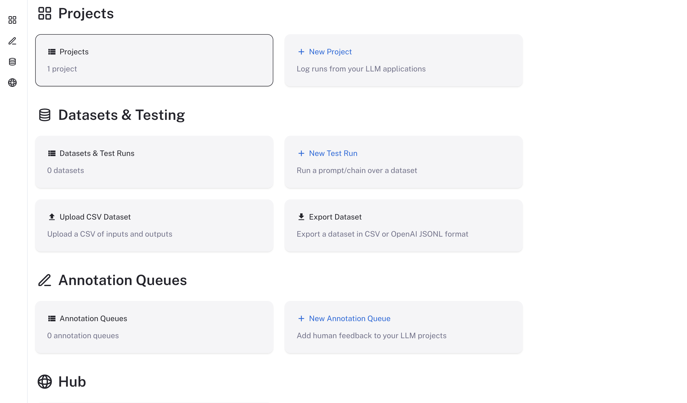

# Self-host LangSmith on Kubernetes

> Install self-hosted LangSmith and its dependencies in a Kubernetes cluster with Helm, including Insights and Chat.

> [!NOTE]
>
> Self-hosted LangSmith is an add-on to the Enterprise plan designed for LangChain's largest, most security-conscious customers. For more details, refer to [Pricing](https://www.langchain.com/pricing). [Contact our sales team](https://www.langchain.com/contact-sales) if you want a license key to trial LangSmith in your environment.

This guide describes how to set up LangSmith in a Kubernetes cluster. You use Helm to install LangSmith and its dependencies.

After completing this guide, you'll have:

* **LangSmith UI and APIs**: Observability, tracing, evaluation, Insights, and Chat.
* **Backend services**: Queue, playground, and ACE.
* **Datastores**: PostgreSQL, Redis, ClickHouse, and optional blob storage.

LangSmith runs on any conformant Kubernetes cluster. It has been tested on the following distributions:

* Google Kubernetes Engine (GKE)
* Amazon Elastic Kubernetes Service (EKS)
* Azure Kubernetes Service (AKS)
* OpenShift 4.14 or later
* Minikube and Kind (for development purposes)

> [!TIP]
>
> **Prefer infrastructure as code?** [Deploy with Terraform](../Deploy%20with%20Terraform/Deploy%20LangSmith%20with%20Terraform.md) bundles cluster provisioning, secrets wiring, and the Helm release for AWS, Azure, and GCP into one workflow. This guide covers the Helm-only path against any conformant cluster you already manage.

## Prerequisites

To self-host LangSmith on Kubernetes, gather the following before you install.

### Tools

* **kubectl**: Access to your Kubernetes cluster.
* **Helm**: The package manager that installs the LangSmith chart. To install it, refer to the [Helm documentation](https://helm.sh/docs/intro/install/).
* **OpenSSL**: Generates the API key salt and JWT secret.
* **Python with the `cryptography` package**: Generates the Insights and Chat encryption keys.

### Keys and secrets

* **LangSmith license key**: Get this from your LangChain representative. [Contact our sales team](https://www.langchain.com/contact-sales) for more information.

* **API key salt** and **JWT secret**: Random strings. LangSmith uses the salt to hash API keys at rest and the JWT secret to sign tokens for basic auth. Generate a separate value for each:

  ```bash
  openssl rand -base64 32
  ```

* **Insights and Chat encryption keys**: Insights and Chat (formerly Polly) are enabled by default in Helm chart version 0.15.1 or later. Each requires a Fernet encryption key at installation time. Generate a separate key for each feature:

  ```bash
  python -c "from cryptography.fernet import Fernet; print(Fernet.generate_key().decode())"
  ```

### Kubernetes cluster

You need a working Kubernetes cluster that you can access with `kubectl`. Your cluster needs the following minimum resources:

1. Recommended: At least 16 vCPUs and 64GB of memory available.

   * You may need to tune resource requests and limits for each service based on organization size and usage. For recommendations, refer to the [self-host scale guide](../Configure%20an%20instance/Configure%20LangSmith%20for%20scale.md).
   * Use a cluster autoscaler to scale nodes up and down based on resource usage.
   * Set up the metrics server so that autoscaling can be turned on.
   * If you run ClickHouse in-cluster, you must have a node with at least 4 vCPUs and 16GB of memory **allocatable**, because ClickHouse requests this amount of resources by default.

2. A valid dynamic PV provisioner or PVs available on your cluster (required only if you run datastores in-cluster).

   * To enable persistence, LangSmith tries to provision volumes for any datastore running in-cluster.
   * If you use PVs in your cluster, set up backups in a production environment.
   * **Use a storage class backed by SSDs for better performance. LangChain recommends 7000 IOPS and 1000 MiB/s throughput.**
   * On EKS, you may need to install and configure the `ebs-csi-driver` for dynamic provisioning. Refer to the [EBS CSI Driver documentation](https://docs.aws.amazon.com/eks/latest/userguide/ebs-csi.html) for more information.

   To verify, run:

   ```bash
   kubectl get storageclass
   ```

   The output should show at least one storage class with a provisioner that supports dynamic provisioning. For example:

   ```txt
   NAME            PROVISIONER                 RECLAIMPOLICY   VOLUMEBINDINGMODE      ALLOWVOLUMEEXPANSION   AGE
   gp2 (default)   ebs.csi.eks.amazonaws.com   Delete          WaitForFirstConsumer   true                   161d
   ```

   > [!NOTE]
   >
   > Use a storage class that supports volume expansion. Traces can require a lot of disk space, and your volumes may need to be resized over time.

   Refer to the [Kubernetes documentation](https://kubernetes.io/docs/concepts/storage/storage-classes/) for more information on storage classes.

> [!NOTE]
>
> LangSmith services listen on both IPv4 and IPv6 by default as of 0.14.0. No additional configuration is required for IPv4-only, IPv6-only, or dual-stack clusters.

### Network access

* **License verification**: Unless you run in offline (air-gapped) mode, LangSmith requires egress to `https://beacon.langchain.com` for license verification and usage reporting. For details, refer to [Egress](../Configure%20an%20instance/Egress%20for%20billing%20and%20operational%20telemetry.md).
* **Model provider access**: Insights and Chat require [provider credentials and model configurations](../../Govern/Organization/Workspace%20setup/Manage%20model%20configurations.md). If your cluster has no internet access, confirm which model provider endpoints it can reach before you install.
* **Container images and charts**: If your cluster cannot reach public registries, [mirror the LangSmith images](../Configure%20an%20instance/Mirror%20images%20for%20your%20LangSmith%20installation.md) to your own registry and install from local charts.

### Datastores

LangSmith uses a PostgreSQL database, a Redis cache, and a ClickHouse database to store traces. By default, these services are installed inside your Kubernetes cluster. For production, use external datastores instead. For PostgreSQL and Redis, the best option is your cloud provider's managed services.

For more information, refer to the following setup guides for external services:

* [PostgreSQL](../Connect%20external%20services/Connect%20to%20an%20external%20PostgreSQL%20database.md)
* [Redis](../Connect%20external%20services/Connect%20to%20an%20external%20Redis%20or%20Valkey%20database.md)
* [ClickHouse](../Connect%20external%20services/Connect%20to%20an%20external%20ClickHouse%20database.md)

For the minimum supported version of each datastore, refer to [Minimum versions for self-hosting dependencies](Minimum%20versions%20for%20self-hosting%20dependencies.md). [SmithDB](../SmithDB/Overview/Enable%20SmithDB%20on%20self-hosted%20LangSmith.md) is an optional datastore that you can enable after the base installation. This guide does not require it.

## Configure your Helm charts

1. Create a new file called `langsmith_config.yaml`. Set only the options your installation needs:

   * If you are new to Kubernetes or Helm, start from one of the [LangSmith Helm chart examples](https://github.com/langchain-ai/helm/tree/main/charts/langsmith/examples).
   * For a full list of configuration options, refer to the [LangSmith Helm chart `values.yaml`](https://github.com/langchain-ai/helm/tree/main/charts/langsmith/values.yaml).

   > [!WARNING]
   >
   > Only override the settings you need in `langsmith_config.yaml`. Do not copy the entire `values.yaml`. Keeping your config minimal ensures you continue to inherit new defaults and upgrades from the Helm chart.

   > [!TIP]
   >
   > If your cluster enforces non-root or read-only container policies, start from the [read-only Helm configuration example](https://github.com/langchain-ai/helm/blob/main/charts/langsmith/examples/read_only_config.yaml). LangSmith containers do not require root privileges. The example shows how to set `runAsNonRoot`, service UIDs and GIDs, `fsGroup`, `RuntimeDefault` seccomp profiles, dropped capabilities, disabled privilege escalation, and writable `emptyDir` mounts for services that need temporary storage.

2. Set the following minimum configuration options (using basic auth), with the keys and secrets from the [prerequisites](#keys-and-secrets):

   > [!WARNING]
   >
   > Set `apiKeySalt` once and do not change it. This value is used to hash all API keys at rest. Rotating it permanently invalidates every existing API key in your organization, requiring all users to regenerate their keys.

   ```yaml
   config:
     langsmithLicenseKey: "<your license key>"
     apiKeySalt: "<your api key salt>"
     authType: mixed
     basicAuth:
       enabled: true
       initialOrgAdminEmail: "admin@example.com" # Change this to your admin email address
       initialOrgAdminPassword: "secure-password" # Must be at least 12 characters long and have at least one lowercase, uppercase, and symbol
       jwtSecret: "<API_KEY>" # A random string of characters used to sign JWT tokens for basic auth.

   insights:
     enabled: true # Enabled by default; key required
     encryptionKey: "<insights-encryption-key>"

   polly:
     enabled: true # Enabled by default; key required
     encryptionKey: "<chat-encryption-key>"
   ```

   To store the keys in an existing Secret, or to disable Insights or Chat, see [Configure Insights and Chat](Configure%20Insights%20and%20Chat%20on%20self-hosted%20LangSmith.md).

3. If you use external datastores, add their connection details.

### Configure a signing JWKS

Self-hosted LangSmith uses an Ed25519 JSON Web Key Set (JWKS) to sign tokens for its OAuth Authorization Server and LLM auth proxy. Configuring this key enables self-hosted OAuth login, including `langsmith auth login` and Remote MCP authentication, and allows LangSmith to sign requests sent through an LLM auth proxy.

The JWKS contains a private key. Store it in a Kubernetes Secret and keep it stable across upgrades. LangSmith derives the public key and serves it from `/.well-known/jwks.json`, so clients such as the LLM auth proxy can verify tokens without receiving the private key.

> [!NOTE]
>
> The Helm configuration in this section requires LangSmith chart version 0.16.0 or later.

Generate an Ed25519 key with [step CLI](https://smallstep.com/docs/step-cli/installation/) or your internal key-management process. RSA keys are rejected.

```shell
TMPDIR_KEYS="$(mktemp -d)"
step crypto jwk create "$TMPDIR_KEYS/pub.json" "$TMPDIR_KEYS/priv.json" \
  --kty OKP --crv Ed25519 --no-password --insecure
SIGNING_JWKS=$(jq -c '{keys: [.]}' "$TMPDIR_KEYS/priv.json")
```

`step crypto jwk create` sets `use` to `sig`, `alg` to `EdDSA`, and `kid` to the key's thumbprint. If you generate the key another way, give the first key a nonempty `kid`. [Sandbox service URLs](Additional%20features/Enable%20Sandboxes/Enable%20Sandboxes%20on%20self-hosted%20LangSmith.md#optional-enable-service-urls) require it.

Choose one of the following storage options:

* **Chart-managed Secret**: Set `config.signingJwks` in your LangSmith `langsmith_config.yaml`. The chart stores the value in its managed Kubernetes Secret.

  ```yaml
  config:
    signingJwks: |
      {"keys":[...]}
  ```

* **Existing Secret**: If your installation already uses `config.existingSecretName`, add the generated JWKS to that Secret under the exact key `langsmith_signing_jwks`:

  ```yaml
  # Add this key to the existing chart-wide Kubernetes Secret.
  stringData:
    langsmith_signing_jwks: |
      {"keys":[...]}
  ```

  ```yaml
  config:
    existingSecretName: "langsmith-secrets"
  ```

  `config.existingSecretName` replaces the chart-managed Secret for the entire LangSmith installation. Do not point it to a JWKS-only Secret. Preserve all existing keys, including `langsmith_license_key` and `api_key_salt`. For the complete Secret structure, see [Use an existing Secret for your installation](../Platform%20auth%20%26%20access%20control/Use%20an%20existing%20secret%20for%20your%20installation%20%28Kubernetes%29.md).

> [!WARNING]
>
> Starting with chart version 0.16.0, the chart owns `LANGSMITH_SIGNING_JWKS`. When upgrading from an earlier chart version, remove this environment variable from `commonEnv` and `platformBackend.deployment.extraEnv`. Setting it there causes a duplicate environment-variable error. If you previously loaded it from a separate Secret, such as `langsmith-signing-jwks`, move the value into the chart configuration and remove that reference. Configure it through `config.signingJwks` or the `langsmith_signing_jwks` key in `config.existingSecretName` instead.

Apply the Helm release after configuring the JWKS. If you update an externally managed Secret without changing the Helm values, restart the platform-backend pods so they load the new environment variable.

Request the public JWKS from your LangSmith installation to verify the configuration:

```bash
curl https://<your-langsmith-host>/.well-known/jwks.json
```

The response contains the public verification key and does not include the private `d` field.

## Deploy to Kubernetes

1. Verify that you can connect to your Kubernetes cluster. Install into an empty namespace.

   1. Run `kubectl get pods`

      The output should look something like:

      ```txt
        langsmith-eks-2vauP7wf 21:07:46 No resources found in default namespace.
      ```

   > [!NOTE]
   >
   > If you are using a namespace other than the default namespace, specify the namespace in the `helm` and `kubectl` commands by using the `-n <namespace>` flag.

2. Ensure you have the LangChain Helm repo added (skip this step if you are using local charts).

   ```bash
   helm repo add langchain https://langchain-ai.github.io/helm
   ```

3. Find the latest version of the chart. You can find the available versions in the [Helm Chart repository](https://github.com/langchain-ai/helm/releases).

   * LangChain recommends using the latest version.
   * You can also run `helm search repo langchain/langsmith --versions` to see the available versions. The output looks something like this:

   ```txt
    langchain/langsmith              	0.13.0      	0.13.1    	Helm chart to deploy the langsmith application ...
    langchain/langsmith              	0.12.34      	0.12.73    	Helm chart to deploy the langsmith application ...
    langchain/langsmith              	0.12.33      	0.12.72    	Helm chart to deploy the langsmith application ...
    langchain/langsmith              	0.12.32      	0.12.70    	Helm chart to deploy the langsmith application ...
    langchain/langsmith              	0.12.31      	0.12.69    	Helm chart to deploy the langsmith application ...
   ```

4. Run `helm upgrade -i langsmith langchain/langsmith --values langsmith_config.yaml --version <version> -n <namespace> --wait --debug`

   * Replace `<namespace>` with the namespace you want to deploy LangSmith to.
   * Replace `<version>` with the version of LangSmith you want to install from the previous step. Most users should install the latest version available.

   > [!NOTE]
   >
   > The latest stable chart is on the v17 line (`0.17.x`). Values written for the v16 line can fail to render on v17. If you are upgrading an existing v16 installation rather than installing a new one, follow [Upgrade from v16 to v17](../Manage%20an%20instance/Upgrade%20an%20installation.md#upgrade-from-v16-to-v17) first.

   > [!NOTE]
   >
   > The namespace specified with `-n <namespace>` must already exist before running this command. If it does not exist, either create it first with `kubectl create namespace <namespace>`, or add the `--create-namespace` flag to the helm command above.

   When the `helm install` command finishes successfully, you should see output similar to this:

   ```txt
   NAME: langsmith
   LAST DEPLOYED: Fri Sep 17 21:08:47 2021
   NAMESPACE: langsmith
   STATUS: deployed
   REVISION: 1
   TEST SUITE: None
   ```

   This may take a few minutes to complete, because it creates several Kubernetes resources and runs several jobs to initialize the database and other services.

5. Run `kubectl get pods`. The output should now look something like this (the exact pod names may vary based on the version and configuration you used):

   ```txt
    langsmith-ace-backend-98fbd468c-x9gjl         1/1     Running   0
    langsmith-backend-84999bbcb7-dfhml            1/1     Running   0
    langsmith-clickhouse-0                        1/1     Running   0
    langsmith-frontend-79bdcbccc6-r7pt7           1/1     Running   0
    langsmith-ingest-queue-cbb67748-8rl8x         1/1     Running   0
    langsmith-platform-backend-586bd9d97c-2g5mv   1/1     Running   0
    langsmith-playground-859d44b46c-fjqjh         1/1     Running   0
    langsmith-postgres-0                          1/1     Running   0
    langsmith-queue-7bd6cb8b9b-bmvxm              1/1     Running   0
    langsmith-redis-0                             1/1     Running   0
   ```

## Validate your deployment

1. Run `kubectl get services`

   The output should look something like:

   ```txt
    NAME                         TYPE           CLUSTER-IP       EXTERNAL-IP                                                                   PORT(S)                      AGE
    langsmith-ace-backend        ClusterIP      172.20.92.210    <none>                                                                        1987/TCP                     1m
    langsmith-backend            ClusterIP      172.20.156.146   <none>                                                                        1984/TCP                     1m
    langsmith-clickhouse         ClusterIP      172.20.250.160   <none>                                                                        8123/TCP,9000/TCP,9363/TCP   1m
    langsmith-frontend           LoadBalancer   172.20.18.173    <external-ip>                                                                 80:30879/TCP,443:31364/TCP   1m
    langsmith-platform-backend   ClusterIP      172.20.95.187    <none>                                                                        1986/TCP                     1m
    langsmith-playground         ClusterIP      172.20.142.121   <none>                                                                        1988/TCP                     1m
    langsmith-postgres           ClusterIP      172.20.226.128   <none>                                                                        5432/TCP                     1m
    langsmith-redis              ClusterIP      172.20.57.248    <none>                                                                        6379/TCP                     1m
   ```

2. Curl the external IP of the `langsmith-frontend` service:

   ```bash
   curl <external ip>/api/tenants
   ```

   Expected output:

   ```json
   [{"id":"00000000-0000-0000-0000-000000000000","has_waitlist_access":true,"created_at":"2023-09-13T18:25:10.488407","display_name":"Personal","config":{"is_personal":true,"max_identities":1},"tenant_handle":"default"}]
   ```

3. Visit the external IP for the `langsmith-frontend` service in your browser.

   The LangSmith UI should be visible and operational.

   

## Next steps

After completing this guide, your LangSmith instance should be running, but it may not be fully configured yet.

1. Log in with the admin email address and password you set in `langsmith_config.yaml`.

2. Configure model access for Insights and Chat. See [Configure model access](Configure%20Insights%20and%20Chat%20on%20self-hosted%20LangSmith.md#configure-model-access).

3. Point your agents at the instance and start tracing. See [Interact with your self-hosted instance](Interact%20with%20your%20self-hosted%20instance%20of%20LangSmith.md).

4. Work with your infrastructure administrators to:

   * Set up DNS for your LangSmith instance to enable easier access.
   * Configure SSL to ensure in-transit encryption of traces submitted to LangSmith.
   * Configure LangSmith with [Single Sign-On](../Platform%20auth%20%26%20access%20control/Set%20up%20SSO%20with%20OAuth2.0%20and%20OIDC.md) to secure your LangSmith instance.
   * Set up [blob storage](../Connect%20external%20services/Enable%20blob%20storage.md) for storing large files.

5. Optional: Add Sandboxes, Engine, Fleet, or Agent Server hosting. Follow only the setup guides your use case requires in [Configure additional self-hosted features](Additional%20features/Configure%20additional%20self-hosted%20features.md).
