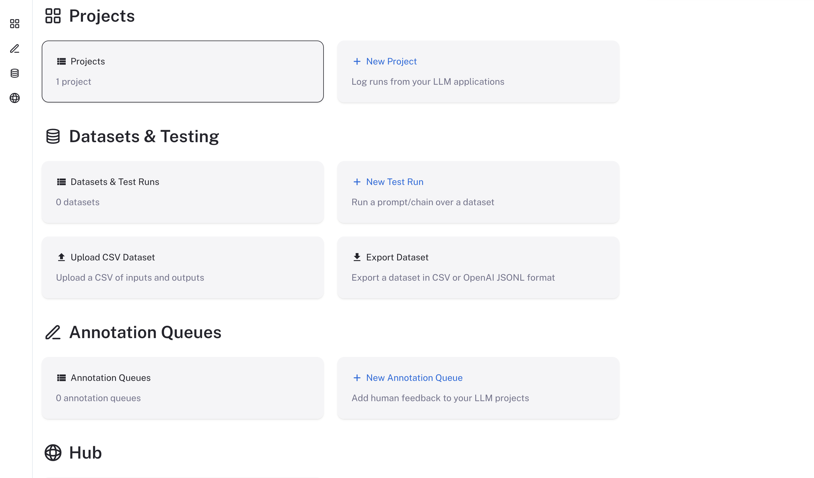

# Upgrade an installation

> [!WARNING]
>
> Downgrades are not officially supported. LangSmith upgrades may include database migrations and other changes that are not backward-compatible. If you need to roll back to a previous version, contact technical support via the [Support Portal](https://support.langchain.com) for guidance.

If you don't have the repo added, run the following command to add it:

```bash
helm repo add langchain https://langchain-ai.github.io/helm/
```

Update your local helm repo

```bash
helm repo update
```

Update your helm chart config file with any updates that are needed in the new version. These will be detailed in the release notes for the new version.

Run the following command to upgrade the chart (replace `version` with the version you want to upgrade to):

> [!NOTE]
>
> If you are using a namespace other than the default namespace, you will need to specify the namespace in the `helm` and `kubectl` commands by using the `-n <namespace` flag.

Find the latest version of the chart. You can find this in the [LangSmith Helm Chart GitHub repository](https://github.com/langchain-ai/helm/releases) or by running the following command:

```bash
helm search repo langchain/langsmith --versions
```

You should see output similar to this:

```bash
NAME                             	CHART VERSION	APP VERSION	DESCRIPTION
langchain/langsmith              	0.17.2       	0.17.30    	Helm chart to deploy the langsmith application ...
langchain/langsmith              	0.17.1       	0.17.30    	Helm chart to deploy the langsmith application ...
langchain/langsmith              	0.17.0       	0.17.29    	Helm chart to deploy the langsmith application ...
langchain/langsmith              	0.16.41      	0.16.70    	Helm chart to deploy the langsmith application ...
langchain/langsmith              	0.16.40      	0.16.70    	Helm chart to deploy the langsmith application ...
```

Choose the version you want to upgrade to (generally the latest version is recommended) and note the version number:

> [!NOTE]
>
> If your installation is more than one major version behind the latest chart, upgrade one major version at a time. Do not skip major versions. Repeat this upgrade procedure for each intervening major version before upgrading to the latest supported version.
>
> For example, to upgrade from 0.15 to 0.17, first upgrade to the latest 0.16 chart, then upgrade to the latest 0.17 chart.

```bash
helm upgrade <release-name> langchain/langsmith --version <version> --values <path-to-values-file> --wait --debug
```

Verify that the upgrade was successful:

```bash
helm status <release-name>
```

All pods should be in the `Running` state. Verify that ClickHouse is running and that both `migrations` jobs have completed.

```bash
kubectl get pods
NAME                                     READY   STATUS      RESTARTS   AGE
langsmith-backend-95b6d54f5-gz48b        1/1     Running     0          15h
langsmith-pg-migrations-d2z6k            0/1     Completed   0          5h48m
langsmith-ch-migrations-gasvk            0/1     Completed   0          5h48m
langsmith-clickhouse-0                   1/1     Running     0          26h
langsmith-frontend-84687d9d45-6cg4r      1/1     Running     0          15h
langsmith-hub-backend-66ffb75fb4-qg6kl   1/1     Running     0          15h
langsmith-playground-85b444d8f7-pl589    1/1     Running     0          15h
langsmith-queue-d58cb64f7-87d68          1/1     Running     0          15h
```

## Validate your deployment

1. Run `kubectl get services`

   Output will be similar to:

   ```bash
   NAME                         TYPE           CLUSTER-IP       EXTERNAL-IP     PORT(S)                      AGE
   kubernetes                   ClusterIP      172.20.0.1       <none>          443/TCP                      27d
   langsmith-backend            ClusterIP      172.20.22.34     <none>          1984/TCP                     21d
   langsmith-clickhouse         ClusterIP      172.20.117.62    <none>          8123/TCP,9000/TCP            21d
   langsmith-frontend           LoadBalancer   172.20.218.30    <external ip>   80:30093/TCP,443:31130/TCP   21d
   langsmith-platform-backend   ClusterIP      172.20.232.183   <none>          1986/TCP                     21d
   langsmith-playground         ClusterIP      172.20.167.132   <none>          3001/TCP                     21d
   langsmith-postgres           ClusterIP      172.20.59.63     <none>          5432/TCP                     21d
   langsmith-redis              ClusterIP      172.20.229.98    <none>          6379/TCP                     20d
   ```

2. Curl the external ip of the `langsmith-frontend` service:

   ```bash
   curl <external ip>/api/info
   {"version":"0.5.7","license_expiration_time":"2033-05-20T20:08:06","batch_ingest_config":{"scale_up_qsize_trigger":1000,"scale_up_nthreads_limit":16,"scale_down_nempty_trigger":4,"size_limit":100,"size_limit_bytes":20971520}}
   ```

   Check that the version matches the version you upgraded to.

3. Visit the external IP for the `langsmith-frontend` service on your browser. The LangSmith UI should be visible and operational.

   

## Upgrade separate sandbox clusters

When Sandboxes run in a [separate cluster](../Install%20an%20instance/Additional%20features/Enable%20Sandboxes/Run%20self-hosted%20Sandboxes%20in%20a%20separate%20cluster.md), each upgrade involves two Helm releases: `langsmith` in the LangSmith cluster and `langsmith-sandbox` in the sandbox cluster. Keep both on the same LangSmith release:

* **Order**: Upgrade `langsmith` first, then `langsmith-sandbox` within days. Do not run the sandbox hosts on a newer release than the control plane, except while the runtime upgrade rolls out. If the release notes for a version give a different order, follow them. LangSmith [warns in the UI](../Install%20an%20instance/Additional%20features/Enable%20Sandboxes/Run%20self-hosted%20Sandboxes%20in%20a%20separate%20cluster.md#watch-for-a-release-mismatch) when the runtime falls behind for more than 72 hours or runs ahead for more than 30 minutes.
* **Version**: Use the newest `langsmith-sandbox` chart whose appVersion equals the appVersion of your `langsmith` chart. The two charts pair by appVersion, never by chart version. See [Release policy](../Reference/Release%20policy.md#pair-the-sandbox-runtime-chart).
* **Pinning**: Pin both releases to exact chart versions. Never use a version range.

To find the runtime chart version that matches your `langsmith` release:

```bash
helm repo update
APP=$(helm get metadata langsmith --kube-context <langsmith-context> -n <langsmith-namespace> -o json | jq -r .appVersion)
helm search repo langchain/langsmith-sandbox --versions --devel -o json \
  | jq -r --arg a "$APP" '[.[] | select(.name == "langchain/langsmith-sandbox" and .app_version == $a)][0].version // error("no langsmith-sandbox chart for appVersion \($a)")'
```

Every host upgrade restarts the hosts one at a time, and each restart suspends the Sandboxes running on that host. See [Understand a rolling upgrade](../Install%20an%20instance/Additional%20features/Enable%20Sandboxes/Operate%20self-hosted%20Sandboxes.md#understand-a-rolling-upgrade).

### Upgrade with the Helm CLI

Run two commands, each against its own cluster, `langsmith` first:

```bash
helm upgrade langsmith langchain/langsmith \
  --kube-context <langsmith-context> \
  --namespace <langsmith-namespace> \
  --version <langsmith-chart-version> \
  --values langsmith_config.yaml \
  --wait

helm upgrade langsmith-sandbox langchain/langsmith-sandbox \
  --kube-context <sandbox-context> \
  --namespace langsmith-sandbox \
  --version <matching-sandbox-chart-version> \
  --values langsmith_sandbox_config.yaml \
  --wait \
  --timeout <timeout>
```

* **No automatic rollback for the runtime**: Do not pass `--atomic` or `--rollback-on-failure` to the `langsmith-sandbox` upgrade. Hosts drain one at a time, so a slow rollout can exceed the `--wait` timeout without having failed, and a rollback restarts every host again.
* **Timeout**: Set `--timeout` to about the number of hosts times `sandboxHost.deployment.terminationGracePeriodSeconds` (300 seconds by default), plus the time a host takes to start. To follow the rollout, run `kubectl rollout status` with a similar timeout.
* **Reused values**: If you reuse the previous release's values, prefer `--reset-then-reuse-values` to `--reuse-values`. `--reuse-values` keeps the previous chart's defaults, including its image tags.

### Upgrade with Argo CD or Flux

* **Two changes**: Bump `langsmith` in one Git change. After its sync succeeds and the application is Healthy (Flux: the HelmRelease is `Ready`), bump `langsmith-sandbox` to the exact matching version in a second change.
* **No combined change**: One change that bumps both charts syncs them at the same time. If the `langsmith` upgrade is then blocked, for example by a failing pre-upgrade hook, the hosts run ahead of the control plane until it goes through.
* **No floating versions**: Never let the runtime chart float. Do not use a range, `*`, or `*-0`, and do not omit `version` in a Flux HelmRelease.

### Upgrade with your own infrastructure as code

Model the two charts as two Helm releases with an explicit dependency, such as `depends_on` in Terraform, so `langsmith` applies before `langsmith-sandbox`. Pin both to exact chart versions.

### Check the upgrade

After both upgrades:

1. Check that both releases report the same `APP VERSION`. Argo CD does not update Helm release records, so skip this step there; step 3 checks the same thing:

   ```bash
   helm list --kube-context <langsmith-context> -n <langsmith-namespace> --filter '^langsmith$'
   helm list --kube-context <sandbox-context> -n langsmith-sandbox --filter '^langsmith-sandbox$'
   ```

2. Check that the `platform-backend` and `sandbox-host` rollouts finished:

   ```bash
   kubectl --context <langsmith-context> -n <langsmith-namespace> rollout status deployment/langsmith-platform-backend
   kubectl --context <sandbox-context> -n langsmith-sandbox rollout status deployment/langsmith-sandbox-sandbox-host --timeout=<timeout>
   ```

3. Check that the image tags each cluster runs match that `APP VERSION`:

   ```bash
   kubectl --context <langsmith-context> -n <langsmith-namespace> get deployment langsmith-platform-backend \
     -o jsonpath='{.spec.template.spec.containers[?(@.name=="platform-backend")].image}{"\n"}'
   kubectl --context <sandbox-context> -n langsmith-sandbox get deployment langsmith-sandbox-sandbox-host \
     -o jsonpath='{.spec.template.spec.containers[?(@.name=="sandbox-host")].image}{"\n"}'
   ```

The commands assume the release names `langsmith` and `langsmith-sandbox`.

### Roll back the runtime

Roll back only the `langsmith-sandbox` release, with `helm rollback` or by reverting its Git change. Do not roll back the `langsmith` release: its database migrations only move forward, so fix forward instead. A host rollback restarts every host, like an upgrade. It is not always safe: if the newer hosts already wrote sandbox data in a format that older hosts cannot read, roll forward instead. If you are unsure, contact support before you roll hosts back.

### Change the topology or uninstall

* **Move from the embedded runtime**: Set `sandboxes.external.enabled: true` on the `langsmith` release first, then install `langsmith-sandbox` against the same JuiceFS metadata store and bucket. See [Move an existing installation to a separate cluster](../Install%20an%20instance/Additional%20features/Enable%20Sandboxes/Run%20self-hosted%20Sandboxes%20in%20a%20separate%20cluster.md#move-an-existing-installation-to-a-separate-cluster).
* **Uninstall**: Uninstall `langsmith-sandbox` first, then uninstall or reconfigure `langsmith`. See [Uninstall](../Install%20an%20instance/Additional%20features/Enable%20Sandboxes/Run%20self-hosted%20Sandboxes%20in%20a%20separate%20cluster.md#uninstall).

## Upgrade from v16 to v17

Chart v17 changes the values for SmithDB, sandboxes, and Engine. Update your values file before you run `helm upgrade`. Chart v17 fails to render the SmithDB, sandbox, and Engine values below until you change them. If you deploy with the Terraform modules, follow the upgrade steps in the [AWS](../Deploy%20with%20Terraform/AWS/Deploy%20LangSmith%20on%20AWS%20with%20Terraform.md#upgrade-from-chart-v16-to-v17), [GCP](../Deploy%20with%20Terraform/GCP/Deploy%20LangSmith%20on%20GCP%20with%20Terraform.md), or [Azure](../Deploy%20with%20Terraform/Azure/Deploy%20LangSmith%20on%20Azure%20with%20Terraform.md) deploy guide, which apply these changes to the module's values files.

> [!WARNING]
>
> Downgrading from chart v17 to v16 is not supported. Back up the database before you upgrade.

* **SmithDB**: Move `smithdb.migration.deployment` to `smithdb.migration.job`. With `smithdb.enabled: true`, move the flat autoscaling keys (`enabled`, `minReplicas`, `maxReplicas`, and the rest) on `query`, `ingestion`, `mutations`, `runRules`, `statsQuery`, and `compactionWorker` under `autoscaling.hpa.*`. For `compactionWorker`, you can use `autoscaling.keda.*` instead, but enable only one scaler. For the cache volume changes, see [Cache storage](../SmithDB/Install%20SmithDB/Prepare%20SmithDB%20supporting%20infrastructure.md#cache-storage).
* **Sandboxes**: Chart v17 removes the bundled JuiceFS CSI driver, and `sandbox-host` mounts JuiceFS itself. Chart v17 ignores a leftover `sandboxes.juicefs.csi` block, and its validation then fails with `sandboxes.juicefs.redis.metaURL is required when sandboxes.enabled is true and sandboxes.juicefs.existingSecretName is not set.` Move the settings:

  * `sandboxes.juicefs.csi.existingSecretName` becomes `sandboxes.juicefs.existingSecretName`. The Secret keeps its keys.
  * The cache options in `sandboxes.juicefs.csi.mountPodPatch` move to `sandboxes.juicefs.hostMount`. `cacheDirs` sets the host paths for the JuiceFS cache and defaults to `/var/cache/juicefs`. If you override it, list at least one absolute path. Set other JuiceFS options in `mountOptions` in the `--flag=value` form, and do not set `--cache-dir` there. The default cache size drops from 300 GiB (`cache-size=307200`) to 50 GiB (`--cache-size=51200`).
  * Move the IRSA or Workload Identity annotation from `sandboxes.juicefs.csi.node.serviceAccount.annotations` to `sandboxes.sandboxHost.serviceAccount.annotations`. On GKE, `sandbox-host` runs on the host network, and GKE does not give Workload Identity to host-network pods, so the annotation serves only the `juicefs-format` Job. Also grant the sandbox node pool's service account `roles/storage.objectAdmin` on the bucket, limited by an IAM condition to the JuiceFS prefix. Without that grant, the mount gets 403 from Cloud Storage.

  Before the upgrade, drain the JuiceFS volumes while the CSI driver still runs. Otherwise the old `sandbox-host` pods stay in `Terminating`. With the default release name:

  ```bash
  kubectl delete -n langsmith deployment.apps/langsmith-sandbox-host
  kubectl delete -n langsmith persistentvolumeclaim/smithbox-juicefs-csi
  kubectl delete -n langsmith persistentvolumeclaim/smithbox-juicefs-csi-host
  kubectl get pods -n langsmith | grep juicefs   # wait until only juicefs-csi-* pods remain
  ```

  Running sandboxes stop. Their data stays in object storage and Redis, because both chart v16 PersistentVolumes use the `Retain` reclaim policy.
* **Engine**: With Engine enabled, set `engine.usageSigningSecret` to a value of at least 32 characters (generate one with `openssl rand -hex 32`), or, when you use `config.existingSecretName`, add an `engine_usage_signing_secret` key to that Secret instead. The default `engine.intelligenceBaseUrl` changes to `https://beacon.langchain.com/intelligence`, which records usage only. To keep running Engine on LangSmith Intelligence models, as on chart v16, keep `https://beacon.aws.langchain.com/intelligence` and select LangSmith Intelligence under **Settings** > **Engine** > **Model providers**. For details, see [LangSmith Engine on Self-hosted](../../../Engine/Self-hosted%20and%20BYOC/LangSmith%20Engine%20on%20Self-hosted%20and%20BYOC.md).
