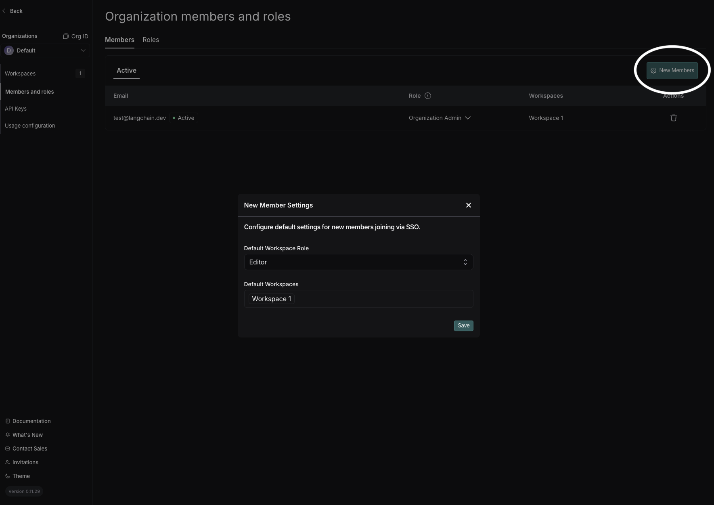

# Customize user management

> [!NOTE]
>
> This guide assumes you have read the [admin guide](../../Govern/Organization/Overview.md) and [organization setup guide](../../Govern/Organization/Workspace%20setup/Set%20up%20hierarchy.md#set-up-an-organization).

LangSmith offers additional customization features for user management using feature flags.

## Features

### Workspace level invites to an organization

The default behavior in LangSmith requires a user to be an Organization Admin in order to invite new users to an organization. For self-hosted customers that would like to delegate this responsibility to workspace Admins, a feature flag may be set that enables workspace Admins to invite new users to the organization as well as their specific workspace **at the workspace level**.

Once this feature is enabled via the configuration option below, workspace Admins may add new users in the `Workspace members` tab under `Settings` > `Workspaces`. Both of the following cases are supported when inviting at the workspace level, while the organization level invite functions the same as before.

1. Invite users who are NOT already active in the organization: this will add the users as pending to the organization and specific workspace
2. Invite users who ARE already active in the organization: adds the users directly to the workspace as an active member (no pending state).

Admins may invite users for both cases at the same time.

#### Configuration

```yaml Helm
config:
  workspaceScopeOrgInvitesEnabled: true
```

### SSO new member login flow

As of helm **v0.11.10**, self-hosted deployments using OAuth SSO will no longer need to manually add members in LangSmith settings for them to join. Deployments will have a **default** organization, to which new users will automatically be added upon their first login to LangSmith.

For your **default** organization, you can set which workspace(s) and workspace role is assigned to new members. For **non-default** organizations, the invitation flow remains the same.
Once a user joins an organization, any changes to their workspaces or roles beyond the default organization settings must be managed either through LangSmith settings (as before) or via SCIM.

> [!NOTE]
>
> By default, all new users are added to the organization’s initially provisioned workspace (**Workspace 1** by default) with the **Workspace Editor** role.



> [!NOTE]
>
> To change your default organization, use **Set Default Organization** in the organization selector dropdown. (Org Admin permissions required in both the source and target organization.)

### SSO Groups Sync

> [!NOTE]
>
> SSO Groups Sync on self-hosted requires LangSmith chart version **0.15.0-rc.3** (application version **0.15.2rc1**) or later.

[SSO Groups Sync](../../Govern/Users%20%26%20access%20control/User%20management.md#sso-groups-sync-alternative) reads group memberships from the OIDC ID token and assigns org and workspace roles using the [SCIM naming convention](../../Govern/Users%20%26%20access%20control/User%20management.md#group-naming-convention). It is a simpler alternative to [SCIM](../../Govern/Users%20%26%20access%20control/User%20management.md#set-up-scim-for-your-organization) for self-hosted organizations whose IdP can include groups in the OIDC token but cannot easily run SCIM provisioning.

For IdP-side configuration (claim, scope) refer to the [SSO Groups Sync section in the OIDC SSO setup guide](Set%20up%20SSO%20with%20OAuth2.0%20and%20OIDC.md#sso-groups-sync). For settings reference and behavior, see the [main SSO Groups Sync documentation](../../Govern/Users%20%26%20access%20control/User%20management.md#sso-groups-sync-alternative).

### Disabling organization creating

By default, any user can create an organization in LangSmith. For self-hosted customers, an admin may want to restrict this ability after setting up initial organizations. This feature flag allows an admin to disable the ability for users to create new organizations.

#### Configuration

> [!NOTE]
>
> The `userOrgCreationDisabled` feature flag is set to `true` by default for organizations using [basic auth](Basic%20authentication%20with%20email%20and%20password.md) or [SSO](Set%20up%20SSO%20with%20OAuth2.0%20and%20OIDC.md).

```yaml Helm
config:
  userOrgCreationDisabled: true
```

### Disabling personal organizations

By default, any user who logs in to LangSmith will have a personal organization created for them. For self-hosted customers, an admin may want to restrict this ability. This feature flag allows an admin to disable the ability for users to create personal organizations.

#### Configuration

> [!NOTE]
>
> The `personalOrgsDisabled` feature flag is set to `true` by default for organizations using [basic auth](Basic%20authentication%20with%20email%20and%20password.md) or [SSO](Set%20up%20SSO%20with%20OAuth2.0%20and%20OIDC.md).

```yaml Helm
config:
  personalOrgsDisabled: true
```

### Disabling personal access token creation

> [!NOTE]
>
> This feature requires Helm chart version 0.13.12 (application version 0.13.12) or later.

By default, users can create Personal Access Tokens (PATs) in any organization. For self-hosted customers, an admin may want to globally disable PAT creation across all organizations. This environment variable allows an admin to prevent users from creating new PATs in any organization on the instance.

To disable PAT creation for a single organization instead, see the [per-organization API option](../../Govern/Organization/Manage%20your%20organization%20using%20the%20API.md#security-settings).

#### Configuration

```yaml Helm
commonEnv:
  - name: PAT_CREATION_DISABLED
    value: "true"
```
