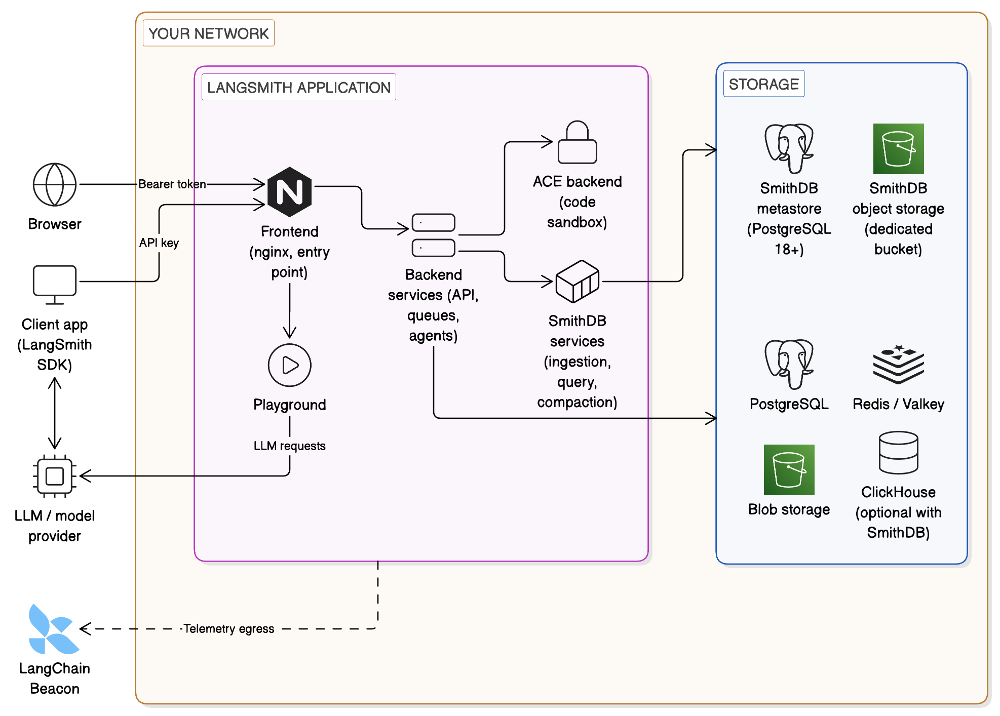

# Self-hosted LangSmith

> Run LangSmith in your own Kubernetes cluster, with Insights and Chat enabled by default and optional features such as Sandboxes, Engine, Fleet, LLM Gateway, and Agent Server hosting.

> [!NOTE]
>
> Self-hosted LangSmith is an add-on to the Enterprise plan designed for LangChain's largest, most security-conscious customers. For more details, refer to [Pricing](https://www.langchain.com/pricing). [Contact our sales team](https://www.langchain.com/contact-sales) if you want a license key to trial LangSmith in your environment.

Self-hosted LangSmith runs the LangSmith platform in your own infrastructure so that trace and operational data stay in your environment. The base installation includes [observability](../../Monitor/Overview/LangSmith%20Observability.md), [evaluation](../../Test/Get%20started/LangSmith%20Evaluation.md), [prompt engineering](../../Deploy/Prompt%20%26%20Context%20Hub/Prompt%20%26%20Context%20Hub.md#prompts), [Insights](../../Monitor/Observe/Monitoring%20%26%20alerting/Discover%20errors%20and%20usage%20patterns%20with%20Insights.md), and [Chat](../../Test/Datasets%20%26%20Experiments/Analyze%20experiment%20results/LangSmith%20Chat.md). You can add [Sandboxes](../../Deploy/Sandboxes/LangSmith%20Sandboxes.md), [Engine](../../Engine/LangSmith%20Engine.md), [Fleet](../../No-code%20agents/Fleet/No-code%20agents%20with%20LangSmith%20Fleet.md), [LLM Gateway](../../LLM%20Gateway/Get%20started/LLM%20Gateway.md), and [Agent Server hosting](../../Deploy/Get%20started/LangSmith%20Agent%20Server.md) when your use case requires them.

## Features

| Feature | Availability | What setup requires |
| - | - | - |
| Observability, evaluation, and prompt engineering | Included | The [base installation](Install%20an%20instance/Self-host%20LangSmith%20on%20Kubernetes.md). |
| [Insights](../../Monitor/Observe/Monitoring%20%26%20alerting/Discover%20errors%20and%20usage%20patterns%20with%20Insights.md) and [Chat](../../Test/Datasets%20%26%20Experiments/Analyze%20experiment%20results/LangSmith%20Chat.md) (formerly Polly) | Enabled by default in Helm chart version 0.15.1 or later | One encryption key per feature and model access. See [Configure Insights and Chat](Install%20an%20instance/Configure%20Insights%20and%20Chat%20on%20self-hosted%20LangSmith.md). |
| [Sandboxes](Install%20an%20instance/Additional%20features/Enable%20Sandboxes/Enable%20Sandboxes%20on%20self-hosted%20LangSmith.md) | Optional | KVM-capable nodes and JuiceFS storage on EKS, GKE, or AKS. |
| [Engine](../../Engine/Self-hosted%20and%20BYOC/LangSmith%20Engine%20on%20Self-hosted%20and%20BYOC.md) | Optional | Sandboxes, a license with the Engine entitlement, and Helm chart version 0.16.0 or later. Air-gapped installations require Helm chart version 0.17.0 or later. |
| [Fleet](Install%20an%20instance/Additional%20features/Enable%20Fleet%20on%20self-hosted%20LangSmith.md) | Optional | Fleet services in your cluster. Does not require Agent Server hosting. |
| [LLM Gateway](Install%20an%20instance/Additional%20features/Enable%20the%20LLM%20Gateway.md) | Optional (beta) | Helm chart version 0.17.1 or later. The `agent-gateway` service needs access to PostgreSQL, Redis, and other LangSmith pods. |
| [Agent Server hosting](Install%20an%20instance/Additional%20features/Enable%20Agent%20Server%20hosting.md) | Optional | KEDA, an ingress, and a control plane and data plane. To run Agent Servers without a control plane, see [standalone servers](../../Deploy/Deploy%20to%20Self-hosted/Self-host%20standalone%20servers.md). |

## Architecture

A self-hosted LangSmith instance runs a set of application services backed by several storage services. When you enable [SmithDB](SmithDB/Overview/Enable%20SmithDB%20on%20self-hosted%20LangSmith.md), its services run inside the application, and its metastore and object storage join the storage services.

The diagram groups the backend, platform backend, queue, ingest queue, and Insights and Chat agents as backend services. The [Services](#services) table describes each one.

To access the LangSmith UI and send API requests, expose the [LangSmith frontend](#services) service. Depending on your installation method, this can be a load balancer or a port exposed on the host machine.

For architecture patterns and best practices on each cloud provider, see the [AWS](Get%20started%20by%20cloud%20provider/Self-hosted%20LangSmith%20on%20AWS.md), [GCP](Get%20started%20by%20cloud%20provider/Self-hosted%20LangSmith%20on%20GCP.md), and [Azure](Get%20started%20by%20cloud%20provider/Self-hosted%20LangSmith%20on%20Azure.md) guides.

### Services

| Service | Description |
| - | - |
|  **LangSmith frontend** | The frontend uses Nginx to serve the LangSmith UI and route API requests to the other servers. This serves as the entrypoint for the application and is the only component that must be exposed to users. |
|  **LangSmith backend** | The backend is the main entrypoint for CRUD API requests and handles the majority of the business logic for the application. This includes handling requests from the frontend and SDK, preparing traces for ingestion, and supporting the hub API. |
|  **LangSmith queue** | The queue handles incoming traces and feedback to ensure that they are ingested and persisted into the traces and feedback datastore asynchronously, handling checks for data integrity and ensuring successful insert into the datastore, handling retries in situations such as database errors or the temporary inability to connect to the database. |
|  **LangSmith ingest queue** | The ingest queue is a worker that persists queued runs and feedback into the traces and feedback datastore. It also runs background tasks, such as backfills. |
|  **LangSmith platform backend** | The platform backend is another critical service that primarily handles authentication, run ingestion, and other high-volume tasks. |
|  **LangSmith Playground** | The Playground is a service that handles forwarding requests to various LLM APIs to support the Playground feature. This can also be used to connect to your own custom model servers. |
|  **LangSmith ACE (Arbitrary Code Execution) backend** | The ACE backend is a service that handles executing arbitrary code in a secure environment. This is used to support running custom code within LangSmith. |
|  **Insights and Chat agents** | The [Insights](../../Monitor/Observe/Monitoring%20%26%20alerting/Discover%20errors%20and%20usage%20patterns%20with%20Insights.md) and [Chat](../../Test/Datasets%20%26%20Experiments/Analyze%20experiment%20results/LangSmith%20Chat.md) agents run as separate deployments, each with its own bundled PostgreSQL and Redis. Both are enabled by default. See [Configure Insights and Chat](Install%20an%20instance/Configure%20Insights%20and%20Chat%20on%20self-hosted%20LangSmith.md). |

### Storage services

> [!NOTE]
>
> LangSmith bundles all storage services by default. You can configure it to use external versions of all storage services. For production, use external storage services.

| Service | Description |
| - | - |
|  **ClickHouse** | [ClickHouse](https://clickhouse.com/docs/en/intro) is a high-performance, column-oriented SQL database management system (DBMS) for online analytical processing (OLAP). LangSmith uses ClickHouse as the primary data store for traces and feedback (high-volume data). On LangSmith 0.17 and later, a new installation can run [SmithDB](SmithDB/Overview/Enable%20SmithDB%20on%20self-hosted%20LangSmith.md) without ClickHouse. 💡 [Connect to external ClickHouse](Connect%20external%20services/Connect%20to%20an%20external%20ClickHouse%20database.md) |
|  **SmithDB** | SmithDB is an optional columnar datastore built for agent trace data: deeply nested spans, multi-modal content, and spans that stay open for hours. SmithDB is available on LangSmith 0.17 and later. It requires a dedicated PostgreSQL 18 or later database for its metastore and a dedicated object storage bucket, separate from the main PostgreSQL database and blob storage. 💡 [Enable SmithDB](SmithDB/Overview/Enable%20SmithDB%20on%20self-hosted%20LangSmith.md) - [Prepare supporting infrastructure](SmithDB/Install%20SmithDB/Prepare%20SmithDB%20supporting%20infrastructure.md) |
|  **PostgreSQL** | [PostgreSQL](https://www.postgresql.org/about/) is a powerful, open source object-relational database system that uses and extends the SQL language combined with many features that safely store and scale the most complicated data workloads. LangSmith uses PostgreSQL as the primary data store for transactional workloads and operational data (almost everything besides traces and feedback). 💡 [Connect to external PostgreSQL](Connect%20external%20services/Connect%20to%20an%20external%20PostgreSQL%20database.md) - AWS RDS, GCP Cloud SQL, Azure Database |
|  **Redis / Valkey** | [Redis](https://github.com/redis/redis) is a powerful in-memory key-value database that persists on disk. By holding data in memory, Redis offers high performance for operations like caching. LangSmith uses Redis to back queuing and caching operations. [Valkey](https://valkey.io/) is also officially supported as a drop-in replacement for Redis. 💡 [Connect to external Redis or Valkey](Connect%20external%20services/Connect%20to%20an%20external%20Redis%20or%20Valkey%20database.md) - AWS ElastiCache, GCP Memorystore, Azure Cache |
|  **Blob storage** | LangSmith supports several blob storage providers, including [AWS S3](https://aws.amazon.com/s3/), [Azure Blob Storage](https://azure.microsoft.com/en-us/services/storage/blobs/), and [Google Cloud Storage](https://cloud.google.com/storage). LangSmith uses blob storage to store large files, such as trace artifacts, feedback attachments, and other large data objects. Blob storage is optional, but highly recommended for production deployments. 💡 [Enable blob storage](Connect%20external%20services/Enable%20blob%20storage.md) - AWS S3, GCP GCS, Azure Blob |

## Installation procedures

This page is an overview. The installation itself happens in the [Kubernetes installation guide](Install%20an%20instance/Self-host%20LangSmith%20on%20Kubernetes.md), and optional features have their own setup guides.

To go from this page to a running instance:

**1. Install the base platform**

Follow [Self-host LangSmith on Kubernetes](Install%20an%20instance/Self-host%20LangSmith%20on%20Kubernetes.md) from start to finish. It covers prerequisites, Helm configuration, Insights and Chat encryption keys, deployment, and verification. When you complete it, you'll have a running LangSmith instance with observability, evaluation, prompt engineering, Insights, and Chat.

Before you start, review the [minimum versions for self-hosting dependencies](Install%20an%20instance/Minimum%20versions%20for%20self-hosting%20dependencies.md). To provision the cluster, datastores, and Helm release together, use [Deploy with Terraform](Deploy%20with%20Terraform/Deploy%20LangSmith%20with%20Terraform.md) instead of the Helm-only guide.

**2. (Optional) Add features**

After the base platform is running, enable the optional features your use case requires from the [Features](#features) table. See [Configure additional self-hosted features](Install%20an%20instance/Additional%20features/Configure%20additional%20self-hosted%20features.md). Skip this step if the base installation covers your use case.
