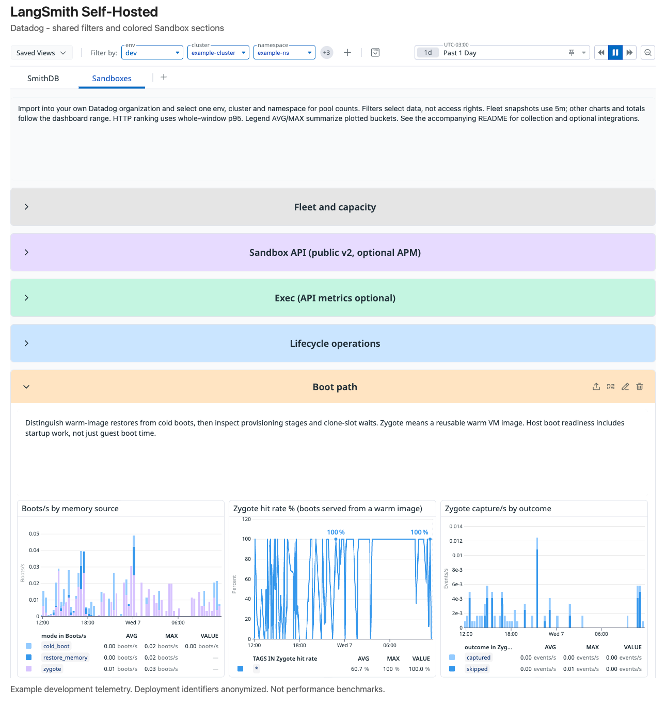
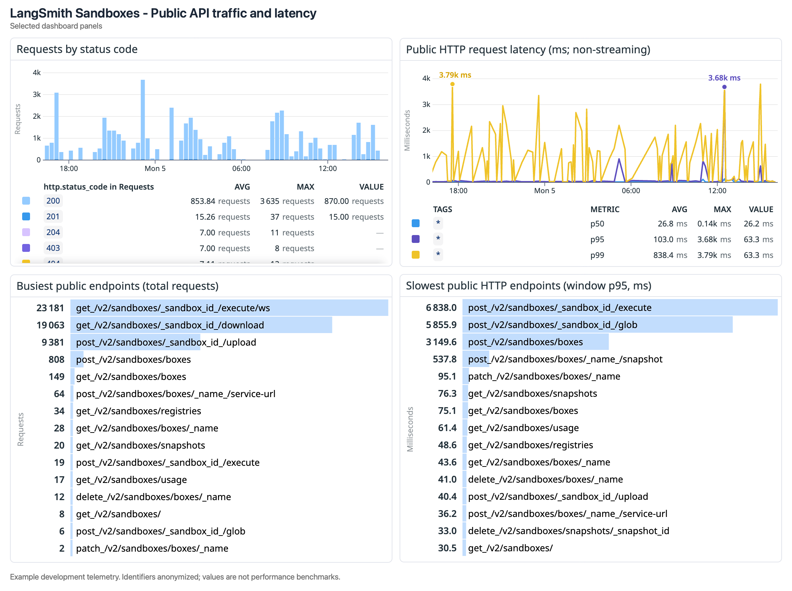
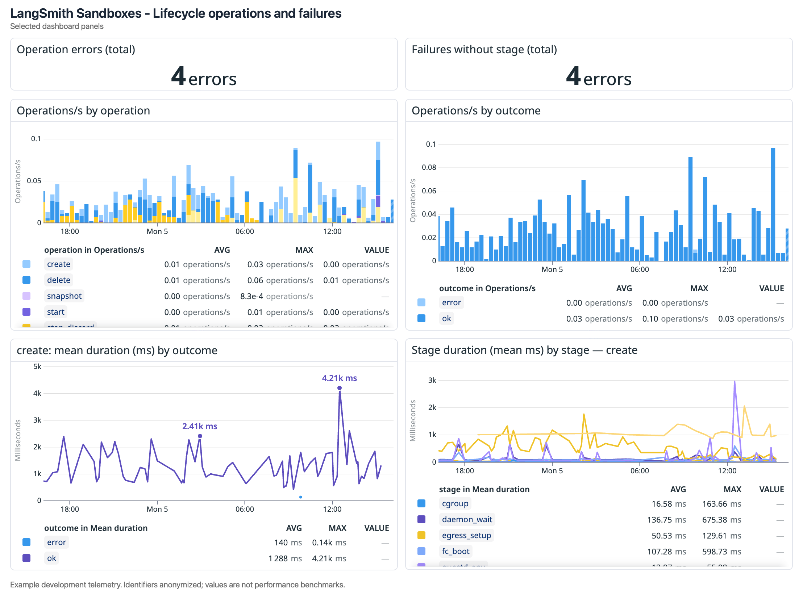
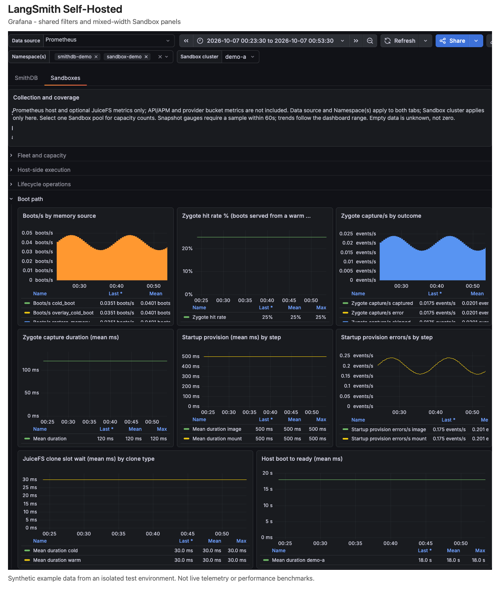

# Monitor self-hosted LangSmith with Datadog or Grafana

> Import tabbed SmithDB and Sandbox dashboards into your own monitoring instance and configure component telemetry collection.

The LangSmith Self-Hosted dashboards group operational metrics into SmithDB and Sandboxes tabs. Use them to monitor the components running in your infrastructure from one dashboard per monitoring platform.

Download the definitions and collection examples from the [LangSmith observability bundle](https://github.com/langchain-ai/helm/tree/main/charts/langsmith/examples/langsmith-observability). Import them into your own Datadog organization or Grafana instance. Download these files from the repository, not the Helm chart archive. The downloads contain queries, not telemetry or access to LangChain's hosted monitoring.

## Choose a platform

The two dashboards share component organization, but their data sources and coverage differ.

| Coverage | Datadog | Grafana with Prometheus |
| - | - | - |
| SmithDB metrics and the LangSmith ingestion path | Included | Included |
| Sandbox host capacity, lifecycle, execution, resources, networking, and health | Included | Included |
| JuiceFS mount metrics | Optional separate scrape | Optional separate scrape |
| Sandbox API/APM views | Optional Datadog APM | Not included |
| AWS/GCP bucket metrics | Optional cloud integration | Not included |

Grafana's Sandbox tab does not assume that Datadog-derived metrics exist in Prometheus. Host-side command counts and durations remain available without APM. Differences in scrape timing, rollups, and counter extrapolation also mean the platforms can display different numerical values.

## Check prerequisites

Use an existing [self-hosted LangSmith deployment](../Self-hosted%20LangSmith.md) and monitoring installation. Enable collection only for components you operate. The examples do not install monitoring software or enable SmithDB or sandboxes.

* **Datadog**: Use an Agent with Kubernetes Autodiscovery and the [OpenMetrics integration](https://docs.datadoghq.com/integrations/openmetrics/). Sandbox annotations require Agent 7.36 or later.
* **Grafana**: Use Grafana 13 or later for native tabs and the V2 dashboard resource format. Configure an existing Prometheus data source.
* **Private connectivity**: Collectors need access to component metrics endpoints. Do not expose them through public ingress. Sandbox hosts use the node network, so restrict access with node firewall configuration.
* **Permissions**: You need permission to import dashboards and update your collection configuration. Prometheus pod discovery needs access to the selected Kubernetes namespace.

Configure credentials through your existing monitoring installation, not the examples. Preserve collector tolerations so collection also runs on dedicated sandbox nodes.

For Sandbox collection, the chart must support `sandboxes.sandboxHost.deployment.podAnnotations`, and the deployment must use the `sandbox-host` Firecracker runtime. Check the installed chart's values schema. Older runtime versions may not emit every metric.

## Collect component metrics

Each component has its own configuration under the bundle's `components/` directory.

### SmithDB

Follow [Configure SmithDB observability](../SmithDB/Monitoring%20and%20alerting/Configure%20SmithDB%20observability.md) and use the appropriate collection example from `components/smithdb/`. Those examples also collect ingestion-path metrics from the ingest queue and platform-backend.

The Datadog download defaults to the `smithdb.` prefix for SmithDB metrics; Grafana uses raw Prometheus names. For metric meanings, see the [Essential SmithDB metrics](../SmithDB/Monitoring%20and%20alerting/Essential%20SmithDB%20metrics.md). Datadog's SmithDB error-log panels additionally require logs matching `service:smithdb*`.

If your collector uses another namespace, regenerate the dashboard from a local copy of the Helm repository:

```bash
python3 charts/langsmith/examples/langsmith-observability/generate_dashboards.py \
  --smithdb-metrics-prefix custom_smithdb.
```

Include the trailing dot, or pass `--smithdb-metrics-prefix ''` for unprefixed SmithDB metrics. The option changes only SmithDB metric names and their prefix note in the Datadog export. Grafana, Sandbox queries, unprefixed `langsmith_*` metrics, and log filters stay unchanged.

The generator does not modify collection settings. Match the SmithDB OpenMetrics namespace to the prefix: use `namespace: custom_smithdb` for the example, or an empty namespace for unprefixed metrics.

### Sandboxes with Datadog

The Sandbox host exports metrics on port `19190`. To collect and import them:

1. Download the root `datadog-dashboard.json` and the values from `components/sandboxes/datadog-values.yaml`.
2. Merge the OpenMetrics annotation into your existing release values. A Helm string replaces the whole annotation, not individual JSON instances. Reconcile existing checks to avoid duplicate scraping.
3. Apply the values through your release manager using the same chart version you currently run. Pod-annotation changes roll sandbox-host pods and suspend their running sandboxes. Schedule this update in a maintenance window.
4. Check the Agent's scrape status and confirm that `langsmith_sandbox_host_live_sandboxes` and `langsmith_sandbox_host_juicefs_mount_ready` reach Datadog.
5. Import the dashboard JSON and open the Sandboxes tab.

The host example adds no metric namespace prefix. Datadog counters use `.count` instead of `_total`. The collection retains histogram `.sum` and `.count` series alongside distributions; host duration charts use these to calculate means. Review custom-metric usage and label cardinality in your Datadog plan.

### Sandboxes with Grafana

The Grafana tab uses Prometheus metrics from the host and optional JuiceFS mount. To configure collection:

1. Merge the `scrape_configs` entries from `components/sandboxes/prometheus/host-scrape.yaml` into your existing Prometheus configuration. This file is not Helm values.
2. Replace the namespace and cluster placeholders. Keep one scrape job per host listener. The example selects the `sandbox-host` container and its declared `19190` port, and attaches namespace, cluster, pod, and instance labels.
3. Optionally merge `juicefs-scrape.yaml` after verifying private access to the mount's metrics listener on port `9567`.
4. Check target health and confirm that host metrics reach Prometheus.
5. Import the root `grafana-dashboard.json`. Select the shared Data source and Namespace(s), then select Sandbox cluster. If the components occupy different namespaces, select both namespaces.

The examples use `scrape_protocols` to request Prometheus text format, preserving JuiceFS counter naming. They are validated with Prometheus 3.5.0; check configuration compatibility if you run an older version. No additional Kubernetes permissions or public network resources are created by these files.

## Select your deployment

Shared selectors apply across component tabs where the telemetry has the same meaning. Select only one Sandbox pool before interpreting ready-host or desired-replica counts. You can include a separate SmithDB namespace without selecting additional Sandbox pools.

| Datadog filter | Tag | Scope |
| - | - | - |
| `env` | `env` | SmithDB, Sandbox host, JuiceFS, and APM |
| `cluster` | `cluster_name` for SmithDB; `kube_cluster_name` for Sandbox host and JuiceFS | Shared cluster selection |
| `namespace` | `kube_namespace` | SmithDB, Sandbox host, and JuiceFS |
| `api_service` | `service` | Sandbox APM only |
| `gcs_bucket` | `bucket_name` | GCS storage only |
| `s3_bucket` | `bucketname` | S3 storage only |

The Datadog cluster picker discovers values from `cluster_name` by default. If your account exposes only `kube_cluster_name`, use that as the picker's tag key. Queries use `$cluster.value` with each component's explicit tag key, so changing the picker does not retag metrics. The tag keys must use matching cluster-name values. If your metrics use another tag key, also update the relevant query filters and group-by clauses.

APM uses only `env` and `api_service`; cloud metrics use their bucket selectors. API service and bucket selectors follow the shared filters. Datadog places overflow controls in its additional-variable menu.

Grafana shows three controls: Data source, Namespace(s), and Sandbox cluster. Data source and Namespace(s) apply to both tabs. The namespace list includes SmithDB and Sandbox metric namespaces and supports multiple selections. Sandbox cluster applies only to Sandboxes because the SmithDB collection example does not guarantee a `cluster` label.

The Grafana `sandbox_job` and `juicefs_job` variables default to All and are hidden from the normal header. Edit their saved values or unhide them in variable settings to distinguish collection jobs. Avoid duplicate scraping even when those filters select All. Installations with separate Prometheus backends must customize component panel and variable data-source references; the default bundle uses one backend.

Dashboard filters are not access controls; use your monitoring instance's permissions to control access to telemetry.

## Read the Sandbox panels

The dashboards distinguish recent fleet snapshots from historical trends. Their curated grids mix panel widths rather than forcing two columns. Compact trends share three-panel rows. Dense charts and storage comparisons use half-width panels, and long-label rankings have more space. Headline cards remain paired where a section has two.

* **Fleet snapshots**: Counts and host rankings use five-minute panel windows. Datadog per-host samples align for up to 60 seconds. Grafana evaluates snapshot gauges at the range's end and requires a sample within 60 seconds.
* **Pool counts**: Ready and desired counts use `max` rather than adding successive leader reports. They describe one selected pool, not a total across pools. The desired-replica target updates only while autoscaling is active.
* **Counts**: Rankings and error totals follow the selected range. Grafana uses `increase` before aggregation to handle counter resets. Its counts can be fractional because Prometheus extrapolates scrape boundaries.
* **Durations**: Host charts show means, not percentiles. The Datadog public HTTP endpoint ranking uses whole-window p95, not an average of interval percentiles.

Grafana time-series count panels show rolling increases over `$__rate_interval`, rather than disjoint Datadog buckets. Legend statistics summarize plotted points, not event-weighted statistics for the whole range. The failure summaries include errors without a recorded stage. Missing data means unknown, not zero.

## Configure optional telemetry

JuiceFS exports `juicefs_*` metrics separately from the host. For Datadog, `datadog-juicefs-values.yaml` replaces the host-only values file and collects both listeners. For Prometheus, add the separate JuiceFS job.

JuiceFS defaults to loopback. These examples do not change its listener. If you change the bind address, restrict it to the intended private network and preserve existing mount options. A mount configuration change also requires a host rollout. Configure externally managed mounts separately and avoid duplicate scraping. Logical filesystem size differs from physical bucket usage because of sparse images and copy-on-write clones.

Datadog's optional API widgets use `trace.http.request`, `trace.http.request.hits`, and `trace.http.request.errors`. Follow [Export LangSmith telemetry](Export%20LangSmith%20telemetry%20to%20your%20observability%20backend.md#traces) and select one `api_service` to avoid double counting. Verify names in your account because OpenTelemetry instrumentation can differ. Public API panels exclude internal reporting, which has its own section. HTTP latency excludes streaming and service-proxy traffic; separate panels show connection durations. APM error flags and HTTP 5xx responses are separate signals.

For Datadog bucket panels, enable the appropriate AWS or GCP integration and select the exact JuiceFS bucket. Placeholder defaults select no bucket. Grafana's supplied Sandbox tab does not include these API/APM or provider-storage integrations.

## Preview the Datadog Sandbox tab

The Datadog preview shows shared filters, component tabs, and colored Sandbox sections. Its charts show anonymized development telemetry, not performance benchmarks.



> [accordion] Public API traffic and latency
>
> 

> [accordion] Lifecycle operations and failures
>
> 

## Preview the Grafana Sandbox tab

The Grafana preview shows shared filters and mixed-width Sandbox panels. Its charts use synthetic example data, not live telemetry or performance benchmarks.



## Update existing dashboards

Back up customized dashboards before importing a replacement. Datadog JSON import overwrites existing dashboard content. The unified Grafana export uses a different UID from the legacy SmithDB dashboard; review the import destination before saving.

The former `smithdb-observability/` directory has been removed. Update bookmarks and automation to use the unified bundle's download paths; already-imported dashboards are unaffected.

For Grafana installations without native tabs, download the [standalone SmithDB dashboard in Classic format](https://github.com/langchain-ai/helm/blob/main/charts/langsmith/examples/langsmith-observability/components/smithdb/grafana.json). It contains SmithDB panels only. The deprecated LangSmith Observability Helm chart is not required for these dashboard examples.

## Troubleshoot missing data

Check collector health and a continuously exported gauge before interpreting an empty failure graph. Counters may have no series until an event occurs. A process that exits before a scrape can lose its final counter increment; check logs when investigating an exit.

For empty optional sections, check integration availability, metric names, and selector values before changing the runtime.

## See also

* [Export LangSmith telemetry](Export%20LangSmith%20telemetry%20to%20your%20observability%20backend.md)
* [Configure SmithDB observability](../SmithDB/Monitoring%20and%20alerting/Configure%20SmithDB%20observability.md)
* [Configure an observability collector](Configure%20your%20collector%20for%20LangSmith%20telemetry.md)
* [LangSmith sandboxes](../../../Deploy/Sandboxes/LangSmith%20Sandboxes.md)
