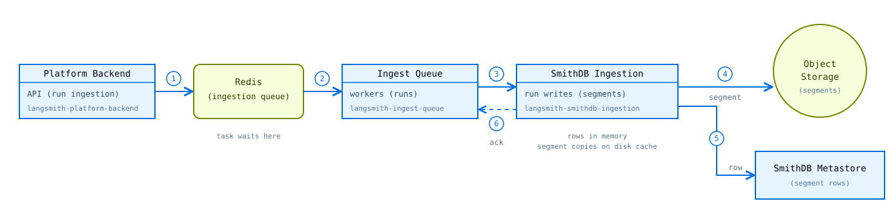
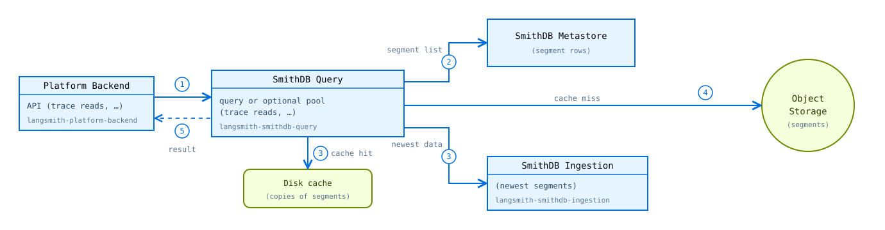

# How SmithDB handles data

> How SmithDB writes runs, answers queries, applies feedback and deletes, and compacts stored data on self-hosted LangSmith.

SmithDB writes runs, answers queries, applies feedback and deletes, and compacts stored data on fixed paths. Knowing those paths helps you tell where a delay or a failure sits when you monitor SmithDB. For the components and the terms on this page, see [SmithDB architecture](SmithDB%20architecture.md).

## Write path

The write path is how new runs from the SDK reach durable storage in SmithDB.

1. The platform backend receives runs from the SDK and adds a *task*, a batch of runs, to the ingestion queue in Redis.
2. An ingest queue worker takes the task.
3. The worker sends the runs to SmithDB ingestion. Ingestion keeps the rows in memory for a short time.
4. Ingestion writes the rows to object storage as a *segment*, a data file that SmithDB never changes after it writes it.
5. Ingestion records the segment in the *metastore*. When the segment is in object storage and in the metastore, the data is durable.
6. Ingestion confirms the write to the worker, and the worker removes the task from Redis.

If a write fails, the task stays in Redis, and the worker tries it again later. After a fixed number of failed attempts, the worker gives up, and the runs of the task are lost. Run data also expires in Redis after a fixed time. Because a task stays in Redis until ingestion confirms the write, a slow or failing write is first visible as a larger queue in Redis.

After the write, ingestion keeps copies of the new segments on its *disk cache*, so that queries can read the newest data from it. Later, ingestion merges small segments into larger segments, and compaction continues this work in the background. The disk cache never holds the only copy of the data.

## Read path

The read path is how SmithDB answers queries from LangSmith, for example for traces, run lists, and run statistics.

1. The platform backend sends UI and API queries to SmithDB query.
2. Query asks the metastore which segments contain data for the tenant, the project, and the time range.
3. For each segment, query uses the fastest source that has it. It reads the newest segments from the ingestion pod that wrote them, and all other segments from its *disk cache*.
4. If the segment is not on the disk cache, or the ingestion pod is not available, query reads it from object storage. It keeps a copy on its disk cache for the next query.
5. Query merges all segments into one result, removes deleted and expired rows, and sends the result to the platform backend.

The more segments a query must read, the slower it is. *Compaction* merges small segments into larger segments to keep this number low. If compaction is late, queries become slower, and query rejects queries that must read too many segments.

## Feedback and delete path

The feedback and delete path is how SmithDB changes runs that it already stores: it adds feedback to runs and removes deleted runs.

Because SmithDB never changes a segment, feedback and deletes follow their own path and go to the same SmithDB pool.

1. The platform backend receives feedback and deletes. It adds a task to a queue in Redis: feedback goes to the *feedback queue*, and deletes go to another task queue.
2. An ingest queue worker takes the task.
3. The worker sends the task to the SmithDB mutations pool, or to the query pool if the mutations pool is not enabled.
4. SmithDB stores feedback as rows in the metastore. For a delete, SmithDB finds the rows to delete and records them in the metastore as a *deletion vector*.
5. SmithDB confirms the change to the worker, and the worker removes the task from Redis. From then on, queries show the new feedback and hide the deleted rows.
6. Later, compaction jobs read the new feedback and the deletion vectors.
7. In object storage, the compaction jobs write the feedback into files next to the run segments, and rewrite the affected segments without the deleted rows.

## Compaction path

The compaction path is how SmithDB keeps stored data fast to query: it merges small segments, writes feedback into files, and removes expired and deleted data.

1. The compaction scheduler watches the metastore for new and changed segments, and plans *compaction jobs* for them. It keeps the jobs in a queue in memory.
2. A compaction worker takes a job, reads its input segments from object storage, and writes new segments to object storage. For example, it merges small segments into one larger segment, writes feedback into files, or rewrites a segment without its deleted and expired rows.
3. In one step, the worker replaces the old segments with the new segments in the metastore. If another job changed one of the old segments first, nothing changes and the job fails. Single failures of this type are normal.

The old segments stay in object storage for at least one hour, so that queries that started earlier can still read them. Then the compaction scheduler deletes them. If the scheduler restarts, it builds its queue again from the metastore. Work that a worker completes during the restart is kept.

## See also

* [SmithDB architecture](SmithDB%20architecture.md)
* [Essential SmithDB metrics](../Monitoring%20and%20alerting/Essential%20SmithDB%20metrics.md)
