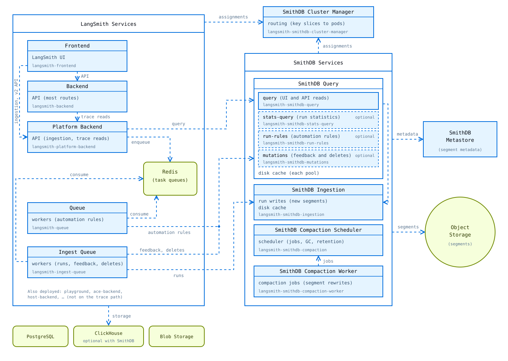

# SmithDB architecture

> How SmithDB and LangSmith components depend on each other on self-hosted LangSmith.

SmithDB is the trace datastore of LangSmith. LangSmith services receive runs and feedback, and serve the UI and the API. They do not write to SmithDB directly. They put new data in a queue in Redis, and an ingest queue worker writes it to SmithDB. Reads go directly to SmithDB. SmithDB keeps all data in object storage and in its own PostgreSQL database, the metastore. Its pods hold only copies of data and work in progress. In the background, compaction merges small data files into larger files, writes feedback into the files, and removes expired and deleted data, so that queries stay fast.

For how SmithDB writes, reads, changes, and compacts data, see [How SmithDB handles data](How%20SmithDB%20handles%20data.md).

## Components

| Component | Description |
| - | - |
| Frontend | Serves the LangSmith UI. |
| Backend | Serves most of the LangSmith API. |
| Platform backend | Receives runs and feedback from clients and queues them for writing. Sends trace queries to SmithDB. |
| Queue | Runs automation rules, including online evaluations. |
| Ingest queue | Writes queued runs, feedback, and deletes to SmithDB. |
| SmithDB cluster manager | Decides which SmithDB pod handles which requests, so that related requests go to the same pod. |
| SmithDB query | Answers queries, and applies feedback and deletes. Optional [query pools](#query-pools) take heavy work away from the main query pods, so that UI and API reads stay fast. |
| SmithDB ingestion | Stores new runs and run updates. |
| SmithDB compaction scheduler | Plans compaction work, including the removal of expired data. |
| SmithDB compaction worker | Runs the compaction jobs: merges and rewrites the data in object storage. |
| SmithDB metastore migration | Prepares the metastore during install and upgrade. |
| SmithDB migration | Copies historical data from ClickHouse. Optional. |
| SmithDB metastore | Keeps a record of each SmithDB data file, and stores new feedback. |
| Object storage | Holds all SmithDB data files. |
| Redis, PostgreSQL | LangSmith datastores. |

## Query pools

By default, one SmithDB query pool, `query`, does all query work. For larger deployments, enable the [dedicated query services](../Install%20SmithDB/Configure%20SmithDB%20for%20scale.md#dedicated-query-services). Each one takes one type of work away from the `query` pool, so that heavy load does not slow down UI and API reads.

| Pool | Work | Requests from |
| - | - | - |
| `query` | Trace reads for the UI and the API, such as run lists and trace views. All work of the optional pools that are not enabled. | Platform backend |
| `stats-query` | Run statistics, such as run counts, latency, and error rates in project and experiment views. Optional. | Platform backend |
| `run-rules` | Finds the runs that automation rules and online evaluations apply to. The queue component runs the rules and evaluations itself. Optional. | Queue |
| `mutations` | Applies feedback and deletes. Optional. | Ingest queue |

## Terms

| Term | Meaning |
| - | - |
| Run | One step of a trace, for example an LLM call or a tool call. |
| Feedback | A score or a comment on a run, from a user, an evaluator, or an automation rule. |
| Task | One unit of work in a Redis queue, for example a batch of runs or of feedback. Each ingest queue worker pod processes several tasks at the same time. |
| Ingestion queue, feedback queue | Redis queues that the ingest queue workers process. The ingestion queue holds runs. The feedback queue holds feedback. |
| Segment | One data file in object storage, plus its row in the metastore. SmithDB never changes a segment after it writes it. |
| Metastore | The PostgreSQL database of SmithDB. It keeps a record of each segment, and stores new feedback. |
| Disk cache | The cache volume of a SmithDB pod, on a local SSD or a network disk. It holds copies of data only, never the only copy. |
| Query pool | A group of SmithDB query pods for one type of request. See [Query pools](#query-pools). |
| Compaction | Background work that merges small segments into larger segments, writes feedback into files, and removes expired and deleted data. |
| Slice | A range of the key space that the cluster manager gives to a SmithDB pod. For ingestion, the key is the tenant and the project. For queries, the key is the tenant. |

## See also

* [How SmithDB handles data](How%20SmithDB%20handles%20data.md)
* [Enable SmithDB on self-hosted LangSmith](Enable%20SmithDB%20on%20self-hosted%20LangSmith.md)
* [Essential SmithDB metrics](../Monitoring%20and%20alerting/Essential%20SmithDB%20metrics.md)
* [Configure SmithDB for scale](../Install%20SmithDB/Configure%20SmithDB%20for%20scale.md)
* [Troubleshoot SmithDB](../Install%20SmithDB/Troubleshoot%20SmithDB.md)
