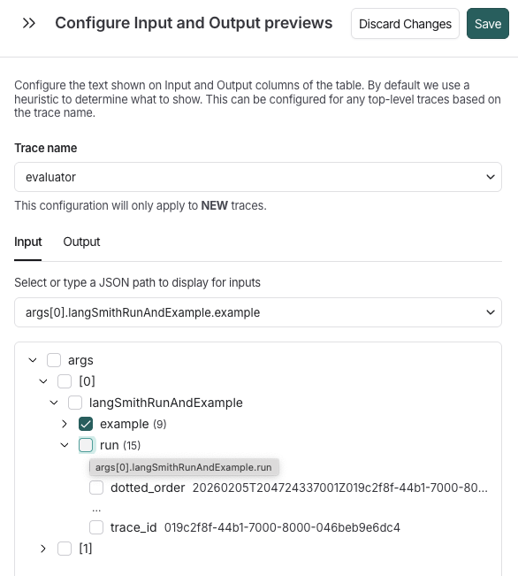

# Configure run input and output preview

> Customize what appears in the Input and Output columns of the Runs table by configuring custom preview paths for specific trace types.

By default, LangSmith uses a heuristic to determine what to display in the **Input** and **Output** columns of your **Runs** table. However, you can customize exactly what appears in these columns by configuring custom preview paths for specific trace types.

This is particularly useful when:

* Your traces have deeply nested structures.
* You want to focus on specific fields in your data.
* The default heuristic doesn't show the most relevant information for your use case.

## Configure preview format in the UI

### Access preview settings

1. Navigate to a trace in your project.
2. Select the **Runs** tab.
3. Locate the format icon  at the top right of the runs table.
4. In the **Configure Input and Output previews** side window, select a trace name from the dropdown.

When you select a trace name, LangSmith loads a successful trace example and renders its structure as an expandable tree. Each node in the tree represents a field in your data, showing:

* Field names (e.g., `messages` for LLM conversation history, `output`, `metadata`).
* Array indices (e.g., \[0], \[1], \[-1] for last item).
* Item counts for arrays (e.g., (3) indicating 3 items).
* Preview values for strings and numbers displayed inline.



### Set the path

1. Select the **Input** or **Output** tab. Then, either the:

   * Dropdown to specify the path directly from your input data that should be shown in the preview.
   * Interactive tree view of a sample trace's data structure, which you can explore and select the exact field you want to display.

   To select a field:

   1. Navigate the tree by clicking the arrow icons (▶) to expand or collapse nested objects and arrays.
   2. Click the checkbox next to the field you want to display in the preview. The selected path appears in the text input preceding the tree.

   When you select a checkbox, the path is automatically constructed using the correct syntax (e.g., messages\[-1].content).

| Method | Best For | Example |
| - | - | - |
| Tree selection | Exploring unfamiliar data structures, seeing sample values | Click through: messages → \[-1] → content |
| Manual typing | When you know exactly what you want, faster for deep paths | Type: output.data.results\[0].answer |

Arrays with more than 3 items are automatically condensed to prevent overwhelming views:

```
☐ messages (15)
  ☐ [0]
  ☐ [1]
  ... (click to expand all 15 items)
```

Click the **...** button to expand and view all array items.

## Example

For example, your trace input is this:

```json
{
  "messages": [
    {"role": "system", "content": "You are a helpful assistant"},
    {"role": "user", "content": "What is the weather today?"}
  ],
  "metadata": {
    "user_id": "user123",
    "session_id": "sess456"
  }
}
```

In this example, `messages` is an array of message objects, each with a `role` (such as `system` or `user`) and a `content` field.

To display the user's question:

1. Expand the **messages** node (shows array items).
2. Expand `[1]` (the second message, which is the user message).
3. Click the checkbox next to **content**.
4. The input field shows: `messages[1].content`.

Or, use negative indexing for the last message:

1. Expand **messages**.
2. Expand `[-1]`.
3. Click **content**.
4. Result: `messages[-1].content` (always shows the last message).

> [!NOTE]
>
> If you see `"No paths available"` in the tree:
>
> * Ensure you have at least one successful trace with the selected trace name in the last 7 days.
> * The trace must have data in the input/output field you're configuring.
> * Try sending a test trace if needed.

## Next steps

* Learn more about [viewing](View%20traces.md) and [filtering](Filter%20traces.md) traces.
* Explore [custom output rendering](../../../Test/Datasets%20%26%20Experiments/Datasets/Custom%20output%20rendering.md) for advanced visualization.
* Set up [metadata and tags](../../Trace/Configuration%20%26%20troubleshooting/Data%20%26%20privacy/Add%20metadata%20and%20tags%20to%20traces.md) to organize your traces.
