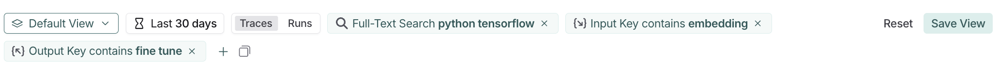
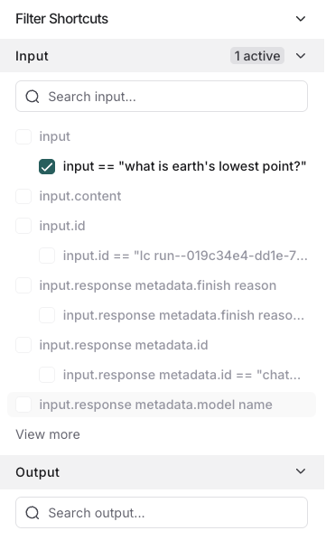
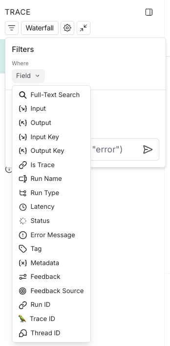

# Filter traces (ClickHouse)

> Filter threads, traces, and runs in a LangSmith tracing project backed by ClickHouse, using the filter bar, filter shortcuts, and saved filters.

Tracing projects can accumulate large amounts of data across [threads](../../Trace/Observability%20concepts.md#threads), [traces](../../Trace/Observability%20concepts.md#traces), and [runs](../../Trace/Observability%20concepts.md#runs). LangSmith's filtering tools let you navigate and analyze that data precisely.

In an [agent-based workspace](../../../LangSmith%20setup/Overview/Agent-based%20workspaces/Agent%20Registry.md), a tracing project is one [environment](../../../LangSmith%20setup/Overview/Agent-based%20workspaces/Agent%20environments.md) of one agent, so a filter applies to the environment you have open rather than to the agent as a whole. To filter across an agent's environments, filter each one in turn.

> [!NOTE]
>
> Tracing projects have two filtering experiences. Check the top of your project to see which one applies to you:
>
> * **A single search bar with a scope selector to its left**: Refer to [Filter traces](Filter%20traces.md).
> * **An Add filter button that builds filter chips**: Refer to [Filter traces (ClickHouse)](Filter%20traces%20%28ClickHouse%29.md).

This page covers:

* [Applying filters from the filter bar](#create-and-apply-filters) and **Filter Shortcuts** panel
* [Filtering by attributes, full-text content, and key-value pairs](#specific-filtering-techniques)
* [Saving and copying filter configurations](#save-a-filter)
* [Filtering within the Details view](#filter-runs-in-the-details-view)
* [Advanced filters](#advanced-filters) for filtering on root or child run properties

If you are programmatically exporting data for analysis via the [API](../../Reference/LangSmith%20REST%20API/Tracing/Query%20runs.md) or [SDK](https://reference.langchain.com/python/langsmith/client/Client/list_runs), refer to the [exporting traces guide](Query%20traces%20using%20the%20SDK.md) instead.

## Create and apply filters

### Filter by run attributes

There are two ways to filter data in a tracing project:

1. **Filters**: Located at the top left of the **Tracing** project page. This is where you construct and manage filter criteria.
   * The first dropdown filters for default and [saved views](#save-a-filter).
   * Quick filter by **Threads**, **Traces**, or **Runs**.
   * **Add filter** to [configure a filter based](#specific-filtering-techniques) on an attribute or full-text search.

2. **Filter Shortcuts**: Positioned on the right sidebar of the **Tracing** project page. The filter shortcuts bar provides quick access to filters based on the most frequently occurring attributes in your project's runs.

### Filter operators

The available filter operators depend on the data type of the attribute you are filtering on. Here's an overview of common operators:

* **is**: Exact match on the filter value
* **is not**: Negative match on the filter value
* **contains**: Partial match on the filter value
* **does not contain**: Negative partial match on the filter value
* **is one of**: Match on any of the values in the list
* `>` / `<`: Available for numeric fields

## Specific filtering techniques

### Filter for runs (spans)

To filter for runs (spans), change the default from **Traces** to **Runs**. For example, you would do this if you wanted to filter by **run name** for runs or filter by **run type**.

Run metadata and tags are also useful to filter on. These rely on good tagging across all parts of your pipeline. To learn more, refer to [Add metadata and tags to traces](../../Trace/Configuration%20%26%20troubleshooting/Data%20%26%20privacy/Add%20metadata%20and%20tags%20to%20traces.md).

As you specify more filters, you can click each filter individually to update the attributes you're searching on.

### Filter based on inputs and outputs

You can filter tracing data based on the content in the inputs and outputs of the thread, trace, or run.

To filter either inputs or outputs, you can use the ** Full-Text Search** filter, which will match keywords in either field. For a more targeted search, you can use the ** Input** or ** Output** filters, which will only match content based on the respective field.

> [!NOTE]
>
> For performance, LangSmith indexes up to 250 characters of data for full-text search. If your search query exceeds this limit, we recommend using [Input/Output key-value search](Filter%20traces%20%28ClickHouse%29.md#filter-based-on-input-%2F-output-key-value-pairs) instead.

You can also specify multiple to match all terms provided, either by:

* Including multiple terms separated by whitespace with the **Full-Text Search**.
* Adding multiple filters with the  button after you've added the first filter.

LangSmith splits the text and matches any partial keyword matches in any order. LangSmith excludes common stop words from the search (from the nltk stop word list along with a few other common JSON keywords).

> [!NOTE]
>
> Tokens must be at least 2 characters long to be indexed. Single-character tokens (for example, `a`, `x`) are excluded from search.



Based on the filters in the image, the system will search for `python` and `tensorflow` in either inputs or outputs, and `embedding` in the inputs along with `fine` and `tune` in the outputs.

You can remove filters as needed from the filter path, which will widen the search to the remaining filters.

### Filter based on input / output key-value pairs

In addition to full-text search, you can filter based on specific key-value pairs in the inputs and outputs. This allows for more precise filtering, especially when dealing with structured data.

> [!NOTE]
>
> LangSmith indexes up to 100 unique keys per run to keep your data organized and searchable. Each key also has a character limit of 250 characters per value. If your data exceeds either of these limits, the text won't be indexed. This helps ensure fast, reliable performance.

To filter based on key-value pairs, for example, to match the following input:

```json
{
  "input": "What is the capital of France?"
}
```

1. Select **Add filter**.
2. Select **Input** from the first dropdown and leave **Key** as the second dropdown and select **input** as the key.
3. Click **+ Value** and enter the value: `What is the capital of France?` as the value.

You can also match nested keys by using dot notation to select the nested key name. For example, to match nested keys in the output:

```json
{
  "documents": [
    {
      "page_content": "The capital of France is Paris",
      "metadata": {},
      "type": "Document"
    }
  ]
}
```

Select **Output Key**, enter `documents.page_content` as the key and enter `The capital of France is Paris` as the value. This will match the nested key `documents.page_content` with the specified value.

You can add multiple key-value filters to create more complex queries. You can also use the **Filter Shortcuts** on the right side to filter based on common key-value pairs quickly:



### Example: Filtering for tool calls

It's common to want to search for traces that contain specific tool calls. Tool calls are typically indicated in the output of an LLM run. To filter for tool calls, you would use the **Output Key** filter.

While this example will show you how to filter for tool calls, you can apply the same logic to filter for any key-value pair in the output.

In this case, let's assume this is the output you want to filter for:

```json
{
  "generations": [
    [
      {
        "text": "",
        "type": "ChatGeneration",
        "message": {
          "lc": 1,
          "type": "constructor",
          "id": [],
          "kwargs": {
            "type": "ai",
            "id": "run-ca7f7531-f4de-4790-9c3e-960be7f8b109",
            "tool_calls": [
              {
                "name": "Plan",
                "args": {
                  "steps": [
                    "Research LangGraph's node configuration capabilities",
                    "Investigate how to add a Python code execution node",
                    "Find an example or create a sample implementation of a code execution node"
                  ]
                },
                "id": "toolu_01XexPzAVknT3gRmUB5PK5BP",
                "type": "tool_call"
              }
            ]
          }
        }
      }
    ]
  ],
  "llm_output": null,
  "run": null,
  "type": "LLMResult"
}
```

With the example, the KV search will map each nested JSON path as a key-value pair that you can use to search and filter.

LangSmith will break it into the following set of searchable key-value pairs:

| Key | Value |
| - | - |
| `generations.type` | `ChatGeneration` |
| `generations.message.type` | `constructor` |
| `generations.message.kwargs.type` | `ai` |
| `generations.message.kwargs.id` | `run-ca7f7531-f4de-4790-9c3e-960be7f8b109` |
| `generations.message.kwargs.tool_calls.name` | `Plan` |
| `generations.message.kwargs.tool_calls.args.steps` | `Research LangGraph's node configuration capabilities` |
| `generations.message.kwargs.tool_calls.args.steps` | `Investigate how to add a Python code execution node` |
| `generations.message.kwargs.tool_calls.args.steps` | `Find an example or create a sample implementation of a code execution node` |
| `generations.message.kwargs.tool_calls.id` | `toolu_01XexPzAVknT3gRmUB5PK5BP` |
| `generations.message.kwargs.tool_calls.type` | `tool_call` |
| `type` | `LLMResult` |

To search for a specific tool call, you can use the following **Output Key** search while removing the root runs filter:

`generations.message.kwargs.tool_calls.name` = `Plan`

This will match root and non-root runs where the `tool_calls` name is `Plan`.

### Negative filtering on key-value pairs

Different types of negative filtering can be applied to **\{x} Metadata**, ** Input**, and ** Output** fields to exclude specific runs from your results.

For example, to find all runs where the metadata key `phone` is not equal to `1234567890`:

1. Set the **Metadata Key** operator to `is` and **Key** field to `phone`.
2. Set the **Value** operator to `is not` and the **Value** field to `1234567890`.

This will match all runs that have a metadata key `phone` with any value except `1234567890`.

To find runs that don't have a specific metadata key: set the **Key** operator to `is not`. For example, setting the `Key` operator to `is not` with `phone` as the key will match all runs that don't have a `phone` field in their metadata.

You can also filter for runs that neither have a specific key nor a specific value. To find runs where the metadata has neither the key `phone` nor any field with the value `1234567890`, set the **Key** operator to `is not` with key `phone`, and the **Value** operator to `is not` with value `1234567890`.

Finally, you can also filter for runs that do not have a specific key but have a specific value. To find runs where there is no `phone` key but there is a value of `1234567890` for some other key, set the **Key** operator to `is not` with key `phone`, and the **Value** operator to `is` with value `1234567890`.

> [!TIP]
>
> You can use the `does not contain` operator instead of `is not` to perform a substring match.

## Save a filter

Saving filters allows you to store and reuse frequently used filter configurations. Saved filters are specific to a tracing project, which in an agent-based workspace means one [environment](../../../LangSmith%20setup/Overview/Agent-based%20workspaces/Agent%20environments.md) of one agent. A filter saved in **Production** is not offered in **Staging**.

After you have constructed your filter, click the **Save as** button to save it. This will bring up a dialog to specify the name and a description of the filter.

After saving a filter, it is available in the view dropdown as a quick filter for you to use.

### Update a saved filter

With the filter selected in the dropdown, you can make any changes to filter parameters. Then, click **Save** to update the filter.

### Delete a saved filter

Click the  icon next to the saved filter in the dropdown, and delete the filter using the trash  icon.

## Copy a filter

You can copy a constructed filter to share it with colleagues, reuse it later, or query runs programmatically in the [API](../../Reference/LangSmith%20REST%20API/Tracing/Query%20runs.md) or [SDK](https://reference.langchain.com/python/langsmith/client/Client/list_runs).

To copy the filter:

1. Create it in the UI.
2. Click the  icon in the filter bar. If you have constructed tree or trace filters, you can also copy those.
3. This will give you a string representing the filter in the LangSmith query language. For example: `and(eq(is_root, true), and(eq(feedback_key, "user_score"), eq(feedback_score, 1)))`.

For more information on the query language syntax, refer to the [Trace query syntax](Trace%20query%20syntax.md#filter-query-language).

## Filter runs in the Details view

You can also apply filters directly in the [Details view](View%20traces.md#details-view), which is useful for sifting through traces with a large number of runs. The same filters available in the main runs table view can be applied here.

By default, only the runs that match the filters will be shown. To see the matched runs within the broader context of the trace tree, switch the view option from "Filtered Only" to "Show All" or "Most relevant".



## Manually specify a raw query in LangSmith query language

If you have [copied a previously constructed filter](#copy-a-filter), you may want to manually apply this raw query in a future session.

In order to do this, you can click on **Switch to raw query** on the bottom of the filters popover in the Details view. From there you can paste a raw query into the text box.

> [!NOTE]
>
> This will add that query to the existing queries, not overwrite it.

## Advanced filters

### Filter for runs (spans) on properties of the root

A common concept is to filter for runs which are part of a trace whose root run has some attribute. An example is filtering for runs of a particular type whose root run has positive (or negative) feedback associated with it. To do this:

1. Click **Runs** in the Threads/Traces/Runs toggle.
2. Add another filter rule. You can then click the **Advanced** filters link at the bottom of the filter dropdown.
3. A modal will open where you can add **Trace** filters. These filters will apply to the traces of all the parent runs of the individual runs you've already filtered for.

### Filter for runs (spans) whose child runs have some attribute

You may want to search for runs who have specific types of sub runs. An example of this could be searching for all traces that had a sub run with name `Foo`. This is useful when `Foo` is not always called, but you want to analyze the cases where it is.

1. Click **Runs** in the Threads/Traces/Runs toggle.
2. Add another filter rule. You can then click the **Advanced** filters link at the bottom of the filter dropdown.
3. A modal will open where you can add **Tree** filters. This will make the rule you specify apply to all child runs of the individual runs you've already filtered for.

### Example: Filtering on all runs whose tree contains the tool call filter

Extending the [tool call filtering example](#example-filtering-for-tool-calls), if you would like to filter for all runs *whose tree contains* the tool filter call, you can use the tree filter in the **Advanced** filters setting.
