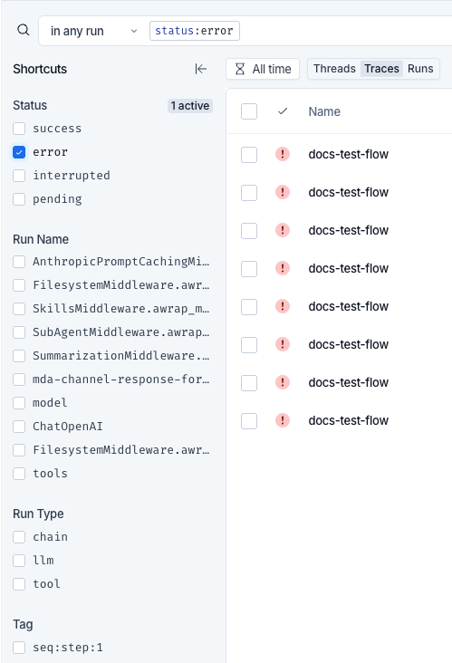
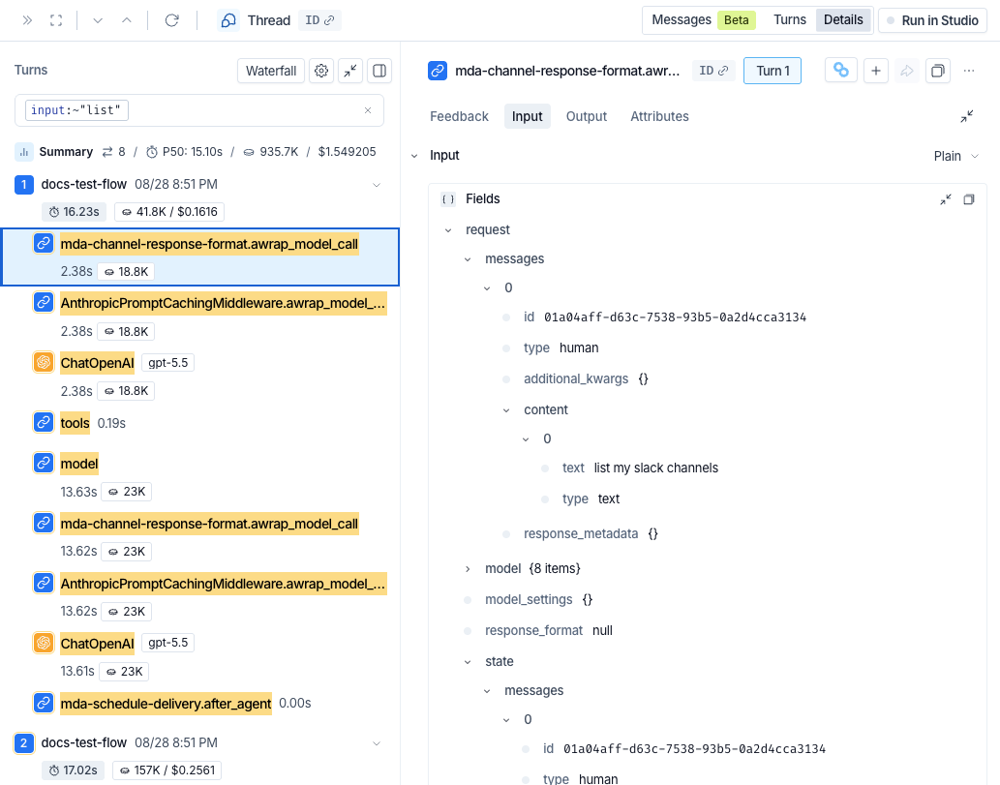

# Filter traces

> Find specific threads, traces, and runs in a LangSmith tracing project by writing filter queries in the search bar.

Filtering narrows the [runs](../../Trace/Observability%20concepts.md#runs) in a [trace container](../../Trace/Observability%20concepts.md#trace-containers) to the ones that need attention, such as the conversations that errored, slow tool calls, or runs with low feedback scores. Write a query in the search bar, then choose which runs in the [trace](../../Trace/Observability%20concepts.md#traces) or [thread](../../Trace/Observability%20concepts.md#threads) hierarchy the query is matched against.

> [!NOTE]
>
> Tracing projects have two filtering experiences. Check the top of your project to see which one applies to you:
>
> * **A single search bar with a scope selector to its left**: Refer to [Filter traces](Filter%20traces.md).
> * **An Add filter button that builds filter chips**: Refer to [Filter traces (ClickHouse)](Filter%20traces%20%28ClickHouse%29.md).

This page covers:

* [Building a query](#build-a-query) in the search bar
* [Choosing what a filter matches](#choose-what-a-filter-matches) with scopes
* [Query syntax](#query-syntax) and the [fields](#fields) available to filter on
* [Examples](#examples) to copy and adapt
* [Filtering in one click](#filter-with-shortcuts) from the **Shortcuts** panel
* [Saving a filter](#save-a-filter) as a view
* [Filtering the runs inside a trace](#filter-the-runs-in-a-trace)
* [Searching with AI](#search-with-ai) in natural language instead of field values (beta)
* [What full-text search indexes](#full-text-search-indexing)
* [Troubleshooting a query](#troubleshoot-a-query)

To query runs programmatically instead, refer to [Query traces using the SDK](Query%20traces%20using%20the%20SDK.md). The SDK and REST API use a separate structured query language, documented in [Trace query syntax](Trace%20query%20syntax.md). To translate a search bar query into that language, refer to the [UI-to-API operator map](Trace%20query%20syntax.md#ui-to-api-operator-map).

## Build a query

A query is made of clauses, and each clause pairs a field with an operator and a value:

```text
status:error
```


To build a query, click the search bar and start typing:

**1. Choose a field**

Type a field name or select one from the suggestion list. Suggestions are grouped by category, and **Recents** lists queries run previously. Use the arrow keys to move through the list and press `Enter` to select.

If AI search is available to your organization, **AI search** appears at the top of the suggestion list. Refer to [Search with AI](#search-with-ai).

**2. Choose an operator**

Type `:` to see the operators the field supports, each with an example.

**3. Enter a value**

For fields whose values LangSmith indexes, such as run names and tags, the suggestion list offers the most common values in the project.

Each completed clause becomes a chip in the bar. Click a chip to edit it, or click its remove icon to delete it. Keep typing after a chip to add another clause.

Two controls outside the search bar also affect the results:

* **The time range control** applies alongside the query. Results must fall inside the time range and match the query.
* **The Threads, Traces, and Runs selection** sets what each row in the table represents, and it also determines which [scopes](#choose-what-a-filter-matches) a query can use.

> [!NOTE]
>
> The search bar uses the syntax described on this page, which is not the structured query language that the SDK and REST API accept. Refer to [Trace query syntax](Trace%20query%20syntax.md) for that language.

## Choose what a filter matches

A trace is a tree of runs, and a thread is a series of traces. A clause such as `status:error` is ambiguous until you say which runs in that hierarchy it applies to: the run that started the trace, any run anywhere inside it, or the thread as a whole. The scope selector, to the left of the search bar, is where you say so.

Four scopes are available:

* **Thread**: Matches the entire thread.
* **Root run**: Matches only the entry runs.
* **Single run**: Matches the run itself.
* **Any run**: Matches anywhere in the tree.

The scope dropdown previews each option against a sample trace, so you can see which runs it covers before choosing:


The scopes offered, and the one selected by default, depend on the table selection:

| Table selection | Default scope | Available scopes |
| - | - | - |
| **Threads** | Any run | Thread, Root run, Any run |
| **Traces** | Root run | Root run, Any run |
| **Runs** | Single run | Single run, Root run, Any run |

If AI search is available to your organization, the scope selector also offers **AI search**, which matches results by a plain-language description rather than by query syntax. Refer to [Search with AI](#search-with-ai).

### Combine scopes

To filter on more than one scope at a time, click the  **Add filter scope** icon at the end of the last row. This adds a row with its own scope selector and search bar, labeled **AND**. Rows combine with `AND`, so a thread, trace, or run must satisfy every row to appear in the table.

Each scope holds at most one row, so the **Threads** and **Runs** selections accept three filter rows and **Traces** accepts two. If AI search is available to your organization, you can also add one AI search row, which combines with the filter rows the same way. Refer to [Combine AI search with filters](#combine-ai-search-with-filters). **Add filter scope** is disabled once every available scope, including AI search, is in use. To remove a row, click **Remove filter** next to it.

For example, in the **Threads** view, find threads longer than 20 turns that contain a failed tool call:

| Scope | Query |
| - | - |
| Thread | `turn_count:>20` |
| Any run | `run_type:tool AND status:error` |


### Scopes a table selection cannot use

Changing the table selection can leave a row on a scope the new selection does not support, such as a **Single run** row after switching from **Runs** to **Threads**. The row stays visible with a **Not applied** badge, and its query is preserved but not applied. Change the row's scope or return to a compatible table selection to apply it again.

## Query syntax

### Operators

The operators a field accepts depend on its type.

| Operator | Syntax | Matches |
| - | - | - |
| is | `field:value` | An exact match on the value. |
| is not | `-field:value` | Everything except an exact match. |
| matches | `field:~value` | A full-text search of the field. Quote the value to search for a phrase. |
| does not match | `-field:~value` | Everything the full-text search does not match. |
| wildcard | `field:value*` | A pattern, where `*` stands for any sequence of characters. |
| exists | `field:*` | Records where the field is set. |
| does not exist | `-field:*` | Records where the field is not set. |
| comparison | `field:>value` | Values above the given value. Also accepts `>=`, `<`, and `<=`. |
| inclusive range | `field:[10 TO 20]` | Values from 10 to 20, including both bounds. |
| exclusive range | `field:{10 TO 20}` | Values between 10 and 20, excluding both bounds. |
| mixed range | `field:[10 TO 20}` | Values from 10 up to but not including 20. Swap the delimiters to invert which bound is inclusive. |

Some fields accept only a subset of these operators:

* **Full-text fields**: `input`, `output`, `metadata`, and `error` accept `~` only.
* **Comparison and range operators**: These apply to numeric fields such as `latency` and `total_tokens`, to timestamp fields such as `first_token_time`, and to numeric [`metadata` paths](#match-a-json-key).

To match any of several values, combine clauses with `OR`, for example `status:error OR status:interrupted`. Listing several values inside one clause is not supported.

### Combine clauses

Combine clauses with `AND`, `OR`, `NOT`, and parentheses:

* **`AND`**: Both clauses must match. Whitespace between two clauses acts as `AND`, so `status:error run_type:llm` and `status:error AND run_type:llm` are equivalent.
* **`OR`**: Either clause must match.
* **`NOT`**: Negates the clause that follows. The `-` prefix does the same thing, so `NOT status:error` and `-status:error` are equivalent.
* **Parentheses**: Group clauses to control precedence.

`AND` binds more tightly than `OR`, so `a OR b AND c` matches `a OR (b AND c)`. Group clauses to change that: `(a OR b) AND c`.

Keywords are case-insensitive.

### Quote values

Double-quote a value that contains a space, contains a colon, or includes a character to match literally:

```text
name:"docs agent"
tags:"env:prod"
```

Quoting also turns off wildcard matching, so `name:"docs*"` matches the literal string `docs*`. As an alternative to quoting, escape the character with a backslash, as in `name:docs\ agent`.

In the run scopes, an unquoted value containing a space splits into two clauses, so `name:docs agent` matches runs whose name is `docs` and whose indexed content contains `agent`.

### Search without naming a field

In the **Single run**, **Root run**, and **Any run** scopes, a bare term searches every [indexed field](#full-text-search-indexing):

```text
"capital of France"
```

The **Thread** scope does not support bare-term search.

## Fields

The suggestion list groups fields into categories. The available fields depend on the [scope](#choose-what-a-filter-matches) of the filter row.

### Run fields

These fields are available in the **Single run**, **Root run**, and **Any run** scopes.

**Run attributes**

| Field | Description |
| - | - |
| `name` | Run name. Supports wildcards. |
| `status` | Run status: `pending`, `success`, `error`, or `interrupted`. |
| `run_type` | The [type of run](../Data%20type%20reference/Run%20%28span%29%20data%20format.md#run-types), for example `llm`, `chain`, `tool`, or `retriever`. |
| `tags` | Run tags. A clause matches if any tag on the run matches. |

**Content**

| Field | Description |
| - | - |
| `input` | Run inputs. Use `~` to search the text, or `input.<key>` to match a JSON key. |
| `output` | Run outputs. Use `~` to search the text, or `output.<key>` to match a JSON key. |
| `metadata` | Run metadata. Use `metadata.<key>` to match a JSON key, or `~` to search metadata values. |
| `error` | Error text. Use `~` to search the text. |
| `attachments` | Attachment names. |

**Identity**

| Field | Description |
| - | - |
| `id`, `trace_id`, `thread_id`, `parent_run_id` | Match a specific run, trace, thread, or parent run by its ID. |
| `ls_user_id` | The LangSmith user the run is attributed to. |

**Performance**

| Field | Description |
| - | - |
| `latency` | Run duration in seconds. |
| `first_token_time` | When the first token was produced. |
| `prompt_tokens`, `completion_tokens`, `total_tokens` | Token counts for the run. |
| `prompt_cost`, `completion_cost`, `total_cost` | Costs for the run. |
| `prompt_token_details`, `completion_token_details` | Token breakdowns. Address a component with dot notation, for example `prompt_token_details.cache_read` or `completion_token_details.reasoning`. |
| `prompt_cost_details`, `completion_cost_details` | Cost breakdowns, with the same components as the token breakdowns. |

**Feedback**

| Field | Description |
| - | - |
| `feedback` | Feedback on the run. Refer to [Filter on feedback](#filter-on-feedback). |

Metadata and tags are usually the most productive fields to filter on, because you control what goes in them. See [Add metadata and tags to traces](../../Trace/Configuration%20%26%20troubleshooting/Data%20%26%20privacy/Add%20metadata%20and%20tags%20to%20traces.md).

### Thread fields

The **Thread** scope filters on attributes of the thread as a whole, so it supports a different set of fields. The suggestion list labels the group **Thread attributes**.

| Field | Description |
| - | - |
| `thread_id` | Thread ID. |
| `turn_count` | Turns in the thread. |
| `num_errored_turns` | Turns that ended in an error. |
| `thread_duration` | First turn start to last turn end. |
| `trace_latency_p50` | Median turn latency. |
| `trace_latency_p99` | P99 turn latency. |
| `total_tokens` | Tokens across the thread. |
| `total_cost` | Cost across the thread. |
| `prompt_token_details`, `completion_token_details`, `prompt_cost_details`, `completion_cost_details` | Token and cost breakdowns across the thread. |

> [!NOTE]
>
> Run fields such as `name`, `status`, and `input` are not available in the **Thread** scope. To filter threads by an attribute of the runs they contain, add a second filter row in the **Any run** scope. Refer to [Combine scopes](#combine-scopes).

### Match a JSON key

`input`, `output`, and `metadata` hold JSON. Address a key inside them with dot notation:

```text
metadata.env:production
input.user_id:abc123
output.status:success
```

Nested paths work the same way, for example `metadata.config.temperature:0.7`. Quote a key that contains a dot, as in `metadata."my.key":production`.

Only `metadata` paths support comparison and range operators, and only where the values are numeric:

```text
metadata.retries:>=3
```

### Filter on feedback

Address a feedback key and one of its subfields with dot notation:

```text
feedback.correctness.score:>=0.5
feedback.relevance.value:pass
feedback.quality.comment:~helpful
```

The available subfields are `key`, `score`, `value`, `comment`, `source`, and `error`. In the **Thread** scope, only `key`, `score`, and `value` are available.

To match records that carry any feedback at all, use `feedback:*`. To match records that carry a particular feedback key regardless of its value, use `feedback.<key>:*`. Comparing a value requires naming a subfield, so `feedback.correctness:0.5` is not valid.

Group a feedback condition with `feedback:{...}`:

```text
feedback:{correctness.score:>0.5}
```

## Examples

Queries to copy and adapt. Each assumes the default scope for its table selection unless stated otherwise.

**Errored LLM calls that were also slow.** Use the **Runs** selection:

```text
run_type:llm AND status:error AND latency:>10
```

**Runs your evaluator scored poorly.** Use the **Runs** selection:

```text
run_type:llm AND feedback.correctness.score:<0.5
```

**Production traffic that did not succeed.** Use the **Traces** selection:

```text
metadata.env:production AND -status:success
```

**Conversations that mention a topic and went wrong.** Use the **Threads** selection:

```text
input:~"refund" AND status:error
```

**Traces that called a specific tool.** Use the **Traces** selection with the **Any run** scope, so the clause is matched against every run in the trace rather than the entry run:

```text
run_type:tool AND name:search_documents
```

**Expensive traces.** Use the **Traces** selection:

```text
total_cost:>0.5
```

## Filter with shortcuts

The **Shortcuts** panel to the left of the table lists the most common values in the project, grouped by **Status**, **Run Name**, **Run Type**, **Tag**, **Metadata**, and **Feedback**. These groups correspond to the `status`, `name`, `run_type`, `tags`, `metadata`, and `feedback` fields. Selecting a value adds the matching clause to the search bar, so the most common filters take one click instead of a typed query.

Each group header shows how many of its values are active. Use the search box in the **Feedback** group to find a feedback key.



To give the table more room, click **Hide shortcuts**, then **Show shortcuts** to bring the panel back. The **Stats** panel on the right collapses the same way, with **Hide stats** and **Show stats**.

## Save a filter

Saved views store a filter for reuse. A view belongs to the tracing project rather than to the person who created it, so anyone with access to the project can select it. In an agent-based workspace that means the view belongs to one [environment](../../../LangSmith%20setup/Overview/Agent-based%20workspaces/Agent%20environments.md): a view saved in **Production** is not offered in **Staging**, and a filter you want in every environment has to be saved in each.

To save the current filter:

1. [Build the query](#build-a-query).
2. Click **Save View**.
3. Enter a name and description, then save.

The view then appears in the **Views** dropdown alongside **Default view**. Each entry lists the scopes its filter uses, which shows at a glance whether it applies to the current table selection.

To update a saved view, select it, change the query, then click **Save View**. To rename or delete a view, click the  icon next to it in the **Views** dropdown.

To discard unsaved changes and return to the selected view, click **Reset**.

### Views saved with the previous syntax

Views saved before this filtering experience shipped continue to work. Selecting one translates its filters into the syntax on this page, and LangSmith prompts you to save the translated view.

## Filter the runs in a trace

Filtering inside an open trace highlights the runs that match, which is how you find the one that matters in a large trace. Open a thread or trace to reach the [Details view](View%20traces.md#details-view), then use **Filter runs** above the run list.

Matching runs are highlighted in place, and the rest of the trace stays visible around them, so a match keeps the context that explains it. A filter applied in the **Any run** scope carries over automatically, so opening a thread or trace from the table highlights the runs that matched it.



This search bar accepts the same fields and syntax as the **Single run** scope on the project page. It has no scope selector, because it always matches individual runs within the open trace. To remove the filter, click the clear icon in the filter box.

The **Visibility** options behind the  icon above the run list, **Most relevant** and **Show All**, are disabled while a filter is applied.

## Search with AI

AI search finds threads, traces, and runs by what happens in their conversations, described in natural language. It answers questions that the [query syntax](#query-syntax) cannot express, because they depend on the meaning of the messages rather than on a field value. For example:

* Traces where the agent did not complete the task.
* Traces where the user seemed frustrated.
* Traces where the agent referenced internal details about its implementation.
* Traces about a particular topic.

> [!NOTE]
>
> AI search is in [beta](../../../LangSmith%20setup/Cloud/Reference/Release%20stages.md) and available on all [LangSmith Cloud](../../../LangSmith%20setup/Cloud/Cloud%20%28SaaS%29.md) SaaS instances. It works in the **Threads**, **Traces**, and **Runs** selections once an organization admin enables it. Refer to [Enable AI search](#enable-ai-search).

To search with AI:

1. Add an AI search row in one of these ways:

   * Click the  **Add AI search** icon in a filter row.
   * Select **AI search** at the top of the search bar's suggestion list.
   * Open the [scope selector](#choose-what-a-filter-matches) and choose **AI search**.

   If the filter row is empty, the AI search row replaces it. Otherwise, LangSmith adds the AI search row below it.
2. Describe the results you want in plain language. While the field is empty, a tip below it offers examples such as `customer is frustrated`. Selecting an example fills the field without searching, so you can edit it first.
3. Press `Enter`, or click the  **Search** button.

Typing a new description does not clear the table, so the current results stay visible until you search again.

AI search results include a **Confidence** column, which shows how strongly each thread, trace, or run matched the description as a percentage. A result without a score shows a dash.

### Search with AI using the SDK

The SDK streaming APIs accept `ai_search` for runs, traces, and threads. Use them to search conversations from scripts, with the same [organization opt-in and data-handling requirements](#enable-ai-search) as the UI.

> [!NOTE]
>
> The following examples require `langsmith>=0.14.14` for Python or `langsmith>=0.11.3` for TypeScript.

Pass a nonempty description of at most 2,000 UTF-8 bytes in `ai_search`, and add a filter to require structured conditions as well: `filter` for runs and threads, or `trace_filter` and `tree_filter` for traces. The description and filters combine the same way as in the UI. See [Combine AI search with filters](#combine-ai-search-with-filters).

> [tab] Python
>
> ```python theme={"theme":{"light":"catppuccin-latte","dark":"catppuccin-mocha"}}
> from langsmith import Langsmith
>
> client = Langsmith()
>
> for run in client.runs.streaming.query_v2_items(
>     project_ids=["<project-id>"],
>     ai_search="tool call failed",
>     filter='eq(run_type, "llm")',
>     selects=["ID", "NAME"],
> ):
>     print(run.id, run.name)
> ```
>
> To search traces or threads, call the matching method:
>
> * **Traces**: `client.traces.streaming.query_items(project_id="<project-id>", ai_search="tool call failed")`
> * **Threads**: `client.threads.streaming.query_items(project_id="<project-id>", ai_search="user asks for a refund")`
>
> With `AsyncLangsmith`, use `async for` with the same methods.

> [tab] TypeScript
>
> ```typescript theme={"theme":{"light":"catppuccin-latte","dark":"catppuccin-mocha"}}
> import Langsmith from "langsmith";
>
> const client = new Langsmith();
>
> for await (const run of client.runs.streaming.queryV2Items({
>   project_ids: ["<project-id>"],
>   ai_search: "tool call failed",
>   filter: 'eq(run_type, "llm")',
>   selects: ["ID", "NAME"],
> })) {
>   console.log(run.id, run.name);
> }
> ```
>
> To search traces or threads, call the matching method:
>
> * **Traces**: `client.traces.streaming.queryItems({ project_id: "<project-id>", ai_search: "tool call failed" })`
> * **Threads**: `client.threads.streaming.queryItems({ project_id: "<project-id>", ai_search: "user asks for a refund" })`

The `query_v2_items` / `queryV2Items` and `query_items` / `queryItems` methods follow pagination cursors and return assembled runs, traces, or threads. The lower-level `query_v2` / `queryV2` and `query` methods return server-sent events containing JSON patches instead.

AI search requires `Accept: text/event-stream`, which the streaming methods set automatically. Passing `ai_search` to a non-streaming query returns HTTP `406`. Deployments that route queries to the legacy v1 backend return HTTP `501`.

For terminal usage, see [Search with AI using the CLI](../../../LangSmith%20setup/Govern/Tools/LangSmith%20CLI.md#search-with-ai).

### Review why a result matched

When you open a thread, trace, or run from AI search results, LangSmith opens it in the [Trajectory view](View%20traces.md#trajectory-view) at the messages that matched the description, so you can see why it matched. A thread opens at the first trace that matched. Reviewing matches requires permission to view run inputs and outputs.

A toolbar at the top of the view shows the description, the result's match confidence, and **Evidence N of M**. LangSmith highlights each matched message and labels it **Evidence N of M**. The count includes only the matches LangSmith can locate in the conversation. Matches it cannot locate, for example a message the Trajectory view does not display or text that repeats in the conversation, are not shown.

Use the up and down arrows in the toolbar to move between matches, and the  icon to leave evidence mode.

### Combine AI search with filters

The AI search row combines with the other filter rows using `AND`, so a result must match the description and every [filter row](#combine-scopes). A search bar holds one AI search row at a time. The description can be up to 2,000 bytes.

While an AI search row is in the search bar, changes to the other filter rows, the time range, and the table selection apply together when you search, not as you edit them. To return to filters that apply automatically, click **Remove AI search** on the row. Changing the AI search row to another scope clears its description, because a description is not filter syntax.

### AI search limitations

* **Saved views**: A filter that includes AI search cannot be saved as a [view](#save-a-filter). Remove the AI search row to save the remaining filters. Selecting a saved view removes the AI search row.
* **Links**: The AI search description is not stored in the page URL, so a copied link does not include it.
* **Recents**: Filters that include AI search do not appear under **Recents** in the search bar's suggestion list.
* **Stats**: The **Stats** panel shows **Stats unavailable for AI search**, and the **Shortcuts** panel hides value counts. To remove the AI search row and restore stats, click **Clear AI filters** in the **Stats** panel.
* **Rate limits**: AI search requests are rate limited per workspace.

### What AI search matches

AI search operates on the [trajectory](../../Trace/Observability%20concepts.md#trajectories): the ordered list of human, AI, and tool messages that LangSmith builds from a trace. It matches your description against each trajectory, then returns the threads, traces, or runs whose associated trajectory matched.

LangSmith builds trajectory messages from LLM runs, so AI search over runs returns only LLM runs. A filter on the run itself for another run type, such as `run_type:tool` with the **Single run** scope or `eq(run_type, "tool")` in `filter`, returns no results. An **Any run** filter, or `tree_filter` in the SDK, still works, because it matches other runs in the trace.

Because AI search reads only the trajectory, it cannot match anything the trajectory does not contain, such as run status, run names, metadata, tags, or the structure of the trace. To filter on those, [write a query in the search bar](#build-a-query), for example `status:error` or `name:docs_agent`, rather than describing them in plain language.

AI search reads the main agent's conversation. It does not read the content of subagent, middleware, or compaction messages, so it cannot match a description against what happened inside them.

If AI search does not return a thread, trace, or run you expect, check the time range and the other filter rows, which apply alongside the description. If neither excludes it, LangSmith may not have parsed its trace into a trajectory correctly.

### Enable AI search

AI search is off until an organization admin enables it. It runs on LangChain-managed inference, so no model provider API key is required. Enabling it applies to every member of the organization.

Enabling AI search confirms that you are authorized to allow your organization's trace data to be transferred to and processed in the United States, including by [LangChain's subprocessors](https://trust.langchain.com/subprocessors), and that you understand the hosting and data residency implications.

> [!WARNING]
>
> Do not use AI search for Protected Health Information (PHI). AI search is not currently covered by any Business Associate Agreement (BAA) your organization has signed with LangChain.

Enabling AI search from organization settings requires organization admin permissions. To enable it:

1. Go to **Settings** > **AI search** in your organization settings.
2. Turn on **Enable AI search**.

To opt out, turn the toggle off.

You can also enable AI search from the tracing page. Until it is enabled, the AI search row shows **Admin must opt in to enable AI search** in place of a search field. Click the notice to open the enable dialog:

* **Organization admins**: Click **Enable AI search**. The AI search row then accepts a description.
* **Other members**: Click **Ask an admin to enable AI search**. LangSmith emails the organization admins, and the dialog confirms that the request was submitted.

## Full-text search indexing

The `~` operator and [bare-term searches](#search-without-naming-a-field) match against a derived search index rather than against the stored run data. LangSmith builds that index by extracting search tokens recursively from the string values in run inputs, outputs, and errors. Object keys are not indexed, and a value is neither rejected nor truncated because of its length.

The following limits apply to the index:

* **Tokens per field**: LangSmith retains up to 2,000 distinct search tokens for each indexed field, selected from up to 200,000 distinct candidates.
* **Nesting depth**: LangSmith processes nested data to a maximum depth of 30.
* **Token length**: A search token runs between 2 and 44 characters of ASCII text. Strings outside that range are not indexed, and non-ASCII text is measured by the space it occupies rather than by character count.
* **Excluded content**: URLs, image data URLs, numeric-only tokens, and common stopwords such as "the" and "of" are not indexed.

These limits govern the search index only. Run data is stored in full, so a value the index leaves out is still visible in the trace itself.

Metadata and key paths are indexed separately. Key-path filtering is not subject to the full-text token limits, and LangSmith does not currently publish separate limits for it. A filter such as `input.<key>` or `metadata.<key>` looks for a value at a specific path, so it can still match values the full-text index omits. Refer to [Match a JSON key](#match-a-json-key).

## Troubleshoot a query

**The search bar flags the query as invalid.** The bar validates as you type and names the problem inline, including unknown field names, unbalanced quotes or brackets, and an operator separated from its colon by a space. Fix the clause it points at.

**The query is valid but matches nothing.** Work through these in order:

1. **Check the time range.** It applies alongside the query, so a correct filter still returns nothing if the matching runs fall outside the window.
2. **Check the scope.** A clause tested against the wrong level of the hierarchy is the most common cause. Filtering traces on `run_type:llm` in the **Root run** scope matches only traces whose entry run is an LLM call, which is rarely what you want. Switch that row to **Any run**.
3. **Check for a Not applied badge.** A row on a scope the current table selection does not support is preserved but not applied.
4. **Check whether the value is indexed.** Full-text search skips URLs, stopwords, numeric-only tokens, and very short or very long tokens. Filter on a [JSON key](#match-a-json-key) instead, which is not subject to those limits.

## See also

* [View traces](View%20traces.md)
* [Threads](../Configure%20threads.md)
* [Add metadata and tags to traces](../../Trace/Configuration%20%26%20troubleshooting/Data%20%26%20privacy/Add%20metadata%20and%20tags%20to%20traces.md)
* [Trace query syntax](Trace%20query%20syntax.md) for the SDK and REST API query language
* [Query traces using the SDK](Query%20traces%20using%20the%20SDK.md)
