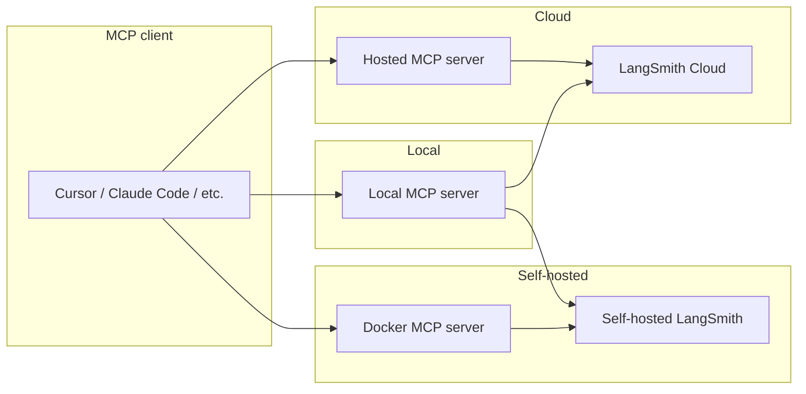

# LangSmith MCP Server

> Use the Model Context Protocol (MCP) server to let language models fetch conversation history, prompts, runs, datasets, experiments, and billing from LangSmith.

> [!WARNING]
>
> **Deprecated—use the [LangSmith Remote MCP](LangSmith%20Remote%20MCP.md) instead.**
>
> LangSmith hosts an OAuth-authenticated remote MCP server on LangSmith Cloud, on [BYOC](../../../LangSmith%20setup/BYOC/Bring%20Your%20Own%20Cloud%20%28BYOC%29.md) data planes, and on [self-hosted LangSmith](../../../LangSmith%20setup/Self-hosted/Self-hosted%20LangSmith.md) v0.16 or later.
>
> Cloud endpoints:
>
> <table>
>   <thead>
>     <tr>
>       <th>Region</th>
>
>       <th>
>         URL
>       </th>
>     </tr>
>   </thead>
>
>   <tbody>
>     <tr>
>       <td>GCP US</td>
>
>       <td>
>         `https://api.smith.langchain.com/mcp`
>       </td>
>     </tr>
>
>     <tr>
>       <td>GCP EU</td>
>
>       <td>
>         `https://eu.api.smith.langchain.com/mcp`
>       </td>
>     </tr>
>
>     <tr>
>       <td>GCP APAC</td>
>
>       <td>
>         `https://apac.api.smith.langchain.com/mcp`
>       </td>
>     </tr>
>
>     <tr>
>       <td>AWS US</td>
>
>       <td>
>         `https://aws.api.smith.langchain.com/mcp`
>       </td>
>     </tr>
>
>     <tr><td>Azure US</td>
>     <td>`https://azure.api.smith.langchain.com/mcp`</td></tr>
>   </tbody>
> </table>
>
> BYOC endpoint: `https://<data_plane_url>/api/mcp`, where `<data_plane_url>` is the URL of your [BYOC](../../../LangSmith%20setup/BYOC/Bring%20Your%20Own%20Cloud%20%28BYOC%29.md) data plane.
>
> Self-hosted endpoint: `https://<your-langsmith-host>/api/mcp`.
>
> It exposes the same tool surface as the standalone server documented on this page, with no separate deployment. Interactive clients authenticate via OAuth 2.1 with dynamic client registration, and programmatic clients can send a LangSmith API key in the `X-Api-Key` header.
>
> The standalone server documented below remains the supported path for self-hosted deployments on versions earlier than v0.16 and for users who prefer running the server themselves.

The LangSmith MCP Server is a [Model Context Protocol](https://modelcontextprotocol.io/introduction) (MCP) server that integrates with [LangSmith](https://smith.langchain.com?utm_source=docs&utm_medium=cta&utm_campaign=langsmith-signup&utm_content=langsmith-langsmith-mcp-server). It lets MCP-compatible clients (for example, AI coding assistants) read [conversation history](../../Trace/Observability%20concepts.md#threads), [prompts](../../../Deploy/Prompt%20%26%20Context%20Hub/Prompts/Create%20and%20manage%20prompts/Manage%20prompts%20programmatically.md), [runs and traces](../../Trace/Observability%20concepts.md#runs), [datasets](../../../Test/Get%20started/Evaluation%20concepts.md#datasets), [experiments](../../../Test/Get%20started/Evaluation%20concepts.md#experiment), and billing usage from your LangSmith workspace.

## Example use cases

* **Conversation history**: "Fetch the history of my conversation from thread 'thread-123' in project 'my-chatbot'"
* **Prompt management**: "Get all public prompts" or "Pull the template for the 'legal-case-summarizer' prompt"
* **Traces and runs**: "Fetch the latest 10 root runs from project 'alpha'" or "Get all runs for a trace by UUID"
* **Datasets**: "List datasets of type chat" or "Read examples from dataset 'customer-support-qa'"
* **Experiments**: "List experiments for dataset 'my-eval-set' with latency and cost metrics"
* **Billing**: "Get billing usage for September 2025"

> [!TIP]
>
> **Use the server in code or Fleet**
>
> * To connect and use remote MCP servers (including this one) in your Python application, see [MCP (Model Context Protocol)](https://docs.langchain.com/oss/python/langchain/mcp.md).
> * To connect and use this server in Fleet, see [Remote MCP servers](../../../No-code%20agents/Fleet/Tools%20and%20automation/Remote%20MCP%20servers.md).

## Quickstart (hosted)

A hosted version of the LangSmith MCP Server is available through the [LangSmith Remote MCP](LangSmith%20Remote%20MCP.md), so you can connect without running the server yourself.

* **URL:** `https://api.smith.langchain.com/mcp`
* **Authentication:** Interactive MCP clients use OAuth 2.1. See [LangSmith Remote MCP authentication](LangSmith%20Remote%20MCP.md#authentication) for programmatic API key access.

**Example (Cursor `mcp.json`):**

```json
{
  "mcpServers": {
    "langsmith": {
      "url": "https://api.smith.langchain.com/mcp"
    }
  }
}
```

The MCP client opens a browser window to complete the OAuth flow when you first connect.

## Available tools

### Conversation and threads

| Tool | Description |
| - | - |
| `get_thread_history` | Get message history for a conversation thread. Uses character-based pagination: pass `page_number` (1-based) and use the returned `total_pages` to request more pages. Optional: `max_chars_per_page`, `preview_chars`. |

### Prompt management

| Tool | Description |
| - | - |
| `list_prompts` | List prompts with optional filtering by visibility (public/private) and limit. |
| `get_prompt_by_name` | Get a single prompt by exact name (details and template). |
| `push_prompt` | Documentation-only: how to create and push prompts to LangSmith. |

### Traces and runs

| Tool | Description |
| - | - |
| `fetch_runs` | Fetch runs (traces, tools, chains, etc.) from one or more projects. Supports filters (`run_type`, `error`, `is_root`), FQL (`filter`, `trace_filter`, `tree_filter`), and ordering. When `trace_id` is set, results are character-based paginated; otherwise one batch up to `limit`. Always pass `limit` and `page_number`. |
| `list_projects` | List projects with optional filtering by name, dataset, and detail level. |

### Datasets and examples

| Tool | Description |
| - | - |
| `list_datasets` | List datasets with filtering by ID, type, name, or metadata. |
| `list_examples` | List examples from a dataset by dataset ID/name or example IDs; supports filter, metadata, splits, and optional `as_of` version. |
| `read_dataset` | Read one dataset by ID or name. |
| `read_example` | Read one example by ID, with optional `as_of` version. |
| `create_dataset` | Documentation-only: how to create datasets. |
| `update_examples` | Documentation-only: how to update dataset examples. |

### Experiments and evaluations

| Tool | Description |
| - | - |
| `list_experiments` | List experiment (reference) projects for a dataset. Requires `reference_dataset_id` or `reference_dataset_name`. Returns metrics (latency, cost, feedback). |
| `run_experiment` | Documentation-only: how to run experiments and evaluations. |

### Billing

| Tool | Description |
| - | - |
| `get_billing_usage` | Get organization billing usage (e.g. trace counts) for a date range. Optional workspace filter. |

### Pagination (character-based)

Tools that return large payloads use **character-budget pagination** so responses stay within a size limit:

* **Used by:** `get_thread_history` and `fetch_runs` (when `trace_id` is set).
* **Parameters:** Send `page_number` (1-based) on each request. Optional: `max_chars_per_page` (default 25000, max 30000), `preview_chars` (truncate long strings with "... (+N chars)").
* **Response:** Includes `page_number`, `total_pages`, and the page payload. Request more by calling again with `page_number = 2`, then `3`, up to `total_pages`.
* **Benefits:** Pages are built by character count, not item count; no cursor or server-side state—just page numbers.

## Installation (run locally)

If you prefer to run the server locally (or use a self-hosted LangSmith endpoint), install it and configure your MCP client.

### Prerequisites

1. Install [uv](https://github.com/astral-sh/uv) (Python package installer):
   ```bash
   curl -LsSf https://astral.sh/uv/install.sh | sh
   ```

2. Install the package:
   ```bash
   uv run pip install --upgrade langsmith-mcp-server
   ```

### MCP client configuration

Add the server to your MCP client config. Use the path from `which uvx` for the `command` value.

**PyPI / uvx:**

```json
{
  "mcpServers": {
    "LangSmith API MCP Server": {
      "command": "/path/to/uvx",
      "args": ["langsmith-mcp-server"],
      "env": {
        "LANGSMITH_API_KEY": "your_langsmith_api_key",
        "LANGSMITH_WORKSPACE_ID": "your_workspace_id",
        "LANGSMITH_ENDPOINT": "https://api.smith.langchain.com"
      }
    }
  }
}
```

**From source** (clone [langsmith-mcp-server](https://github.com/langchain-ai/langsmith-mcp-server) first):

```json
{
  "mcpServers": {
    "LangSmith API MCP Server": {
      "command": "/path/to/uv",
      "args": [
        "--directory",
        "/path/to/langsmith-mcp-server",
        "run",
        "langsmith_mcp_server/server.py"
      ],
      "env": {
        "LANGSMITH_API_KEY": "your_langsmith_api_key",
        "LANGSMITH_WORKSPACE_ID": "your_workspace_id",
        "LANGSMITH_ENDPOINT": "https://api.smith.langchain.com"
      }
    }
  }
}
```

Replace `/path/to/uv`, `/path/to/uvx`, and `/path/to/langsmith-mcp-server` with your actual paths.

## Docker deployment (HTTP-streamable)

You can run the server as an HTTP service with Docker so clients connect via the HTTP-streamable protocol.

1. Build and run:
   ```bash
   docker build -t langsmith-mcp-server .
   docker run -p 8000:8000 langsmith-mcp-server
   ```
   Use the [langsmith-mcp-server](https://github.com/langchain-ai/langsmith-mcp-server) repository for the Dockerfile and context.

2. Connect your MCP client to `http://localhost:8000/mcp` with the `LANGSMITH-API-KEY` header (and optional `LANGSMITH-WORKSPACE-ID`, `LANGSMITH-ENDPOINT`).

3. Health check (no auth):
   ```bash
   curl http://localhost:8000/health
   ```

For full Docker and HTTP-streamable details, see the [LangSmith MCP Server repository](https://github.com/langchain-ai/langsmith-mcp-server).

## Deployment overview

Use the **hosted** MCP server to connect to [LangSmith Cloud](../../../LangSmith%20setup/Cloud/Cloud%20%28SaaS%29.md) (`smith.langchain.com`, `eu.smith.langchain.com`, `apac.smith.langchain.com`, or `aws.smith.langchain.com`). To connect to Cloud or [self-hosted LangSmith](../../../LangSmith%20setup/Self-hosted/Self-hosted%20LangSmith.md), run the server [locally](#installation-run-locally) and set `LANGSMITH_ENDPOINT`. For self-hosted deployments, you can also run the server via the [Docker image](#docker-deployment-http-streamable) inside your VPC.



## Environment variables

| Variable | Required | Description |
| - | - | - |
| `LANGSMITH_API_KEY` | Yes | Your [LangSmith API key](../../../LangSmith%20setup/Account/Create%20an%20account%20and%20API%20key.md) for authentication. |
| `LANGSMITH_WORKSPACE_ID` | No | Workspace ID when your API key has access to multiple workspaces. |
| `LANGSMITH_ENDPOINT` | No | API endpoint URL (for [self-hosted](../../../LangSmith%20setup/Self-hosted/Self-hosted%20LangSmith.md) or custom regions). Default: `https://api.smith.langchain.com`. |

For the **hosted** server, use the same names as **headers**: `LANGSMITH-API-KEY`, `LANGSMITH-WORKSPACE-ID`, `LANGSMITH-ENDPOINT`.

## TypeScript implementation

A community-maintained TypeScript/Node.js port of the official Python server is available. To run it: `LANGSMITH_API_KEY=your-key npx langsmith-mcp-server`.

Source and package: [GitHub](https://github.com/amitrechavia/langsmith-mcp-server-js) · [npm](https://www.npmjs.com/package/langsmith-mcp-server). Maintained by [amitrechavia](https://github.com/amitrechavia).
