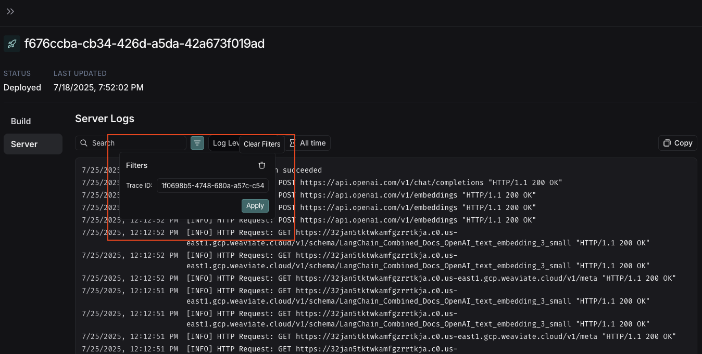

# Manage a trace

> Share traces publicly, and view server logs from the Details view in LangSmith.

You can [share a trace publicly](#share-a-trace), and [view the server logs](#view-server-logs) associated with a trace execution.

## Share a trace

> [!WARNING]
>
> **Sharing a trace publicly will make it accessible to anyone with the link. Make sure you're not sharing sensitive information.**
>
> If your [self-hosted](../../../LangSmith%20setup/Self-hosted/Self-hosted%20LangSmith.md) LangSmith deployment is within a VPC, then the public link is accessible only to members authenticated within your VPC. For enhanced security, we recommend configuring your instance with a private URL accessible only to users with access to your network.

To share a trace publicly:

1. Open any trace in the [UI](https://smith.langchain.com?utm_source=docs&utm_medium=cta&utm_campaign=langsmith-signup&utm_content=langsmith-manage-trace).
2. Click the **Share** button in the more  menu at the top of the Details view.
3. In the dialog that appears, copy the public link.

Shared traces are accessible to anyone with the link, even without a LangSmith account. They can view the trace but not edit it.

To unshare a trace, use either of the following methods:

1. Open the shared trace, click **Public** in the toolbar at the top of the Details view, then click **Unshare** in the dialog.
2. Go to **Settings** > **Shared URLs** to view all publicly shared traces in the selected workspace. Click **Unshare** next to the trace you want to unshare.

## View server logs

> [!NOTE]
>
> Viewing server logs for a trace only works with the [Cloud SaaS](../../../LangSmith%20setup/Cloud/Cloud%20%28SaaS%29.md) and [fully self-hosted](../../../LangSmith%20setup/Self-hosted/Self-hosted%20LangSmith.md) deployment options.

When viewing a trace that was generated by a run in LangSmith, you can access the associated server logs directly from the Details view.

In the Details view, use the **See Logs** button in the top right corner, next to the **Run in Studio** button.

Clicking this button will take you to the server logs view for the associated deployment in LangSmith.

The server logs view displays logs from both:

* **Agent Server's own operational logs**: Internal server operations, API calls, and system events
* **User application logs**: Logs written in your graph with:
  * Python: Use the `logging` or `structlog` libraries.
  * JavaScript: Use the re-exported Winston logger from `@langchain/langgraph-sdk/logging`:

    ```javascript
    import { getLogger } from "@langchain/langgraph-sdk/logging";

    const logger = getLogger();
    logger.info("Your log message");
    ```

When you navigate from the Details view, the **Filters** box will automatically pre-fill with the Trace ID from the trace you just viewed, so you can quickly filter the logs to see only those related to your specific trace execution.



## Delete a trace

If you need to remove traces from LangSmith before their expiration date, you can delete an entire project or delete specific traces.

### Delete an entire project

* In the [LangSmith UI](https://smith.langchain.com?utm_source=docs&utm_medium=cta&utm_campaign=langsmith-signup&utm_content=langsmith-manage-trace), select the **Delete** option on the project's overflow menu.
* With the [`delete_tracer_sessions`](../../Reference/LangSmith%20REST%20API/Tracing/Delete%20tracer%20session.md) API endpoint.
* With the `delete_project()` ([Python](https://reference.langchain.com/python/langsmith/observability/sdk/)) or `deleteProject()` ([JS/TS](https://reference.langchain.com/javascript/modules/langsmith.html)) in the LangSmith SDK.

### Delete specific traces:

Use the [`delete_runs`](../../Reference/LangSmith%20REST%20API/Tracing/Delete%20runs.md) API endpoint to delete runs by trace IDs or metadata key-value pairs. The request body accepts:

* `session_id`: scope deletion to a specific project.
* `trace_ids`: list of trace IDs to delete.
* `metadata`: delete all runs matching the given metadata key-value pairs.

For full API usage, including code examples, the 1000-trace-per-request limit, deletion timeline, and metadata matching behavior, refer to [Data purging for compliance](../../../LangSmith%20setup/Govern/Data%20%26%20compliance/Data%20purging%20for%20compliance.md#trace-deletes).
