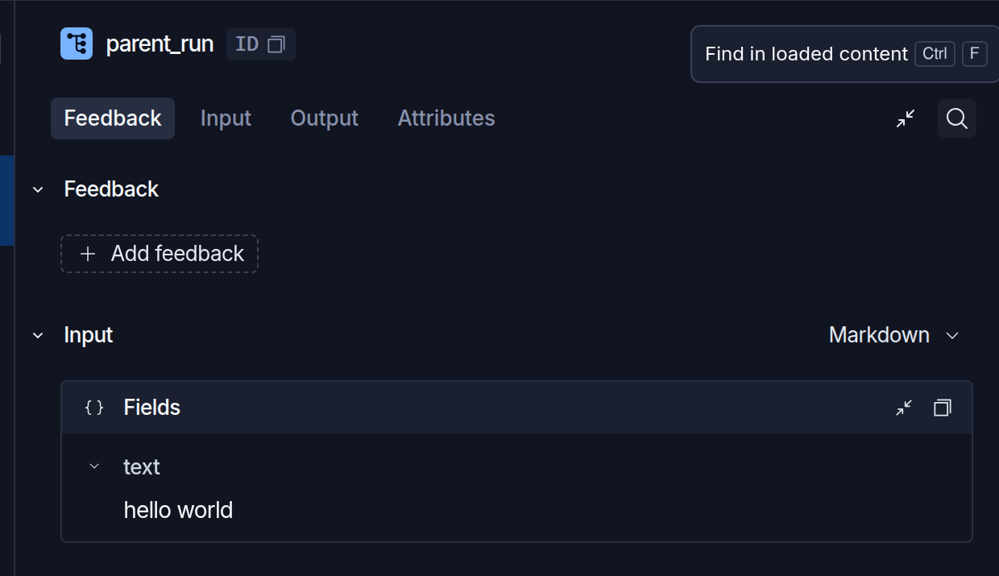
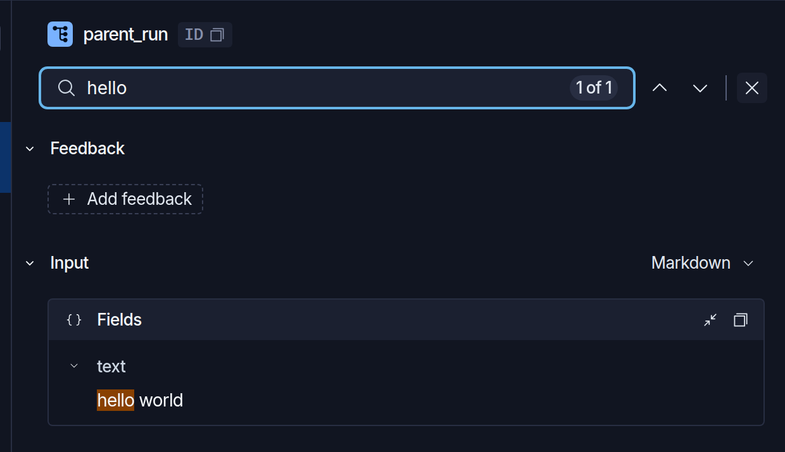
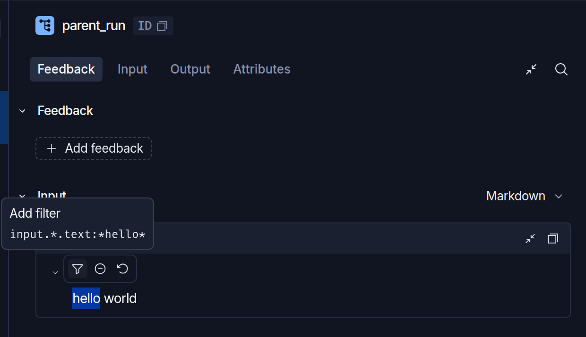

# View traces

> Inspect agent threads in LangSmith using the Trajectory view or Details view.

From a tracing project, use the **Threads**, **Traces**, or **Runs** tabs to change what appears in the table. To narrow it to specific rows, [apply a filter](Filter%20traces.md). Click into any row to open the side panel.

In an [agent-based workspace](../../../LangSmith%20setup/Overview/Agent-based%20workspaces/Agent%20Registry.md), a tracing project is one [environment](../../../LangSmith%20setup/Overview/Agent-based%20workspaces/Agent%20environments.md) of one agent. Select the agent, then the environment, to reach the same table.

The side panel is organized around [threads](../../Trace/Observability%20concepts.md#threads) as the primary unit of navigation. Instead of treating each [run](../../Trace/Observability%20concepts.md#runs) as an isolated object, the UI keeps the surrounding conversation visible so you can understand where a run fits in the agent's broader execution.

> [!NOTE]
>
> The Threads tab and the Turns view are only available for runs instrumented with a `thread_id` metadata field. Without thread instrumentation, you'll see traces as individual runs and won't have access to the Turns view.

Three views are available at the top of the side panel:

* [**Trajectory**](#trajectory-view): The conversation layer. Scan the [trajectory](../../Trace/Observability%20concepts.md#trajectories) as inputs, outputs, reasoning, tool calls, and subagent activity. Use this to find where to look. Press `T` to switch to this view.
* [**Turns**](#turns-view): The per-turn summary. View each turn in the thread as a card showing its inputs and outputs, with expand/collapse. Use this when you want a structural overview without the full conversation rendering.
* [**Details**](#details-view): The debugging layer. Drill into a specific run to inspect inputs, outputs, timing, token counts, errors, and metadata. Use this to understand what happened at a specific point in execution. Press `D` to switch to this view.

> [!NOTE]
>
> The Trajectory tab is disabled for threads that do not have any renderable messages. The side panel defaults to the Details view.

Use the Trajectory view to orient yourself in the conversation and identify where to focus, then switch to the Details view to inspect a specific run:

**1. Start in the Trajectory view**

Open a thread and switch to the Trajectory view to see the full conversation.

**2. Investigate**

Scan the trajectory to identify unexpected behavior, for example, a bad tool result, an unexpected subagent handoff, a latency spike.

**3. Inspect the run**

Click the relevant message or tool call to open the Details view at the exact run that produced it. Review its inputs, outputs, timing, errors, and metadata.

**4. Return to the trajectory**

Toggle back to the Trajectory view to continue scanning the conversation.

## Trajectory view

Use the Trajectory view to scan the full [trajectory](../../Trace/Observability%20concepts.md#trajectories) and identify unexpected behavior, such as a bad tool result, an unexpected subagent handoff, or a latency spike, before drilling into a specific run.

### What the Trajectory view shows

Each turn in the trajectory renders as a single block containing the model's response, the tool calls it triggered, and the results those tools returned. You can scan the full trajectory and read the agent's behavior without opening a child run.

The metadata row for each block shows:

* **Token usage:** total tokens for the call
* **Cost:** total cost for the call
* **Model name**
* An **LLM call** link to the corresponding run in the [Details view](#details-view) (shown only when the AI message has visible text)

**Thought** blocks appear inline with assistant messages when a model uses extended thinking, collapsed by default. Click to expand the model's chain of thought for that turn.

**Subagents** appear inline in the conversation as distinct actions. Click into a subagent to open a nested view of that subagent's messages. Click back to return to the parent thread.

**Tool calls** appear with the assistant message that triggered them. Each tool call card includes a link to its run in the [Details view](#details-view). When an agent makes multiple tool calls together, either the same tool repeated or multiple different tools in parallel, those calls collapse into a single grouped row. Expand the group to see each individual call.

To download the thread as a Markdown file, use the download button in the Trajectory view. The exported file includes the full conversation transcript with human and AI turns, tool calls, and tool results, formatted for reading in any Markdown viewer.

### Customize the Trajectory view

You can control how runs appear in the Trajectory view using metadata keys on individual runs.

* `ls_agent_type`: Controls where messages from an agent-like run appear. Accepted values:

  | Value | Trajectory view behavior |
  | - | - |
  | `"root"` | Messages from this run appear in the main Trajectory view. |
  | `"subagent"` | Messages from this run appear as a subagent action in the conversation thread. |

  ```python
  @traceable(metadata={"ls_agent_type": "root"})
  def my_agent():
      ...
  ```

* `ls_message_format`: Overrides automatic format detection. Accepted values:
  * `"langchain"`: parse as LangChain message format
  * `"completions"`: parse as OpenAI Chat Completions format
  * `"responses"`: parse as OpenAI Responses API format
  * `"anthropic"`: parse as Anthropic message format

* `LS_MESSAGE_VIEW_EXCLUDE`: Exclude an individual run from the Trajectory view. Import the constant from `langsmith` (Python and JS), or use the literal string `"ls_message_view_exclude"`. For code examples, refer to [Exclude runs from the Trajectory view](../Trajectory%20view/Trajectory%20view%20integrations.md#exclude-runs-from-the-trajectory-view).
  * For `@traceable` / `traceable()`: child runs that execute inside the tagged run's tracing context inherit the exclusion.
  * For `wrap_openai` / `wrapOpenAI`, `wrapAISDK`, `RunTree.createChild`, and LangChain `RunnableConfig`: set the key on each run you want to hide. Inheritance to child runs is not guaranteed on these surfaces.

For the integrations that set this metadata automatically, refer to [Trajectory view integrations](../Trajectory%20view/Trajectory%20view%20integrations.md).

## Turns view

Use the Turns view to scan the structure of a thread one turn at a time, without the full conversation rendering of the Trajectory view. Each turn in the thread appears as a card showing the root run's inputs and outputs. Click a card's chevron to expand or collapse its contents.

The Turns view is useful when:

* The thread doesn't have renderable messages (for example, a trace from an integration that isn't supported by the Trajectory view).
* You want a quick structural overview of the thread before deciding which turn to drill into.
* You want to see raw inputs and outputs per turn without normalization into a chat-style conversation.

Click into any turn to open the [Details view](#details-view) at the run that produced it.

### Customize the Turns view

By default, LangSmith picks input and output fields to show on each turn card using heuristics. To override which fields appear, click the **Format** button at the top of the thread to open the format pane, select the specific input and output paths you want to display, and save. Your selection persists for the project.

## Details view

The Details view is the debugging layer. When you click into a specific run, the surrounding thread context remains available so you can understand where that run fits in the broader conversation. Inspect inputs, outputs, metadata, timing, errors, and child runs without losing track of the thread.

### Search within run details

**Find in loaded content**  searches the selected run, including inputs, outputs, tags, and metadata. Use it to locate text without manually expanding each field or message. Find does not search other runs in the trace.

To find text in a run:

1. Open a trace and select a run in the **Details** view.

2. Click **Find in loaded content**  to the right of the run detail tabs. You can also press `Cmd+F` on macOS or `Ctrl+F` on Windows and Linux while the run pane has focus.

   

3. Type text into the search bar. It shows the current match and total match count.

4. Click **Next match**  or **Previous match**  to move between results. With the search bar focused, press `Enter` for the next match or `Shift+Enter` for the previous match. LangSmith expands the matching field or message and scrolls to the highlighted text.

   

5. Click **Close find** , or press `Escape` while the search bar has focus, to return to the run detail tabs.

Find supports rendered messages and structured fields, including JSON and YAML views. If a run has too much searchable content, or a query matches more than 1,000 times, the search bar shows a search-limit warning instead of results.

### Filter by highlighted text

Highlighting text in run details lets you create a filter from the selected value. Use it to narrow the table to matching content without typing a query. Unlike Find, highlighting filters the table rather than searching within the open run.

Filtering by highlighted text requires the single search bar described in [Filter traces](Filter%20traces.md). Where the table uses filter chips instead, selecting text does not open a toolbar.

To filter by a value:

1. Select text within a single input, output, or metadata value. A selection that spans more than one value does not open the toolbar. You can select text in rendered Markdown, the code editor, or structured fields. LangSmith extends a partial word to the whole word.

2. In the toolbar above the selection, choose an action:

   * **Add filter** : Keep existing filters and add a condition based on the selected text.
   * **Exclude** : Keep existing filters and exclude matches for the selected text.
   * **Replace all filters** : Replace the current query filters with a filter based on the selected text.

   LangSmith applies the filter, closes the trace, and returns to the table.

   

3. Review the matching rows in the table. To change or remove the condition, edit the [filters in the search bar](Filter%20traces.md).

On the **Runs** tab, the filter matches individual runs. On other tabs, a selection in the root run filters in the **Root run** scope, and a selection in a child run filters in the **Any run** scope. For more information, see [Choose what a filter matches](Filter%20traces.md#choose-what-a-filter-matches).

Input and output selections create text-contains filters. Selecting an entire metadata value creates an exact-value filter. Selecting part of a metadata string creates a text-contains filter.

### Customize the Details view

Setting `run_type="llm"` on a run causes the Details view to render token counts and latency for that run. For the full message format specification, refer to [Log an LLM trace](../../Trace/Tracing%20setup/Manual%20instrumentation/Log%20LLM%20calls.md).

Tool messages are auto-expanded when a run's `run_type` is `tool`.

Setting `run_type="retriever"` on a run causes the Details view to render each retrieved document with its contents and metadata inline. For the required return format, refer to [Log retriever traces](../../Trace/Tracing%20setup/Manual%20instrumentation/Log%20retriever%20traces.md).

### Actions

From the Details view, you can also:

* **Share a trace:** Generate a public link to the trace. Refer to [Manage a trace](Manage%20a%20trace.md#share-a-trace).
* **View server logs:** Access server logs associated with a trace generated by a LangSmith deployment. Refer to [Manage a trace](Manage%20a%20trace.md#view-server-logs).
* **Add to a dataset:** Save the run as an example in a dataset for use in evaluations. Refer to [Manage datasets in the application](../../../Test/Datasets%20%26%20Experiments/Datasets/Create%20a%20dataset/Create%20and%20manage%20datasets%20in%20the%20UI.md#manually-from-a-tracing-project).
* **Add to an annotation queue:** Send the run or its entire [thread](../../Trace/Observability%20concepts.md#threads) to a queue for human review and feedback. Refer to [Annotation queues](../../../Test/Annotation%20Queues/Use%20annotation%20queues.md#assign-runs-and-threads-to-a-single-run-queue).
