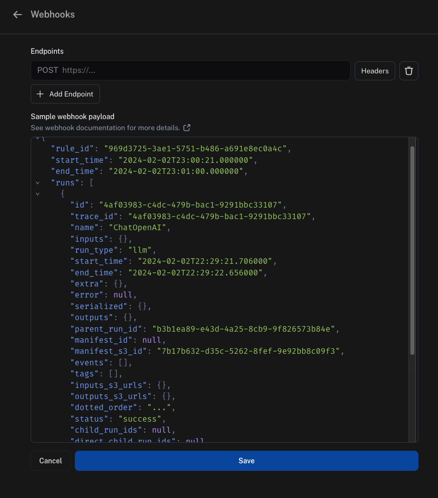
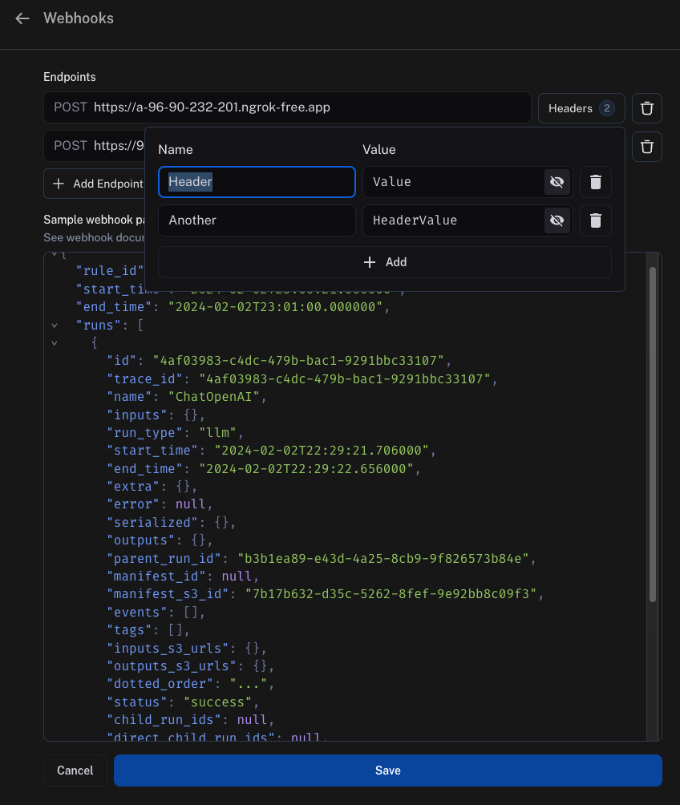
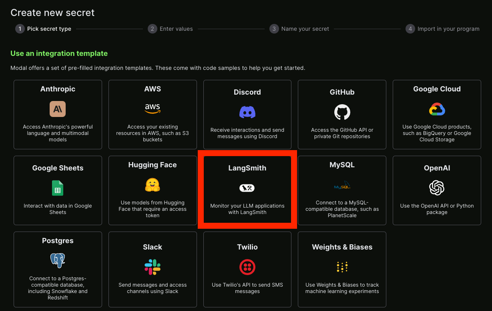

# Configure webhook notifications for rules

> Configure webhook notifications to receive POST requests when automation rules match new runs or threads in LangSmith.

> [!NOTE]
>
> This page covers **LangSmith automation webhooks**, POST notifications triggered when automation rules match runs or threads. If you are looking for **LangGraph API webhooks** (a callback parameter you pass when creating or streaming a run), see [Use webhooks](../../../Deploy/Agent%20Server/Capabilities/Use%20webhooks.md).

When you add a webhook URL on an automation action, LangSmith makes a POST request to your webhook endpoint any time the rules you defined match any new runs or threads.



## Webhook payload

The payload LangSmith sends to your webhook endpoint contains:

* `"rule_id"`: this is the ID of the automation that sent this payload.
* `"start_time"` and `"end_time"`: these are the time boundaries where LangSmith found matching items.
* `"runs"`: this is an array of runs, where each run is a dictionary. If you need more information about each run, use the SDK in your endpoint to fetch it from the API. Each run dictionary includes:
  * `"feedback_stats"`: a dictionary with the feedback statistics for that run. An example of this field is shown in the following code block.
* `"threads"`: this is an array of threads, sent in place of `"runs"` when the rule's [item type](Set%20up%20automation%20rules.md#set-the-item-type-to-runs-or-threads) is **Threads**. A payload carries one array or the other, never both. For more information, refer to [Read a thread rule payload](#read-a-thread-rule-payload).

```json
"feedback_stats": {
    "about_langchain": {
        "n": 1,
        "avg": 0.0,
        "show_feedback_arrow": true,
        "values": {}
    },
    "category": {
        "n": 0,
        "avg": null,
        "show_feedback_arrow": true,
        "values": {
            "CONCEPTUAL": 1
        }
    },
    "user_score": {
        "n": 2,
        "avg": 0.0,
        "show_feedback_arrow": false,
        "values": {}
    },
    "vagueness": {
        "n": 1,
        "avg": 0.0,
        "show_feedback_arrow": true,
        "values": {}
    }
}
```

> [!NOTE]
>
> **fetching from S3 URLs**
>
> Depending on how recent your runs are, the `inputs_s3_urls` and `outputs_s3_urls` fields may contain S3 URLs to the actual data instead of the data itself.
>
> The `inputs` and `outputs` can be fetched by the `ROOT.presigned_url` provided in `inputs_s3_urls` and `outputs_s3_urls` respectively.

This is an example of the entire payload LangSmith sends to your webhook endpoint:

```json
{
  "rule_id": "d75d7417-0c57-4655-88fe-1db3cda3a47a",
  "start_time": "2024-04-05T01:28:54.734491+00:00",
  "end_time": "2024-04-05T01:28:56.492563+00:00",
  "runs": [
    {
      "status": "success",
      "is_root": true,
      "trace_id": "6ab80f10-d79c-4fa2-b441-922ed6feb630",
      "dotted_order": "20230505T051324571809Z6ab80f10-d79c-4fa2-b441-922ed6feb630",
      "run_type": "tool",
      "modified_at": "2024-04-05T01:28:54.145062",
      "tenant_id": "2ebda79f-2946-4491-a9ad-d642f49e0815",
      "end_time": "2024-04-05T01:28:54.085649",
      "name": "Search",
      "start_time": "2024-04-05T01:28:54.085646",
      "id": "6ab80f10-d79c-4fa2-b441-922ed6feb630",
      "session_id": "6a3be6a2-9a8c-4fc8-b4c6-a8983b286cc5",
      "parent_run_ids": [],
      "child_run_ids": null,
      "direct_child_run_ids": null,
      "total_tokens": 0,
      "completion_tokens": 0,
      "prompt_tokens": 0,
      "total_cost": null,
      "completion_cost": null,
      "prompt_cost": null,
      "first_token_time": null,
      "app_path": "/o/2ebda79f-2946-4491-a9ad-d642f49e0815/projects/p/6a3be6a2-9a8c-4fc8-b4c6-a8983b286cc5/r/6ab80f10-d79c-4fa2-b441-922ed6feb630?trace_id=6ab80f10-d79c-4fa2-b441-922ed6feb630&start_time=2023-05-05T05:13:24.571809",
      "in_dataset": false,
      "last_queued_at": null,
      "inputs": null,
      "inputs_s3_urls": null,
      "outputs": null,
      "outputs_s3_urls": null,
      "extra": null,
      "events": null,
      "feedback_stats": null,
      "serialized": null,
      "share_token": null
    }
  ]
}
```

### Handle batched payloads

A payload covers a polling window rather than a single match. LangSmith collects every item the rule matched between `"start_time"` and `"end_time"` and delivers them in one POST, instead of sending one POST per item.

Write your endpoint to iterate the array rather than reading only the first element. A thread rule delivers at most 500 threads per execution.

### Read a thread rule payload

A rule whose [item type](Set%20up%20automation%20rules.md#set-the-item-type-to-runs-or-threads) is **Threads** replaces the top-level `"runs"` array with a `"threads"` array. Each entry in that array contains:

* `"thread_id"`: the ID of the thread that went idle and matched the rule.
* `"session_id"`: the ID of the tracing project the thread belongs to.
* `"runs"`: an array of the thread's root runs, one per trace, each with the traced inputs and outputs. Child runs such as tool and model calls are not included. These run dictionaries also omit `"feedback_stats"`, which is present only on runs in a `"runs"` payload.

This example is abbreviated, showing one thread with a single root run:

```json
{
  "rule_id": "7f3e9c21-5b48-4a6d-8e12-9f0a1b2c3d4e",
  "start_time": "2026-08-14T09:00:00.000000+00:00",
  "end_time": "2026-08-14T09:01:00.000000+00:00",
  "threads": [
    {
      "thread_id": "019a1b2c-3d4e-7f80-9a1b-2c3d4e5f6071",
      "session_id": "2a9d6e4b-1c37-4f58-b0e9-6d5c4a3b2f10",
      "runs": [
        {
          "trace_id": "019a1b2c-3d4e-7f80-9a1b-2c3d4e5f6072",
          "start_time": "2026-08-14T08:57:12.412000",
          "inputs": {
            "messages": [
              {
                "type": "human",
                "id": "019a1b2c-3d4e-7f80-9a1b-2c3d4e5f6073",
                "content": "How do I group traces into a thread?",
                "additional_kwargs": {},
                "response_metadata": {}
              }
            ]
          }
        }
      ]
    }
  ]
}
```

## Security

Add a secret query string parameter to the webhook URL and verify it on every incoming request. This ensures that if someone discovers your webhook URL, you can distinguish those calls from authentic webhook notifications.

An example would be

```
https://api.example.com/langsmith_webhook?secret=38ee77617c3a489ab6e871fbeb2ec87d
```

### Webhook custom HTTP headers

If you'd like to send any specific headers with your webhook, this can be configured per URL. To set this up, click on the `Headers` option next to the URL field and add your headers.

> [!NOTE]
>
> Headers are stored in encrypted format.



### Webhook delivery

When delivering events to your webhook endpoint, LangSmith follows these guidelines:

* If LangSmith fails to connect to your endpoint, LangSmith retries the transport connection up to 2 times before declaring the delivery failed.
* If your endpoint takes longer than 5 seconds to reply, LangSmith declares the delivery failed and does not retry.
* If your endpoint returns a 5xx status code in less than 5 seconds, LangSmith retries up to 2 times with exponential backoff.
* If your endpoint returns a 4xx status code, LangSmith declares the delivery failed and does not retry.
* Anything your endpoint returns in the body will be ignored.

## Ensuring evaluations complete before the webhook fires

By default, automation rules run on independent schedules. A webhook rule and an online evaluator rule scanning the same project can pick up the same run at different times, so the webhook may fire before the evaluator has had a chance to score the run.

The recommended solution is to add a *feedback filter* to your webhook rule. This tells LangSmith to send a run to your webhook only once it already carries the expected score, regardless of when it was evaluated.

For example, you have an online evaluator that produces an `answer_usefulness` score, and a webhook rule that should only fire after that score is present.

1. Open the webhook automation rule in the **Automations** tab of your tracing project or agent environment.

2. Edit the rule's filter to require the feedback key. In the filter builder, add a condition:

   ```text
   eq(feedback_key, "answer_usefulness")
   ```

3. Save the rule.

Now the webhook rule will skip any run that does not yet have an `answer_usefulness` score. When the evaluator rule runs and attaches the score, the webhook rule's next polling cycle will pick up those runs and send them to your endpoint.

> [!TIP]
>
> You can also filter on the score value itself, not just its presence. For example, to only send runs with a low usefulness score to your endpoint:
>
> ```text theme={"theme":{"light":"catppuccin-latte","dark":"catppuccin-mocha"}}
> and(eq(feedback_key, "answer_usefulness"), lt(feedback_score, 0.5))
> ```
>
> For the full filter syntax, refer to [Filter traces (ClickHouse)](../../Debug/Viewing%20%26%20managing%20traces/Filter%20traces%20%28ClickHouse%29.md).

> [!NOTE]
>
> Within a single automation rule, actions execute in a fixed order: annotation queue → dataset → webhook → evaluation. This means that if your webhook and evaluator are configured on the **same** rule, the webhook will always fire before the evaluation completes on that rule's run. To ensure the webhook receives evaluation scores, keep the webhook and evaluator as **separate rules** and use a feedback filter on the webhook rule as described in the example.

## Example with Modal

### Setup

For an example of how to set this up, this guide uses [Modal](https://modal.com/). Modal provides autoscaling GPUs for inference and fine-tuning, secure containerization for code agents, and serverless Python web endpoints. This guide focuses on the web endpoints.

First, create a Modal account. Then, locally install the Modal SDK:

```bash pip
pip install modal
```

```bash uv
uv add modal
```

To finish setting up your account, run the command:

```shell
modal setup
```

Follow the instructions to finish setting up your account.

### Secrets

Next, you will need to set up some secrets in Modal.

First, LangSmith will need to authenticate to Modal by passing in a secret.
The easiest way to do this is to pass in a secret in the query parameters.
To validate this secret, add a secret in *Modal* to validate it.
Do this by [creating a Modal secret](https://modal.com/docs/guide/secrets).
Name the secret `ls-webhook` and set an environment variable with the name `LS_WEBHOOK`.

You can also set up a LangSmith secret—luckily there is already an integration template for this!



### Service

After that, you can create a Python file that will serve as your endpoint.
An example is shown in the following code block, with comments explaining what is going on:

```python
from fastapi import HTTPException, status, Request, Query
from modal import Secret, Stub, web_endpoint, Image

stub = Stub("auth-example", image=Image.debian_slim().pip_install("langsmith"))


@stub.function(
    secrets=[Secret.from_name("ls-webhook"), Secret.from_name("my-langsmith-secret")]
)
# We want this to be a `POST` endpoint since we will post data here
@web_endpoint(method="POST")
# We set up a `secret` query parameter
def f(data: dict, secret: str = Query(...)):
    # You can import dependencies you don't have locally inside Modal functions
    from langsmith import Client

    # First, we validate the secret key we pass
    import os

    if secret != os.environ["LS_WEBHOOK"]:
        raise HTTPException(
            status_code=status.HTTP_401_UNAUTHORIZED,
            detail="Incorrect bearer token",
            headers={"WWW-Authenticate": "Bearer"},
        )

    # This is where we put the logic for what should happen inside this webhook
    ls_client = Client()
    runs = data["runs"]
    ids = [r["id"] for r in runs]
    feedback = list(ls_client.list_feedback(run_ids=ids))
    for r, f in zip(runs, feedback):
        try:
            ls_client.create_example(
                inputs=r["inputs"],
                outputs={"output": f.correction},
                dataset_name="classifier-github-issues",
            )
        except Exception:
            raise ValueError(f"{r} and {f}")
    # Function body
    return "success!"
```

Deploy this with `modal deploy ...` (see [managing Modal deployments](https://modal.com/docs/guide/managing-deployments)).

You should now get something like:

```
✓ Created objects.
├── 🔨 Created mount /Users/harrisonchase/workplace/langsmith-docs/example-webhook.py
├── 🔨 Created mount PythonPackage:langsmith
└── 🔨 Created f => https://hwchase17--auth-example-f.modal.run
✓ App deployed! 🎉

View Deployment: https://modal.com/apps/hwchase17/auth-example
```

Note the function URL: `https://hwchase17--auth-example-f.modal.run`.
NOTE: this is NOT the final deployment URL, make sure not to accidentally use that.

### Hooking it up

Take the function URL you created previously and add it as a webhook.
Remember to also pass in the secret key as a query parameter.
Putting it all together, it should look something like:

```
https://hwchase17--auth-example-f-dev.modal.run?secret={SECRET}
```

Replace `{SECRET}` with the secret key you created to access the Modal service.
