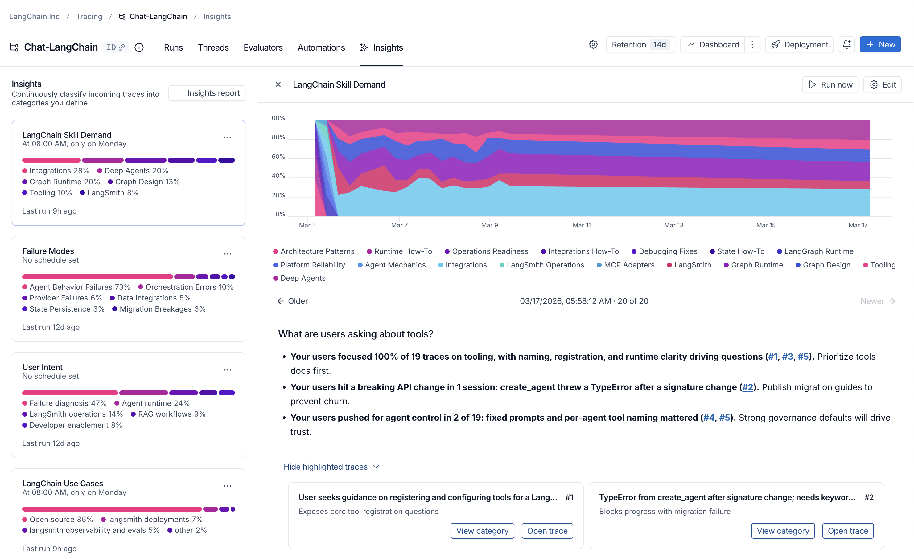
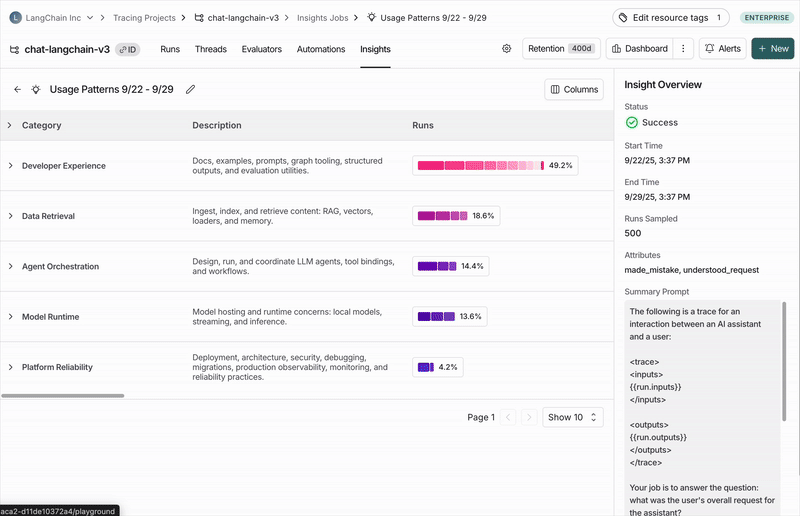

# Discover errors and usage patterns with Insights

> Use LangSmith Insights to automatically analyze traces, detect usage patterns, identify common agent behaviors, and surface failure modes without manual trace review.

Insights automatically analyzes your traces to detect usage patterns, common agent behaviors, and failure modes, so you do not need to review thousands of traces manually.

In an agent-based workspace, running a report against a single [environment](../../../LangSmith%20setup/Overview/Agent-based%20workspaces/Agent%20environments.md) is how to analyze production traffic without also analyzing local runs.

Insights uses hierarchical categorization to make sense of your data and highlight actionable trends.

> [!NOTE]
>
> Insights is available for LangSmith Plus and Enterprise [plans](https://docs.langchain.com/langsmith/pricing-plans.md).

## Prerequisites

* A [model configuration](../../../LangSmith%20setup/Govern/Organization/Workspace%20setup/Manage%20model%20configurations.md) set up for Insights in your workspace.
* [Permissions](../../../LangSmith%20setup/Govern/Users%20%26%20access%20control/Organization%20and%20workspace%20operations%20reference.md#projects) to create rules in LangSmith (required to generate new Insights Reports).
* [Permissions](../../../LangSmith%20setup/Govern/Users%20%26%20access%20control/Organization%20and%20workspace%20operations%20reference.md#projects) to view tracing projects in LangSmith (required to view existing Insights Reports).

## Generate your first Insights report

> [tab] UI
>
> 1. Navigate to **Tracing** in the left-hand menu and select a tracing project or an agent and environment. In an agent-based workspace, a report runs against one environment rather than the whole agent.
>
> 2. Click **+New** in the top right corner then **New Insights Report** to generate new insights over it.
>
> 3. Enter a name for your job.
>
> 4. If you haven't already, [configure a model](../../../LangSmith%20setup/Govern/Organization/Workspace%20setup/Manage%20model%20configurations.md) for Insights in your workspace settings.
>
> 5. Answer the guided questions to focus your Insights Report on what you want to learn about your agent, then click **Run job**.
>
> > [!TIP]
> >
> > Toggle to Manual mode to [configure the job manually](#configure-a-job).
>
> This will kick off a background Insights Report. Reports can take up to 30 minutes to complete.

> [tab] SDK
>
> You can generate Insights Reports over data stored outside LangSmith using the [Python SDK](../../Reference/langsmith%20%28smith-python-sdk%29.md). This allows you to analyze chat histories from your production systems, logs, or other sources.
>
> When you call `generate_insights()`, the SDK will:
>
> 1. Upload your chat histories as traces to a new LangSmith project.
> 2. Generate an Insights Report over those uploaded traces.
> 3. Return a link to your results in the [LangSmith UI](https://smith.langchain.com?utm_source=docs&utm_medium=cta&utm_campaign=langsmith-signup&utm_content=langsmith-insights).
>
> ```python Python theme={"theme":{"light":"catppuccin-latte","dark":"catppuccin-mocha"}}
> import os
> from langsmith import Client
>
> client = Client()
>
> chat_histories = [
>     [
>         {"role": "user", "content": "how are you"},
>         {"role": "assistant", "content": "good!"},
>     ],
>     [
>         {"role": "user", "content": "do you like art"},
>         {"role": "assistant", "content": "only Tarkovsky"},
>     ],
> ]
>
> report = client.generate_insights(
>     chat_histories=chat_histories,
>     name="Customer Support Topics - March 2024",
>     instructions="What are the main topics and questions users are asking about?",
>     openai_api_key=os.environ["OPENAI_API_KEY"],  # optional if already set as workspace secret
> )
>
> # client.poll_insights(report=report)
> ```

> [tab] CLI
>
> The [LangSmith CLI](../../../LangSmith%20setup/Govern/Tools/LangSmith%20CLI.md) creates a report from a JSON file that uses the fields of a [manual configuration](#manual-configuration):
>
> ```bash theme={"theme":{"light":"catppuccin-latte","dark":"catppuccin-mocha"}}
> langsmith insights create --project my-app --config insights.json --wait
> ```
>
> For the file format and the commands that run, list, and update saved configurations, see [Manage insights](../../../LangSmith%20setup/Govern/Tools/LangSmith%20CLI.md#manage-insights).

> [!NOTE]
>
> Generating insights over 1,000 threads typically costs \$1.00-\$2.00 with OpenAI models and \$3.00-\$4.00 with current Anthropic models. The cost scales with the number of threads sampled and the size of each thread.

## Understand the results

Once your job has completed, you can navigate to the **Insights** tab where you'll see a table of Insights Report. Each Report contains insights generated over a specific sample of traces from the tracing project.



Insights Reports for a single tracing project

Click into your job to see traces organized into a set of auto-generated categories.

You can drill down through categories and subcategories to view the underlying traces, feedback, and run statistics.



Common topics of conversations with the [https://chat.langchain.com](https://chat.langchain.com) chatbot

### Executive summary

At the top of each report, you'll find an executive summary that surfaces the most important patterns discovered in your traces. This includes:

* Key findings with percentages showing how often each pattern appears.
* Clickable references (e.g., #1, #2, #3) to traces the agent identified as exceptionally relevant to your question.

### Top-level categories

Your traces are automatically grouped into top-level categories that represent the broadest patterns in your data.

The distribution bars show how frequently each pattern occurs, making it easy to spot behaviors that happen more or less than expected.

Each category has a brief description and displays aggregated metrics over the traces it contains, including:

* Typical trace stats (like error rates, latency, cost)
* Feedback scores from your evaluators
* [Attributes](#attributes) extracted as part of the job

### Subcategories

Clicking on any category shows a breakdown into subcategories, which gives you a more granular understanding of interaction patterns in that category of traces.

In the [Chat Langchain](https://chat.langchain.com) example, under **Data & Retrieval** there are subcategories like **Vector Stores** and **Data Ingestion**.

### Individual traces

You can view the traces assigned to each category or subcategory by clicking through to see the traces table. From there, you can click into any trace to see the full conversation details.

## Configure a job

You can create an Insights Report using the auto-generated flow or by configuring it manually.

### Autogenerating a config

1. Open **New Insights** and make sure the **Auto** toggle is active.
2. Answer the natural-language questions about your agent's purpose, what you want to learn, and how traces are structured. Insights will translate your answers into a draft config (job name, summary prompt, attributes, and sampling defaults).
3. Choose a provider, then click **Generate config** to preview or **Run job** to launch immediately.

**Providing useful context**

For best results, write a sentence or two for each prompt that gives Insights the context it needs—what you're trying to learn, which signals or fields matter most, and anything you already know isn't useful. The clearer you are about what your agent does and how its traces are structured, the more Insights can group examples in a way that's specific, actionable, and aligned with how you reason about your data.

**Describing your traces**

Explain how your data is organized: are these single runs or multi-turn conversations? Which inputs and outputs contain the key information? This helps Insights generate summary prompts and attributes that focus on what matters. You can also directly specify variables from the [summary prompt](#summary-prompt) section if needed.

### Choose models

Insights uses two models:

* **Thinking model**: performs the clustering step (more capable, higher cost).
* **Summarization model**: generates the per-trace summaries (faster, lower cost).

Both models are selected from the providers you have configured in your workspace. When specific models have been enabled for Insights in your [model configurations](../../../LangSmith%20setup/Govern/Organization/Workspace%20setup/Manage%20model%20configurations.md), you can select them individually. If no individual models are configured, you select a provider (OpenAI or Anthropic) and Insights uses default models for that provider.

For best results, use models from the same provider for both roles.

### Manual configuration

Manual configuration gives you more control—for example, predefining categories you want your data grouped into or targeting traces that match specific feedback scores and filters.

#### Select traces

* **Sample size**: The maximum number of traces to analyze (1,000 limit).
* **Time range**: Traces are sampled from this time range.
* **Filters**: Additional trace filters. As you adjust filters, you'll see how many traces match your criteria.

#### Categories

By default, top-level categories are automatically generated bottom-up from the underlying traces.

In some instances, you know specific categories you're interested in upfront and want the job to bucket traces into those predefined categories.

The **Categories** section of the config lets you do this by enumerating the names and descriptions of the top-level categories you want to be used.

Subcategories are still auto-generated by the algorithm within the predefined top-level categories.

When a job completes, the discovered top-level categories are automatically saved back to the config—but only if the config had no categories defined beforehand. This means subsequent scheduled runs will reuse those categories for consistency.

#### Summary prompt

The first step of the job is to create a brief summary of every trace. These summaries are then categorized.

Extracting the right information in the summary is essential for getting useful categories.

You can edit the prompt used to generate these summaries. The two things to think about when editing the prompt are:

* Summarization instructions: Any information that isn't in the trace summary won't affect the categories that get generated, so make sure to provide clear instructions on what information is important to extract from each trace.
* Trace content: Use mustache formatting to specify which parts of each trace are passed to the summarizer. Large traces with lots of inputs and outputs can be expensive and noisy. Reducing the prompt to only include the most relevant parts of the trace can improve your results.

You must specify what parts of each trace to send to the summarizer using at least one of these template variables:

| Variable | Description | Example |
| - | - | - |
| `run.inputs` | Inputs of the most recent root run | `{{run.inputs}}` |
| `run.outputs` | Outputs of the most recent root run | `{{run.outputs}}` |
| `run.error` | Error string, if the run failed | `{{run.error}}` |
| `run.feedback` | All feedback scores as a JSON blob | `{{run.feedback}}` |
| `run.feedback.<key>` | A specific feedback score by key | `{{run.feedback.correctness}}` |
| `all_thread_messages` | Full message history for the thread (only available for projects with [threads](../../Debug/Configure%20threads.md)) | `{{all_thread_messages}}` |

You can access nested fields using dot notation. For example, `{{run.inputs.foo.bar}}` includes only the `bar` field within `foo` in the last run's inputs.

> [!NOTE]
>
> For projects with [threads](../../Debug/Configure%20threads.md), Insights analyzes full conversations. Only the most recent root run from each thread is used for `run.*` variables. Use `all_thread_messages` to access the complete conversation history.

#### Attributes

Along with a summary, you can define additional string, numerical, and boolean attributes to be extracted from each trace.
These attributes will influence the categorization step—traces with similar attribute values will tend to be categorized together.
You can also see aggregations of these attributes per category.

As an example, you might want to extract the attribute `user_satisfied: boolean` from each trace to steer the algorithm towards categories that split up positive and negative user experiences, and to see the average user satisfaction per category.

#### Filter attributes

You can use the `filter_by` parameter on boolean attributes to pre-filter traces before generating insights. When enabled, only traces where the attribute evaluates to `true` are included in the analysis.

This is useful when you want to focus your Insights Report on a specific subset of traces. For example, only analyzing errors, only examining English-language conversations, or only including traces that meet certain quality criteria.

**How it works:**

* Add `"filter_by": true` to any boolean attribute when creating a config for Insights.
* The LLM evaluates each trace against the attribute description during summarization.
* Traces where the attribute is `false` or missing are excluded before insights are generated.

## Schedule Insights Reports

Schedule Insights reports to run automatically on a recurring basis. When creating or editing a configuration, use the **Schedule** section to choose:

* **Daily**: Runs every day at 8:00 UTC.
* **Weekly on Monday**: Runs every Monday at 8:00 UTC.
* **Custom**: Enter your own cron expression (in UTC).

Each scheduled run generates a new report using your saved configuration. Time ranges are computed dynamically. For example, "last 24 hours" always analyzes the most recent 24-hour window at execution time.

## Save your config

You can optionally save configs for future reuse using the **Save as** button.
This is especially useful if you want to compare Insights Reports over time to identify changes in user and agent behavior.

Select from previously saved configs in the dropdown in the top-left corner of the pane when creating a new Insights Report.
