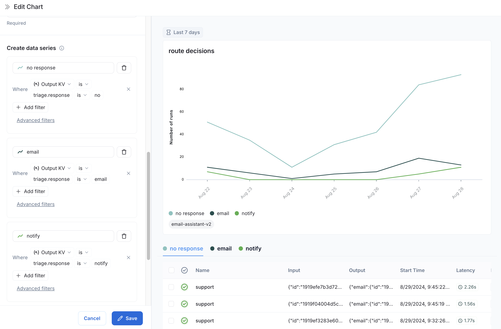

# Monitor projects with dashboards

Dashboards give you high-level insights into your [trace](../../Trace/Observability%20concepts.md#traces) data, helping you spot trends and monitor the health of your applications. Dashboards are available in **Monitoring** in the [LangSmith UI](https://smith.langchain.com?utm_source=docs&utm_medium=cta&utm_campaign=langsmith-signup&utm_content=langsmith-dashboards).

LangSmith offers two dashboard types:

* **Prebuilt dashboards**: Automatically generated for every tracing project or [agent environment](../../../LangSmith%20setup/Overview/Agent-based%20workspaces/Agent%20environments.md).
* **Custom dashboards**: Collections of charts you can configure to your needs. Two experiences are available depending on your [platform setup](../../../LangSmith%20setup/Overview/Hosting/Set%20up%20LangSmith.md):
  * [**Custom dashboards**](#custom-dashboards): Available for LangSmith Cloud US, and for LangSmith Self-hosted installations that [query SmithDB](../../../LangSmith%20setup/Self-hosted/SmithDB/SmithDB%20feature%20availability.md).
  * [**Custom dashboards (legacy)**](#custom-dashboards-legacy): Available for LangSmith Cloud EU/APAC, and for LangSmith Self-hosted installations that query ClickHouse.

## Prebuilt dashboards

Prebuilt dashboards are created automatically for each project and cover essential metrics, such as trace count, error rates, token usage, and more. By default, you can access the prebuilt dashboard for your tracing project using the **Dashboard** button on the top right of the tracing project page.

In an agent-based workspace, **Monitoring** requires an agent, and its dashboard selector splits the two types into tabs: **Environments** lists the prebuilt dashboard for each of the agent's environments, and **Custom** lists the custom dashboards tagged with that agent's [resource tag](../../../LangSmith%20setup/Govern/Organization/Workspace%20setup/Set%20up%20resource%20tags.md). A custom dashboard without that tag does not appear in the agent's selector.

### Dashboard sections

Prebuilt dashboards are broken down into the following sections:

| Section | What it shows |
| :- | :- |
| Traces | Trace count, latency and error rates. A [trace](../../Trace/Observability%20concepts.md#traces) is a collection of [runs](../../Trace/Observability%20concepts.md#runs) related to a single operation. For example, if a user request triggers an agent, all runs for that agent invocation would be part of the same trace. |
| LLM Calls | LLM call count and latency. Includes all runs where run type is "llm". |
| Cost & Tokens | Total and per-trace token counts and costs, broken down by token type. Costs are measured using [LangSmith's cost tracking](../../Trace/Tracing%20setup/Manual%20instrumentation/Log%20LLM%20calls.md#provide-token-and-cost-information). |
| Tools | Run counts, error rates, and latency stats for tool runs broken down by tool name. Includes runs where run type is "tool". Limits to top 5 most frequently occurring tools. |
| Run Types | Run counts, error rates, and latency stats for runs that are immediate children of the root run. This helps in understanding the high-level execution path of agents. Limits to top 5 most frequently occurring run names. |
| Feedback Scores | Aggregate stats for the top 5 most frequently occurring types of feedback. Charts show average score for numerical feedback and category counts for categorical feedback. |

### Group by

You can use group by [run tag or metadata](../../Trace/Configuration%20%26%20troubleshooting/Data%20%26%20privacy/Add%20metadata%20and%20tags%20to%20traces.md) to split data over attributes that are important to your application. The global group by setting appears on the top right-hand side of the dashboard. Note that the **Tool** and **Run Type** charts already have a group by applied, so the global group by won't take effect. The global group by will apply to all other charts.

> [!NOTE]
>
> When adding metadata to runs, we recommend having the same metadata on the trace, as well as the specific run (e.g., LLM call). Metadata and tags are not propagated from parent to child runs, or vice versa. If you want to see both trace charts and LLM call charts grouped by a metadata key, both traces (root runs) and LLM runs need that [metadata attached](../../Trace/Configuration%20%26%20troubleshooting/Data%20%26%20privacy/Add%20metadata%20and%20tags%20to%20traces.md).

## Custom dashboards

> [!NOTE]
>
> Available for LangSmith [Cloud](../../../LangSmith%20setup/Cloud/Cloud%20%28SaaS%29.md) US, and for LangSmith [Self-hosted](../../../LangSmith%20setup/Self-hosted/Self-hosted%20LangSmith.md) installations that [query SmithDB](../../../LangSmith%20setup/Self-hosted/SmithDB/Install%20SmithDB/Install%20LangSmith%20with%20SmithDB.md#step-6-switch-queries-to-smithdb).

Create tailored collections of charts for tracking metrics that matter most for your application.

### Create a new dashboard

1. Navigate to the **Monitoring** tab in the left sidebar.
2. Click on the **+ New Dashboard** button.
3. Give your dashboard a name and a description.
4. Click on **Create**.

### Add charts to your dashboard

1. Within a dashboard, click the **+ New Chart** button to open the chart creation pane.
2. Give your chart a name and description using the **Edit** icon at the top of the pane.

### Chart configuration

#### Start from a template (Optional)

To start from a template, select one of the templates, which include some common observability use cases:

* Error rate over time
* Average latency by model
* Run volume
* Token usage over time
* Most expensive models

Alternatively, use **Search templates** to find another template.

#### Choose a data source

Open **+ Select project or dataset** to find sources. In an agent-based workspace, the button reads **+ Select environment or dataset**. Switch between the two source types with the tabs at the top of the popover: **Tracing** (**Environments** in an agent-based workspace) and **Datasets**.

* **Tracing projects or environments**: Add one or more per chart. LangSmith pools runs across every selected project or environment into a single set, rather than showing each one separately. To break out results per project or environment, use [Group by](#filter-and-group).
* **Datasets**: Pick a single dataset per chart.
  * Selecting a second dataset silently replaces the previous one.
  * A chart draws from either tracing projects or environments, or from a dataset, not both. Picking a dataset while projects or environments are selected, or the reverse, clears the existing selection.

#### Pick a metric

Choose a metric from the dropdown. Options are grouped by what you are measuring:

| Metric | Description | Aggregations |
| :- | :- | :- |
| Count | Number of runs. | — |
| Latency | Aggregates over `latency_seconds`. | Average, Percentile (p50 or p99) |
| Time to first token | Aggregates over `first_token_seconds`. | Percentile (p50 or p99), Average |
| Tokens | Choose Total, Input, or Output tokens. | Sum, Average, Percentile |
| Cost | Choose Total, Input, or Output cost. | Sum, Average, Percentile |
| Feedback score | Select a feedback key. | Average, Minimum, Maximum |
| Ratio | Define a numerator and denominator, each a metric with its own filter. Useful for error rate, LLM run share, etc. | — |

For filtering with multiple metrics, read the following [Filter and group](#filter-and-group) section.

#### Filter and group

Refine what data appears on the chart with filters, and split it into multiple series with a group.

Where **filters** appear depends on how many metrics your chart has:

* **Single metric**: one **+ Filter** in the **Filter & group** panel (the `where` slot). It applies to that metric.
* **Multiple metrics or a ratio**: each metric (or ratio) gets its own **+ Filter** inline in its card under **Pick a metric**. There is no separate chart-wide filter.

When you add a filter, it defaults to filtering at the [run](../../Trace/Observability%20concepts.md#runs) level. To broaden the scope, open the filter picker, then the **Advanced** submenu at the bottom, and choose:

* **Trace filter**: filters at the [trace](../../Trace/Observability%20concepts.md#traces) (root-run) level.
* **Tree filter**: includes the entire trace tree if any run in it matches the condition.

The active scope appears as a suffix on the **Advanced** item (for example, **Advanced Tree Filter**). Click the **X** next to it to reset back to a plain run filter.

Dataset sources do not expose run/trace/tree filters. Data is scoped by the selected dataset. For filter syntax, refer to [filtering traces (ClickHouse)](../../Debug/Viewing%20%26%20managing%20traces/Filter%20traces%20%28ClickHouse%29.md).

**Grouping** creates multiple series on the same chart in one of two ways:

1. **Group by**: Automatically splits data into series based on one attribute. Available attributes: Run Name, Run Type, Tag, Project, [Metadata](../../Trace/Configuration%20%26%20troubleshooting/Data%20%26%20privacy/Add%20metadata%20and%20tags%20to%20traces.md) (with a path such as `metadata.ls_model_name`), and Feedback Label. Groups are ranked by frequency and capped at the top 20.
2. **Data series**: Manually add metrics with the **Add another metric** button. Each series can carry its own filter, so you can compare, for example, "count where status is error" against "count where status is success" on the same chart.

> [!NOTE]
>
> Group by and multi-metric are mutually exclusive on a single chart. Only one group-by attribute is allowed. Donut, ranked bar, and table charts do not support multiple data series (extras are dropped or blocked).

#### Choose visualization

Choose a visualization type:

* Line
* Stacked bar
* KPI
* Ranked bar
* Donut
* Table

### Save and manage charts

* Click **Save** to save your chart to the dashboard.
* Edit or delete a chart by clicking the triple dot button in the top right of the chart.
* Clone a chart by clicking the triple line button in the top right of the chart and selecting **+ Clone**. This will open a new chart creation pane with the same configurations as the original.

### Arrange your dashboard

* **Reorder charts**: drag any chart by its header to move it in the grid.
* **Dashboard time range**: set once at the top of the dashboard. Every chart uses this range unless it overrides its own bucket size.
* **Clone a dashboard**: use the copy icon in the dashboard header. Cloning a [prebuilt dashboard](#prebuilt-dashboards) converts its charts into fully editable custom charts.

## Custom dashboards (legacy)

> [!NOTE]
>
> Available for LangSmith [Cloud](../../../LangSmith%20setup/Cloud/Cloud%20%28SaaS%29.md) EU/APAC customers, and for LangSmith [Self-hosted](../../../LangSmith%20setup/Self-hosted/Self-hosted%20LangSmith.md) installations that query ClickHouse.

Create tailored collections of charts for tracking metrics that matter most for your application.

### Create a new dashboard

1. Navigate to the **Monitor** tab in the left sidebar.
2. Click on the **+ New Dashboard** button.
3. Give your dashboard a name and a description.
4. Click on **Create**.

### Add charts to your dashboard

1. Within a dashboard, click on the **+ New Chart** button to open up the chart creation pane.
2. Give your chart a name and a description.
3. Configure the chart.

### Chart configuration

#### Select tracing projects and filter runs

* Select one or more tracing projects to track metrics for.
* Use the **Chart filters** section to refine the matching runs. This filter applies to all data series in the chart. For more information, view the guide on [filtering traces (ClickHouse)](../../Debug/Viewing%20%26%20managing%20traces/Filter%20traces%20%28ClickHouse%29.md).

#### Pick a metric

* Choose a metric from the dropdown menu to set the y-axis of your chart. With a project and a metric selected, you'll see a preview of your chart and the matching runs.
* For certain metrics (such as latency, token usage, cost), LangSmith supports comparing multiple metrics with the same unit. For example, you may want one chart where you can see prompt tokens and completion tokens. Each metric appears as a separate line.

#### Split the data

There are two ways to create multiple series in a chart (i.e., create multiple lines in a chart):

1. **Group by**: Group runs by [run tag or metadata](../../Trace/Configuration%20%26%20troubleshooting/Data%20%26%20privacy/Add%20metadata%20and%20tags%20to%20traces.md), run name, or run type. Group by automatically splits the data into multiple series based on the field selected. Group by defaults to the top 5 elements by frequency, configurable up to 20.
2. **Data series**: Manually define multiple series with individual filters. This is useful for comparing granular data within a single metric.

#### Pick a chart type

* Choose between a line chart and a bar chart for visualizing.

### Save and manage charts

* Click **Save** to save your chart to the dashboard.
* Edit or delete a chart by clicking the triple dot button in the top right of the chart.
* Clone a chart by clicking the triple line button in the top right of the chart and selecting **+ Clone**. This will open a new chart creation pane with the same configurations as the original.

## Link to a dashboard

You can link to any dashboard directly from a tracing project or from an agent environment. By default, the prebuilt dashboard for that project or environment is selected. If you have a custom dashboard that you would like to link instead:

1. In your tracing project or agent environment, click the three dots next to the **Dashboard** button.
2. Choose a dashboard to set as the new default.

## Example: user-journey monitoring

Use monitoring charts for mapping the decisions made by an agent at a particular node.

Consider an email assistant agent. At a particular node it makes a decision about an email to:

* Send an email back.
* Notify the user.
* No response needed.

You can create a chart to track and visualize the breakdown of these decisions.

**Creating the chart**

1. **Metric Selection**: Select the metric `Run count`.
2. **Chart Filters**: Add a tree filter to include all of the traces with name `triage_input`. This means you only include traces that hit the `triage_input` node. Also add a chart filter for `Is Root` is `true`, so the count is not inflated by the number of nodes in the trace.
3. **Data Series**: Create a data series for each decision made at the `triage_input` node. The output of the decision is stored in the `triage.response` field of the output object, and the value of the decision is either `no`, `email`, or `notify`. Each of these decisions generates a separate data series in the chart.

   

Now you can visualize the decisions made at the `triage_input` node over time.
