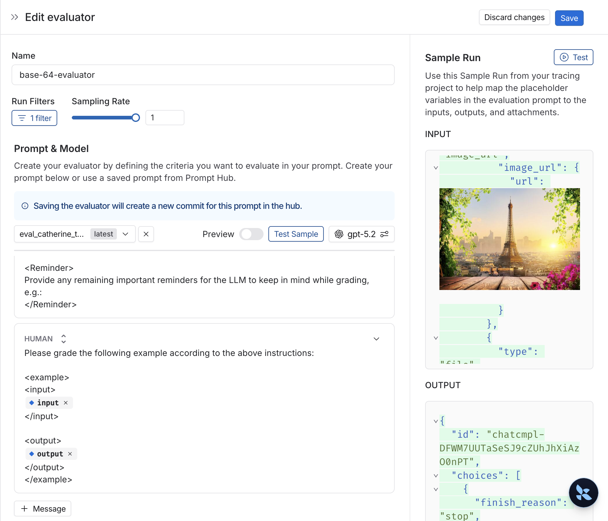

# Set up LLM-as-a-judge online evaluators

[Online evaluations](../../../Test/Get%20started/Evaluation%20concepts.md#online-evaluations) provide real-time feedback on your production traces. This is useful to monitor the performance of your application continuously—to identify issues, measure improvements, and ensure consistent quality over time.

**[LLM-as-a-judge](../../../Test/Get%20started/Evaluation%20concepts.md#llm-as-judge)** evaluators use an LLM to evaluate traces as a scalable substitute for human-like judgment. This guide covers **run-level** evaluators that evaluate a single run. For evaluating entire conversation threads, see [multi-turn online evaluators](Set%20up%20multi-turn%20online%20evaluators.md).

> [!NOTE]
>
> When an online evaluator runs on any run within a trace, the trace will be auto-upgraded to [extended data retention](../../Trace/Configuration%20%26%20troubleshooting/Usage%20and%20billing.md#data-retention-auto-upgrades). This ensures that traces meeting your evaluation criteria (typically those most valuable for analysis) are preserved for investigation.

## View online evaluators

In the [LangSmith UI](https://smith.langchain.com?utm_source=docs&utm_medium=cta&utm_campaign=langsmith-signup&utm_content=langsmith-online-evaluations-llm-as-judge), head to the **Tracing** tab and select a tracing project, or an agent environment. To view existing online evaluators for that project, click on the **Evaluators** tab.

## Add an online evaluator

1. In the [LangSmith UI](https://smith.langchain.com?utm_source=docs&utm_medium=cta&utm_campaign=langsmith-signup&utm_content=langsmith-online-evaluations-llm-as-judge), navigate to the **Tracing** page and select a tracing project, or an agent environment.
2. Click the **Evaluators** tab.
3. Click **+ Evaluator** to open the **Add Evaluator** panel.
4. Choose one of the following:
   * **Create from scratch**: Select **LLM-as-a-Judge Evaluator**.
   * **Attach an existing evaluator**: Select an evaluator already in your workspace to reuse it.
   * **Create from a template**: Start from a ready-made evaluator.
5. Name your evaluator.

## Apply a filter to runs that trigger the evaluator

You can apply a filter to the runs that trigger the evaluator. You may want to apply an evaluator based on:

* Runs where a [user left feedback](../../../Test/Annotation%20Queues/Feedback/Log%20user%20feedback%20using%20the%20SDK.md) indicating the response was unsatisfactory.
* Runs that invoke a specific tool call. See [filtering for tool calls](../../Debug/Viewing%20%26%20managing%20traces/Filter%20traces%20%28ClickHouse%29.md#example-filtering-for-tool-calls) for more information.
* Runs that match a particular piece of metadata (e.g. if you log traces with a `plan_type` and only want to run evaluations on traces from your enterprise customers). See [adding metadata to your traces](../../Trace/Configuration%20%26%20troubleshooting/Data%20%26%20privacy/Add%20metadata%20and%20tags%20to%20traces.md) for more information.
* Runs where another evaluator's score meets a condition, such as a `correctness` score below `0.5`. See [Chain evaluators](../../../Test/Evaluators/Manage%20evaluators.md#chain-evaluators) for more information.

Evaluators use the filter builder, with the same fields and operators described in [Filter traces (ClickHouse)](../../Debug/Viewing%20%26%20managing%20traces/Filter%20traces%20%28ClickHouse%29.md).

> [!TIP]
>
> It's often helpful to inspect runs as you're creating a filter for your evaluator. With the evaluator configuration panel open, you can inspect runs and apply filters to them. Any filters you apply to the runs table will automatically be reflected in filters on your evaluator.

> [!TIP]
>
> If you also have a webhook automation rule on this project and want the webhook payload to include this evaluator's scores, add a feedback filter to the webhook rule rather than relying on rule ordering. For example, filter on `eq(feedback_key, "answer_usefulness")` so the webhook only fires after the score exists. See [Ensuring evaluations complete before the webhook fires](../Automations/Configure%20webhook%20notifications%20for%20rules.md#ensuring-evaluations-complete-before-the-webhook-fires) for details.

## Configure a sampling rate

Configure a sampling rate to control the percentage of filtered runs that trigger the automation action. For example, to control costs, you may want to set a filter to only apply the evaluator to 10% of traces. In order to do this, you would set the sampling rate to 0.1.

## Apply a rule to past runs or threads

To apply the rule to past runs or threads, in the **Configure Evaluator** panel:

1. In **Source**, select **Runs** or **Threads**.
2. Expand **Advanced**.
3. Toggle on **Apply to past runs from date** or **Apply to past threads from date**, then enter a date.

You can only backfill when you create the rule.

When you backfill a [thread-level evaluation rule](Set%20up%20multi-turn%20online%20evaluators.md), LangSmith finds threads with matching trace activity between the start date you selected and the time you created the rule, then applies the rule's filters. Once each selected thread is idle, LangSmith evaluates its root-run history and attaches the feedback to a representative trace in the thread. After the backfill finishes, the rule stays active and keeps evaluating new matching threads through the normal live flow.

> [!NOTE]
>
> The backfill is processed as a background job, so you will not see the results immediately.

In order to track progress of the backfill, you can view logs for your evaluator by heading to the **Evaluators** tab within a tracing project or agent environment and clicking the Logs button for the evaluator you created. Online evaluator logs are similar to [automation rule logs](../Automations/Set%20up%20automation%20rules.md#view-logs-for-your-automations).

1. Add an evaluator name.
2. Optionally filter runs that you would like to apply your evaluator on or configure a sampling rate.
3. Select **Apply Evaluator**.

## Set a spend limit

You can cap LLM cost on this evaluator's attached projects and datasets per week. By default, the organization-wide evaluator limit applies. Organization admins can override this for a specific evaluator by setting a custom value in the **Spend limit** field under **Advanced**. To remove an override and inherit the organization default again, click **Reset to organization default**. When weekly spend reaches the effective limit, LangSmith pauses the evaluator on that project or dataset until the limit resets at Monday 12AM UTC or the limit is manually increased.

For details, refer to [Track and limit evaluator spend](../../../Test/Evaluators/Track%20and%20limit%20evaluator%20spend.md).

## Configure the LLM-as-a-judge evaluator

View [LLM-as-a-judge evaluators](../../../Test/Evaluators/Evaluator%20types/UI/How%20to%20define%20an%20LLM-as-a-judge%20evaluator.md#evaluator-templates) for more information.

When you save a custom LLM-as-a-judge evaluator in the UI, LangSmith automatically saves its prompt to the prompt hub. You do not need to save the prompt separately. To find it, open **Prompts** and select **Used in Evaluators** from the filter dropdown. The **All Prompts** filter excludes evaluator-linked prompts.

New evaluator prompts use the name `eval_<evaluator_name>_<8-character suffix>`. LangSmith lowercases the evaluator name and replaces characters other than letters, numbers, and underscores with underscores. The suffix contains eight random lowercase letters or digits.

## Use a decision model as the judge

You can use a decision model as the judge in place of an LLM. Each question you define returns a typed answer, such as a probability, a selected option, or a score, and LangSmith records each one under its own feedback key. See [Set up decision model online evaluators](Set%20up%20decision%20model%20online%20evaluators.md).

## Map multimodal content to evaluator

If your traces contain multimodal content like images, audio, or documents, you can include this content in your evaluator prompts. There are two approaches:

* **Using base64-encoded content from traces**: If your application logs multimodal content as base64-encoded data in the trace (for example, in the input or output of a run), you can reference this content directly in your evaluator prompt using template variables. The evaluator will extract the base64 data from the trace and pass it to the LLM.
* **Using attachments from traces**: Similar to [offline evaluations with attachments](../../../Test/Datasets%20%26%20Experiments/Evaluation%20techniques/Multimodal%20evaluations/Run%20an%20evaluation%20with%20multimodal%20content.md), you can use attachments from your traces in online evaluations. Since your traces already include attachments logged via the SDK, you can reference them directly in your evaluator.

  1. Select **+ Evaluator** from the dataset page.
  2. In the **Template variables** editor, add a variable for the attachment(s) to include:
     * If you want to include a specific attachment, you can use the suggested variable name, such as `{{attachment.file_name}}`, this will map the file with `file_name` in the attachment list to pass it to the evaluator.
     * If you want to include all attachments, use the `{{attachments}`}\` variable.

  

The evaluator can then access these attachments when evaluating the trace. This is useful for evaluators that need to:

* Verify if an image description matches the actual image in the trace.
* Check if a transcription accurately reflects the audio input.
* Validate if extracted text from a document is correct.
