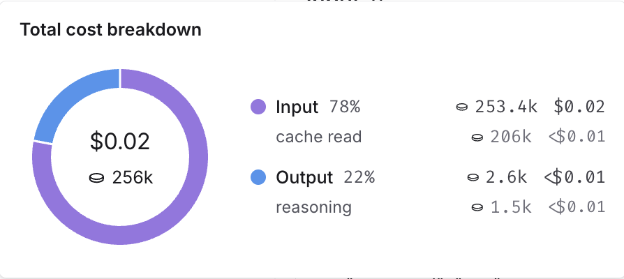

# Cost tracking

Building agents at scale introduces non-trivial, usage-based costs that can be difficult to track. LangSmith automatically records LLM token usage and costs for major providers, and also allows you to submit custom cost data for any additional components.

This gives you a single, unified view of costs across your entire application, which makes it easy to monitor, understand, and debug your spend.

> [!NOTE]
>
> To cap LLM cost on evaluator runs, refer to [Track and limit evaluator spend](../../../Test/Evaluators/Track%20and%20limit%20evaluator%20spend.md). Evaluator spend tracking and limits use the per-model pricing configured under [Model pricing](#create-a-new-or-modify-an-existing-model-price-entry).

> [!TIP]
>
> If you route LLM calls through the [LLM Gateway](../../../LLM%20Gateway/Get%20started/LLM%20Gateway.md), the gateway records their cost and can also limit spend.

## View costs in the LangSmith UI

In the [LangSmith UI](https://smith.langchain.com?utm_source=docs&utm_medium=cta&utm_campaign=langsmith-signup&utm_content=langsmith-cost-tracking), you can explore usage and spend three ways: as a breakdown within individual traces, as aggregated metrics in project stats, and in dashboards.

### Token and cost breakdowns

The UI separates token usage and costs into three categories:

* **Input**: Tokens in the prompt sent to the model. Subtypes include: cache reads, text tokens, image tokens, etc.
* **Output**: Tokens generated in the response from the model. Subtypes include: reasoning tokens, text tokens, image tokens, etc.
* **Other**: Costs from tool calls, retrieval steps, or any custom runs.

You can view detailed breakdowns by hovering over cost sections in the UI. When available, each section is further categorized by subtype.



You can inspect these breakdowns throughout the LangSmith UI:

#### In the trace tree

The trace tree shows the most detailed view of token usage and cost (for a single trace). It displays the total usage for the entire trace, aggregated values for each parent run and token and cost breakdowns for each child run.

Open any run inside a tracing project to view its trace tree.

> [!NOTE]
>
> When tracking costs across threads, ensure that all child runs include the thread metadata (`session_id` or `thread_id`). Without thread metadata on child runs, token counts and costs from those runs won't be included in thread-level aggregations. Refer to [configuring threads](../../Debug/Configure%20threads.md) for details on setting thread metadata.

#### In project stats

The project stats panel shows the total token usage and cost for all traces in a project.

#### In dashboards

Dashboards help you explore cost and token usage trends over time. The [prebuilt dashboard](../../Observe/Monitoring%20%26%20alerting/Monitor%20projects%20with%20dashboards.md#prebuilt-dashboards) for a tracing project shows total costs and a cost breakdown by input and output tokens.

You may also configure custom cost tracking charts in [custom dashboards](../../Observe/Monitoring%20%26%20alerting/Monitor%20projects%20with%20dashboards.md#custom-dashboards).

## Cost tracking

You can track costs in two ways:

1. **Automatically**: derived from token counts and model prices for LLM calls.
2. **Manually**: specified directly on any run, including non-LLM types.

| Method | Run type: LLM | Run type: Other |
| - | - | - |
| **Automatically** | <ul><li>Calling LLMs with [LangChain](https://docs.langchain.com/oss/python/langchain/overview.md)</li><li>Tracing LLM calls to OpenAI, Anthropic or models that follow an OpenAI-compliant format with `@traceable`</li><li> Using LangSmith wrappers for [OpenAI](../Tracing%20setup/Integrations/LLM%20providers/Trace%20with%20OpenAI.md) or [Anthropic](../Tracing%20setup/Integrations/LLM%20providers/Trace%20with%20Anthropic.md)</li><li>For other model providers, read the [token and cost information guide](../Tracing%20setup/Manual%20instrumentation/Log%20LLM%20calls.md#provide-token-and-cost-information)</li></ul> | Not applicable. |
| **Manually** | If LLM call costs are non-linear (eg. follow a custom cost function) | Send costs for any run types, e.g. tool calls, retrieval steps |

### LLM calls: Automatically track costs based on token counts

To compute cost automatically from token usage, you need to provide **token counts**, the **model and provider**, and the **model price**.

> [!NOTE]
>
> Skip this section if you are calling LLMs with [LangChain](https://docs.langchain.com/oss/python/langchain/overview.md), using `@traceable` with OpenAI or Anthropic (or an OpenAI-compatible model), or using a LangSmith wrapper for [OpenAI](../Tracing%20setup/Integrations/LLM%20providers/Trace%20with%20OpenAI.md) or [Anthropic](../Tracing%20setup/Integrations/LLM%20providers/Trace%20with%20Anthropic.md).

1. Send token counts. Many models include token counts as part of the response. You must extract this information and include it in your run using one of the following methods:

   * Set a `usage_metadata` field on the run’s metadata. The advantage of this approach is that you do not need to change your traced function’s runtime outputs:

     ```python Python expandable wrap
     from langsmith import traceable, get_current_run_tree

     inputs = [
         {"role": "system", "content": "You are a helpful assistant."},
         {"role": "user", "content": "I'd like to book a table for two."},
     ]

     @traceable(
         run_type="llm",
         metadata={"ls_provider": "my_provider", "ls_model_name": "my_model"}
     )
     def chat_model(messages: list):
         # Imagine this is the real model output format your application expects
         assistant_message = {
             "role": "assistant",
             "content": "Sure, what time would you like to book the table for?"
         }

         # Token usage you compute or receive from the provider
         token_usage = {
             "input_tokens": 27,
             "output_tokens": 13,
             "total_tokens": 40,
             "input_token_details": {"cache_read": 10}
         }

         # Attach token usage to the LangSmith run
         run = get_current_run_tree()
         run.set(usage_metadata=token_usage)

         return assistant_message

     chat_model(inputs)
     ```

     ```typescript TypeScript expandable wrap
     import { traceable, getCurrentRunTree } from "langsmith/traceable";

     const inputs = [
     { role: "system", content: "You are a helpful assistant." },
     { role: "user", content: "I'd like to book a table for two." },
     ];

     const chatModel = traceable(
     async ({ messages }) => {
         // The output your application expects
         const assistantMessage = {
         role: "assistant",
         content: "Sure, what time would you like to book the table for?",
         };

         // Token usage you compute or receive from the provider
         const tokenUsage = {
         input_tokens: 27,
         output_tokens: 13,
         total_tokens: 40,
         input_token_details: { cache_read: 10 },
         };

         // Attach usage to the LangSmith run
         const runTree = getCurrentRunTree();
         runTree.metadata.usage_metadata = tokenUsage;

         return assistantMessage;
     },
     {
         run_type: "llm",
         name: "chat_model",
         metadata: {
         ls_provider: "my_provider",
         ls_model_name: "my_model",
         },
     }
     );

     await chatModel({ messages: inputs });
     ```

     ```java Java expandable wrap
     import com.langchain.smith.client.LangsmithClient;
     import com.langchain.smith.client.okhttp.LangsmithOkHttpClient;
     import com.langchain.smith.tracing.RunTree;
     import com.langchain.smith.tracing.RunType;
     import com.langchain.smith.tracing.TraceConfig;
     import com.langchain.smith.tracing.Tracing;
     import java.util.Arrays;
     import java.util.HashMap;
     import java.util.List;
     import java.util.Map;
     import java.util.concurrent.ExecutorService;
     import java.util.concurrent.Executors;
     import java.util.concurrent.TimeUnit;
     import java.util.function.Function;

     class CostTrackingUsageMetadataRun {
       public static void main(String[] args) throws InterruptedException {
         if (System.getenv("LANGSMITH_API_KEY") == null
             || System.getenv("LANGSMITH_API_KEY").isBlank()) {
           System.out.println(
               "[cost-tracking-usage-metadata-run] Skipping (LANGSMITH_API_KEY is not set).");
           return;
         }

         LangsmithClient langsmith = LangsmithOkHttpClient.fromEnv();
         ExecutorService executor = Executors.newSingleThreadExecutor();

         try {
           List<Map<String, String>> inputs =
               Arrays.asList(
                   message("system", "You are a helpful assistant."),
                   message("user", "I'd like to book a table for two."));

           Map<String, Object> metadata = new HashMap<>();
           metadata.put("ls_provider", "my_provider");
           metadata.put("ls_model_name", "my_model");

           Function<List<Map<String, String>>, Map<String, String>> chatModel =
               Tracing.traceFunction(
                   messages -> {
                     Map<String, String> assistantMessage =
                         message(
                             "assistant",
                             "Sure, what time would you like to book the table for?");

                     Map<String, Object> inputTokenDetails = new HashMap<>();
                     inputTokenDetails.put("cache_read", 10);

                     Map<String, Object> tokenUsage = new HashMap<>();
                     tokenUsage.put("input_tokens", 27);
                     tokenUsage.put("output_tokens", 13);
                     tokenUsage.put("total_tokens", 40);
                     tokenUsage.put("input_token_details", inputTokenDetails);

                     RunTree run = Tracing.getCurrentRunTree();
                     if (run != null) {
                       run.getMetadata().put("usage_metadata", tokenUsage);
                     }

                     return assistantMessage;
                   },
                   TraceConfig.builder()
                       .name("chat_model")
                       .runType(RunType.LLM)
                       .client(langsmith)
                       .executor(executor)
                       .metadata(metadata)
                       .build());

           chatModel.apply(inputs);
         } finally {
           executor.shutdown();
           if (!executor.awaitTermination(10, TimeUnit.SECONDS)) {
             throw new IllegalStateException("Timed out waiting for LangSmith traces to submit");
           }
         }
       }

       private static Map<String, String> message(String role, String content) {
         Map<String, String> message = new HashMap<>();
         message.put("role", role);
         message.put("content", content);
         return message;
       }
     }
     ```

     ```kotlin Kotlin expandable wrap
     import com.langchain.smith.client.okhttp.LangsmithOkHttpClient
     import com.langchain.smith.tracing.RunType
     import com.langchain.smith.tracing.TraceConfig
     import com.langchain.smith.tracing.getCurrentRunTree
     import com.langchain.smith.tracing.traceable
     import java.util.concurrent.Executors
     import java.util.concurrent.TimeUnit

     val langsmith = LangsmithOkHttpClient.fromEnv()
     val executor = Executors.newSingleThreadExecutor()

     fun message(role: String, content: String) = mapOf("role" to role, "content" to content)

     try {
         val inputs =
             listOf(
                 message("system", "You are a helpful assistant."),
                 message("user", "I'd like to book a table for two."),
             )

         val chatModel =
             traceable(
                 { _: List<Map<String, String>> ->
                     val assistantMessage =
                         message(
                             "assistant",
                             "Sure, what time would you like to book the table for?",
                         )
                     val tokenUsage =
                         mapOf(
                             "input_tokens" to 27,
                             "output_tokens" to 13,
                             "total_tokens" to 40,
                             "input_token_details" to mapOf("cache_read" to 10),
                         )
                     getCurrentRunTree()?.metadata?.put("usage_metadata", tokenUsage)
                     assistantMessage
                 },
                 TraceConfig.builder()
                     .name("chat_model")
                     .runType(RunType.LLM)
                     .client(langsmith)
                     .executor(executor)
                     .metadata(
                         mapOf(
                             "ls_provider" to "my_provider",
                             "ls_model_name" to "my_model",
                         ),
                     )
                     .build(),
             )

         chatModel(inputs)
     } finally {
         executor.shutdown()
         check(executor.awaitTermination(10, TimeUnit.SECONDS)) {
             "Timed out waiting for LangSmith traces to submit"
         }
     }
     ```

     The Java and Kotlin examples use a dedicated executor. Shutting down the executor and awaiting termination ensures background trace submissions complete before the process exits.

   * Return a `usage_metadata` field in your traced function's outputs. Include the `usage_metadata` key directly within the object returned by your traced function. LangSmith will extract it from the output:

     ```python Python expandable wrap
     from langsmith import traceable

     inputs = [
         {"role": "system", "content": "You are a helpful assistant."},
         {"role": "user", "content": "I'd like to book a table for two."},
     ]
     output = {
         "choices": [
             {
                 "message": {
                     "role": "assistant",
                     "content": "Sure, what time would you like to book the table for?"
                 }
             }
         ],
         "usage_metadata": {
             "input_tokens": 27,
             "output_tokens": 13,
             "total_tokens": 40,
             "input_token_details": {"cache_read": 10}
         },
     }

     @traceable(
         run_type="llm",
         metadata={"ls_provider": "my_provider", "ls_model_name": "my_model"}
     )
     def chat_model(messages: list):
         return output

     chat_model(inputs)
     ```

     ```typescript TypeScript expandable wrap
     import { traceable } from "langsmith/traceable";

     const messages = [
         { role: "system", content: "You are a helpful assistant." },
         { role: "user", content: "I'd like to book a table for two." }
     ];
     const output = {
         choices: [
             {
                 message: {
                     role: "assistant",
                     content: "Sure, what time would you like to book the table for?",
                 },
             },
         ],
         usage_metadata: {
             input_tokens: 27,
             output_tokens: 13,
             total_tokens: 40,
         },
     };

     const chatModel = traceable(
         async ({
             messages,
         }: {
             messages: { role: string; content: string }[];
             model: string;
         }) => {
             return output;
         },
         {
             run_type: "llm",
             name: "chat_model",
             metadata: {
                 ls_provider: "my_provider",
                 ls_model_name: "my_model"
             }
         }
     );

     await chatModel({ messages });
     ```

     ```java Java expandable wrap
     import com.langchain.smith.client.LangsmithClient;
     import com.langchain.smith.client.okhttp.LangsmithOkHttpClient;
     import com.langchain.smith.tracing.RunType;
     import com.langchain.smith.tracing.TraceConfig;
     import com.langchain.smith.tracing.Tracing;
     import java.util.Arrays;
     import java.util.HashMap;
     import java.util.List;
     import java.util.Map;
     import java.util.concurrent.ExecutorService;
     import java.util.concurrent.Executors;
     import java.util.concurrent.TimeUnit;
     import java.util.function.Function;

     class CostTrackingUsageMetadataOutput {
       public static void main(String[] args) throws InterruptedException {
         if (System.getenv("LANGSMITH_API_KEY") == null
             || System.getenv("LANGSMITH_API_KEY").isBlank()) {
           System.out.println(
               "[cost-tracking-usage-metadata-output] Skipping (LANGSMITH_API_KEY is not set).");
           return;
         }

         LangsmithClient langsmith = LangsmithOkHttpClient.fromEnv();
         ExecutorService executor = Executors.newSingleThreadExecutor();

         try {
           List<Map<String, String>> messages =
               Arrays.asList(
                   message("system", "You are a helpful assistant."),
                   message("user", "I'd like to book a table for two."));

           Map<String, Object> metadata = new HashMap<>();
           metadata.put("ls_provider", "my_provider");
           metadata.put("ls_model_name", "my_model");

           Function<List<Map<String, String>>, Map<String, Object>> chatModel =
               Tracing.traceFunction(
                   inputMessages -> output(),
                   TraceConfig.builder()
                       .name("chat_model")
                       .runType(RunType.LLM)
                       .client(langsmith)
                       .executor(executor)
                       .metadata(metadata)
                       .build());

           chatModel.apply(messages);
         } finally {
           executor.shutdown();
           if (!executor.awaitTermination(10, TimeUnit.SECONDS)) {
             throw new IllegalStateException("Timed out waiting for LangSmith traces to submit");
           }
         }
       }

       private static Map<String, Object> output() {
         Map<String, Object> output = new HashMap<>();
         Map<String, Object> choice = new HashMap<>();
         choice.put(
             "message",
             message("assistant", "Sure, what time would you like to book the table for?"));
         output.put("choices", Arrays.asList(choice));

         Map<String, Object> inputTokenDetails = new HashMap<>();
         inputTokenDetails.put("cache_read", 10);

         Map<String, Object> usageMetadata = new HashMap<>();
         usageMetadata.put("input_tokens", 27);
         usageMetadata.put("output_tokens", 13);
         usageMetadata.put("total_tokens", 40);
         usageMetadata.put("input_token_details", inputTokenDetails);
         output.put("usage_metadata", usageMetadata);
         return output;
       }

       private static Map<String, String> message(String role, String content) {
         Map<String, String> message = new HashMap<>();
         message.put("role", role);
         message.put("content", content);
         return message;
       }
     }
     ```

     ```kotlin Kotlin expandable wrap
     import com.langchain.smith.client.okhttp.LangsmithOkHttpClient
     import com.langchain.smith.tracing.RunType
     import com.langchain.smith.tracing.TraceConfig
     import com.langchain.smith.tracing.traceable
     import java.util.concurrent.Executors
     import java.util.concurrent.TimeUnit

     val langsmith = LangsmithOkHttpClient.fromEnv()
     val executor = Executors.newSingleThreadExecutor()

     fun message(role: String, content: String) = mapOf("role" to role, "content" to content)

     val output =
         mapOf(
             "choices" to
                 listOf(
                     mapOf(
                         "message" to
                             message(
                                 "assistant",
                                 "Sure, what time would you like to book the table for?",
                             ),
                     ),
                 ),
             "usage_metadata" to
                 mapOf(
                     "input_tokens" to 27,
                     "output_tokens" to 13,
                     "total_tokens" to 40,
                     "input_token_details" to mapOf("cache_read" to 10),
                 ),
         )

     try {
         val messages =
             listOf(
                 message("system", "You are a helpful assistant."),
                 message("user", "I'd like to book a table for two."),
             )

         val chatModel =
             traceable(
                 { _: List<Map<String, String>> -> output },
                 TraceConfig.builder()
                     .name("chat_model")
                     .runType(RunType.LLM)
                     .client(langsmith)
                     .executor(executor)
                     .metadata(
                         mapOf(
                             "ls_provider" to "my_provider",
                             "ls_model_name" to "my_model",
                         ),
                     )
                     .build(),
             )

         chatModel(messages)
     } finally {
         executor.shutdown()
         check(executor.awaitTermination(10, TimeUnit.SECONDS)) {
             "Timed out waiting for LangSmith traces to submit"
         }
     }
     ```

   In either case, the usage metadata should contain a subset of the following LangSmith-recognized fields:

   > [accordion] Usage Metadata Schema and Cost Calculation
   >
   > The following fields in the `usage_metadata` dict are recognized by LangSmith. You can view the full [Python types](https://github.com/langchain-ai/langsmith-sdk/blob/e705fbd362be69dd70229f94bc09651ef8056a61/python/langsmith/schemas.py#L1196-L1227) or [TypeScript interfaces](https://github.com/langchain-ai/langsmith-sdk/blob/e705fbd362be69dd70229f94bc09651ef8056a61/js/src/schemas.ts#L637-L689) directly.
   >
   > **input\_tokens** `number`
   >
   > Number of tokens used in the model input. Sum of all input token types.
   >
   > **output\_tokens** `number`
   >
   > Number of tokens used in the model response. Sum of all output token types.
   >
   > **total\_tokens** `number`
   >
   > Number of tokens used in the input and output. Optional, can be inferred. Sum of input\_tokens + output\_tokens.
   >
   > **input\_token\_details** `object`
   >
   > Breakdown of input token types. Keys are token-type strings, values are counts. Example `{"cache_read": 5}`.
   >
   > Known fields include: `audio`, `text`, `image`, `cache_read`, `cache_creation`, `cache_read_over_200k` (Gemini), `ephemeral_5m_input_tokens`, `ephemeral_1h_input_tokens` (Anthropic ephemeral caching tiers). Additional fields are possible depending on the model or provider.
   >
   > **output\_token\_details** `object`
   >
   > Breakdown of output token types. Keys are token-type strings, values are counts. Example `{"reasoning": 5}`.
   >
   > Known fields include: `audio`, `text`, `image`, `reasoning`. Additional fields are possible depending on the model or provider.
   >
   > **input\_cost** `number`
   >
   > Cost of the input tokens.
   >
   > **output\_cost** `number`
   >
   > Cost of the output tokens.
   >
   > **total\_cost** `number`
   >
   > Cost of the tokens. Optional, can be inferred.  Sum of input\_cost + output\_cost.
   >
   > **input\_cost\_details** `object`
   >
   > Details of the input cost. Keys are token-type strings, values are cost amounts.
   >
   > **output\_cost\_details** `object`
   >
   > Details of the output cost. Keys are token-type strings, values are cost amounts.
   >
   > **Cost Calculations**
   >
   > The cost for a run is computed greedily from most-to-least specific token type. Suppose you set a price of \$2 per 1M input tokens with a detailed price of \$1 per 1M `cache_read` input tokens, and \$3 per 1M output tokens. If you uploaded the following usage metadata:
   >
   > ```python theme={"theme":{"light":"catppuccin-latte","dark":"catppuccin-mocha"}}
   > {
   > "input_tokens": 20,
   > "input_token_details": {"cache_read": 5},
   > "output_tokens": 10,
   > "total_tokens": 30,
   > }
   > ```
   >
   > Then, the token costs would be computed as follows:
   >
   > ```python theme={"theme":{"light":"catppuccin-latte","dark":"catppuccin-mocha"}}
   > # Notice that LangSmith computes the cache_read cost and then for any
   > # remaining input_tokens, the default input price is applied.
   > input_cost = 5 * 1e-6 + (20 - 5) * 2e-6  # 3.5e-5
   > output_cost = 10 * 3e-6  # 3e-5
   > total_cost = input_cost + output_cost  # 6.5e-5
   > ```

2. Specify model name. When using a custom model, the following fields need to be specified in a [run's metadata](Data%20%26%20privacy/Add%20metadata%20and%20tags%20to%20traces.md) in order to associate token counts with costs. It's also helpful to provide these metadata fields to identify the model when viewing traces and when filtering.

   * `ls_provider`: The provider of the model, e.g., “openai”, “anthropic”
   * `ls_model_name`: The name of the model, e.g., “gpt-5.4-mini”, “claude-opus-4-8”

3. Set model prices. LangSmith maps model names to per-token prices using its [model pricing table](https://smith.langchain.com/settings/workspaces/models) to compute costs from token counts.

   > [!NOTE]
   >
   > The table comes with pricing information for most OpenAI, Anthropic, and Gemini models. You can create a new model price entry or overwrite pricing for default models if you have custom pricing.

   For models that have different pricing for different token types (e.g., multimodal or cached tokens), you can specify a breakdown of prices for each token type. Hovering over the **...** next to the **Input price** and **Output price** entries shows you the price breakdown by token type.

   > [!NOTE]
   >
   > LangSmith does not reflect updates to the model pricing map in the costs for traces **already** logged. Backfilling model pricing changes is not supported.

#### Create a new or modify an existing model price entry

To modify the default model prices, create a new entry with the same model, provider and match pattern as the default entry.

To create a new entry in the model pricing map, click on the **+ Model** button in the top right corner.

Here, you can specify the following fields:

* **Model Name**: The human-readable name of the model.
* **Input Price**: The cost per 1M input tokens for the model. This number is multiplied by the number of tokens in the prompt to calculate the prompt cost.
* **Input Price Breakdown** (Optional): The breakdown of price for each different type of input token, e.g., `cache_read`, `video`, `audio`.
* **Output Price**: The cost per 1M output tokens for the model. This number is multiplied by the number of tokens in the completion to calculate the completion cost.
* **Output Price Breakdown** (Optional): The breakdown of price for each different type of output token, e.g., `reasoning`, `image`, etc.
* **Model Activation Date** (Optional): The date from which the pricing is applicable. Only runs after this date will apply this model price.
* **Match Pattern**: A regex pattern to match the model name. This is used to match the value for `ls_model_name` in the run metadata.
* **Provider** (Optional): The provider of the model. If specified, this is matched against `ls_provider` in the run metadata.

Once you have set up the model pricing map, LangSmith will automatically calculate and aggregate the token-based costs for traces based on the token counts provided in the LLM invocations.

### LLM calls: Send costs directly

Gemini 2.5 Pro Preview and Gemini 2.5 Pro use a stepwise cost function, which LangSmith supports by default. For any other model with non-linear pricing, calculate costs client-side and send them as `usage_metadata` as shown in the following code:

```python Python
from langsmith import traceable, get_current_run_tree

inputs = [
    {"role": "system", "content": "You are a helpful assistant."},
    {"role": "user", "content": "I'd like to book a table for two."},
]

@traceable(
    run_type="llm",
    metadata={"ls_provider": "my_provider", "ls_model_name": "my_model"}
)
def chat_model(messages: list):
    llm_output = {
        "choices": [
            {
                "message": {
                    "role": "assistant",
                    "content": "Sure, what time would you like to book the table for?"
                }
            }
        ],
        "usage_metadata": {
            # Specify cost (in dollars) for the inputs and outputs
            "input_cost": 1.1e-6,
            "input_cost_details": {"cache_read": 2.3e-7},
            "output_cost": 5.0e-6,
        },
    }
    run = get_current_run_tree()
    run.set(usage_metadata=llm_output["usage_metadata"])
    return llm_output["choices"][0]["message"]

chat_model(inputs)
```

```typescript TypeScript
import { traceable, getCurrentRunTree } from "langsmith/traceable";

const messages = [
  { role: "system", content: "You are a helpful assistant." },
  { role: "user", content: "I'd like to book a table for two." }
];

const chatModel = traceable(
  async (messages: { role: string; content: string }[]) => {
    const llmOutput = {
      choices: [
        {
          message: {
            role: "assistant",
            content: "Sure, what time would you like to book the table for?",
          },
        },
      ],
      // Specify cost (in dollars) for the inputs and outputs
      usage_metadata: {
        input_cost: 1.1e-6,
        input_cost_details: { cache_read: 2.3e-7 },
        output_cost: 5.0e-6,
      },
    };

    // Attach usage metadata to the run
    const runTree = getCurrentRunTree();
    runTree.metadata.usage_metadata = llmOutput.usage_metadata;

    // Return only the assistant message
    return llmOutput.choices[0].message;
  },
  {
    run_type: "llm",
    name: "chat_model",
    metadata: {
      ls_provider: "my_provider",
      ls_model_name: "my_model",
    },
  }
);

await chatModel(messages);
```

```java Java
import com.langchain.smith.client.LangsmithClient;
import com.langchain.smith.client.okhttp.LangsmithOkHttpClient;
import com.langchain.smith.tracing.RunTree;
import com.langchain.smith.tracing.RunType;
import com.langchain.smith.tracing.TraceConfig;
import com.langchain.smith.tracing.Tracing;
import java.util.Arrays;
import java.util.HashMap;
import java.util.List;
import java.util.Map;
import java.util.concurrent.ExecutorService;
import java.util.concurrent.Executors;
import java.util.concurrent.TimeUnit;
import java.util.function.Function;

class CostTrackingLlmCostDirect {
  public static void main(String[] args) throws InterruptedException {
    LangsmithClient langsmith = LangsmithOkHttpClient.fromEnv();
    ExecutorService executor = Executors.newSingleThreadExecutor();

    try {
      List<Map<String, String>> messages =
          Arrays.asList(
              message("system", "You are a helpful assistant."),
              message("user", "I'd like to book a table for two."));

      Map<String, Object> metadata = new HashMap<>();
      metadata.put("ls_provider", "my_provider");
      metadata.put("ls_model_name", "my_model");

      Function<List<Map<String, String>>, Map<String, String>> chatModel =
          Tracing.traceFunction(
              inputMessages -> {
                Map<String, Object> inputCostDetails = new HashMap<>();
                inputCostDetails.put("cache_read", 2.3e-7);

                Map<String, Object> usageMetadata = new HashMap<>();
                usageMetadata.put("input_cost", 1.1e-6);
                usageMetadata.put("input_cost_details", inputCostDetails);
                usageMetadata.put("output_cost", 5.0e-6);

                RunTree run = Tracing.getCurrentRunTree();
                if (run != null) {
                  run.getMetadata().put("usage_metadata", usageMetadata);
                }

                return message(
                    "assistant", "Sure, what time would you like to book the table for?");
              },
              TraceConfig.builder()
                  .name("chat_model")
                  .runType(RunType.LLM)
                  .client(langsmith)
                  .executor(executor)
                  .metadata(metadata)
                  .build());

      chatModel.apply(messages);
    } finally {
      executor.shutdown();
      if (!executor.awaitTermination(10, TimeUnit.SECONDS)) {
        throw new IllegalStateException("Timed out waiting for LangSmith traces to submit");
      }
    }
  }

  private static Map<String, String> message(String role, String content) {
    Map<String, String> message = new HashMap<>();
    message.put("role", role);
    message.put("content", content);
    return message;
  }
}
```

```kotlin Kotlin
import com.langchain.smith.client.okhttp.LangsmithOkHttpClient
import com.langchain.smith.tracing.RunType
import com.langchain.smith.tracing.TraceConfig
import com.langchain.smith.tracing.getCurrentRunTree
import com.langchain.smith.tracing.traceable
import java.util.concurrent.Executors
import java.util.concurrent.TimeUnit

val langsmith = LangsmithOkHttpClient.fromEnv()
val executor = Executors.newSingleThreadExecutor()

fun message(role: String, content: String) = mapOf("role" to role, "content" to content)

try {
    val messages =
        listOf(
            message("system", "You are a helpful assistant."),
            message("user", "I'd like to book a table for two."),
        )

    val chatModel =
        traceable(
            { _: List<Map<String, String>> ->
                val usageMetadata =
                    mapOf(
                        "input_cost" to 1.1e-6,
                        "input_cost_details" to mapOf("cache_read" to 2.3e-7),
                        "output_cost" to 5.0e-6,
                    )
                getCurrentRunTree()?.metadata?.put("usage_metadata", usageMetadata)
                message(
                    "assistant",
                    "Sure, what time would you like to book the table for?",
                )
            },
            TraceConfig.builder()
                .name("chat_model")
                .runType(RunType.LLM)
                .client(langsmith)
                .executor(executor)
                .metadata(
                    mapOf(
                        "ls_provider" to "my_provider",
                        "ls_model_name" to "my_model",
                    ),
                )
                .build(),
        )

    chatModel(messages)
} finally {
    executor.shutdown()
    check(executor.awaitTermination(10, TimeUnit.SECONDS)) {
        "Timed out waiting for LangSmith traces to submit"
    }
}
```

### Other runs: Send costs

You can also send cost information for any non-LLM runs, such as tool calls. Specify the cost in the `total_cost` field of the run’s `usage_metadata`:

```python Python
from langsmith import traceable, get_current_run_tree

# Example tool: get_weather
@traceable(run_type="tool", name="get_weather")
def get_weather(city: str):
    # Your tool logic goes here
    result = {
        "temperature_f": 68,
        "condition": "sunny",
        "city": city,
    }

    # Cost for this tool call (computed however you like)
    tool_cost = 0.0015

    # Attach usage metadata to the LangSmith run
    run = get_current_run_tree()
    run.set(usage_metadata={"total_cost": tool_cost})

    # Return only the actual tool result (no usage info)
    return result

tool_response = get_weather("San Francisco")
```

```typescript TypeScript
import { traceable, getCurrentRunTree } from "langsmith/traceable";

// Example tool: get_weather
const getWeather = traceable(
  async ({ city }) => {
    // Your tool logic goes here
    const result = {
      temperature_f: 68,
      condition: "sunny",
      city,
    };

    // Cost for this tool call (computed however you like)
    const toolCost = 0.0015;

    // Attach usage metadata to the LangSmith run
    const runTree = getCurrentRunTree();
    runTree.metadata.usage_metadata = {
      total_cost: toolCost,
    };

    // Return only the actual tool result (no usage info)
    return result;
  },
  {
    run_type: "tool",
    name: "get_weather",
  }
);

const toolResponse = await getWeather({ city: "San Francisco" });
```

```java Java
import com.langchain.smith.client.LangsmithClient;
import com.langchain.smith.client.okhttp.LangsmithOkHttpClient;
import com.langchain.smith.tracing.RunTree;
import com.langchain.smith.tracing.RunType;
import com.langchain.smith.tracing.TraceConfig;
import com.langchain.smith.tracing.Tracing;
import java.util.HashMap;
import java.util.Map;
import java.util.concurrent.ExecutorService;
import java.util.concurrent.Executors;
import java.util.concurrent.TimeUnit;
import java.util.function.Function;

class CostTrackingToolCostRun {
  public static void main(String[] args) throws InterruptedException {
    LangsmithClient langsmith = LangsmithOkHttpClient.fromEnv();
    ExecutorService executor = Executors.newSingleThreadExecutor();

    try {
      Function<String, Map<String, Object>> getWeather =
          Tracing.traceFunction(
              city -> {
                Map<String, Object> result = new HashMap<>();
                result.put("temperature_f", 68);
                result.put("condition", "sunny");
                result.put("city", city);

                RunTree run = Tracing.getCurrentRunTree();
                if (run != null) {
                  Map<String, Object> usageMetadata = new HashMap<>();
                  usageMetadata.put("total_cost", 0.0015);
                  run.getMetadata().put("usage_metadata", usageMetadata);
                }

                return result;
              },
              TraceConfig.builder()
                  .name("get_weather")
                  .runType(RunType.TOOL)
                  .client(langsmith)
                  .executor(executor)
                  .build());

      Map<String, Object> toolResponse = getWeather.apply("San Francisco");
    } finally {
      executor.shutdown();
      if (!executor.awaitTermination(10, TimeUnit.SECONDS)) {
        throw new IllegalStateException("Timed out waiting for LangSmith traces to submit");
      }
    }
  }
}
```

```kotlin Kotlin
import com.langchain.smith.client.okhttp.LangsmithOkHttpClient
import com.langchain.smith.tracing.RunType
import com.langchain.smith.tracing.TraceConfig
import com.langchain.smith.tracing.getCurrentRunTree
import com.langchain.smith.tracing.traceable
import java.util.concurrent.Executors
import java.util.concurrent.TimeUnit

val langsmith = LangsmithOkHttpClient.fromEnv()
val executor = Executors.newSingleThreadExecutor()

try {
    val getWeather =
        traceable(
            { city: String ->
                val result =
                    mapOf(
                        "temperature_f" to 68,
                        "condition" to "sunny",
                        "city" to city,
                    )
                getCurrentRunTree()
                    ?.metadata
                    ?.put("usage_metadata", mapOf("total_cost" to 0.0015))
                result
            },
            TraceConfig.builder()
                .name("get_weather")
                .runType(RunType.TOOL)
                .client(langsmith)
                .executor(executor)
                .build(),
        )

    val toolResponse = getWeather("San Francisco")
} finally {
    executor.shutdown()
    check(executor.awaitTermination(10, TimeUnit.SECONDS)) {
        "Timed out waiting for LangSmith traces to submit"
    }
}
```

Alternatively, include `usage_metadata` directly in your traced function's return value:

```python Python
from langsmith import traceable

# Example tool: get_weather
@traceable(run_type="tool", name="get_weather")
def get_weather(city: str):
    # Your tool logic goes here
    result = {
        "temperature_f": 68,
        "condition": "sunny",
        "city": city,
    }

    # Attach tool call costs here
    return {
        **result,
        "usage_metadata": {
            "total_cost": 0.0015,   # <-- cost for this tool call
        },
    }

tool_response = get_weather("San Francisco")
```

```typescript TypeScript
import { traceable } from "langsmith/traceable";

// Example tool: get_weather
const getWeather = traceable(
  async ({ city }) => {
    // Your tool logic goes here
    const result = {
      temperature_f: 68,
      condition: "sunny",
      city,
    };

    // Attach tool call costs here
    return {
      ...result,
      usage_metadata: {
        total_cost: 0.0015,  // <-- cost for this tool call
      },
    };
  },
  {
    run_type: "tool",
    name: "get_weather",
  }
);

const toolResponse = await getWeather({ city: "San Francisco" });
```

```java Java
import com.langchain.smith.client.LangsmithClient;
import com.langchain.smith.client.okhttp.LangsmithOkHttpClient;
import com.langchain.smith.tracing.RunType;
import com.langchain.smith.tracing.TraceConfig;
import com.langchain.smith.tracing.Tracing;
import java.util.HashMap;
import java.util.Map;
import java.util.concurrent.ExecutorService;
import java.util.concurrent.Executors;
import java.util.concurrent.TimeUnit;
import java.util.function.Function;

class CostTrackingToolCostOutput {
  public static void main(String[] args) throws InterruptedException {
    if (System.getenv("LANGSMITH_API_KEY") == null
        || System.getenv("LANGSMITH_API_KEY").isBlank()) {
      System.out.println(
          "[cost-tracking-tool-cost-output] Skipping (LANGSMITH_API_KEY is not set).");
      return;
    }

    LangsmithClient langsmith = LangsmithOkHttpClient.fromEnv();
    ExecutorService executor = Executors.newSingleThreadExecutor();

    try {
      Function<String, Map<String, Object>> getWeather =
          Tracing.traceFunction(
              city -> {
                Map<String, Object> result = new HashMap<>();
                result.put("temperature_f", 68);
                result.put("condition", "sunny");
                result.put("city", city);

                Map<String, Object> usageMetadata = new HashMap<>();
                usageMetadata.put("total_cost", 0.0015);
                result.put("usage_metadata", usageMetadata);
                return result;
              },
              TraceConfig.builder()
                  .name("get_weather")
                  .runType(RunType.TOOL)
                  .client(langsmith)
                  .executor(executor)
                  .build());

      Map<String, Object> toolResponse = getWeather.apply("San Francisco");
    } finally {
      executor.shutdown();
      if (!executor.awaitTermination(10, TimeUnit.SECONDS)) {
        throw new IllegalStateException("Timed out waiting for LangSmith traces to submit");
      }
    }
  }
}
```

```kotlin Kotlin
import com.langchain.smith.client.okhttp.LangsmithOkHttpClient
import com.langchain.smith.tracing.RunType
import com.langchain.smith.tracing.TraceConfig
import com.langchain.smith.tracing.traceable
import java.util.concurrent.Executors
import java.util.concurrent.TimeUnit

val langsmith = LangsmithOkHttpClient.fromEnv()
val executor = Executors.newSingleThreadExecutor()

try {
    val getWeather =
        traceable(
            { city: String ->
                mapOf(
                    "temperature_f" to 68,
                    "condition" to "sunny",
                    "city" to city,
                    "usage_metadata" to mapOf("total_cost" to 0.0015),
                )
            },
            TraceConfig.builder()
                .name("get_weather")
                .runType(RunType.TOOL)
                .client(langsmith)
                .executor(executor)
                .build(),
        )

    val toolResponse = getWeather("San Francisco")
} finally {
    executor.shutdown()
    check(executor.awaitTermination(10, TimeUnit.SECONDS)) {
        "Timed out waiting for LangSmith traces to submit"
    }
}
```
