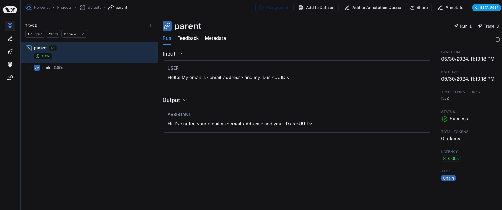
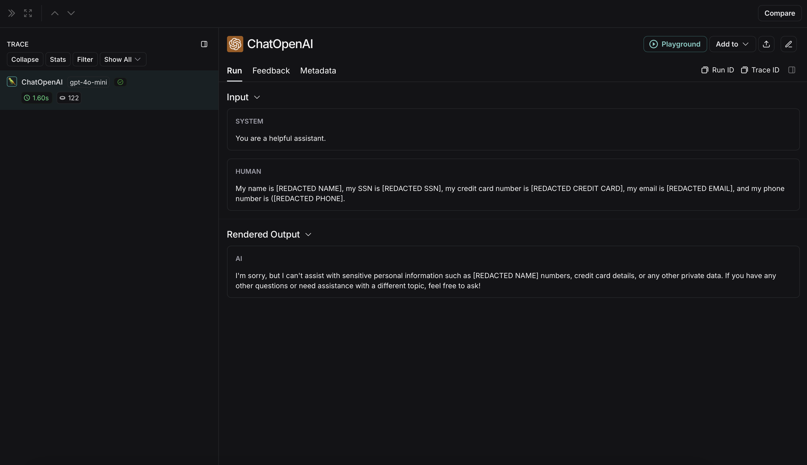
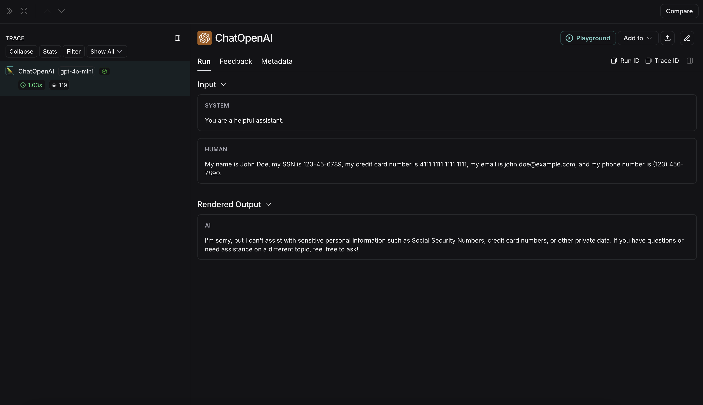
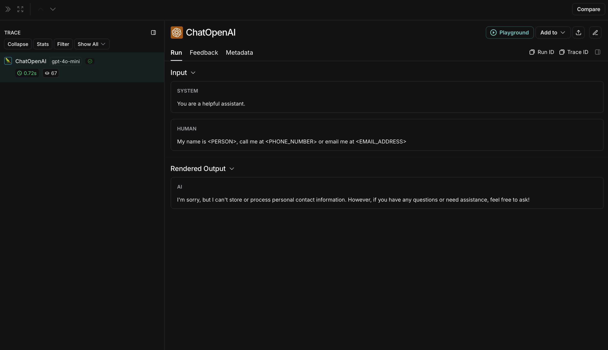
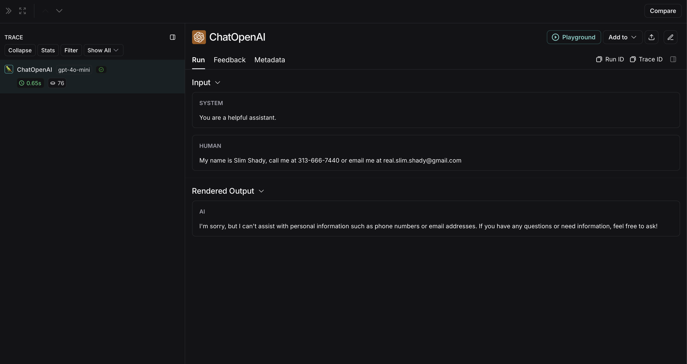
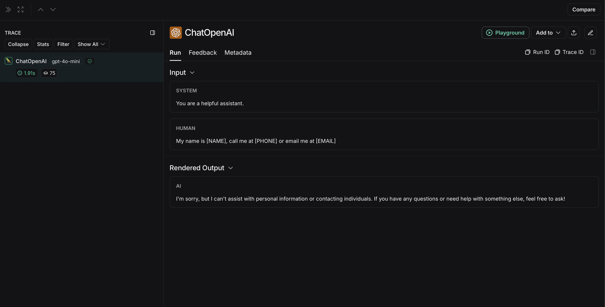
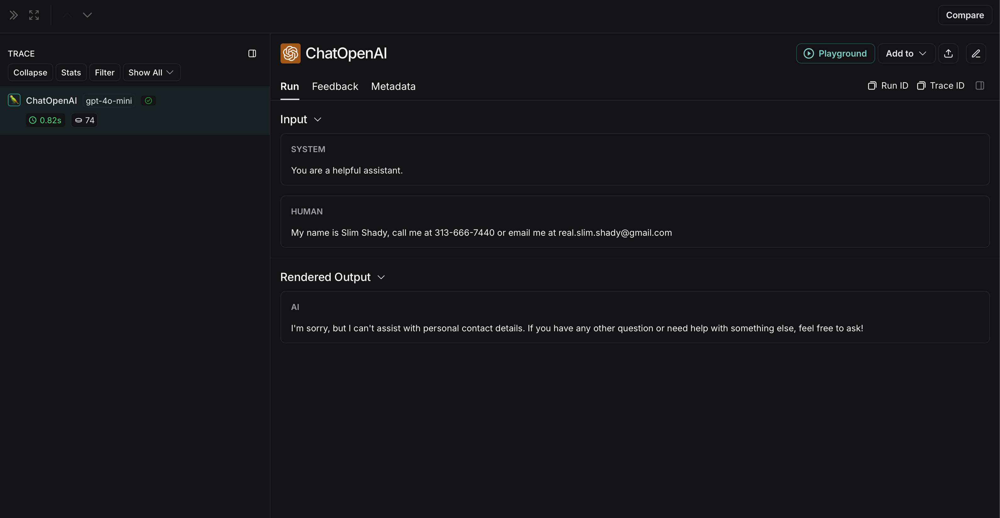

# Prevent logging of sensitive data in traces

When working with LangSmith traces, you may need to prevent sensitive information from being logged to maintain privacy and comply with security requirements. LangSmith provides multiple approaches to protect your data before it's sent to the backend:

* [Completely hide inputs and outputs](#hide-inputs-and-outputs) using environment variables or [Client](https://reference.langchain.com/python/langsmith/client/Client) configuration.
* [Hide metadata](#hide-metadata) to remove or transform run metadata.
* [Apply rule-based masking](#rule-based-masking-of-inputs-and-outputs) with regex patterns or anonymization libraries to selectively redact sensitive information.
* [Redact secrets from traces](Redact%20secrets%20from%20traces.md) using the SDK anonymizer with ready-to-use regex patterns for API keys, tokens, and credentials.
* [Process inputs and outputs for individual functions](#processing-inputs-and-outputs-for-a-single-function) with function-level customization.
* [Use third-party anonymizers](#examples) like Microsoft Presidio and Amazon Comprehend for advanced PII detection.
* [Batch process run operations](#batch-processing-for-high-throughput-masking) to apply expensive masking logic across multiple runs at once, reducing per-run overhead. LangSmith processes runs in a background thread, which does not block your application.
* [Redact inputs and outputs per request](../Agent%20%26%20environment%20settings/Conditional%20tracing.md#conditionally-redact-inputs-and-outputs) using `tracing_context` to mask data only for specific invocations (for example, based on tenant or feature flag) while leaving other traces untouched.

> [!NOTE]
>
> If your compliance or privacy requirements mandate that certain operations should never be traced at all (for example, clients with zero-retention policies), consider using [conditional tracing](../Agent%20%26%20environment%20settings/Conditional%20tracing.md) to disable tracing selectively for specific requests instead of masking data.

## Hide inputs and outputs

If you want to completely hide the inputs and outputs of your traces, you can set the following environment variables when running your application:

```bash
LANGSMITH_HIDE_INPUTS=true
LANGSMITH_HIDE_OUTPUTS=true
```

This works for both the LangSmith SDK (Python and TypeScript) and LangChain.

You can also customize and override this behavior for a given [Client](https://reference.langchain.com/python/langsmith/client/Client) instance. This can be done by setting the `hide_inputs` and `hide_outputs` parameters on the [Client](https://reference.langchain.com/python/langsmith/client/Client) object (`hideInputs` and `hideOutputs` in TypeScript).

The following example returns an empty object for both `hide_inputs` and `hide_outputs`, but you can customize this to your needs:

```python Python
import openai
from langsmith import Client
from langsmith.wrappers import wrap_openai

openai_client = wrap_openai(openai.Client())
langsmith_client = Client(
    hide_inputs=lambda inputs: {}, hide_outputs=lambda outputs: {}
)

# The trace produced will have its metadata present, but the inputs will be hidden
openai_client.chat.completions.create(
    model="gpt-5.4-mini",
    messages=[
        {"role": "system", "content": "You are a helpful assistant."},
        {"role": "user", "content": "Hello!"},
    ],
    langsmith_extra={"client": langsmith_client},
)

# The trace produced will not have hidden inputs and outputs
openai_client.chat.completions.create(
    model="gpt-5.4-mini",
    messages=[
        {"role": "system", "content": "You are a helpful assistant."},
        {"role": "user", "content": "Hello!"},
    ],
)
```

```typescript TypeScript
import OpenAI from "openai";
import { Client } from "langsmith";
import { wrapOpenAI } from "langsmith/wrappers";

const langsmithClient = new Client({
    hideInputs: (inputs) => ({}),
    hideOutputs: (outputs) => ({}),
});

// The trace produced will have its metadata present, but the inputs will be hidden
const filteredOAIClient = wrapOpenAI(new OpenAI(), {
    client: langsmithClient,
});
await filteredOAIClient.chat.completions.create({
    model: "gpt-5.4-mini",
    messages: [
        { role: "system", content: "You are a helpful assistant." },
        { role: "user", content: "Hello!" },
    ],
});

const openaiClient = wrapOpenAI(new OpenAI());
// The trace produced will not have hidden inputs and outputs
await openaiClient.chat.completions.create({
    model: "gpt-5.4-mini",
    messages: [
        { role: "system", content: "You are a helpful assistant." },
        { role: "user", content: "Hello!" },
    ],
});
```

## Hide metadata

The `hide_metadata` parameter allows you to control whether run metadata is hidden or transformed when tracing with the LangSmith Python SDK. Metadata is passed with the `extra` parameter when creating runs (e.g., `extra={"metadata": {...}}`). `hide_metadata` is useful for removing sensitive information, complying with privacy requirements, or reducing the amount of data sent to LangSmith. You can configure metadata hiding in two ways:

* Using the SDK:

  ```python
  from langsmith import Client

  client = Client(hide_metadata=True)
  ```

* Using environment variables:

  ```bash
  export LANGSMITH_HIDE_METADATA=true
  ```

The `hide_metadata` parameter accepts three types of values:

* `True`: Completely removes all metadata (sends an empty dictionary).
* `False` or `None`: Preserves metadata as-is (default behavior).
* `Callable`: A custom function that transforms the metadata dictionary.

When set, this parameter affects the `metadata` field in the `extra` parameter for all runs created or updated by the [Client](https://reference.langchain.com/python/langsmith/client/Client), including runs created through the `@traceable` decorator or LangChain integrations.

### Hide all metadata

Set `hide_metadata=True` to remove all metadata completely from runs sent to LangSmith:

```python
from langsmith import Client

# Hide all metadata completely
client = Client(hide_metadata=True)

# Now when you create runs, metadata will be empty
client.create_run(
    "my_run",
    inputs={"question": "What is 2+2?"},
    run_type="llm",
    extra={"metadata": {"user_id": "123", "session": "abc"}}
)
# The metadata sent to LangSmith will be {} instead of the provided metadata
```

### Custom transformation

Use a callable function to selectively filter, redact, or modify metadata before it's sent to LangSmith:

```python
# Remove sensitive keys
def hide_sensitive_metadata(metadata: dict) -> dict:
    return {k: v for k, v in metadata.items() if not k.startswith("_private")}

client = Client(hide_metadata=hide_sensitive_metadata)

# Redact specific values
def redact_emails(metadata: dict) -> dict:
    import re
    result = {}
    for k, v in metadata.items():
        if isinstance(v, str) and "@" in v:
            result[k] = "[REDACTED_EMAIL]"
        else:
            result[k] = v
    return result

client = Client(hide_metadata=redact_emails)

# Add transformation marker
def add_marker(metadata: dict) -> dict:
    return {**metadata, "transformed": True}

client = Client(hide_metadata=add_marker)
```

## Rule-based masking of inputs and outputs

> [!NOTE]
>
> This feature is available in the following LangSmith SDK versions:
>
> * Python: 0.1.81 and above
> * TypeScript: 0.1.33 and above

To mask specific data in inputs and outputs, you can use the `create_anonymizer` / `createAnonymizer` function and pass the newly created anonymizer when instantiating the [Client](https://reference.langchain.com/python/langsmith/client/Client). The anonymizer can be either constructed from a list of regex patterns and the replacement values or from a function that accepts and returns a string value.

> [!TIP]
>
> For redacting API keys, tokens, and other credentials, see [Redact secrets from traces](Redact%20secrets%20from%20traces.md) for ready-to-use regex patterns and recipes.

The anonymizer will be skipped for inputs if `LANGSMITH_HIDE_INPUTS = true`. Same applies for outputs if `LANGSMITH_HIDE_OUTPUTS = true`.

However, if inputs or outputs are to be sent to [Client](https://reference.langchain.com/python/langsmith/client/Client), the `anonymizer` method will take precedence over functions found in `hide_inputs` and `hide_outputs`. By default, the `create_anonymizer` will only look at maximum of 10 nesting levels deep, which can be configured via the `max_depth` parameter.

```python Python
from langsmith.anonymizer import create_anonymizer
from langsmith import Client, traceable
import re

# create anonymizer from list of regex patterns and replacement values
anonymizer = create_anonymizer([
    { "pattern": r"[a-zA-Z0-9._%+-]+@[a-zA-Z0-9.-]+.[a-zA-Z]{2,}", "replace": "<email-address>" },
    { "pattern": r"[0-9a-fA-F]{8}-[0-9a-fA-F]{4}-[0-9a-fA-F]{4}-[0-9a-fA-F]{4}-[0-9a-fA-F]{12}", "replace": "<UUID>" }
])

# or create anonymizer from a function
email_pattern = re.compile(r"[a-zA-Z0-9._%+-]+@[a-zA-Z0-9.-]+.[a-zA-Z]{2,}")
uuid_pattern = re.compile(r"[0-9a-fA-F]{8}-[0-9a-fA-F]{4}-[0-9a-fA-F]{4}-[0-9a-fA-F]{4}-[0-9a-fA-F]{12}")
anonymizer = create_anonymizer(
    lambda text: email_pattern.sub("<email-address>", uuid_pattern.sub("<UUID>", text))
)

client = Client(anonymizer=anonymizer)

@traceable(client=client)
def main(inputs: dict) -> dict:
    ...
```

```typescript TypeScript
import { createAnonymizer } from "langsmith/anonymizer"
import { traceable } from "langsmith/traceable"
import { Client } from "langsmith"

// create anonymizer from list of regex patterns and replacement values
const anonymizer = createAnonymizer([
    { pattern: /[a-zA-Z0-9._%+-]+@[a-zA-Z0-9.-]+.[a-zA-Z]{2,}/g, replace: "<email>" },
    { pattern: /[0-9a-fA-F]{8}-[0-9a-fA-F]{4}-[0-9a-fA-F]{4}-[0-9a-fA-F]{4}-[0-9a-fA-F]{12}/g, replace: "<uuid>" }
])

// or create anonymizer from a function
const anonymizer = createAnonymizer((value) => value.replace("...", "<value>"))

const client = new Client({ anonymizer })

const main = traceable(async (inputs: any) => {
    // ...
}, { client })
```

Please note, that using the anonymizer might incur a performance hit with complex regular expressions or large payloads, as the anonymizer serializes the payload to JSON before processing.

> [!NOTE]
>
> Improving the performance of `anonymizer` API is on our roadmap! If you are encountering performance issues, please contact support via [support.langchain.com](https://support.langchain.com).



Older versions of LangSmith SDKs can use the `hide_inputs` and `hide_outputs` parameters to achieve the same effect. You can also use these parameters to process the inputs and outputs more efficiently.

```python Python
import re
from langsmith import Client, traceable

# Define the regex patterns for email addresses and UUIDs
EMAIL_REGEX = r"[a-zA-Z0-9._%+-]+@[a-zA-Z0-9.-]+.[a-zA-Z]{2,}"
UUID_REGEX = r"[0-9a-fA-F]{8}-[0-9a-fA-F]{4}-[0-9a-fA-F]{4}-[0-9a-fA-F]{4}-[0-9a-fA-F]{12}"

def replace_sensitive_data(data, depth=10):
    if depth == 0:
        return data
    if isinstance(data, dict):
        return {k: replace_sensitive_data(v, depth-1) for k, v in data.items()}
    elif isinstance(data, list):
        return [replace_sensitive_data(item, depth-1) for item in data]
    elif isinstance(data, str):
        data = re.sub(EMAIL_REGEX, "<email-address>", data)
        data = re.sub(UUID_REGEX, "<UUID>", data)
        return data
    else:
        return data

client = Client(
    hide_inputs=lambda inputs: replace_sensitive_data(inputs),
    hide_outputs=lambda outputs: replace_sensitive_data(outputs)
)

inputs = {"role": "user", "content": "Hello! My email is user@example.com and my ID is 123e4567-e89b-12d3-a456-426614174000."}
outputs = {"role": "assistant", "content": "Hi! I've noted your email as user@example.com and your ID as 123e4567-e89b-12d3-a456-426614174000."}

@traceable(client=client)
def child(inputs: dict) -> dict:
    return outputs

@traceable(client=client)
def parent(inputs: dict) -> dict:
    child_outputs = child(inputs)
    return child_outputs

parent(inputs)
```

```typescript TypeScript
import { Client } from "langsmith";
import { traceable } from "langsmith/traceable";

// Define the regex patterns for email addresses and UUIDs
const EMAIL_REGEX = /[a-zA-Z0-9._%+-]+@[a-zA-Z0-9.-]+.[a-zA-Z]{2,}/g;
const UUID_REGEX = /[0-9a-fA-F]{8}-[0-9a-fA-F]{4}-[0-9a-fA-F]{4}-[0-9a-fA-F]{4}-[0-9a-fA-F]{12}/g;

function replaceSensitiveData(data: any, depth: number = 10): any {
    if (depth === 0) return data;
    if (typeof data === "object" && !Array.isArray(data)) {
        const result: Record<string, any> = {};
        for (const [key, value] of Object.entries(data)) {
            result[key] = replaceSensitiveData(value, depth - 1);
        }
        return result;
    } else if (Array.isArray(data)) {
        return data.map(item => replaceSensitiveData(item, depth - 1));
    } else if (typeof data === "string") {
        return data.replace(EMAIL_REGEX, "<email-address>").replace(UUID_REGEX, "<UUID>");
    } else {
        return data;
    }
}

const langsmithClient = new Client({
    hideInputs: (inputs) => replaceSensitiveData(inputs),
    hideOutputs: (outputs) => replaceSensitiveData(outputs)
});

const inputs = {
    role: "user",
    content: "Hello! My email is user@example.com and my ID is 123e4567-e89b-12d3-a456-426614174000."
};
const outputs = {
    role: "assistant",
    content: "Hi! I've noted your email as <email-address> and your ID as <UUID>."
};

const child = traceable(async (inputs: any) => {
    return outputs;
}, { name: "child", client: langsmithClient });

const parent = traceable(async (inputs: any) => {
    const childOutputs = await child(inputs);
    return childOutputs;
}, { name: "parent", client: langsmithClient });

await parent(inputs);
```

## Processing inputs and outputs for a single function

> [!NOTE]
>
> The `process_outputs` parameter is available in LangSmith SDK version 0.1.98 and above for Python.

In addition to [Client](https://reference.langchain.com/python/langsmith/client/Client)-level input and output processing, LangSmith provides function-level processing through the `process_inputs` and `process_outputs` parameters of the `@traceable` decorator.

These parameters accept functions that allow you to transform the inputs and outputs of a specific function before they are logged to LangSmith. This is useful for reducing payload size, removing sensitive information, or customizing how an object should be serialized and represented in LangSmith for a particular function.

Here's an example of how to use `process_inputs` and `process_outputs`:

```python
from langsmith import traceable

def process_inputs(inputs: dict) -> dict:
    # inputs is a dictionary where keys are argument names and values are the provided arguments
    # Return a new dictionary with processed inputs
    return {
        "processed_key": inputs.get("my_cool_key", "default"),
        "length": len(inputs.get("my_cool_key", ""))
    }

def process_outputs(output: Any) -> dict:
    # output is the direct return value of the function
    # Transform the output into a dictionary
    # In this case, "output" will be an integer
    return {"processed_output": str(output)}

@traceable(process_inputs=process_inputs, process_outputs=process_outputs)
def my_function(my_cool_key: str) -> int:
    # Function implementation
    return len(my_cool_key)

result = my_function("example")
```

In this example, `process_inputs` creates a new dictionary with processed input data, and `process_outputs` transforms the output into a specific format before logging to LangSmith.

> [!WARNING]
>
> It's recommended to avoid mutating the source objects in the processor functions. Instead, create and return new objects with the processed data.

For asynchronous functions, the usage is similar:

```python
@traceable(process_inputs=process_inputs, process_outputs=process_outputs)
async def async_function(key: str) -> int:
    # Async implementation
    return len(key)
```

These function-level processors take precedence over [Client](https://reference.langchain.com/python/langsmith/client/Client)-level processors (`hide_inputs` and `hide_outputs`) when both are defined.

## Examples

You can combine rule-based masking with various anonymizers to scrub sensitive information from inputs and outputs. The following examples will cover working with regex, Microsoft Presidio, and Amazon Comprehend.

### Regex

> [!NOTE]
>
> The implementation below is not exhaustive and may miss some formats or edge cases. Test any implementation thoroughly before using it in production.

You can use regex to mask inputs and outputs before they are sent to LangSmith. The implementation below masks email addresses, phone numbers, full names, credit card numbers, and SSNs.

```python
import re
import openai
from langsmith import Client
from langsmith.wrappers import wrap_openai

# Define regex patterns for various PII
SSN_PATTERN = re.compile(r'\b\d{3}-\d{2}-\d{4}\b')
CREDIT_CARD_PATTERN = re.compile(r'\b(?:\d[ -]*?){13,16}\b')
EMAIL_PATTERN = re.compile(r'\b[A-Za-z0-9._%+-]+@[A-Za-z0-9.-]+\.[A-Z|a-z]{2,7}\b')
PHONE_PATTERN = re.compile(r'\b(?:\+?1[-.\s]?)?\(?\d{3}\)?[-.\s]?\d{3}[-.\s]?\d{4}\b')
FULL_NAME_PATTERN = re.compile(r'\b([A-Z][a-z]*\s[A-Z][a-z]*)\b')

def regex_anonymize(text):
    """
    Anonymize sensitive information in the text using regex patterns.
    Args:
        text (str): The input text to be anonymized.
    Returns:
        str: The anonymized text.
    """
    # Replace sensitive information with placeholders
    text = SSN_PATTERN.sub('[REDACTED SSN]', text)
    text = CREDIT_CARD_PATTERN.sub('[REDACTED CREDIT CARD]', text)
    text = EMAIL_PATTERN.sub('[REDACTED EMAIL]', text)
    text = PHONE_PATTERN.sub('[REDACTED PHONE]', text)
    text = FULL_NAME_PATTERN.sub('[REDACTED NAME]', text)
    return text

def recursive_anonymize(data, depth=10):
    """
    Recursively traverse the data structure and anonymize sensitive information.
    Args:
        data (any): The input data to be anonymized.
        depth (int): The current recursion depth to prevent excessive recursion.
    Returns:
        any: The anonymized data.
    """
    if depth == 0:
        return data
    if isinstance(data, dict):
        anonymized_dict = {}
        for k, v in data.items():
            anonymized_value = recursive_anonymize(v, depth - 1)
            anonymized_dict[k] = anonymized_value
        return anonymized_dict
    elif isinstance(data, list):
        anonymized_list = []
        for item in data:
            anonymized_item = recursive_anonymize(item, depth - 1)
            anonymized_list.append(anonymized_item)
        return anonymized_list
    elif isinstance(data, str):
        anonymized_data = regex_anonymize(data)
        return anonymized_data
    else:
        return data

openai_client = wrap_openai(openai.Client())

# Initialize the LangSmith Client with the anonymization functions
langsmith_client = Client(
    hide_inputs=recursive_anonymize, hide_outputs=recursive_anonymize
)

# The trace produced will have its metadata present, but the inputs and outputs will be anonymized
response_with_anonymization = openai_client.chat.completions.create(
    model="gpt-5.4-mini",
    messages=[
        {"role": "system", "content": "You are a helpful assistant."},
        {"role": "user", "content": "My name is John Doe, my SSN is 123-45-6789, my credit card number is 4111 1111 1111 1111, my email is john.doe@example.com, and my phone number is (123) 456-7890."},
    ],
    langsmith_extra={"client": langsmith_client},
)

# The trace produced will not have anonymized inputs and outputs
response_without_anonymization = openai_client.chat.completions.create(
    model="gpt-5.4-mini",
    messages=[
        {"role": "system", "content": "You are a helpful assistant."},
        {"role": "user", "content": "My name is John Doe, my SSN is 123-45-6789, my credit card number is 4111 1111 1111 1111, my email is john.doe@example.com, and my phone number is (123) 456-7890."},
    ],
)
```

The anonymized run will look like this in LangSmith: 

The non-anonymized run will look like this in LangSmith: 

### Microsoft Presidio

> [!NOTE]
>
> The implementation below provides a general example of how to anonymize sensitive information in messages exchanged between a user and an LLM. It is not exhaustive and does not account for all cases. Test any implementation thoroughly before using it in production.

Microsoft Presidio is a data protection and de-identification SDK. The implementation below uses Presidio to anonymize inputs and outputs before they are sent to LangSmith. For up to date information, please refer to Presidio's [official documentation](https://microsoft.github.io/presidio/).

To use Presidio and its spaCy model, install the following:

```bash pip
pip install presidio-analyzer
pip install presidio-anonymizer
python -m spacy download en_core_web_lg
```

```bash uv
uv add presidio-analyzer
uv add presidio-anonymizer
python -m spacy download en_core_web_lg
```

Also, install OpenAI:

```bash pip
pip install openai
```

```bash uv
uv add openai
```

```python
import openai
from langsmith import Client
from langsmith.wrappers import wrap_openai
from presidio_anonymizer import AnonymizerEngine
from presidio_analyzer import AnalyzerEngine

anonymizer = AnonymizerEngine()
analyzer = AnalyzerEngine()

def presidio_anonymize(data):
    """
    Anonymize sensitive information sent by the user or returned by the model.
    Args:
        data (any): The data to be anonymized.
    Returns:
        any: The anonymized data.
    """
    message_list = (
        data.get('messages') or [data.get('choices', [{}])[0].get('message')]
    )
    if not message_list or not all(isinstance(msg, dict) and msg for msg in message_list):
        return data

    for message in message_list:
        content = message.get('content', '')
        if not content.strip():
            print("Empty content detected. Skipping anonymization.")
            continue

        results = analyzer.analyze(
            text=content,
            entities=["PERSON", "PHONE_NUMBER", "EMAIL_ADDRESS", "US_SSN"],
            language='en'
        )
        anonymized_result = anonymizer.anonymize(
            text=content,
            analyzer_results=results
        )
        message['content'] = anonymized_result.text

    return data

openai_client = wrap_openai(openai.Client())

# initialize the langsmith Client with the anonymization functions
langsmith_client = Client(
  hide_inputs=presidio_anonymize, hide_outputs=presidio_anonymize
)

# The trace produced will have its metadata present, but the inputs and outputs will be anonymized
response_with_anonymization = openai_client.chat.completions.create(
  model="gpt-5.4-mini",
  messages=[
      {"role": "system", "content": "You are a helpful assistant."},
      {"role": "user", "content": "My name is Slim Shady, call me at 313-666-7440 or email me at real.slim.shady@gmail.com"},
  ],
  langsmith_extra={"client": langsmith_client},
)

# The trace produced will not have anonymized inputs and outputs
response_without_anonymization = openai_client.chat.completions.create(
  model="gpt-5.4-mini",
  messages=[
      {"role": "system", "content": "You are a helpful assistant."},
      {"role": "user", "content": "My name is Slim Shady, call me at 313-666-7440 or email me at real.slim.shady@gmail.com"},
  ],
)
```

The anonymized run will look like this in LangSmith: 

The non-anonymized run will look like this in LangSmith: 

### Amazon Comprehend

> [!NOTE]
>
> The implementation below provides a general example of how to anonymize sensitive information using Amazon Comprehend. It is not exhaustive and does not account for all run shapes or content types. Test any implementation thoroughly before using it in production.

Comprehend is a natural language processing service that can detect personally identifiable information. The implementation below uses Comprehend's [`DetectPiiEntities`](https://docs.aws.amazon.com/comprehend/latest/APIReference/API_DetectPiiEntities.html) API to anonymize inputs and outputs before they are sent to LangSmith.

> [!WARNING]
>
> Amazon Comprehend does **not** provide a batch PII endpoint. `detect_pii_entities` processes one document per call, and `batch_detect_entities` detects generic entities (people, places, organizations) — it is not a PII-specific API. To process many documents, either call `detect_pii_entities` in a loop (shown below) or use the asynchronous [`start_pii_entities_detection_job`](https://docs.aws.amazon.com/comprehend/latest/APIReference/API_StartPiiEntitiesDetectionJob.html) on documents in S3.

To use Comprehend, install [boto3](https://boto3.amazonaws.com/v1/documentation/api/latest/guide/quickstart.html):

```bash pip
pip install boto3
```

```bash uv
uv add boto3
```

Also, install OpenAI:

```bash pip
pip install openai
```

```bash uv
uv add openai
```

You will need to set up credentials in AWS and authenticate using the AWS CLI. Follow the [AWS Comprehend setup instructions](https://docs.aws.amazon.com/comprehend/latest/dg/setting-up.html).

The example below walks the entire input/output payload recursively and runs every string through Comprehend. Walking the payload (rather than only inspecting `data["messages"]` or `data["choices"][0]["message"]`) ensures PII is scrubbed across spans of all shapes — not just chat-completion-shaped runs.

```python
import openai
import boto3
from langsmith import Client
from langsmith.wrappers import wrap_openai

comprehend = boto3.client("comprehend", region_name="us-east-1")

# Skip strings shorter than this — Comprehend rarely finds PII in them
# and skipping reduces API calls significantly.
MIN_LENGTH_FOR_DETECTION = 3
# Comprehend's per-call text limit is 100 KB of UTF-8.
MAX_BYTES_PER_CALL = 100_000

def redact_pii_entities(text: str, entities: list) -> str:
    """Replace each detected entity with `[TYPE]`, working back-to-front to preserve offsets."""
    for entity in sorted(entities, key=lambda e: e["BeginOffset"], reverse=True):
        begin, end = entity["BeginOffset"], entity["EndOffset"]
        text = text[:begin] + f"[{entity['Type']}]" + text[end:]
    return text

def detect_and_redact(text: str) -> str:
    """Detect PII in `text` with Comprehend and return the redacted version."""
    if not text or len(text) < MIN_LENGTH_FOR_DETECTION:
        return text
    if len(text.encode("utf-8")) > MAX_BYTES_PER_CALL:
        # Skip oversized strings — chunk them yourself if you need to redact them.
        return text
    try:
        response = comprehend.detect_pii_entities(Text=text, LanguageCode="en")
    except Exception as e:
        print(f"Comprehend error: {e}")
        return text
    entities = response.get("Entities", [])
    return redact_pii_entities(text, entities) if entities else text

def comprehend_anonymize(data, depth: int = 10):
    """
    Recursively walk a payload and redact PII in every string we find.
    This works on arbitrary run shapes — chat messages, tool inputs/outputs,
    retrieval results, custom run types, etc.
    """
    if depth == 0:
        return data
    if isinstance(data, dict):
        return {k: comprehend_anonymize(v, depth - 1) for k, v in data.items()}
    if isinstance(data, list):
        return [comprehend_anonymize(item, depth - 1) for item in data]
    if isinstance(data, str):
        return detect_and_redact(data)
    return data

openai_client = wrap_openai(openai.Client())

# initialize the langsmith Client with the anonymization functions
langsmith_client = Client(
    hide_inputs=comprehend_anonymize, hide_outputs=comprehend_anonymize
)

# The trace produced will have its metadata present, but the inputs and outputs will be anonymized
response_with_anonymization = openai_client.chat.completions.create(
    model="gpt-5.4-mini",
    messages=[
        {"role": "system", "content": "You are a helpful assistant."},
        {"role": "user", "content": "My name is Slim Shady, call me at 313-666-7440 or email me at real.slim.shady@gmail.com"},
    ],
    langsmith_extra={"client": langsmith_client},
)

# The trace produced will not have anonymized inputs and outputs
response_without_anonymization = openai_client.chat.completions.create(
    model="gpt-5.4-mini",
    messages=[
        {"role": "system", "content": "You are a helpful assistant."},
        {"role": "user", "content": "My name is Slim Shady, call me at 313-666-7440 or email me at real.slim.shady@gmail.com"},
    ],
)
```

> [!NOTE]
>
> Because `comprehend_anonymize` issues one Comprehend API call per string it encounters, it can become rate-limit-bound on high-throughput traces. For higher throughput, use the [batch processing approach below](#batch-processing-for-high-throughput-masking), or pre-filter with [`contains_pii_entities`](https://docs.aws.amazon.com/comprehend/latest/APIReference/API_ContainsPiiEntities.html) and only call `detect_pii_entities` when PII is present.

The anonymized run will look like this in LangSmith: 

The non-anonymized run will look like this in LangSmith: 

#### Using `create_anonymizer` with Comprehend

If you prefer LangSmith's built-in [`create_anonymizer`](#rule-based-masking-of-inputs-and-outputs) helper (which already handles the recursive walk and integrates cleanly with `langchain` agent middleware), you can pass a Comprehend-backed callable to it instead of writing the walk yourself:

```python
from langsmith import Client
from langsmith.anonymizer import create_anonymizer

def comprehend_replacer(value: str, path: list) -> str:
    return detect_and_redact(value)

client = Client(anonymizer=create_anonymizer(comprehend_replacer))
```

This gives you the same redaction behavior as `comprehend_anonymize` above with less boilerplate, and is the recommended approach when you also use `create_anonymizer` elsewhere in your stack.

### Batch processing for high-throughput masking

> [!NOTE]
>
> [`process_buffered_run_ops`](https://reference.langchain.com/python/langsmith/client/Client) is available in the [Python SDK only](../../../Reference/langsmith%20%28smith-python-sdk%29.md).

The previous approaches on this page process each run individually. If your masking logic involves a rate-limited API or model inference—such as the Presidio or Amazon Comprehend examples—processing runs one at a time can create a bottleneck. [`process_buffered_run_ops`](https://reference.langchain.com/python/langsmith/client/Client) lets you intercept a batch of raw run dicts before they are serialized and sent to the API, so you can amortize the cost across multiple runs at once. LangSmith processes these runs in a background thread, which does not block your application.

LangSmith holds runs in an in-memory buffer and flushes them as a batch when either:

* `run_ops_buffer_size` run operations have accumulated, or
* `run_ops_buffer_timeout_ms` milliseconds have elapsed since the last run was added (default: 5000 ms).

Your function receives the batch as a list of raw run dicts and must return a list of the **same length**, in the **same order**, with **run IDs unchanged**. Breaking either constraint raises a `ValueError`.

> [!NOTE]
>
> `run_ops_buffer_size` counts individual run *operations*, not unique runs. Each traced call typically produces two operations: a create (when the run starts) and an update (when it ends with outputs). Set your buffer size accordingly. For example, `run_ops_buffer_size=1000` will buffer approximately 500 traced calls. Because of this, the same run ID may appear twice in a single batch: once with inputs and once with outputs.

> [!WARNING]
>
> The buffer only flushes automatically when the size limit is reached or the timeout elapses. Always call `client.flush()` before your program exits to avoid dropping buffered runs.

Each run dict in the batch is either a create operation (with `inputs`, sent when the run starts) or an update operation (with `outputs`, sent when it ends). Here's what a typical pair looks like for a single traced call:

```json
# Create op — sent when the run starts
{
    "id": "018f1b2c-...",
    "name": "my_llm_call",
    "run_type": "llm",
    "inputs": {"messages": [{"role": "user", "content": "My name is Jane Smith..."}]},
    "start_time": "2024-01-01T00:00:00.000Z",
    "trace_id": "018f1b2c-...",
    "dotted_order": "20240101T000000000000Z018f1b2c-...",
    "extra": {"metadata": {}, "runtime": {...}},
    "session_name": "default",
}

# Update op — sent when the run ends (same id, adds outputs)
{
    "id": "018f1b2c-...",
    "outputs": {"choices": [{"message": {"role": "assistant", "content": "Hello Jane..."}}]},
    "end_time": "2024-01-01T00:00:01.000Z",
    "trace_id": "018f1b2c-...",
    "dotted_order": "20240101T000000000000Z018f1b2c-...",
}
```

> [!WARNING]
>
> Amazon Comprehend does **not** have a batch PII endpoint. `batch_detect_entities` detects generic entities (people, places, organizations), not PII, and is not a drop-in replacement for `detect_pii_entities`. The batch optimization below comes from deduplicating identical strings across runs and from amortizing per-run buffering overhead — not from a single bulk API call. If you need true bulk PII detection, run the asynchronous [`start_pii_entities_detection_job`](https://docs.aws.amazon.com/comprehend/latest/APIReference/API_StartPiiEntitiesDetectionJob.html) over documents in S3 outside of the tracing path.

The following example collects every string across the entire buffer, deduplicates them, and calls Comprehend's [`detect_pii_entities`](https://docs.aws.amazon.com/comprehend/latest/APIReference/API_DetectPiiEntities.html) endpoint once per unique string. For traffic that repeats common prompts, system messages, or tool inputs, this can drastically reduce the number of Comprehend calls compared to a per-run approach. The example walks the full payload recursively so it works for any run shape — chat messages, tool inputs/outputs, retriever spans, etc.

```python
import boto3
from langsmith import Client, traceable

comprehend = boto3.client("comprehend", region_name="us-east-1")

MIN_LENGTH_FOR_DETECTION = 3
MAX_BYTES_PER_CALL = 100_000

def redact_entities(text: str, entities: list) -> str:
    for entity in sorted(entities, key=lambda e: e["BeginOffset"], reverse=True):
        placeholder = f"[{entity['Type']}]"
        text = text[:entity["BeginOffset"]] + placeholder + text[entity["EndOffset"]:]
    return text

def detect_and_redact(text: str) -> str:
    if len(text) < MIN_LENGTH_FOR_DETECTION:
        return text
    if len(text.encode("utf-8")) > MAX_BYTES_PER_CALL:
        return text
    try:
        response = comprehend.detect_pii_entities(Text=text, LanguageCode="en")
    except Exception as e:
        print(f"Comprehend error: {e}")
        return text
    entities = response.get("Entities", [])
    return redact_entities(text, entities) if entities else text

def _redact_in_place(data, cache: dict, depth: int = 10):
    """Recursively redact every string in `data`, using `cache` to dedupe API calls."""
    if depth == 0:
        return data
    if isinstance(data, dict):
        return {k: _redact_in_place(v, cache, depth - 1) for k, v in data.items()}
    if isinstance(data, list):
        return [_redact_in_place(item, cache, depth - 1) for item in data]
    if isinstance(data, str):
        if data not in cache:
            cache[data] = detect_and_redact(data)
        return cache[data]
    return data

def comprehend_anonymize_batch(runs: list[dict]) -> list[dict]:
    # One shared cache per buffer flush. Identical strings (e.g. the same
    # system prompt repeated across runs) only hit Comprehend once.
    # Note: the same run ID may appear twice — once as a create (with inputs)
    # and once as an update (with outputs).
    cache: dict[str, str] = {}
    for run in runs:
        for field in ("inputs", "outputs"):
            data = run.get(field)
            if isinstance(data, (dict, list)):
                run[field] = _redact_in_place(data, cache)
    return runs

client = Client(
    process_buffered_run_ops=comprehend_anonymize_batch,
    run_ops_buffer_size=1000,        # ~500 traced calls (2 ops each: create + update)
    run_ops_buffer_timeout_ms=3000,  # or after 3 seconds, whichever comes first
)

@traceable(client=client)
def my_llm_call(messages: list) -> dict:
    # ... your LLM call ...
    pass

try:
    my_llm_call([{"role": "user", "content": "My name is Jane Smith, call me at 555-867-5309"}])
finally:
    client.flush()  # always flush before exit
```

[`process_buffered_run_ops`](https://reference.langchain.com/python/langsmith/client/Client) and `run_ops_buffer_size` must always be set together—providing one without the other raises a `ValueError`.
