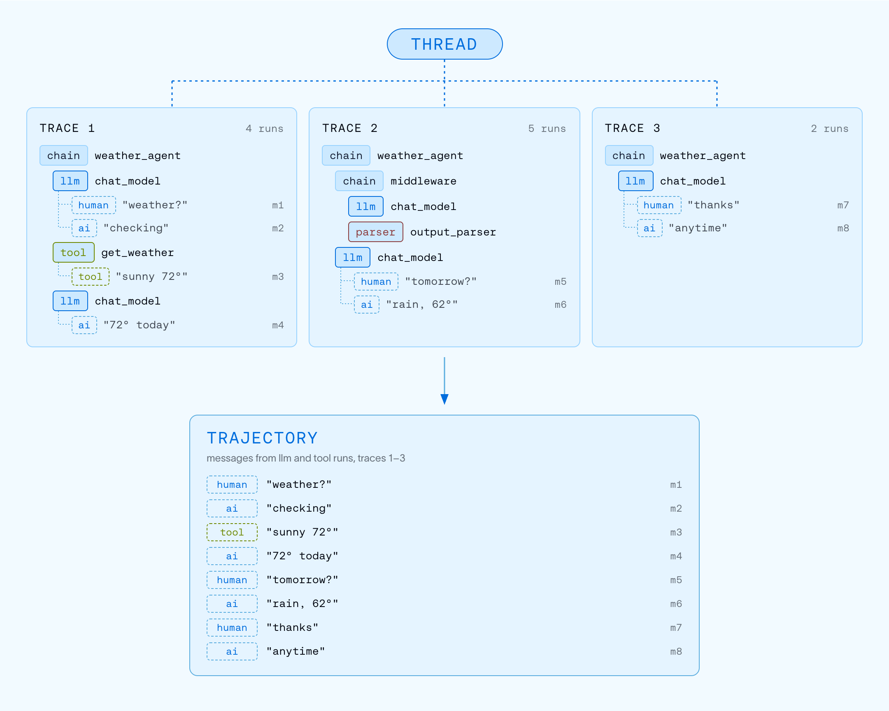

# Observability concepts

> How LangSmith structures observability data as runs, traces, threads, and trajectories, and how to send traces.

LangSmith Observability lets you record, inspect, and analyze every step your AI agent takes. This page explains how that data is structured and visualized in LangSmith as well as how to start sending traces.

## How LangSmith structures and visualizes data

In LangSmith, every unit of work an agent performs, such as a model call, tool invocation, or information retrieval, is recorded as a [*run*](#runs). The runs for a single operation are collected into a [*trace*](#traces). You can link together traces from multi-turn sessions as a [*thread*](#threads).

A [*trajectory*](#trajectories) is another way to structure and visualize that data. While a thread groups the traces of a session and keeps their nested structure, a trajectory flattens the entire session into an ordered list of messages that shows the path an agent took from start to finish.

### Runs

A *run* represents a single unit of work executed by an agent, such as calling an LLM, formatting a prompt, or retrieving documents. If you are familiar with [OpenTelemetry](https://opentelemetry.io/), you can think of a run as a span.

### Traces

A *trace* is a collection of runs for a single operation. For example, if a user request triggers an agent that calls a model, runs a tool, and then calls the model again, all of those runs belong to the same trace. Runs are bound to a trace by a unique trace ID.

> [!NOTE]
>
> Each trace is limited to a maximum of 25,000 runs. Once the trace reaches this limit, LangSmith will reject any additional runs that you send for that trace.

### Threads

A *thread* is a sequence of traces representing a single multi-turn session. A turn is one exchange in that session: a user's message and everything the agent does in response. Each turn is recorded as its own trace. To group traces into a thread, pass a `thread_id` metadata key with a unique value.

[Learn how to configure threads](../Debug/Configure%20threads.md).

### Trajectories

A *trajectory* is a flat, ordered list of messages that shows the path an agent took from start to finish.

In LangSmith, a trajectory is a projection over the traces in a thread. It contains the human, AI, and tool messages exchanged during the session, each appearing once, in the order it first appeared, with the nesting of runs removed.

[Learn how trajectories render in the Trajectory view](../Debug/Trajectory%20view/Trajectory%20view%20integrations.md).

### Compare traces, threads, and trajectories

| | Trace | Thread | Trajectory |
| - | - | - | - |
| Shape | Tree of runs | Sequence of traces | Flat, ordered list of messages |
| Contains | Every run, with full inputs and outputs | Every run in every linked trace | Every message in every linked trace, deduplicated |
| Reach for it when | You are debugging why one operation failed or ran slow | You are inspecting how the agent behaved across turns, with timing and nesting intact | You are reading what was exchanged in the session, without the execution detail |

Use **[Chat](../../Test/Datasets%20%26%20Experiments/Analyze%20experiment%20results/LangSmith%20Chat.md)** to analyze traces, runs, and threads. Chat helps you understand agent performance, debug issues, and gain insights from conversation threads without manually digging through data.

### Trace containers

An organization contains workspaces. Each workspace contains agents, and each agent has environments that separate its traces.

#### Agents and environments

> [!NOTE]
>
> **Agent-based workspaces.** This section applies if your workspace organizes traces by [agent and environment](../../LangSmith%20setup/Overview/Agent-based%20workspaces/Agent%20Registry.md). To check, look at the control at the top left: it names your workspace. If it shows the LangSmith logo instead, and the sidebar has an **Application** section with an application picker, your workspace is project-based. Skip this section and read [Tracing projects](Observability%20concepts.md#tracing-projects).

An *agent* has a stable identifier within its workspace. Use that identifier to associate traces with the agent that produced them. An agent's traces divide across *environments* drawn from a fixed set of four: Production, Staging, Development, and Local. Traces land in one environment of one agent, so a query about production behavior never has to exclude test traffic by hand.

[Log traces to an agent](Configuration%20%26%20troubleshooting/Agent%20%26%20environment%20settings/Log%20traces%20to%20an%20agent.md).

> [accordion] Compatibility with older workspaces and APIs
>
> > [!NOTE]
> >
> > **Project-based workspaces.** This section applies if your workspace organizes traces by [tracing project](Observability%20concepts.md#tracing-projects). To check, look at the control at the top left. In a project-based workspace, it shows the LangSmith logo, and the sidebar has an **Application** section with an application picker. If the control shows your workspace name instead, your workspace is agent-based. Skip this section and read [Agent Registry](../../LangSmith%20setup/Overview/Agent-based%20workspaces/Agent%20Registry.md).
>
> Older workspaces and self-hosted LangSmith group traces into tracing projects. In an agent-based workspace, each agent environment has its own trace storage: a backing tracing project. Some APIs and integrations still use its name or UUID through fields such as `project_name` and `session_id`. These fields refer to the environment's trace storage, not an additional agent you need to create. See [Resolve an agent environment](../Debug/Viewing%20%26%20managing%20traces/Resolve%20an%20agent%20environment.md).

## Trace enrichment

### Feedback

*Feedback* allows you to score an individual run based on certain criteria. Each feedback entry consists of a tag and a score, and is bound to a run by a unique run ID. Feedback can be continuous or discrete (categorical), and tags can be reused across runs within an organization.

For more on how feedback is stored, refer to the [Feedback data format guide](../Debug/Data%20type%20reference/Feedback%20data%20format.md).

### Tags

*Tags* are strings you can attach to runs to categorize, filter, and group them in the LangSmith UI.

[Learn how to attach tags to your traces](Configuration%20%26%20troubleshooting/Data%20%26%20privacy/Add%20metadata%20and%20tags%20to%20traces.md).

### Metadata

*Metadata* is a collection of key-value pairs you can attach to runs. For example, agent version, environment, or any other contextual information. Similarly to tags, you can use metadata to filter and group runs.

[Learn how to add metadata to your traces](Configuration%20%26%20troubleshooting/Data%20%26%20privacy/Add%20metadata%20and%20tags%20to%20traces.md).

## Sending traces

There are two ways to send trace data to LangSmith.

### Integrations

LangSmith *integrations* provide automatic tracing for popular LLM providers and agent frameworks (the equivalent of auto-instrumentation in general observability). When you use a supported framework such as LangChain, LangGraph, OpenAI, Anthropic, or CrewAI, the integration captures inputs, outputs, and metadata without requiring manual code changes.

[Browse all integrations](Tracing%20setup/Integrations/Integrations.md).

### Manual instrumentation

*Manual instrumentation* lets you add tracing to any code, regardless of the framework. Use it when you're not using a supported integration or when you need granular control over what gets traced. LangSmith provides three mechanisms:

* `@traceable` / `traceable`: a decorator to trace any function
* `trace` context manager (Python): wrap specific code blocks
* `RunTree` API: low-level, explicit trace construction

[Learn how to add manual instrumentation](Tracing%20setup/Manual%20instrumentation/Custom%20instrumentation.md).

## Data retention

LangSmith (SaaS) retains trace data for 180 days from ingestion. After that, traces are permanently deleted, with limited metadata retained for usage statistics. For details on retention tiers and pricing, refer to [Usage and billing: Data retention](Configuration%20%26%20troubleshooting/Usage%20and%20billing.md#data-retention).

> [!NOTE]
>
> To keep data beyond the retention period, add it to a [dataset](../../Test/Datasets%20%26%20Experiments/Datasets/Manage%20datasets.md). Datasets persist indefinitely, even after the source trace is deleted.

To delete traces before their expiration date, see [Manage a trace](../Debug/Viewing%20%26%20managing%20traces/Manage%20a%20trace.md#delete-a-trace).
