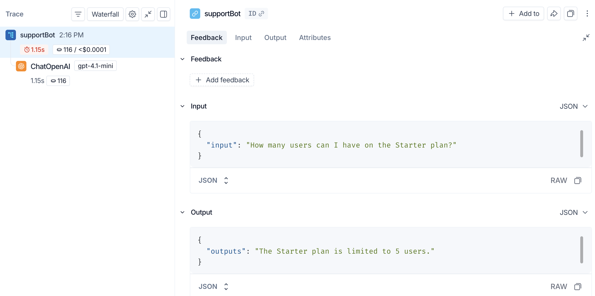
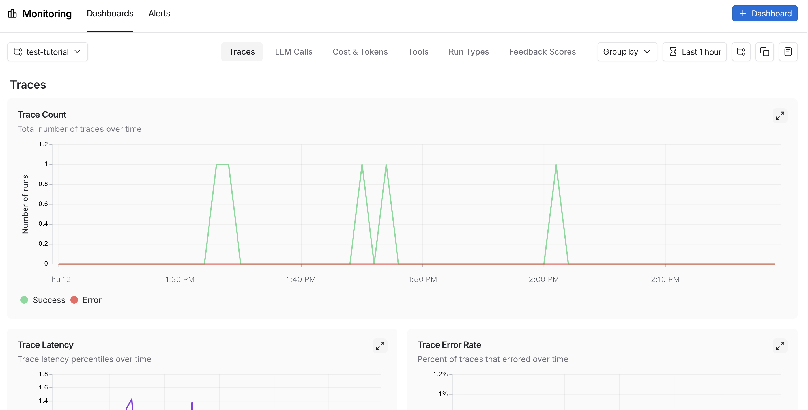
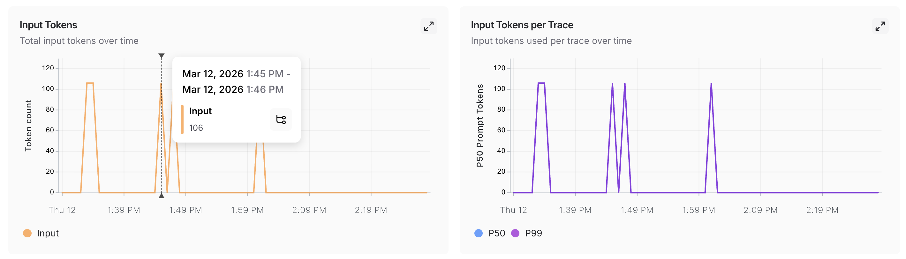

# Trace an agent

> Add LangSmith observability to an agent across prototyping, beta testing, and production.

In this tutorial, you will build a customer support chatbot using retrieval-augmented generation (RAG) and add LangSmith observability at each stage of development, from early prototyping through production.

By the end, you will know how to:

* Trace individual LLM calls and full agent pipelines.
* Collect and query user feedback.
* Log metadata and use it for filtering and A/B testing.
* Use monitoring dashboards to track production performance.

The agent will retrieve relevant documentation snippets and use them to answer user questions. The retriever is mocked in this tutorial; in a real agent you would replace it with a vector search or similar.

## Prerequisites

Before you begin, make sure you have:

* **A LangSmith account**: Sign up or log in at [smith.langchain.com](https://smith.langchain.com?utm_source=docs&utm_medium=cta&utm_campaign=langsmith-signup&utm_content=langsmith-observability-llm-tutorial).
* **A LangSmith API key**: Follow the [Create an API key](../../LangSmith%20setup/Account/Create%20an%20account%20and%20API%20key.md) guide.
* **An OpenAI API key**: Generate this from the [OpenAI dashboard](https://platform.openai.com/account/api-keys).
* **LangSmith CLI** (optional): Install to inspect traces from the terminal. For instructions, refer to [LangSmith CLI](../../LangSmith%20setup/Govern/Tools/LangSmith%20CLI.md).

Install the required packages:

```bash Python
pip install langsmith openai
```

```bash TypeScript
npm install langsmith openai
npm install -D typescript tsx
```

## Prototyping

Having observability set up from the start lets you iterate faster. You can see exactly what is being sent to the model, what is coming back, and where time is being spent, without adding print statements or running a debugger.

### Set up your environment

Set the following environment variables in your shell:

```bash
export LANGSMITH_TRACING=true
export LANGSMITH_API_KEY="<API_KEY>"
export OPENAI_API_KEY="<API_KEY>"
```

Before sending traces, create the agent in LangSmith:

1. In an [agent-based workspace](../../LangSmith%20setup/Overview/Agent-based%20workspaces/Agent%20Registry.md), open **+ Agent**, choose **Observability**, and create an agent with an **Agent name** and **Agent ID**. This requires the `projects:create` permission. If the agent already exists, reuse it.
2. Copy the **Agent ID** and choose an environment: `local`, `development`, `staging`, or `production`.
3. Configure [agent addressing](Configuration%20%26%20troubleshooting/Agent%20%26%20environment%20settings/Log%20traces%20to%20an%20agent.md) before running the agent:

   ```bash
   export LANGSMITH_AGENT_ID="<your-agent-id>"
   export LANGSMITH_AGENT_ENVIRONMENT="local"
   ```

Register the agent once, not for every trace. Remove `LANGSMITH_PROJECT`, `LANGCHAIN_PROJECT`, and `LANGCHAIN_SESSION` from the environment where your code runs. Do not combine legacy destination settings with agent addressing. To create the agent with an SDK call or API request, see [Create an agent programmatically](../../LangSmith%20setup/Overview/Agent-based%20workspaces/Create%20an%20agent.md#create-an-agent-programmatically).

> [accordion] Project-based workspaces and self-hosted LangSmith
>
> Agent addressing is available in agent-based workspaces on LangSmith Cloud. In a project-based workspace, including self-hosted LangSmith, set `LANGSMITH_PROJECT` to your tracing project name instead of setting the two agent variables.

> [!NOTE]
>
> You may see these variables referenced as `LANGCHAIN_*` in other places. Both work, but `LANGSMITH_TRACING` and `LANGSMITH_API_KEY` are the recommended names.

### Trace LLM calls

Start by tracing your OpenAI calls, where the model is actually invoked. This gives you immediate visibility into the prompts your app sends and the responses the model returns.

Wrap the OpenAI client with [`wrap_openai`](https://reference.langchain.com/python/langsmith/wrappers/_openai/wrap_openai) (Python) or [`wrapOpenAI`](https://reference.langchain.com/javascript/langsmith/wrappers/wrapOpenAI) (TypeScript). Create a file called `app.py` (or `app.ts`) with the following code:

```python Python
from openai import OpenAI
from langsmith.wrappers import wrap_openai

client = wrap_openai(OpenAI())

docs = [
    "Acme Cloud supports unlimited users on Enterprise plans. Starter plans are limited to 5 users.",
    "To reset your password, click 'Forgot password' on the login page and follow the instructions sent to your email.",
    "API rate limits are 1,000 requests per hour on the Starter plan and 10,000 requests per hour on Enterprise.",
]

def retriever(query: str) -> list[str]:
    return docs

def support_bot(question: str) -> str:
    context = retriever(question)
    system_message = (
        "You are a helpful customer support agent. "
        "Answer using only the information provided below:\n\n"
        + "\n".join(context)
    )
    response = client.chat.completions.create(
        model="gpt-5.4-mini",
        messages=[
            {"role": "system", "content": system_message},
            {"role": "user", "content": question},
        ],
    )
    return response.choices[0].message.content

if __name__ == "__main__":
    print(support_bot("How many users can I have on the Starter plan?"))
```

```typescript TypeScript
import OpenAI from "openai";
import { wrapOpenAI } from "langsmith/wrappers";

const client = wrapOpenAI(new OpenAI());

const docs = [
    "Acme Cloud supports unlimited users on Enterprise plans. Starter plans are limited to 5 users.",
    "To reset your password, click 'Forgot password' on the login page and follow the instructions sent to your email.",
    "API rate limits are 1,000 requests per hour on the Starter plan and 10,000 requests per hour on Enterprise.",
];

function retriever(query: string): string[] {
    return docs;
}

async function supportBot(question: string): Promise<string> {
    const context = retriever(question);
    const systemMessage =
        "You are a helpful customer support agent. " +
        "Answer using only the information provided below:\n\n" +
        context.join("\n");
    const response = await client.chat.completions.create({
        model: "gpt-5.4-mini",
        messages: [
            { role: "system", content: systemMessage },
            { role: "user", content: question },
        ],
    });
    return response.choices[0].message?.content ?? "";
}

(async () => {
    console.log(await supportBot("How many users can I have on the Starter plan?"));
})();
```

Calling `support_bot("How many users can I have on the Starter plan?")` produces a trace of the OpenAI call.

### Trace the whole pipeline

Tracing the LLM call is useful, but tracing the full pipeline (including retrieval) gives you a complete overview of your agent's behavior. Add [`@traceable`](https://reference.langchain.com/python/langsmith/run_helpers/traceable) (Python) or [`traceable`](https://reference.langchain.com/javascript/langsmith/traceable) (TypeScript) to the main function:

```python Python
from openai import OpenAI
from langsmith import traceable
from langsmith.wrappers import wrap_openai

client = wrap_openai(OpenAI())

docs = [
    "Acme Cloud supports unlimited users on Enterprise plans. Starter plans are limited to 5 users.",
    "To reset your password, click 'Forgot password' on the login page and follow the instructions sent to your email.",
    "API rate limits are 1,000 requests per hour on the Starter plan and 10,000 requests per hour on Enterprise.",
]

def retriever(query: str) -> list[str]:
    return docs

@traceable  # [!code highlight]
def support_bot(question: str) -> str:
    context = retriever(question)
    system_message = (
        "You are a helpful customer support agent. "
        "Answer using only the information provided below:\n\n"
        + "\n".join(context)
    )
    response = client.chat.completions.create(
        model="gpt-5.4-mini",
        messages=[
            {"role": "system", "content": system_message},
            {"role": "user", "content": question},
        ],
    )
    return response.choices[0].message.content

if __name__ == "__main__":
    print(support_bot("How many users can I have on the Starter plan?"))
```

```typescript TypeScript
import OpenAI from "openai";
import { wrapOpenAI } from "langsmith/wrappers";
import { traceable } from "langsmith/traceable";

const client = wrapOpenAI(new OpenAI());

const docs = [
    "Acme Cloud supports unlimited users on Enterprise plans. Starter plans are limited to 5 users.",
    "To reset your password, click 'Forgot password' on the login page and follow the instructions sent to your email.",
    "API rate limits are 1,000 requests per hour on the Starter plan and 10,000 requests per hour on Enterprise.",
];

function retriever(query: string): string[] {
    return docs;
}

const supportBot = traceable(async function supportBot(question: string): Promise<string> {  // [!code highlight]
    const context = retriever(question);
    const systemMessage =
        "You are a helpful customer support agent. " +
        "Answer using only the information provided below:\n\n" +
        context.join("\n");
    const response = await client.chat.completions.create({
        model: "gpt-5.4-mini",
        messages: [
            { role: "system", content: systemMessage },
            { role: "user", content: question },
        ],
    });
    return response.choices[0].message?.content ?? "";
});  // [!code highlight]

(async () => {
    console.log(await supportBot("How many users can I have on the Starter plan?"));
})();
```

Calling `support_bot("How many users can I have on the Starter plan?")` now produces a trace of the full RAG pipeline.



### Check your traces from the terminal

If you installed the [LangSmith CLI](../../LangSmith%20setup/Govern/Tools/LangSmith%20CLI.md), list recent traces for your agent environment without opening the UI. The CLI's `--project` option takes the environment's [`tracer_session_name`](../../LangSmith%20setup/Overview/Agent-based%20workspaces/Create%20an%20agent.md#use-an-environment-project):

```bash
langsmith trace list --project "<environment-tracer-session-name>" --limit 5
```

To view the full run hierarchy and inputs/outputs for a specific trace:

```bash
langsmith trace get <trace-id> --full
```

## Beta testing

Once your app is working well in prototyping, you release it to a small group of real users. At this stage, you often don't know exactly how users will interact with your app, so you need richer observability. You want to understand not just what the app did, but how users responded to it.

### Collect feedback

Linking [user feedback](../../Test/Annotation%20Queues/Feedback/Log%20user%20feedback%20using%20the%20SDK.md) to specific traces lets you identify which responses were helpful or unhelpful. Update `app.py` (or `app.ts`) from the previous step to add a run ID to each call and attach a score afterward:

```python Python
import asyncio  # [!code highlight]
import os  # [!code highlight]

from openai import OpenAI
from langsmith import Client, agent_address, traceable, uuid7  # [!code highlight]
from langsmith.wrappers import wrap_openai

client = wrap_openai(OpenAI())

docs = [
    "Acme Cloud supports unlimited users on Enterprise plans. Starter plans are limited to 5 users.",
    "To reset your password, click 'Forgot password' on the login page and follow the instructions sent to your email.",
    "API rate limits are 1,000 requests per hour on the Starter plan and 10,000 requests per hour on Enterprise.",
]

def retriever(query: str) -> list[str]:
    return docs

@traceable
def support_bot(question: str) -> str:
    context = retriever(question)
    system_message = (
        "You are a helpful customer support agent. "
        "Answer using only the information provided below:\n\n"
        + "\n".join(context)
    )
    response = client.chat.completions.create(
        model="gpt-5.4-mini",
        messages=[
            {"role": "system", "content": system_message},
            {"role": "user", "content": question},
        ],
    )
    return response.choices[0].message.content

if __name__ == "__main__":
    run_id = str(uuid7())  # [!code highlight]
    support_bot(  # [!code highlight]
        "How many users can I have on the Starter plan?",  # [!code highlight]
        langsmith_extra={"run_id": run_id},  # [!code highlight]
    )  # [!code highlight]
    ls_client = Client()  # [!code highlight]
    # Feedback requires the session_id for the agent environment  # [!code highlight]
    address = agent_address(  # [!code highlight]
        os.environ["LANGSMITH_AGENT_ID"], os.environ["LANGSMITH_AGENT_ENVIRONMENT"]  # [!code highlight]
    )  # [!code highlight]
    resolved = asyncio.run(ls_client.sessions.resolve(**address))  # [!code highlight]
    session_id = resolved.session_id  # [!code highlight]
    ls_client.create_feedback(  # [!code highlight]
        run_id, key="user-score", score=1.0, session_id=session_id  # [!code highlight]
    )  # [!code highlight]
```

```typescript TypeScript
import OpenAI from "openai";
import { wrapOpenAI } from "langsmith/wrappers";
import { traceable, getCurrentRunTree } from "langsmith/traceable"; // [!code highlight]
import { AgentAddress, Client } from "langsmith"; // [!code highlight]

const client = wrapOpenAI(new OpenAI());

const docs = [
    "Acme Cloud supports unlimited users on Enterprise plans. Starter plans are limited to 5 users.",
    "To reset your password, click 'Forgot password' on the login page and follow the instructions sent to your email.",
    "API rate limits are 1,000 requests per hour on the Starter plan and 10,000 requests per hour on Enterprise.",
];

function retriever(query: string): string[] {
    return docs;
}

let capturedRunId: string; // [!code highlight]

const supportBot = traceable(async function supportBot(question: string): Promise<string> {
    const runTree = getCurrentRunTree(); // [!code highlight]
    capturedRunId = runTree.id; // [!code highlight]
    const context = retriever(question);
    const systemMessage =
        "You are a helpful customer support agent. " +
        "Answer using only the information provided below:\n\n" +
        context.join("\n");
    const response = await client.chat.completions.create({
        model: "gpt-5.4-mini",
        messages: [
            { role: "system", content: systemMessage },
            { role: "user", content: question },
        ],
    });
    return response.choices[0].message?.content ?? "";
});

(async () => {
    await supportBot("How many users can I have on the Starter plan?"); // [!code highlight]
    const lsClient = new Client(); // [!code highlight]
    // Feedback requires the session_id for the agent environment // [!code highlight]
    const address = new AgentAddress( // [!code highlight]
        process.env.LANGSMITH_AGENT_ID!, process.env.LANGSMITH_AGENT_ENVIRONMENT! // [!code highlight]
    ); // [!code highlight]
    const { session_id: sessionId } = await lsClient.sessions.resolve(address); // [!code highlight]
    await lsClient.createFeedback({ // [!code highlight]
        runId: capturedRunId, // [!code highlight]
        sessionId, // [!code highlight]
        key: "user-score", // [!code highlight]
        score: 1.0, // [!code highlight]
    }); // [!code highlight]
    await lsClient.flush(); // [!code highlight]
})();
```

> [!NOTE]
>
> In production, these two pieces would live in separate locations: the `support_bot` call with `run_id` stays in your agent code, and `create_feedback` moves to whichever endpoint receives user feedback (for example, a `/feedback` API route). The `run_id` is passed from one to the other so the feedback can be linked to the correct trace. Because feedback also requires the environment's trace-storage UUID, pass `session_id` alongside the `run_id`.

In a project-based workspace, look up the project UUID with `read_project` / `readProject` instead of resolving an agent address. See [Resolve an agent environment](../Debug/Viewing%20%26%20managing%20traces/Resolve%20an%20agent%20environment.md) for address resolution requirements.

The feedback appears in the **Feedback** tab when you inspect the run in the UI. You can then filter runs by feedback score using the filtering controls in the **Runs** table.

### Log metadata

[Metadata](Configuration%20%26%20troubleshooting/Data%20%26%20privacy/Add%20metadata%20and%20tags%20to%20traces.md) lets you tag runs with attributes useful for filtering and comparison. For example, which model version was used or which user made the request.

The following example traces both the retriever (with `run_type="retriever"`) and the main function (with a `metadata` attribute for the model name):

```python Python
from openai import OpenAI
from langsmith import traceable
from langsmith.wrappers import wrap_openai

client = wrap_openai(OpenAI())

docs = [
    "Acme Cloud supports unlimited users on Enterprise plans. Starter plans are limited to 5 users.",
    "To reset your password, click 'Forgot password' on the login page and follow the instructions sent to your email.",
    "API rate limits are 1,000 requests per hour on the Starter plan and 10,000 requests per hour on Enterprise.",
]

@traceable(run_type="retriever")  # [!code highlight]
def retriever(query: str) -> list[str]:
    return docs

@traceable(metadata={"llm": "gpt-5.4-mini"})  # [!code highlight]
def support_bot(question: str) -> str:
    context = retriever(question)
    system_message = (
        "You are a helpful customer support agent. "
        "Answer using only the information provided below:\n\n"
        + "\n".join(context)
    )
    response = client.chat.completions.create(
        model="gpt-5.4-mini",
        messages=[
            {"role": "system", "content": system_message},
            {"role": "user", "content": question},
        ],
    )
    return response.choices[0].message.content

if __name__ == "__main__":
    support_bot("How many users can I have on the Starter plan?")
```

```typescript TypeScript
import OpenAI from "openai";
import { wrapOpenAI } from "langsmith/wrappers";
import { traceable } from "langsmith/traceable";

const client = wrapOpenAI(new OpenAI());

const docs = [
    "Acme Cloud supports unlimited users on Enterprise plans. Starter plans are limited to 5 users.",
    "To reset your password, click 'Forgot password' on the login page and follow the instructions sent to your email.",
    "API rate limits are 1,000 requests per hour on the Starter plan and 10,000 requests per hour on Enterprise.",
];

const retriever = traceable(  // [!code highlight]
    function retriever(query: string): string[] {  // [!code highlight]
        return docs;  // [!code highlight]
    },  // [!code highlight]
    { run_type: "retriever" }  // [!code highlight]
);  // [!code highlight]

const supportBot = traceable(
    async function supportBot(question: string): Promise<string> {
        const context = await retriever(question);
        const systemMessage =
            "You are a helpful customer support agent. " +
            "Answer using only the information provided below:\n\n" +
            context.join("\n");
        const response = await client.chat.completions.create({
            model: "gpt-5.4-mini",
            messages: [
                { role: "system", content: systemMessage },
                { role: "user", content: question },
            ],
        });
        return response.choices[0].message?.content ?? "";
    },
    { metadata: { llm: "gpt-5.4-mini" } }  // [!code highlight]
);

(async () => {
    await supportBot("How many users can I have on the Starter plan?");
})();
```

Both metadata values appear on the trace. You can filter runs by metadata using the filtering controls in the **Runs** table.

## Production

With strong observability in place, you can confidently ship to production. In production, you have significantly more traffic and can't examine every trace individually. LangSmith provides monitoring tools to help you understand aggregate behavior and drill down when something looks wrong.

### Monitoring

Select your agent, then select **Monitoring** in the sidebar. Choose the [environment](../../LangSmith%20setup/Overview/Agent-based%20workspaces/Agent%20environments.md) under **Environments**. Charts display metrics for that environment over time, including trace count, latency, error rate, feedback scores, and costs. For more on available metrics and chart configuration, refer to [Dashboards](../Observe/Monitoring%20%26%20alerting/Monitor%20projects%20with%20dashboards.md).



### A/B testing

> [!NOTE]
>
> Group-by functionality requires at least two different values for a given metadata key.

Because you have been logging the `llm` metadata attribute, you can group monitoring charts by that attribute to compare model performance over time. From **Monitoring** in the UI sidebar, click **Group by** in the top left corner, select **Metadata** from the dropdown, then select `llm`. The charts update to show results grouped by that attribute. For more on grouping and custom charts, refer to [Dashboards](../Observe/Monitoring%20%26%20alerting/Monitor%20projects%20with%20dashboards.md).

### Drilldown

When a monitoring chart shows something unexpected, click a data point to freeze the tooltip, then click the metric name (for example, **Input**) to jump to the filtered runs table for that time window. For more on searching and filtering runs, refer to [Filter traces](../Debug/Viewing%20%26%20managing%20traces/Filter%20traces.md).



## Conclusion

In this tutorial, you added LangSmith observability to an agent across its full development lifecycle. The same tracing setup that helps you iterate quickly during prototyping will continue to provide value in production. You'll have visibility into individual traces and aggregate performance trends.

For more, see:

* [Observability concepts](Observability%20concepts.md): terminology and core ideas.
* [Tracing integrations](Tracing%20setup/Integrations/Integrations.md): LangChain, LangGraph, Anthropic, and other providers.
* [Automations](../Observe/Automations/Set%20up%20automation%20rules.md): rules and online evaluations that run automatically on your traces.
