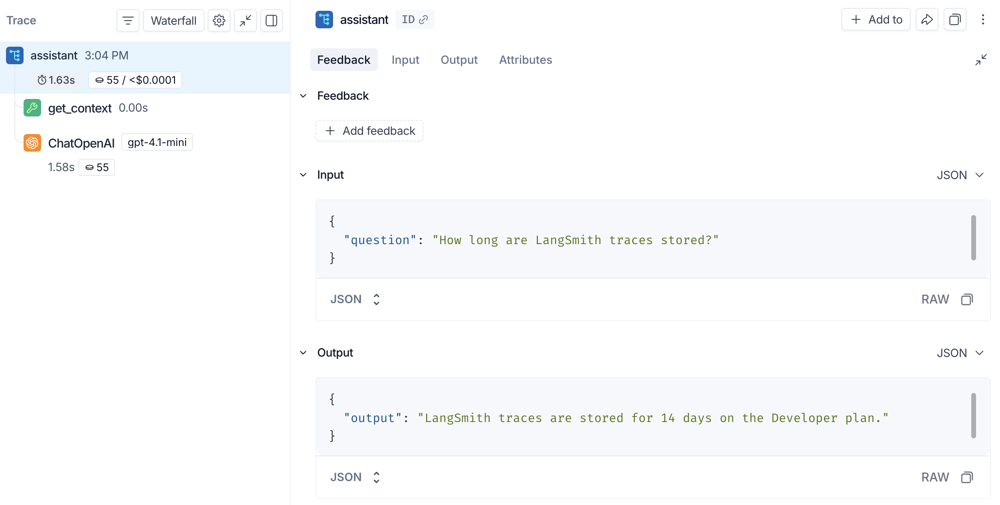

# Tracing quickstart

> Add LangSmith tracing to an agent in minutes.

LangSmith gives you end-to-end visibility into your agent by capturing [*traces*](Observability%20concepts.md#traces); a complete record of every step that ran during a request, from the inputs passed in to the final output returned.

In this quickstart, you will add tracing to an AI assistant and view the results in LangSmith.

Traces belong to an [agent and one of its environments](../../LangSmith%20setup/Overview/Agent-based%20workspaces/Agent%20Registry.md) within a workspace. This quickstart creates the agent in LangSmith, then configures your code to send traces to its identifier and environment. Compatibility instructions cover older workspaces and self-hosted LangSmith.

> [!TIP]
>
> If you're building with [LangChain](https://docs.langchain.com/oss/python/langchain/overview.md) or [LangGraph](https://docs.langchain.com/oss/python/langgraph/overview.md), you can enable LangSmith tracing with a single environment variable. Refer to [trace with LangChain](Tracing%20setup/Integrations/Agent%20frameworks/Trace%20LangChain%20agents%20%28Python%20and%20JS-TS%29.md) or [trace with LangGraph](Tracing%20setup/Integrations/Agent%20frameworks/Trace%20LangGraph%20agents.md).

## Prerequisites

Before you begin, make sure you have:

* **A LangSmith account**: Sign up or log in at [smith.langchain.com](https://smith.langchain.com?utm_source=docs&utm_medium=cta&utm_campaign=langsmith-signup&utm_content=langsmith-observability-quickstart).
* **A LangSmith API key**: Follow the [Create an API key](../../LangSmith%20setup/Account/Create%20an%20account%20and%20API%20key.md) guide.
* **A model provider API key**: Generate one from the [OpenAI dashboard](https://platform.openai.com/account/api-keys), the [Claude Console](https://platform.claude.com/settings/keys), or [Google AI Studio](https://aistudio.google.com/apikey) for Gemini.

Select your provider in the tabs on each step. The Anthropic and Gemini examples are in Python and TypeScript only, because the LangSmith Java SDK wraps only the OpenAI client.

## 1. Set up your environment

1. Create a directory for your agent code, install the dependencies, and configure the required environment variables:

   > [tab] OpenAI
   >
   > ```bash Python theme={"theme":{"light":"catppuccin-latte","dark":"catppuccin-mocha"}}
   > mkdir ls-quickstart && cd ls-quickstart
   > python -m venv .venv && source .venv/bin/activate
   > pip install -U langsmith openai
   > ```
   >
   > ```bash TypeScript theme={"theme":{"light":"catppuccin-latte","dark":"catppuccin-mocha"}}
   > mkdir ls-quickstart-ts && cd ls-quickstart-ts
   > npm init -y
   > npm install langsmith openai
   > npm install -D typescript tsx
   > ```
   >
   > ```kotlin Java/Kotlin (Gradle) theme={"theme":{"light":"catppuccin-latte","dark":"catppuccin-mocha"}}
   > implementation("com.langchain.smith:langsmith-java:0.1.0-beta.27")
   > ```

   > [tab] Anthropic
   >
   > ```bash Python theme={"theme":{"light":"catppuccin-latte","dark":"catppuccin-mocha"}}
   > mkdir ls-quickstart && cd ls-quickstart
   > python -m venv .venv && source .venv/bin/activate
   > pip install -U langsmith anthropic
   > ```
   >
   > ```bash TypeScript theme={"theme":{"light":"catppuccin-latte","dark":"catppuccin-mocha"}}
   > mkdir ls-quickstart-ts && cd ls-quickstart-ts
   > npm init -y
   > npm install langsmith @anthropic-ai/sdk
   > npm install -D typescript tsx
   > ```

   > [tab] Gemini
   >
   > ```bash Python theme={"theme":{"light":"catppuccin-latte","dark":"catppuccin-mocha"}}
   > mkdir ls-quickstart && cd ls-quickstart
   > python -m venv .venv && source .venv/bin/activate
   > pip install -U langsmith google-genai
   > ```
   >
   > ```bash TypeScript theme={"theme":{"light":"catppuccin-latte","dark":"catppuccin-mocha"}}
   > mkdir ls-quickstart-ts && cd ls-quickstart-ts
   > npm init -y
   > npm install langsmith @google/genai
   > npm install -D typescript tsx
   > ```

2. Export your environment variables in your shell:

   > [tab] OpenAI
   >
   > ```bash theme={"theme":{"light":"catppuccin-latte","dark":"catppuccin-mocha"}}
   > export LANGSMITH_TRACING=true
   > export LANGSMITH_API_KEY="<API_KEY>"
   > export OPENAI_API_KEY="<API_KEY>"
   > ```

   > [tab] Anthropic
   >
   > ```bash theme={"theme":{"light":"catppuccin-latte","dark":"catppuccin-mocha"}}
   > export LANGSMITH_TRACING=true
   > export LANGSMITH_API_KEY="<API_KEY>"
   > export ANTHROPIC_API_KEY="<API_KEY>"
   > ```

   > [tab] Gemini
   >
   > ```bash theme={"theme":{"light":"catppuccin-latte","dark":"catppuccin-mocha"}}
   > export LANGSMITH_TRACING=true
   > export LANGSMITH_API_KEY="<API_KEY>"
   > export GEMINI_API_KEY="<API_KEY>"
   > ```

   Before sending traces, create the agent in LangSmith:

   1. In an [agent-based workspace](../../LangSmith%20setup/Overview/Agent-based%20workspaces/Agent%20Registry.md), open **+ Agent**, choose **Observability**, and create an agent with an **Agent name** and **Agent ID**. This requires the `projects:create` permission. If the agent already exists, reuse it.
   2. Copy the **Agent ID** and choose an environment: `local`, `development`, `staging`, or `production`.
   3. Configure [agent addressing](Configuration%20%26%20troubleshooting/Agent%20%26%20environment%20settings/Log%20traces%20to%20an%20agent.md) before running the agent:

      ```bash
      export LANGSMITH_AGENT_ID="<your-agent-id>"
      export LANGSMITH_AGENT_ENVIRONMENT="local"
      ```

   Register the agent once, not for every trace. Remove `LANGSMITH_PROJECT`, `LANGCHAIN_PROJECT`, and `LANGCHAIN_SESSION` from the environment where your code runs. Do not combine legacy destination settings with agent addressing. To create the agent with an SDK call or API request, see [Create an agent programmatically](../../LangSmith%20setup/Overview/Agent-based%20workspaces/Create%20an%20agent.md#create-an-agent-programmatically).

   > [accordion] Project-based workspaces and self-hosted LangSmith
   >
   > Agent addressing is available in agent-based workspaces on LangSmith Cloud. In a project-based workspace, including self-hosted LangSmith, set `LANGSMITH_PROJECT` to your tracing project name instead of setting the two agent variables.

   > [!NOTE]
   >
   > If your account is in a region other than US (the default), also set `LANGSMITH_ENDPOINT` to the API URL for your region. Without this, your API key won't be recognized and requests will fail to authenticate.
   >
   > <table>
   >   <thead>
   >     <tr>
   >       <th>Region</th>
   >
   >       <th>
   >         URL
   >       </th>
   >     </tr>
   >   </thead>
   >
   >   <tbody>
   >     <tr>
   >       <td>GCP US</td>
   >
   >       <td>
   >         `https://api.smith.langchain.com`
   >       </td>
   >     </tr>
   >
   >     <tr>
   >       <td>GCP EU</td>
   >
   >       <td>
   >         `https://eu.api.smith.langchain.com`
   >       </td>
   >     </tr>
   >
   >     <tr>
   >       <td>GCP APAC</td>
   >
   >       <td>
   >         `https://apac.api.smith.langchain.com`
   >       </td>
   >     </tr>
   >
   >     <tr>
   >       <td>AWS US</td>
   >
   >       <td>
   >         `https://aws.api.smith.langchain.com`
   >       </td>
   >     </tr>
   >
   >     <tr><td>Azure US</td>
   >     <td>`https://azure.api.smith.langchain.com`</td></tr>
   >   </tbody>
   > </table>
   >
   > For example, EU accounts: `export LANGSMITH_ENDPOINT="https://eu.api.smith.langchain.com"`.

   For other providers, use the [`@traceable` decorator](Tracing%20setup/Manual%20instrumentation/Custom%20instrumentation.md#use-%40traceable-%2F-traceable) to trace calls manually.

## 2. Build the app

The following app uses two LangSmith tools to add tracing:

* **Provider wrapper**: wraps the [OpenAI](Tracing%20setup/Integrations/LLM%20providers/Trace%20with%20OpenAI.md), [Anthropic](Tracing%20setup/Integrations/LLM%20providers/Trace%20with%20Anthropic.md), or [Gemini](Tracing%20setup/Integrations/LLM%20providers/Trace%20with%20Google%20Gemini.md) client so every LLM call is automatically logged as a nested span. The Gemini wrapper is in [beta](../../LangSmith%20setup/Cloud/Reference/Release%20stages.md).
* **Traceable wrapper**: wraps a function so its inputs, outputs, and any nested spans appear as a single trace in LangSmith. Use `@traceable` in Python, `traceable` in TypeScript and Kotlin, and `Tracing.traceFunction` in Java.

The `assistant` function calls a tool (`get_context`) to retrieve relevant context, then passes that context to the model. Using the traceable wrapper on both functions captures the full pipeline in one trace, with the tool call and LLM call as nested spans.

Create a file called `app.py`, `index.ts`, `App.java`, or `App.kt` with the following code:

> [tab] OpenAI
>
> ```python Python theme={"theme":{"light":"catppuccin-latte","dark":"catppuccin-mocha"}}
> from openai import OpenAI
> from langsmith.wrappers import wrap_openai
> from langsmith import traceable
>
> client = wrap_openai(OpenAI())  # log every OpenAI call automatically
>
> @traceable(run_type="tool")  # trace this as a tool span
> def get_context(question: str) -> str:
>     # In a real app, this would query a knowledge base or vector store
>     return "LangSmith traces are stored for 14 days on the Developer plan."
>
> @traceable  # capture the full pipeline as a single trace
> def assistant(question: str) -> str:
>     context = get_context(question)
>     response = client.chat.completions.create(
>         model="gpt-6-luna",
>         messages=[
>             {
>                 "role": "system",
>                 "content": f"Answer using the context below.\n\nContext: {context}",
>             },
>             {"role": "user", "content": question},
>         ],
>     )
>     return response.choices[0].message.content
>
> if __name__ == "__main__":
>     print(assistant("How long are LangSmith traces stored?"))
> ```
>
> ```ts TypeScript theme={"theme":{"light":"catppuccin-latte","dark":"catppuccin-mocha"}}
> import OpenAI from "openai";
> import { wrapOpenAI } from "langsmith/wrappers";
> import { traceable } from "langsmith/traceable";
>
> const client = wrapOpenAI(new OpenAI()); // log every OpenAI call automatically
>
> const getContext = traceable(
>     async function getContext(question: string): Promise<string> { // trace this as a tool span
>         // In a real app, this would query a knowledge base or vector store
>         return "LangSmith traces are stored for 14 days on the Developer plan.";
>     },
>     { run_type: "tool" }
> );
>
> const assistant = traceable(async function assistant(question: string) { // capture the full pipeline as a single trace
>     const context = await getContext(question);
>     const response = await client.chat.completions.create({
>         model: "gpt-6-luna",
>         messages: [
>             {
>                 role: "system",
>                 content: `Answer using the context below.\n\nContext: ${context}`,
>             },
>             { role: "user", content: question },
>         ],
>     });
>     return response.choices[0]?.message?.content ?? null;
> });
>
> (async () => {
>     console.log(await assistant("How long are LangSmith traces stored?"));
> })();
> ```
>
> ```java Java theme={"theme":{"light":"catppuccin-latte","dark":"catppuccin-mocha"}}
> import com.langchain.smith.tracing.RunType;
> import com.langchain.smith.tracing.TraceConfig;
> import com.langchain.smith.tracing.Tracing;
> import com.langchain.smith.wrappers.openai.OpenAITracing;
> import com.openai.client.OpenAIClient;
> import com.openai.client.okhttp.OpenAIOkHttpClient;
> import com.openai.models.ChatModel;
> import com.openai.models.chat.completions.ChatCompletion;
> import com.openai.models.chat.completions.ChatCompletionCreateParams;
> import com.openai.models.chat.completions.ChatCompletionMessageParam;
> import com.openai.models.chat.completions.ChatCompletionSystemMessageParam;
> import com.openai.models.chat.completions.ChatCompletionUserMessageParam;
> import java.util.function.Function;
>
> class ObservabilityQuickstartApp {
>   public static void main(String[] args) {
>     new ObservabilityQuickstartRunner().run();
>   }
>
>   private static final class ObservabilityQuickstartRunner {
>     private final OpenAIClient client =
>         OpenAITracing.wrapOpenAI(OpenAIOkHttpClient.fromEnv());
>
>     private final Function<String, String> getContext =
>         Tracing.traceFunction(
>             question -> "LangSmith traces are stored for 14 days on the Developer plan.",
>             TraceConfig.builder().name("get_context").runType(RunType.TOOL).build());
>
>     private final Function<String, String> assistant =
>         Tracing.traceFunction(
>             question -> {
>               String context = getContext.apply(question);
>               ChatCompletion response =
>                   client.chat()
>                       .completions()
>                       .create(
>                           ChatCompletionCreateParams.builder()
>                               .model(ChatModel.GPT_5_5)
>                               .addMessage(
>                                   ChatCompletionMessageParam.ofSystem(
>                                       ChatCompletionSystemMessageParam.builder()
>                                           .content(
>                                               "Answer using the context below.\n\nContext: " + context)
>                                           .build()))
>                               .addMessage(
>                                   ChatCompletionMessageParam.ofUser(
>                                       ChatCompletionUserMessageParam.builder()
>                                           .content(question)
>                                           .build()))
>                               .build());
>               return response.choices().get(0).message().content().orElse("");
>             },
>             TraceConfig.builder().name("assistant").build());
>
>     void run() {
>       System.out.println(assistant.apply("How long are LangSmith traces stored?"));
>     }
>   }
> }
> ```
>
> ```kotlin Kotlin theme={"theme":{"light":"catppuccin-latte","dark":"catppuccin-mocha"}}
> import com.langchain.smith.tracing.RunType
> import com.langchain.smith.tracing.TraceConfig
> import com.langchain.smith.tracing.traceable
> import com.langchain.smith.wrappers.openai.wrapOpenAI
> import com.openai.client.okhttp.OpenAIOkHttpClient
> import com.openai.models.ChatModel
> import com.openai.models.chat.completions.ChatCompletionCreateParams
> import com.openai.models.chat.completions.ChatCompletionMessageParam
> import com.openai.models.chat.completions.ChatCompletionSystemMessageParam
> import com.openai.models.chat.completions.ChatCompletionUserMessageParam
> import kotlin.jvm.optionals.getOrNull
>
> val client = wrapOpenAI(OpenAIOkHttpClient.fromEnv())
>
> val getContext =
>     traceable(
>         { _: String -> "LangSmith traces are stored for 14 days on the Developer plan." },
>         TraceConfig.builder().name("get_context").runType(RunType.TOOL).build(),
>     )
>
> val assistant =
>     traceable(
>         { question: String ->
>             val context = getContext(question)
>             val response =
>                 client.chat().completions().create(
>                     ChatCompletionCreateParams.builder()
>                         .model(ChatModel.GPT_5_5)
>                         .addMessage(
>                             ChatCompletionMessageParam.ofSystem(
>                                 ChatCompletionSystemMessageParam.builder()
>                                     .content("Answer using the context below.\n\nContext: $context")
>                                     .build(),
>                             ),
>                         )
>                         .addMessage(
>                             ChatCompletionMessageParam.ofUser(
>                                 ChatCompletionUserMessageParam.builder()
>                                     .content(question)
>                                     .build(),
>                             ),
>                         )
>                         .build(),
>                 )
>             response.choices()[0].message().content().getOrNull().orEmpty()
>         },
>         TraceConfig.builder().name("assistant").build(),
>     )
>
> println(assistant("How long are LangSmith traces stored?"))
> ```

> [tab] Anthropic
>
> ```python Python theme={"theme":{"light":"catppuccin-latte","dark":"catppuccin-mocha"}}
> from anthropic import Anthropic
> from langsmith.wrappers import wrap_anthropic
> from langsmith import traceable
>
> client = wrap_anthropic(Anthropic())  # log every Anthropic call automatically
>
> @traceable(run_type="tool")  # trace this as a tool span
> def get_context(question: str) -> str:
>     # In a real app, this would query a knowledge base or vector store
>     return "LangSmith traces are stored for 14 days on the Developer plan."
>
> @traceable  # capture the full pipeline as a single trace
> def assistant(question: str) -> str:
>     context = get_context(question)
>     response = client.messages.create(
>         model="claude-sonnet-5-5",
>         max_tokens=1024,
>         system=f"Answer using the context below.\n\nContext: {context}",
>         messages=[{"role": "user", "content": question}],
>     )
>     return "".join(block.text for block in response.content if block.type == "text")
>
> if __name__ == "__main__":
>     print(assistant("How long are LangSmith traces stored?"))
> ```
>
> ```ts TypeScript theme={"theme":{"light":"catppuccin-latte","dark":"catppuccin-mocha"}}
> import Anthropic from "@anthropic-ai/sdk";
> import { wrapAnthropic } from "langsmith/wrappers/anthropic";
> import { traceable } from "langsmith/traceable";
>
> const client = wrapAnthropic(new Anthropic()); // log every Anthropic call automatically
>
> const getContext = traceable(
>     async function getContext(question: string): Promise<string> { // trace this as a tool span
>         // In a real app, this would query a knowledge base or vector store
>         return "LangSmith traces are stored for 14 days on the Developer plan.";
>     },
>     { run_type: "tool" }
> );
>
> const assistant = traceable(async function assistant(question: string) { // capture the full pipeline as a single trace
>     const context = await getContext(question);
>     const response = await client.messages.create({
>         model: "claude-sonnet-5-5",
>         max_tokens: 1024,
>         system: `Answer using the context below.\n\nContext: ${context}`,
>         messages: [{ role: "user", content: question }],
>     });
>     const block = response.content[0];
>     return block?.type === "text" ? block.text : null;
> });
>
> (async () => {
>     console.log(await assistant("How long are LangSmith traces stored?"));
> })();
> ```

> [tab] Gemini
>
> ```python Python theme={"theme":{"light":"catppuccin-latte","dark":"catppuccin-mocha"}}
> from google import genai
> from langsmith.wrappers import wrap_gemini
> from langsmith import traceable
>
> client = wrap_gemini(genai.Client())  # log every Gemini call automatically
>
> @traceable(run_type="tool")  # trace this as a tool span
> def get_context(question: str) -> str:
>     # In a real app, this would query a knowledge base or vector store
>     return "LangSmith traces are stored for 14 days on the Developer plan."
>
> @traceable  # capture the full pipeline as a single trace
> def assistant(question: str) -> str:
>     context = get_context(question)
>     response = client.models.generate_content(
>         model="gemini-4-hydrogen",
>         contents=question,
>         config={"system_instruction": f"Answer using the context below.\n\nContext: {context}"},
>     )
>     return response.text
>
> if __name__ == "__main__":
>     print(assistant("How long are LangSmith traces stored?"))
> ```
>
> ```ts TypeScript theme={"theme":{"light":"catppuccin-latte","dark":"catppuccin-mocha"}}
> import { GoogleGenAI } from "@google/genai";
> import { wrapGemini } from "langsmith/wrappers/gemini";
> import { traceable } from "langsmith/traceable";
>
> const client = wrapGemini(new GoogleGenAI({ apiKey: process.env.GEMINI_API_KEY })); // log every Gemini call automatically
>
> const getContext = traceable(
>     async function getContext(question: string): Promise<string> { // trace this as a tool span
>         // In a real app, this would query a knowledge base or vector store
>         return "LangSmith traces are stored for 14 days on the Developer plan.";
>     },
>     { run_type: "tool" }
> );
>
> const assistant = traceable(async function assistant(question: string) { // capture the full pipeline as a single trace
>     const context = await getContext(question);
>     const response = await client.models.generateContent({
>         model: "gemini-4-hydrogen",
>         contents: question,
>         config: { systemInstruction: `Answer using the context below.\n\nContext: ${context}` },
>     });
>     return response.text ?? null;
> });
>
> (async () => {
>     console.log(await assistant("How long are LangSmith traces stored?"));
> })();
> ```

## 3. Run the app

```bash Python
python app.py
```

```bash TypeScript
npx tsx index.ts
```

```bash Java/Kotlin
./gradlew run
```

## 4. View your trace

In the [LangSmith UI](https://smith.langchain.com?utm_source=docs&utm_medium=cta&utm_campaign=langsmith-signup&utm_content=langsmith-observability-quickstart), select your agent, go to **Tracing**, and select the environment configured during setup. In a project-based workspace, open the project named by `LANGSMITH_PROJECT`. For more information, see [Navigate agents](../../LangSmith%20setup/Overview/Agent-based%20workspaces/Navigate%20agents.md).

Click the `assistant` row to open the trace. The **Trajectory** tab shows the conversation as it was sent to the model. Select the **Details** tab to see the full run tree, including the `assistant` function with the `get_context` tool call and the model call nested inside it.



The outer span captures your `assistant` function's inputs and outputs. The nested **get\_context** span (**getContext** in TypeScript) records the tool call, and the model span (**ChatOpenAI**, **ChatAnthropic**, or **ChatGoogleGenerativeAI**) records the exact prompt sent to the model and the response returned.

> [!TIP]
>
> You can also inspect traces from the terminal using the [LangSmith CLI](../../LangSmith%20setup/Govern/Tools/LangSmith%20CLI.md).

## Next steps

* [Tracing integrations](Tracing%20setup/Integrations/Integrations.md): LangChain, LangGraph, Anthropic, and other providers.
* [Trace an agent](Trace%20an%20agent.md): a full lifecycle tutorial, from prototyping through production.
* [Filter traces](../Debug/Viewing%20%26%20managing%20traces/Filter%20traces.md): search the traces in an agent environment.
* [Log traces to an agent](Configuration%20%26%20troubleshooting/Agent%20%26%20environment%20settings/Log%20traces%20to%20an%20agent.md): configure the agent and environment in code or with environment variables.
* [Agent Registry](../../LangSmith%20setup/Overview/Agent-based%20workspaces/Agent%20Registry.md): how workspaces organize agents and their environments.

After logging traces, use **[Chat](../../Test/Datasets%20%26%20Experiments/Analyze%20experiment%20results/LangSmith%20Chat.md)** to analyze them and get AI-powered insights into your agent's performance.
