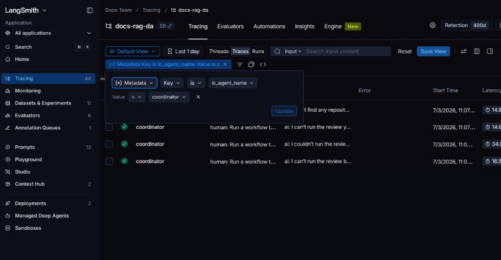

# Trace Deep Agents

[`deepagents`](https://docs.langchain.com/oss/python/deepagents/overview) is an open-source agent framework built on top of LangGraph, designed for complex, multi-step tasks that require planning, tool usage, and sub-agent delegation. Deep Agents supports native LangSmith tracing.

This guide shows you how to enable LangSmith tracing for Deep Agents, view traces in the LangSmith UI, and (optionally) customize trace configuration for more advanced use cases.

> [!NOTE]
>
> In an [agent-based workspace](../../../../../LangSmith%20setup/Overview/Agent-based%20workspaces/Agent%20Registry.md), [create an agent](../../../../../LangSmith%20setup/Overview/Agent-based%20workspaces/Create%20an%20agent.md) once before sending traces. Use [agent addressing](../../../Configuration%20%26%20troubleshooting/Agent%20%26%20environment%20settings/Log%20traces%20to%20an%20agent.md) to select its identifier and environment. If an integration requires `project_name`, use the selected environment's [`tracer_session_name`](../../../../../LangSmith%20setup/Overview/Agent-based%20workspaces/Create%20an%20agent.md#use-an-environment-project) as a compatibility value.

## Installation

Install `deepagents` in your Python environment:

```bash pip
pip install deepagents
```

```bash uv
uv add deepagents
```

`deepagents` requires:

* Python 3.11+.
* An LLM that supports tool calling (for example, OpenAI or Anthropic models).
* For tracing, a [LangSmith account and API key](../../../../../LangSmith%20setup/Account/Create%20an%20account%20and%20API%20key.md) (free to sign up).

> [!NOTE]
>
> You do not need to install the `langsmith` Python package to trace Deep Agents. `deepagents` is built on LangGraph, which includes native LangSmith tracing support. As long as the LangSmith environment variables are set, traces are sent automatically.
>
> The `langsmith` package is only required if you want [programmatic control over tracing](#customize-langsmith-tracing) (for example, using `tracing_context`, adding custom metadata, or querying runs from Python).

## Setup

Sending traces to an agent requires `langchain-core>=1.6.11`, which installs `langsmith>=0.14.9`.

Get your LangSmith API key from **Settings**, then configure the registered agent identifier and environment:

```bash
export LANGSMITH_API_KEY=<your-langsmith-api-key>
export LANGSMITH_TRACING=true
export LANGSMITH_AGENT_ID="<your-agent-id>"
export LANGSMITH_AGENT_ENVIRONMENT="local"
```

## Create a trace

Once tracing is enabled via environment variables, Deep Agents will automatically emit traces to LangSmith. For example:

```python
from typing import Dict, Any, List

from deepagents import create_deep_agent


def compute_compound_interest(
    principal: float,
    annual_rate: float,
    years: int,
    compounds_per_year: int,
) -> Dict[str, Any]:
    """Compute compound interest and return ending balance and interest earned."""
    r = annual_rate
    n = compounds_per_year
    t = years
    amount = principal * (1 + r / n) ** (n * t)
    interest = amount - principal
    return {
        "principal": principal,
        "annual_rate": annual_rate,
        "years": years,
        "compounds_per_year": n,
        "ending_balance": round(amount, 2),
        "interest_earned": round(interest, 2),
    }


def yearly_balance_schedule(
    principal: float,
    annual_rate: float,
    years: int,
    compounds_per_year: int,
) -> List[Dict[str, Any]]:
    """Return a year-by-year balance schedule for the investment."""
    r = annual_rate
    n = compounds_per_year
    schedule: List[Dict[str, Any]] = []

    for year in range(1, years + 1):
        amount = principal * (1 + r / n) ** (n * year)
        schedule.append(
            {
                "year": year,
                "ending_balance": round(amount, 2),
                "interest_earned": round(amount - principal, 2),
            }
        )

    return schedule


agent = create_deep_agent(
    model="google_genai:gemini-4-hydrogen",
    tools=[compute_compound_interest, yearly_balance_schedule],
    system_prompt=(
        "You are a careful assistant. "
        "Use tools for calculations and structured outputs. "
        "Return a concise final answer."
    ),
)

result = agent.invoke(
    {
        "messages": [
            {
                "role": "user",
                "content": (
                    "I have $2,500 invested at 6% annual interest compounded monthly for 5 years.\n"
                    "1) Compute the ending balance and total interest earned.\n"
                    "2) Generate a year-by-year ending balance schedule.\n"
                    "Then summarize the key takeaways in 3 bullets.\n\n"
                    "Use compounds_per_year=12."
                ),
            }
        ]
    }
)

print(result)
```

## Viewing traces

### Details View

Click on the trace, and toggle to the **Details** view on the top right. Your trace tree in the [LangSmith UI](https://smith.langchain.com?utm_source=docs&utm_medium=cta&utm_campaign=langsmith-signup&utm_content=langsmith-trace-deep-agents) will look like [this](https://smith.langchain.com/public/ec82be64-b158-425e-a959-924be16b8588/r), with the following structure:

* Agent run (top level) representing the full Deep Agents invocation.
* LLM call where the agent analyzes the user request and decides which tools to use.
* Tool run: `compute_compound_interest`:
  * Displays the tool inputs (for example, principal, annual\_rate, years, and compounds\_per\_year).
  * Displays the structured output, including the ending balance and total interest earned.
* LLM call that interprets the calculation results and determines the next step.
* Tool run: `yearly_balance_schedule`:
  * Shows the inputs used to generate the schedule.
  * Returns a year-by-year breakdown of ending balances and interest earned.
* Final LLM response that summarizes the results for the user.

The resulting trace contains multiple nested spans, which allows you to follow the agent’s planning, calculation steps, and interpretation flow in the LangSmith UI.

### Trajectory view

The **Trajectory** view in the LangSmith UI shows a simplified conversation history between the user and the agent. This view pulls messages from the top-level trace, (including the user’s initial request, tool calls and the agent’s final response) and represents them in a chat-like format.

### Filter by subagent

Deep Agents automatically writes the subagent's `name` to the `lc_agent_name` metadata key on every run that subagent produces. Use this to isolate all runs from a specific subagent in LangSmith—useful for debugging, monitoring, or comparing subagent behavior.

**Filter in the LangSmith UI:**

1. Select your agent and environment, then open **Tracing** in [LangSmith](https://smith.langchain.com?utm_source=docs&utm_medium=cta&utm_campaign=langsmith-signup&utm_content=langsmith-trace-deep-agents).
2. Switch the view to **Runs** to see individual spans.
3. Click **Add filter** and select **Metadata**.
4. Set the **Key** to `lc_agent_name` and the **Value** to the subagent name, for example `coordinator`.



Save the filter as a named view for quick reuse. For a full reference on filter options, see [Filter traces](../../../../Debug/Viewing%20%26%20managing%20traces/Filter%20traces.md).

**Filter programmatically with the SDK:**

[Retrieve the environment's `tracer_session_name`](../../../../../LangSmith%20setup/Overview/Agent-based%20workspaces/Create%20an%20agent.md#use-an-environment-project), look up its project ID, and pass it to `client.runs.query()`. The query looks back 1 day unless you pass `min_start_time`.

```python
import asyncio
from datetime import datetime, timedelta, timezone

from langsmith import Client


async def main():
    client = Client()
    project_id = str(client.read_project(project_name="<environment-tracer-session-name>").id)

    # Fetch all runs produced by a specific subagent
    async for run in client.runs.query(
        project_ids=[project_id],
        min_start_time=datetime.now(timezone.utc) - timedelta(days=7),
        filter='and(eq(metadata_key, "lc_agent_name"), eq(metadata_value, "research-agent"))',
        selects=["NAME", "START_TIME", "STATUS"],
    ):
        print(run.name, run.start_time, run.status)


asyncio.run(main())
```

For the full filter query language reference, see [Trace query syntax](../../../../Debug/Viewing%20%26%20managing%20traces/Trace%20query%20syntax.md).

## Customize LangSmith tracing

By default, Deep Agents traces are emitted automatically when LangSmith tracing is enabled via environment variables. You can use the [LangSmith SDK](https://reference.langchain.com/python/langsmith/observability/sdk/) directly to customize your tracing, such as scoping traces to part of your code, attaching tags or metadata, or selecting an agent and environment.

Install and use `langsmith` if you want to:

* Trace only specific agent invocations.
* Add custom tags or metadata for filtering in the UI.
* Select an agent environment at runtime.

```bash pip
pip install langsmith
```

```bash uv
uv add langsmith
```

This example invokes the same deep agent twice:

* The first invocation is untraced, because it runs outside of `tracing_context`.
* The second invocation is traced, because it runs inside `tracing_context(enabled=True, ...)`.

You can selectively trace only part of your workflow, without enabling global tracing for your entire process with `LANGSMITH_TRACING=true`:

```python
from typing import Dict, Any, List

import langsmith as ls
from deepagents import create_deep_agent


def compute_compound_interest(
    principal: float,
    annual_rate: float,
    years: int,
    compounds_per_year: int,
) -> Dict[str, Any]:
    """Compute compound interest and return ending balance and interest earned."""
    r = annual_rate
    n = compounds_per_year
    t = years
    amount = principal * (1 + r / n) ** (n * t)
    interest = amount - principal
    return {
        "principal": principal,
        "annual_rate": annual_rate,
        "years": years,
        "compounds_per_year": n,
        "ending_balance": round(amount, 2),
        "interest_earned": round(interest, 2),
    }


def yearly_balance_schedule(
    principal: float,
    annual_rate: float,
    years: int,
    compounds_per_year: int,
) -> List[Dict[str, Any]]:
    """Return a year-by-year balance schedule for the investment."""
    r = annual_rate
    n = compounds_per_year
    schedule: List[Dict[str, Any]] = []

    for year in range(1, years + 1):
        amount = principal * (1 + r / n) ** (n * year)
        schedule.append(
            {
                "year": year,
                "ending_balance": round(amount, 2),
                "interest_earned": round(amount - principal, 2),
            }
        )

    return schedule


agent = create_deep_agent(
    model="google_genai:gemini-4-hydrogen",
    tools=[compute_compound_interest, yearly_balance_schedule],
    system_prompt=(
        "You are a careful assistant. "
        "Use tools for calculations and structured outputs. "
        "Return a concise final answer."
    ),
)

# ----------------------------
# Untraced invocation
# ----------------------------
agent.invoke(
    {
        "messages": [
            {
                "role": "user",
                "content": (
                    "I have $2,500 invested at 6% annual interest compounded monthly for 5 years. "
                    "Compute the ending balance and total interest earned. "
                    "Use compounds_per_year=12."
                ),
            }
        ]
    }
)

# ----------------------------
# Traced invocation
# ----------------------------
with ls.tracing_context(
    enabled=True,
    tags=["deepagents", "scoped-tracing"],
    metadata={"example": "partial-workflow"},
):
    agent.invoke(
        {
            "messages": [
                {
                    "role": "user",
                    "content": (
                        "I have $2,500 invested at 6% annual interest compounded monthly for 5 years.\n"
                        "1) Compute the ending balance and total interest earned.\n"
                        "2) Generate a year-by-year ending balance schedule.\n"
                        "Then summarize the key takeaways in 3 bullets.\n\n"
                        "Use compounds_per_year=12."
                    ),
                }
            ]
        }
    )
```

The `tracing_context` block enables tracing and also configures how the trace is recorded and organized in LangSmith:

* `enabled=True` explicitly enables tracing for the duration of the block, even if `LANGSMITH_TRACING` is unset or set to `false`.
* With no destination override, the block uses the agent identifier and environment configured during setup.
* `tags=[...]` attaches tags to the traced runs. [Tags](../../../Configuration%20%26%20troubleshooting/Data%20%26%20privacy/Add%20metadata%20and%20tags%20to%20traces.md) appear in the [LangSmith UI](https://smith.langchain.com?utm_source=docs&utm_medium=cta&utm_campaign=langsmith-signup&utm_content=langsmith-trace-deep-agents), which you can use to filter and group traces.
* `metadata={...}` attaches arbitrary structured metadata (for example, environment, experiment name, or feature flag).

In this example, the agent is invoked twice, but only the invocation inside `tracing_context` is recorded. This demonstrates how you can selectively trace specific parts of a Deep Agents workflow without enabling global tracing for the entire process.
