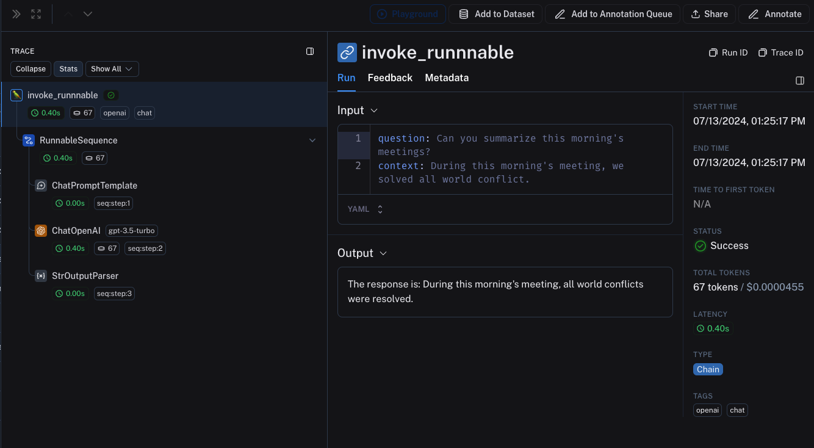
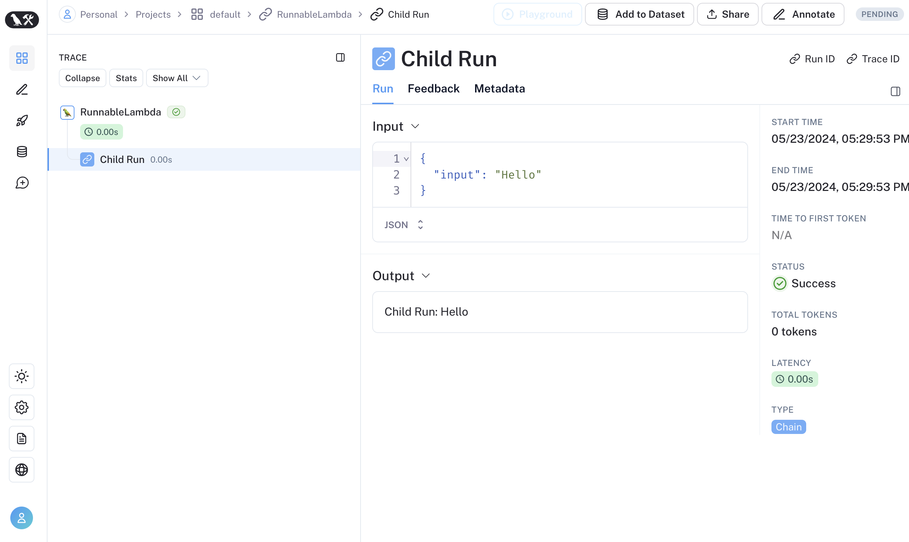

# Trace LangChain agents (Python and JS/TS)

LangSmith integrates seamlessly with LangChain (Python and JavaScript), the popular open-source framework for building agents.

> [!NOTE]
>
> In an [agent-based workspace](../../../../../LangSmith%20setup/Overview/Agent-based%20workspaces/Agent%20Registry.md), [create an agent](../../../../../LangSmith%20setup/Overview/Agent-based%20workspaces/Create%20an%20agent.md) once before sending traces. Use [agent addressing](../../../Configuration%20%26%20troubleshooting/Agent%20%26%20environment%20settings/Log%20traces%20to%20an%20agent.md) to select its identifier and environment. If an integration requires `project_name`, use the selected environment's [`tracer_session_name`](../../../../../LangSmith%20setup/Overview/Agent-based%20workspaces/Create%20an%20agent.md#use-an-environment-project) as a compatibility value.

## Installation

Install the following for Python or JS (the code snippets use the OpenAI integration).

For a full list of packages available, see the [LangChain docs](https://docs.langchain.com/oss/python/integrations/providers/overview.md).

```bash pip
pip install langchain_openai
```

```bash yarn
yarn add @langchain/openai @langchain/core
```

```bash npm
npm install @langchain/openai @langchain/core
```

```bash pnpm
pnpm add @langchain/openai @langchain/core
```

## Quick start

### 1. Configure your environment

```bash wrap
export LANGSMITH_TRACING=true
export LANGSMITH_API_KEY=<your-api-key>
export LANGSMITH_AGENT_ID="<your-agent-id>"
export LANGSMITH_AGENT_ENVIRONMENT="local"
# This example uses OpenAI, but you can use any LLM provider of choice
export OPENAI_API_KEY=<your-openai-api-key>
# For LangSmith API keys linked to multiple workspaces, set the LANGSMITH_WORKSPACE_ID environment variable to specify which workspace to use.
export LANGSMITH_WORKSPACE_ID=<your-workspace-id>
```

> [!NOTE]
>
> If your account is in a region other than US (the default), also set `LANGSMITH_ENDPOINT` to the API URL for your region. Without this, your API key won't be recognized and requests will fail to authenticate.
>
> <table>
>   <thead>
>     <tr>
>       <th>Region</th>
>
>       <th>
>         URL
>       </th>
>     </tr>
>   </thead>
>
>   <tbody>
>     <tr>
>       <td>GCP US</td>
>
>       <td>
>         `https://api.smith.langchain.com`
>       </td>
>     </tr>
>
>     <tr>
>       <td>GCP EU</td>
>
>       <td>
>         `https://eu.api.smith.langchain.com`
>       </td>
>     </tr>
>
>     <tr>
>       <td>GCP APAC</td>
>
>       <td>
>         `https://apac.api.smith.langchain.com`
>       </td>
>     </tr>
>
>     <tr>
>       <td>AWS US</td>
>
>       <td>
>         `https://aws.api.smith.langchain.com`
>       </td>
>     </tr>
>
>     <tr><td>Azure US</td>
>     <td>`https://azure.api.smith.langchain.com`</td></tr>
>   </tbody>
> </table>
>
> For example, EU accounts: `export LANGSMITH_ENDPOINT="https://eu.api.smith.langchain.com"`.

> [!NOTE]
>
> If you are using LangChain.js with LangSmith and are not in a serverless environment, we also recommend setting the following explicitly to reduce latency:
>
> `export LANGCHAIN_CALLBACKS_BACKGROUND=true`
>
> If you are in a serverless environment, we recommend setting the reverse to allow tracing to finish before your function ends:
>
> `export LANGCHAIN_CALLBACKS_BACKGROUND=false`

### 2. Log a trace

No extra code is needed to log a trace to LangSmith. Just run your LangChain code as you normally would.

```python Python
from langchain_openai import ChatOpenAI
from langchain_core.prompts import ChatPromptTemplate
from langchain_core.output_parsers import StrOutputParser

prompt = ChatPromptTemplate.from_messages([
    ("system", "You are a helpful assistant. Please respond to the user's request only based on the given context."),
    ("user", "Question: {question}\nContext: {context}")
])

model = ChatOpenAI(model="gpt-6-luna")
output_parser = StrOutputParser()
chain = prompt | model | output_parser

question = "Can you summarize this morning's meetings?"
context = "During this morning's meeting, we solved all world conflict."

chain.invoke({"question": question, "context": context})
```

```typescript TypeScript
import { ChatOpenAI } from "@langchain/openai";
import { ChatPromptTemplate } from "@langchain/core/prompts";
import { StringOutputParser } from "@langchain/core/output_parsers";

const prompt = ChatPromptTemplate.fromMessages([
  ["system", "You are a helpful assistant. Please respond to the user's request only based on the given context."],
  ["user", "Question: {question}\nContext: {context}"],
]);

const model = new ChatOpenAI({ modelName: "gpt-6-luna" });
const outputParser = new StringOutputParser();
const chain = prompt.pipe(model).pipe(outputParser);

const question = "Can you summarize this morning's meetings?"
const context = "During this morning's meeting, we solved all world conflict."

await chain.invoke({ question: question, context: context });
```

### 3. View your trace

Open the registered agent in LangSmith and select its **Local** environment to view the trace.

## Trace selectively

The [previous section](#quick-start) showed how to trace all LangChain runnable invocations in your code by enabling tracing and selecting an agent environment. While this is a convenient way to get started, you may want to trace only specific invocations or parts of your agent.

There are two ways to do this in Python: by manually passing in a `LangChainTracer` instance as a [callback](https://reference.langchain.com/python/langchain_core/callbacks/), or by using the [`tracing_context` context manager](https://reference.langchain.com/python/langsmith/observability/sdk/run_helpers/#langsmith.run_helpers.tracing_context).

In JS/TS, you can pass a [`LangChainTracer`](https://reference.langchain.com/javascript/classes/_langchain_core.tracers_tracer_langchain.LangChainTracer.html) instance as a callback.

```python Python
# You can opt-in to specific invocations..
import langsmith as ls

with ls.tracing_context(enabled=True):
    chain.invoke({"question": "Am I using a callback?", "context": "I'm using a callback"})

# This will NOT be traced (assuming LANGSMITH_TRACING is not set)
chain.invoke({"question": "Am I being traced?", "context": "I'm not being traced"})

# This would not be traced, even if LANGSMITH_TRACING=true
with ls.tracing_context(enabled=False):
    chain.invoke({"question": "Am I being traced?", "context": "I'm not being traced"})
```

```typescript TypeScript
// You can configure a LangChainTracer instance to trace a specific invocation.
import { LangChainTracer } from "@langchain/core/tracers/tracer_langchain";

const tracer = new LangChainTracer();
await chain.invoke(
  {
    question: "Am I using a callback?",
    context: "I'm using a callback"
  },
  { callbacks: [tracer] }
);
```

## Select an agent and environment

Use `LANGSMITH_AGENT_ID` and `LANGSMITH_AGENT_ENVIRONMENT` to select the registered agent and environment. For per-request routing, pass an agent address in code. See [Log traces to an agent](../../../Configuration%20%26%20troubleshooting/Agent%20%26%20environment%20settings/Log%20traces%20to%20an%20agent.md).

> [accordion] Project-based workspaces and self-hosted LangSmith
>
> Set `LANGSMITH_PROJECT` to the tracing project name instead of setting the agent variables. For integrations that require `project_name` in an agent-based workspace, use the environment's [`tracer_session_name`](../../../../../LangSmith%20setup/Overview/Agent-based%20workspaces/Create%20an%20agent.md#use-an-environment-project) as a compatibility value.

## Add metadata and tags to traces

You can annotate your traces with arbitrary metadata and tags by providing them in the [`RunnableConfig`](https://reference.langchain.com/python/langchain_core/runnables/?h=runnablecon#langchain_core.runnables.RunnableConfig). This is useful for associating additional information with a trace, such as the environment in which it was executed, or the user who initiated it. For information on how to query traces and runs by metadata and tags, see [Query traces (SDK)](../../../../Debug/Viewing%20%26%20managing%20traces/Query%20traces%20using%20the%20SDK.md)

> [!NOTE]
>
> When you attach metadata or tags to a runnable (either through the [`RunnableConfig`](https://reference.langchain.com/python/langchain-core/runnables/config/RunnableConfig) or at runtime with invocation params), they are inherited by all child runnables of that runnable.

```python Python
from langchain_openai import ChatOpenAI
from langchain_core.prompts import ChatPromptTemplate
from langchain_core.output_parsers import StrOutputParser

prompt = ChatPromptTemplate.from_messages([
    ("system", "You are a helpful AI."),
    ("user", "{input}")
])

# The tag "model-tag" and metadata {"model-key": "model-value"} will be attached to the ChatOpenAI run only
chat_model = ChatOpenAI().with_config({"tags": ["model-tag"], "metadata": {"model-key": "model-value"}})
output_parser = StrOutputParser()

# Tags and metadata can be configured with RunnableConfig
chain = (prompt | chat_model | output_parser).with_config({"tags": ["config-tag"], "metadata": {"config-key": "config-value"}})

# Tags and metadata can also be passed at runtime
chain.invoke({"input": "What is the meaning of life?"}, {"tags": ["invoke-tag"], "metadata": {"invoke-key": "invoke-value"}})
```

```typescript TypeScript
import { ChatOpenAI } from "@langchain/openai";
import { ChatPromptTemplate } from "@langchain/core/prompts";
import { StringOutputParser } from "@langchain/core/output_parsers";

const prompt = ChatPromptTemplate.fromMessages([
    ["system", "You are a helpful AI."],
    ["user", "{input}"]
])

// The tag "model-tag" and metadata {"model-key": "model-value"} will be attached to the ChatOpenAI run only
const model = new ChatOpenAI().withConfig({ tags: ["model-tag"], metadata: { "model-key": "model-value" } });
const outputParser = new StringOutputParser();

// Tags and metadata can be configured with RunnableConfig
const chain = (prompt.pipe(model).pipe(outputParser)).withConfig({"tags": ["config-tag"], "metadata": {"config-key": "top-level-value"}});

// Tags and metadata can also be passed at runtime
await chain.invoke({input: "What is the meaning of life?"}, {tags: ["invoke-tag"], metadata: {"invoke-key": "invoke-value"}})
```

## Customize run name

You can customize the name of a given run when invoking or streaming your LangChain code by providing it in the [Config](https://reference.langchain.com/python/langchain_core/runnables/?h=runnablecon#langchain_core.runnables.RunnableConfig). This name is used to identify the run in LangSmith and can be used to filter and group runs. The name is also used as the title of the run in the LangSmith UI. This can be done by setting a `run_name` in the [`RunnableConfig`](https://reference.langchain.com/python/langchain-core/runnables/config/RunnableConfig) object at construction or by passing a `run_name` in the invocation parameters in JS/TS.

```python Python
# When tracing within LangChain, run names default to the class name of the traced object (e.g., 'ChatOpenAI').
configured_chain = chain.with_config({"run_name": "MyCustomChain"})
configured_chain.invoke({"input": "What is the meaning of life?"})

# You can also configure the run name at invocation time, like below
chain.invoke({"input": "What is the meaning of life?"}, {"run_name": "MyCustomChain"})
```

```typescript TypeScript
// When tracing within LangChain, run names default to the class name of the traced object (e.g., 'ChatOpenAI').
const configuredChain = chain.withConfig({ runName: "MyCustomChain" });
await configuredChain.invoke({ input: "What is the meaning of life?" });

// You can also configure the run name at invocation time, like below
await chain.invoke({ input: "What is the meaning of life?" }, {runName: "MyCustomChain"})
```

> [!NOTE]
>
> The `run_name` parameter only changes the name of the runnable you invoke (e.g., a chain, function). It does not rename the nested run automatically created when you invoke an LLM object like [`ChatOpenAI`](https://reference.langchain.com/python/langchain-openai/chat_models/base/ChatOpenAI) (`gpt-6-luna`). In the example, the enclosing run will appear in LangSmith as `MyCustomChain`, while the nested LLM run still shows the model’s default name.
>
> To give the LLM run a more meaningful name, you can either:
>
> * Wrap the model in another runnable and assign a `run_name` to that step.
> * Use a tracing decorator or helper (e.g., `@traceable` in Python, or `traceable` from `langsmith` in JS/TS) to create a custom run around the model call.

## Override model name in traces

When tracing LangChain model calls, LangSmith automatically captures the model identifier used in the API call. However, you may want to display a different, more descriptive name in traces for organizational purposes or to distinguish between different model configurations. You can do this by passing the `ls_model_name` [metadata parameter](../../Manual%20instrumentation/Metadata%20parameters%20reference.md#ls_model_name) when constructing or configuring your LangChain model.

This is particularly useful when:

* Working with self-hosted or local models where the model ID might not be descriptive.
* Using the same model with different configurations and wanting to distinguish them in traces.
* Creating aliases for models to make traces more readable for your team.
* Standardizing model names across different deployment environments.

```python Python
from langchain_openai import ChatOpenAI
from langchain_ollama import ChatOllama

# Override model name for a local model
llm = ChatOllama(
    model="llama2:13b-chat",  # Actual model ID
    metadata={"ls_model_name": "llama2-13b-production"}  # Name shown in LangSmith
)

# Or with OpenAI to distinguish configurations
llm_creative = ChatOpenAI(
    model="gpt-6.1-sol",
    temperature=0.9,
    metadata={"ls_model_name": "gpt-5.4-creative"}
)

llm_factual = ChatOpenAI(
    model="gpt-6.1-sol",
    temperature=0.1,
    metadata={"ls_model_name": "gpt-5.4-factual"}
)

# The metadata is inherited when the model is used in a chain
result = llm.invoke("What is the meaning of life?")
```

```typescript TypeScript
import { ChatOpenAI } from "@langchain/openai";
import { ChatOllama } from "@langchain/ollama";

// Override model name for a local model
const llm = new ChatOllama({
  model: "llama2:13b-chat",  // Actual model ID
  metadata: { ls_model_name: "llama2-13b-production" }  // Name shown in LangSmith
});

// Or with OpenAI to distinguish configurations
const llmCreative = new ChatOpenAI({
  modelName: "gpt-6.1-sol",
  temperature: 0.9,
  metadata: { ls_model_name: "gpt-5.4-creative" }
});

const llmFactual = new ChatOpenAI({
  modelName: "gpt-6.1-sol",
  temperature: 0.1,
  metadata: { ls_model_name: "gpt-5.4-factual" }
});

// The metadata is inherited when the model is used in a chain
const result = await llm.invoke("What is the meaning of life?");
```

When you pass `ls_model_name` in the model's metadata, this name will appear in the LangSmith UI for all traces involving that model instance. This works for any LangChain chat model or LLM and is inherited by all runs that use the model, including when it's part of a chain.

> [!NOTE]
>
> The `ls_model_name` metadata parameter is also used for [cost tracking](../../../Configuration%20%26%20troubleshooting/Cost%20tracking.md). When combined with the `ls_provider` parameter, LangSmith can automatically calculate costs for custom or self-hosted models. For more information about all available metadata parameters, see the [metadata parameters reference](../../Manual%20instrumentation/Metadata%20parameters%20reference.md).

## Customize run ID

You can customize the ID of a given run when invoking or streaming your LangChain code by providing it in the [Config](https://reference.langchain.com/python/langchain_core/runnables/?h=runnablecon#langchain_core.runnables.RunnableConfig). This ID is used to uniquely identify the run in LangSmith and can be used to query specific runs. The ID can be useful for linking runs across different systems or for implementing custom tracking logic. This can be done by setting a `run_id` in the [`RunnableConfig`](https://reference.langchain.com/python/langchain-core/runnables/config/RunnableConfig) object at construction or by passing a `run_id` in the invocation parameters.

> [!NOTE]
>
> This feature is not currently supported directly for LLM objects.

```python Python
from langchain_core.utils.uuid import uuid7

my_uuid = uuid7()

# You can configure the run ID at invocation time:
chain.invoke({"input": "What is the meaning of life?"}, {"run_id": my_uuid})
```

```typescript TypeScript
import { uuid7 } from "langsmith";

const myUuid = uuid7();

// You can configure the run ID at invocation time, like below
await chain.invoke({ input: "What is the meaning of life?" }, { runId: myUuid });
```

Note that if you do this at the **root** of a trace (i.e., the top-level run, that run ID will be used as the `trace_id`).

## Access run (span) ID for LangChain invocations

When you invoke a LangChain object, you can manually specify the run ID of the invocation. This run ID can be used to query the run in LangSmith.

In JS/TS, you can use a `RunCollectorCallbackHandler` instance to access the run ID.

```python Python
from langchain_openai import ChatOpenAI
from langchain_core.prompts import ChatPromptTemplate
from langchain_core.output_parsers import StrOutputParser
from langchain_core.utils.uuid import uuid7

prompt = ChatPromptTemplate.from_messages([
    ("system", "You are a helpful assistant. Please respond to the user's request only based on the given context."),
    ("user", "Question: {question}\n\nContext: {context}")
])
model = ChatOpenAI(model="gpt-6-luna")
output_parser = StrOutputParser()

chain = prompt | model | output_parser

question = "Can you summarize this morning's meetings?"
context = "During this morning's meeting, we solved all world conflict."
my_uuid = uuid7()
result = chain.invoke({"question": question, "context": context}, {"run_id": my_uuid})
print(my_uuid)
```

```typescript TypeScript
import { ChatOpenAI } from "@langchain/openai";
import { ChatPromptTemplate } from "@langchain/core/prompts";
import { StringOutputParser } from "@langchain/core/output_parsers";
import { RunCollectorCallbackHandler } from "@langchain/core/tracers/run_collector";

const prompt = ChatPromptTemplate.fromMessages([
  ["system", "You are a helpful assistant. Please respond to the user's request only based on the given context."],
  ["user", "Question: {question}\n\nContext: {context}"],
]);
const model = new ChatOpenAI({ modelName: "gpt-6-luna" });
const outputParser = new StringOutputParser();

const chain = prompt.pipe(model).pipe(outputParser);
const runCollector = new RunCollectorCallbackHandler();

const question = "Can you summarize this morning's meetings?"
const context = "During this morning's meeting, we solved all world conflict."
await chain.invoke(
    { question: question, context: context },
    { callbacks: [runCollector] }
);
const runId = runCollector.tracedRuns[0].id;
console.log(runId);
```

## Ensure all traces are submitted before exiting

In LangChain Python, LangSmith's tracing is done in a background thread to avoid obstructing your production agent. This means that your process may end before all traces are successfully posted to LangSmith. This is especially prevalent in a serverless environment, where your VM may be terminated immediately once your chain or agent completes.

You can make callbacks synchronous by setting the `LANGCHAIN_CALLBACKS_BACKGROUND` environment variable to `"false"`.

For both languages, LangChain exposes methods to wait for traces to be submitted before your process exits. Below is an example:

```python Python
from langchain_openai import ChatOpenAI
from langchain_core.tracers.langchain import wait_for_all_tracers

llm = ChatOpenAI()

try:
  llm.invoke("Hello, World!")
finally:
  wait_for_all_tracers()
```

```typescript TypeScript
import { awaitAllCallbacks } from "@langchain/core/callbacks/promises";

try {
    const llm = new ChatOpenAI();
    const response = await llm.invoke("Hello, World!");
} catch (e) {
    // handle error
} finally {
    await awaitAllCallbacks();
}
```

## Trace without setting environment variables

As mentioned in other guides, the following environment variables allow you to configure tracing enabled, the api endpoint, the api key, and the tracing destination:

* `LANGSMITH_TRACING`
* `LANGSMITH_API_KEY`
* `LANGSMITH_ENDPOINT`
* `LANGSMITH_AGENT_ID`
* `LANGSMITH_AGENT_ENVIRONMENT`

However, in some environments, it is not possible to set environment variables. In these cases, you can set the tracing configuration programmatically.

This largely builds off of the [previous section](#trace-selectively).

```python Python
import langsmith as ls

# You can create a client instance with an api key and api url
client = ls.Client(
    api_key="<API_KEY>",  # This can be retrieved from a secrets manager
    api_url="https://api.smith.langchain.com",  # Self-hosted, GCP EU (`eu.api...`), GCP APAC (`apac.api...`), or AWS US (`aws.api...`) as needed
)

# You can pass the client and agent address to the tracing_context
with ls.tracing_context(client=client, address=ls.agent_address("<your-agent-id>", "production"), enabled=True):
    chain.invoke({"question": "Am I using a callback?", "context": "I'm using a callback"})
```

```typescript TypeScript
import { LangChainTracer } from "@langchain/core/tracers/tracer_langchain";
import { AgentAddress, Client } from "langsmith";

// You can create a client instance with an api key and api url
const client = new Client(
    {
        apiKey: "<API_KEY>",
        apiUrl: "https://api.smith.langchain.com", // Self-hosted, GCP EU (`eu.api...`), GCP APAC (`apac.api...`), or AWS US (`aws.api...`) as needed
    }
);

// You can pass the client and agent address to the LangChainTracer instance
const tracer = new LangChainTracer({client, address: new AgentAddress("<your-agent-id>", "production")});
await chain.invoke(
  {
    question: "Am I using a callback?",
    context: "I'm using a callback",
  },
  { callbacks: [tracer] }
);
```

## Distributed tracing with LangChain (Python)

LangSmith supports distributed tracing with LangChain Python. This allows you to link runs (spans) across different services and agents. The principles are similar to the [distributed tracing guide](../../../Configuration%20%26%20troubleshooting/Advanced%20tracing%20techniques/Implement%20distributed%20tracing.md) for the LangSmith SDK.

```python
import langsmith
from langchain_core.runnables import chain
from langsmith.run_helpers import get_current_run_tree

# -- This code should be in a separate file or service --
@chain
def child_chain(inputs):
    return inputs["test"] + 1

def child_wrapper(x, headers):
    with langsmith.tracing_context(parent=headers):
        child_chain.invoke({"test": x})

# -- This code should be in a separate file or service --
@chain
def parent_chain(inputs):
    rt = get_current_run_tree()
    headers = rt.to_headers()
    # ... make a request to another service with the headers
    # The headers should be passed to the other service, eventually to the child_wrapper function

parent_chain.invoke({"test": 1})
```

## Interoperability between LangChain (Python) and LangSmith SDK

If you are using LangChain for part of your agent and the LangSmith SDK (see [Custom instrumentation](../../Manual%20instrumentation/Custom%20instrumentation.md)) for other parts, you can still trace the entire agent seamlessly.

LangChain objects will be traced when invoked within a `traceable` function and be bound as a child run of the `traceable` function.

```python
from langchain_openai import ChatOpenAI
from langchain_core.prompts import ChatPromptTemplate
from langchain_core.output_parsers import StrOutputParser
from langsmith import traceable

prompt = ChatPromptTemplate.from_messages([
    ("system", "You are a helpful assistant. Please respond to the user's request only based on the given context."),
    ("user", "Question: {question}\nContext: {context}")
])

model = ChatOpenAI(model="gpt-6-luna")
output_parser = StrOutputParser()
chain = prompt | model | output_parser

# The above chain will be traced as a child run of the traceable function
@traceable(
    tags=["openai", "chat"],
    metadata={"foo": "bar"}
)
def invoke_runnnable(question, context):
    result = chain.invoke({"question": question, "context": context})
    return "The response is: " + result

invoke_runnnable("Can you summarize this morning's meetings?", "During this morning's meeting, we solved all world conflict.")
```

This will produce the following trace tree: 

## Interoperability between LangChain.JS and LangSmith SDK

### Tracing LangChain objects inside `traceable` (JS only)

Starting with `langchain@0.2.x`, LangChain objects are traced automatically when used inside `@traceable` functions, inheriting the client, tags, metadata, and tracing destination of the traceable function.

For older versions of LangChain below `0.2.x`, you will need to manually pass an instance `LangChainTracer` created from the tracing context found in `@traceable`.

```typescript
import { ChatOpenAI } from "@langchain/openai";
import { ChatPromptTemplate } from "@langchain/core/prompts";
import { StringOutputParser } from "@langchain/core/output_parsers";
import { getLangchainCallbacks } from "langsmith/langchain";

const prompt = ChatPromptTemplate.fromMessages([
  [
    "system",
    "You are a helpful assistant. Please respond to the user's request only based on the given context.",
  ],
  ["user", "Question: {question}\nContext: {context}"],
]);

const model = new ChatOpenAI({ modelName: "gpt-6-luna" });
const outputParser = new StringOutputParser();
const chain = prompt.pipe(model).pipe(outputParser);

const main = traceable(
  async (input: { question: string; context: string }) => {
    const callbacks = await getLangchainCallbacks();
    const response = await chain.invoke(input, { callbacks });
    return response;
  },
  { name: "main" }
);
```

### Tracing LangChain child runs via `traceable` / RunTree API (JS only)

> [!NOTE]
>
> We're working on improving the interoperability between `traceable` and LangChain. The following limitations are present when using combining LangChain with `traceable`:
>
> 1. Mutating RunTree obtained from `getCurrentRunTree()` of the RunnableLambda context will result in a no-op.
> 2. It's discouraged to traverse the RunTree obtained from RunnableLambda via `getCurrentRunTree()` as it may not contain all the RunTree nodes.
> 3. Different child runs may have the same `execution_order` and `child_execution_order` value. Thus in extreme circumstances, some runs may end up in a different order, depending on the `start_time`.

In some uses cases, you might want to run `traceable` functions as part of the RunnableSequence or trace child runs of LangChain run imperatively via the `RunTree` API. Starting with LangSmith 0.1.39 and @langchain/core 0.2.18, you can directly invoke `traceable`-wrapped functions within RunnableLambda.

```typescript
import { traceable } from "langsmith/traceable";
import { RunnableLambda } from "@langchain/core/runnables";
import { RunnableConfig } from "@langchain/core/runnables";

const tracedChild = traceable((input: string) => `Child Run: ${input}`, {
  name: "Child Run",
});

const parrot = new RunnableLambda({
  func: async (input: { text: string }, config?: RunnableConfig) => {
    return await tracedChild(input.text);
  },
});
```



Alternatively, you can convert LangChain's [`RunnableConfig`](https://reference.langchain.com/python/langchain-core/runnables/config/RunnableConfig) to a equivalent RunTree object by using `RunTree.fromRunnableConfig` or pass the [`RunnableConfig`](https://reference.langchain.com/python/langchain-core/runnables/config/RunnableConfig) as the first argument of `traceable`-wrapped function.

```typescript Traceable
import { traceable } from "langsmith/traceable";
import { RunnableLambda } from "@langchain/core/runnables";
import { RunnableConfig } from "@langchain/core/runnables";

const tracedChild = traceable((input: string) => `Child Run: ${input}`, {
  name: "Child Run",
});

const parrot = new RunnableLambda({
  func: async (input: { text: string }, config?: RunnableConfig) => {
    // Pass the config to existing traceable function
    await tracedChild(config, input.text);
    return input.text;
  },
});
```

```typescript Run Tree
import { RunTree } from "langsmith/run_trees";
import { RunnableLambda } from "@langchain/core/runnables";
import { RunnableConfig } from "@langchain/core/runnables";

const parrot = new RunnableLambda({
  func: async (input: { text: string }, config?: RunnableConfig) => {
    // create the RunTree from the RunnableConfig of the RunnableLambda
    const childRunTree = RunTree.fromRunnableConfig(config, {
      name: "Child Run",
    });

    childRunTree.inputs = { input: input.text };
    await childRunTree.postRun();

    childRunTree.outputs = { output: `Child Run: ${input.text}` };
    await childRunTree.patchRun();

    return input.text;
  },
});
```

If you prefer a video tutorial, check out the [Alternative Ways to Trace video](https://academy.langchain.com/pages/intro-to-langsmith-preview) from the Introduction to LangSmith Course.
