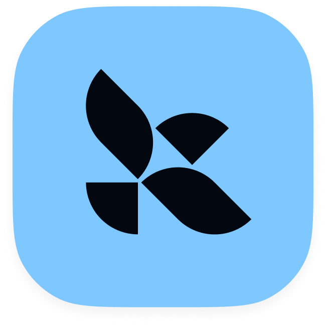

# Integrations

[LangSmith](https://smith.langchain.com?utm_source=docs&utm_medium=cta&utm_campaign=langsmith-signup&utm_content=langsmith-integrations) provides integrations for a growing set of popular [LLM providers](#llm-providers) and [agent frameworks](#agent-frameworks) as well as [Deep Agents](https://docs.langchain.com/oss/python/deepagents/overview.md), [LangChain](https://docs.langchain.com/oss/python/langchain/overview.md), and [LangGraph](https://docs.langchain.com/oss/python/langgraph/overview.md). For setup and usage, refer to the guides listed on this page.

Before sending traces in an agent-based workspace, [create an agent](../../../../LangSmith%20setup/Overview/Agent-based%20workspaces/Create%20an%20agent.md) and choose its environment. Complete this setup once, then follow the tracing guide for your integration.

## LLM providers

Amazon Bedrock

[Open](LLM%20providers/Trace%20with%20Amazon%20Bedrock.md)

Anthropic

[Open](LLM%20providers/Trace%20with%20Anthropic.md)

DeepSeek

[Open](LLM%20providers/Trace%20with%20DeepSeek.md)

Google Gemini

[Open](LLM%20providers/Trace%20with%20Google%20Gemini.md)

LiteLLM

[Open](LLM%20providers/Trace%20with%20LiteLLM.md)

Mistral

[Open](LLM%20providers/Trace%20with%20Mistral.md)

OpenAI

[Open](LLM%20providers/Trace%20with%20OpenAI.md)

OpenAI-compatible APIs

[Open](LLM%20providers/Trace%20OpenAI-compatible%20providers.md)

**Using LangChain?** LangChain provides a unified interface to 100+ LLM providers, which allows you to switch between models by setting environment variables. [Initialize a model](https://docs.langchain.com/oss/python/langchain/models.md#initialize-a-model) and LangSmith will automatically trace your agent.

## Agent frameworks

AutoGen

[Open](Agent%20frameworks/Trace%20AutoGen%20agents.md)

Claude Agent SDK

[Open](Agent%20frameworks/Trace%20with%20the%20Claude%20Agent%20SDK.md)

Claude Managed Agents

[Open](Agent%20frameworks/Trace%20Claude%20Managed%20Agents.md)

CrewAI

[Open](Agent%20frameworks/Trace%20CrewAI%20agents.md)

Deep Agents

[Open](Agent%20frameworks/Trace%20Deep%20Agents.md)

Google ADK

[Open](Agent%20frameworks/Trace%20Google%20ADK%20agents.md)

LangChain

[Open](Agent%20frameworks/Trace%20LangChain%20agents%20%28Python%20and%20JS-TS%29.md)

LangGraph

[Open](Agent%20frameworks/Trace%20LangGraph%20agents.md)

Mastra

[Open](Agent%20frameworks/Trace%20Mastra%20agents.md)

Microsoft Agent Framework

[Open](Agent%20frameworks/Trace%20with%20Microsoft%20Agent%20Framework.md)

OpenAI Agents

[Open](Agent%20frameworks/Trace%20with%20the%20OpenAI%20Agents%20SDK.md)

OpenTelemetry

[Open](Agent%20frameworks/Trace%20with%20OpenTelemetry.md)

PydanticAI

[Open](Agent%20frameworks/Trace%20PydanticAI%20agents.md)

Semantic Kernel

[Open](Agent%20frameworks/Trace%20Semantic%20Kernel%20agents.md)

Strands Agents

[Open](Agent%20frameworks/Trace%20with%20Strands%20Agents.md)

Vercel AI SDK

[Open](Agent%20frameworks/Trace%20Vercel%20AI%20SDK%20agents%20%28JS-TS%20only%29.md)

## Voice AI frameworks

OpenAI Realtime

[Open](Voice%20AI%20frameworks/Trace%20OpenAI%20Realtime%20agents.md)

Gemini Live

[Open](Voice%20AI%20frameworks/Trace%20Gemini%20Live%20agents.md)

Livekit

[Open](Voice%20AI%20frameworks/Trace%20LiveKit%20agents.md)

Pipecat

[Open](Voice%20AI%20frameworks/Trace%20Pipecat%20agents.md)

## Developer tools

Claude Code

[Open](Developer%20tools/Trace%20Claude%20Code%20sessions.md)

OpenAI Codex

[Open](Developer%20tools/Trace%20OpenAI%20Codex%20sessions.md)

OpenCode

[Open](Developer%20tools/Trace%20OpenCode%20sessions.md)

Cursor

[Open](Developer%20tools/Trace%20Cursor%20sessions.md)

Instructor

[Open](Developer%20tools/Trace%20with%20Instructor.md)

n8n

[Open](Developer%20tools/Trace%20n8n%20workflows.md)

Pi

[Open](Developer%20tools/Trace%20Pi%20coding%20agent%20sessions.md)

Temporal

[Open](Developer%20tools/Trace%20with%20Temporal.md)

VS Code Copilot

[Open](Developer%20tools/Trace%20Visual%20Studio%20Code%20Copilot%20Chat%20sessions.md)

These coding agent integrations follow a shared [metadata contract](Developer%20tools/Coding%20agent%20metadata%20contract.md) that standardizes the trace fields they emit.

## Productivity

Claude Cowork

[Open](Productivity/Trace%20Claude%20Cowork%20sessions.md)
