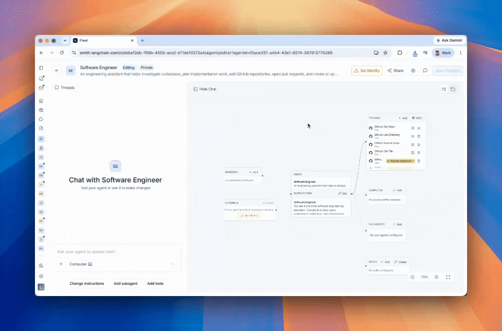

# Use Fleet agents in code

> Invoke Fleet agents via the LangGraph SDK or REST API, or download and run them locally with the fleet-deepagents-export package.

There are two main ways to use Fleet agents programmatically:

* **[Call from code](#call-from-code)**: Invoke your agent remotely via the LangGraph SDK or REST API, without downloading anything.
* **[Export to code](#export-to-code)**: Download your agent's configuration and run it locally as a self-contained Python project using the `fleet-deepagents-export` package.

## Call from code

You can invoke LangSmith Fleet agents from your applications using the [LangGraph SDK](../../../Monitor/Reference/LangSmith%20reference.md) or the REST API. Fleet agents run on [Agent Server](../../../Deploy/Agent%20Server/Capabilities/Agent%20Server.md), so you can use the same API methods as any other [Agent Server](../../../Deploy/Get%20started/LangSmith%20Agent%20Server.md).

The REST API lets you call your agent from any language or platform that supports HTTP requests.

### Prerequisites

* A LangSmith account with a Fleet agent
* A [Personal Access Token (PAT)](../../../LangSmith%20setup/Account/Create%20an%20account%20and%20API%20key.md) for authentication
* (SDK only) The [LangGraph SDK](../../../Monitor/Reference/LangSmith%20reference.md) installed:

```bash Python
pip install langgraph-sdk python-dotenv
```

```bash TypeScript
yarn add @langchain/langgraph-sdk
```

### Authentication

To authenticate with your agent's Fleet deployment, provide a LangSmith [Personal Access Token (PAT)](../../../LangSmith%20setup/Account/Create%20an%20account%20and%20API%20key.md) to the `api_key` argument when instantiating the LangGraph SDK client, or via the `X-API-Key` header. If using `X-API-Key`, you must also set the `X-Auth-Scheme` header to `langsmith-api-key`.

If the PAT you pass is not tied to the owner of the agent, your request will be rejected with a `404 Not Found` error.

If the agent you're trying to invoke is a workspace agent (Agents shared with all members of a LangSmith workspace. Private agents are only visible to the creator.) and you're not the owner, you can perform all the same operations as you would in the UI (read-only).

### 1. Get the agent ID and URL

To get your agent's `agent_id` and `api_url`:

1. In the [LangSmith UI](https://smith.langchain.com?utm_source=docs&utm_medium=cta&utm_campaign=langsmith-signup&utm_content=langsmith-fleet-code), open your agent.
2. In the sidebar, expand the **Advanced settings** drawer.
3. Under **Developer**, click **View code snippets** to see pre-populated values for your agent.

Copy the code below and replace `agent_id` and `api_url` with the values from your agent's code snippets.

Create a `.env` file in your project root with your [Personal Access Token](../../../LangSmith%20setup/Account/Create%20an%20account%20and%20API%20key.md):

```bash .env
LANGGRAPH_API_KEY=your-personal-access-token
```

### 2. Fetch agent configuration

Verify your connection by fetching your agent's configuration:

> [tab] Python
>
> ```python theme={"theme":{"light":"catppuccin-latte","dark":"catppuccin-mocha"}}
> import os
> from dotenv import load_dotenv
> from langgraph_sdk.client import get_client
>
> load_dotenv()
>
> agent_id = "your-agent-id"
>
> api_key = os.getenv("LANGGRAPH_API_KEY")
> api_url = "<AGENT-BUILDER-URL>.us.langgraph.app"
>
> client = get_client(
>     url=api_url,
>     api_key=api_key,
>     headers={
>         "X-Auth-Scheme": "langsmith-api-key",
>     },
> )
>
> async def get_assistant(agent_id: str):
>     agent = await client.assistants.get(agent_id)
>     print(agent)
>
> if __name__ == "__main__":
>     import asyncio
>     asyncio.run(get_assistant(agent_id))
> ```

> [tab] TypeScript
>
> ```ts theme={"theme":{"light":"catppuccin-latte","dark":"catppuccin-mocha"}}
> import "dotenv/config";
> import { Client } from "@langchain/langgraph-sdk";
>
> const agentId = "your-agent-id";
>
> const apiKey = process.env.LANGGRAPH_API_KEY;
> const apiUrl = "<AGENT-BUILDER-URL>.us.langgraph.app";
>
> const client = new Client({
>   apiUrl,
>   apiKey,
>   defaultHeaders: {
>     "X-Auth-Scheme": "langsmith-api-key",
>   },
> });
>
> async function main(agentId: string) {
>   const agent = await client.assistants.get(agentId);
>   console.log(agent);
> }
>
> main(agentId).catch(console.error);
> ```

> [tab] cURL
>
> ```bash theme={"theme":{"light":"catppuccin-latte","dark":"catppuccin-mocha"}}
> curl --request GET \
>     --url "<AGENT-BUILDER-URL>.us.langgraph.app/assistants/your-agent-id" \
>     --header 'Content-Type: application/json' \
>     --header 'X-Api-Key: your-personal-access-token' \
>     --header 'X-Auth-Scheme: langsmith-api-key'
> ```

Use a [Personal Access Token (PAT)](../../../LangSmith%20setup/Account/Create%20an%20account%20and%20API%20key.md) tied to your LangSmith account. Set the `X-Auth-Scheme` header to `langsmith-api-key` for authentication.

### 3. Invoke agent

The examples below show how to send a message to your agent and receive a response. You can use either a **stateless** run (no thread, no conversation history) or a **stateful** run (with a thread to maintain conversation history across multiple turns).

#### Stateless run

A stateless run sends a single request and returns the full response. No conversation history is persisted. This is the simplest way to call your agent:

> [tab] Python
>
> ```python theme={"theme":{"light":"catppuccin-latte","dark":"catppuccin-mocha"}}
> import os
> from dotenv import load_dotenv
> from langgraph_sdk.client import get_client
>
> load_dotenv()
>
> agent_id = "your-agent-id"
>
> api_key = os.getenv("LANGGRAPH_API_KEY")
> api_url = "https://<AGENT-BUILDER-URL>.us.langgraph.app"
>
> client = get_client(
>     url=api_url,
>     api_key=api_key,
>     headers={
>         "X-Auth-Scheme": "langsmith-api-key",
>     },
> )
>
> result = await client.runs.wait(
>     None,
>     agent_id,
>     input={
>         "messages": [
>             {"role": "user", "content": "What can you help me with?"}
>         ]
>     },
> )
> print(result)
> ```

> [tab] TypeScript
>
> ```ts theme={"theme":{"light":"catppuccin-latte","dark":"catppuccin-mocha"}}
> import "dotenv/config";
> import { Client } from "@langchain/langgraph-sdk";
>
> const agentId = "your-agent-id";
>
> const apiKey = process.env.LANGGRAPH_API_KEY;
> const apiUrl = "<AGENT-BUILDER-URL>.us.langgraph.app";
>
> const client = new Client({
>   apiUrl,
>   apiKey,
>   defaultHeaders: {
>     "X-Auth-Scheme": "langsmith-api-key",
>   },
> });
>
> const result = await client.runs.wait(
>   null,
>   agentId,
>   {
>     input: {
>       messages: [
>         { role: "user", content: "What can you help me with?" }
>       ]
>     }
>   }
> );
> console.log(result);
> ```

> [tab] cURL
>
> ```bash theme={"theme":{"light":"catppuccin-latte","dark":"catppuccin-mocha"}}
> curl --request POST \
>     --url "<AGENT-BUILDER-URL>.us.langgraph.app/runs/wait" \
>     --header 'Content-Type: application/json' \
>     --header 'X-Api-Key: your-personal-access-token' \
>     --header 'X-Auth-Scheme: langsmith-api-key' \
>     --data '{
>         "assistant_id": "your-agent-id",
>         "input": {
>             "messages": [
>                 {
>                     "role": "user",
>                     "content": "What can you help me with?"
>                 }
>             ]
>         }
>     }'
> ```

#### Stateless streaming run

To stream the response as it is generated rather than waiting for the full result, use the streaming endpoint:

> [tab] Python
>
> ```python theme={"theme":{"light":"catppuccin-latte","dark":"catppuccin-mocha"}}
> async for chunk in client.runs.stream(
>     None,
>     agent_id,
>     input={
>         "messages": [
>             {"role": "user", "content": "What can you help me with?"}
>         ]
>     },
>     stream_mode="updates",
> ):
>     if chunk.data and "run_id" not in chunk.data:
>         print(chunk.data)
> ```

> [tab] TypeScript
>
> ```ts theme={"theme":{"light":"catppuccin-latte","dark":"catppuccin-mocha"}}
> const streamResponse = client.runs.stream(
>   null,
>   agentId,
>   {
>     input: {
>       messages: [
>         { role: "user", content: "What can you help me with?" }
>       ]
>     },
>     streamMode: "updates"
>   }
> );
> for await (const chunk of streamResponse) {
>   if (chunk.data && !("run_id" in chunk.data)) {
>     console.log(chunk.data);
>   }
> }
> ```

> [tab] cURL
>
> ```bash theme={"theme":{"light":"catppuccin-latte","dark":"catppuccin-mocha"}}
> curl --request POST \
>     --url "<AGENT-BUILDER-URL>.us.langgraph.app/runs/stream" \
>     --header 'Content-Type: application/json' \
>     --header 'X-Api-Key: your-personal-access-token' \
>     --header 'X-Auth-Scheme: langsmith-api-key' \
>     --data '{
>         "assistant_id": "your-agent-id",
>         "input": {
>             "messages": [
>                 {
>                     "role": "user",
>                     "content": "What can you help me with?"
>                 }
>             ]
>         },
>         "stream_mode": [
>             "updates"
>         ]
>     }'
> ```

#### Stateful run with a thread

To maintain conversation history across multiple interactions, first create a thread and then run your agent on it. Each subsequent run on the same thread has access to the full message history:

> [tab] Python
>
> ```python theme={"theme":{"light":"catppuccin-latte","dark":"catppuccin-mocha"}}
> import os
> from dotenv import load_dotenv
> from langgraph_sdk.client import get_client
>
> load_dotenv()
>
> agent_id = "your-agent-id"
>
> api_key = os.getenv("LANGGRAPH_API_KEY")
> api_url = "<AGENT-BUILDER-URL>.us.langgraph.app"
>
> client = get_client(
>     url=api_url,
>     api_key=api_key,
>     headers={
>         "X-Auth-Scheme": "langsmith-api-key",
>     },
> )
>
> thread = await client.threads.create()
>
> async for chunk in client.runs.stream(
>     thread["thread_id"],
>     agent_id,
>     input={
>         "messages": [
>             {"role": "user", "content": "Hi, my name is Alice."}
>         ]
>     },
>     stream_mode="updates",
> ):
>     if chunk.data and "run_id" not in chunk.data:
>         print(chunk.data)
>
> async for chunk in client.runs.stream(
>     thread["thread_id"],
>     agent_id,
>     input={
>         "messages": [
>             {"role": "user", "content": "What is my name?"}
>         ]
>     },
>     stream_mode="updates",
> ):
>     if chunk.data and "run_id" not in chunk.data:
>         print(chunk.data)
> ```

> [tab] TypeScript
>
> ```ts theme={"theme":{"light":"catppuccin-latte","dark":"catppuccin-mocha"}}
> import "dotenv/config";
> import { Client } from "@langchain/langgraph-sdk";
>
> const agentId = "your-agent-id";
>
> const apiKey = process.env.LANGGRAPH_API_KEY;
> const apiUrl = "<AGENT-BUILDER-URL>.us.langgraph.app";
>
> const client = new Client({
>   apiUrl,
>   apiKey,
>   defaultHeaders: {
>     "X-Auth-Scheme": "langsmith-api-key",
>   },
> });
>
> const thread = await client.threads.create();
>
> let streamResponse = client.runs.stream(
>   thread["thread_id"],
>   agentId,
>   {
>     input: {
>       messages: [
>         { role: "user", content: "Hi, my name is Alice." }
>       ]
>     },
>     streamMode: "updates"
>   }
> );
> for await (const chunk of streamResponse) {
>   if (chunk.data && !("run_id" in chunk.data)) {
>     console.log(chunk.data);
>   }
> }
>
> streamResponse = client.runs.stream(
>   thread["thread_id"],
>   agentId,
>   {
>     input: {
>       messages: [
>         { role: "user", content: "What is my name?" }
>       ]
>     },
>     streamMode: "updates"
>   }
> );
> for await (const chunk of streamResponse) {
>   if (chunk.data && !("run_id" in chunk.data)) {
>     console.log(chunk.data);
>   }
> }
> ```

> [tab] cURL
>
> First, create a thread:
>
> ```bash theme={"theme":{"light":"catppuccin-latte","dark":"catppuccin-mocha"}}
> curl --request POST \
>     --url "<AGENT-BUILDER-URL>.us.langgraph.app/threads" \
>     --header 'Content-Type: application/json' \
>     --header 'X-Api-Key: your-personal-access-token' \
>     --header 'X-Auth-Scheme: langsmith-api-key' \
>     --data '{}'
> ```
>
> Use the `thread_id` from the response to send messages on the thread:
>
> ```bash theme={"theme":{"light":"catppuccin-latte","dark":"catppuccin-mocha"}}
> curl --request POST \
>     --url "<AGENT-BUILDER-URL>.us.langgraph.app/threads/<THREAD_ID>/runs/stream" \
>     --header 'Content-Type: application/json' \
>     --header 'X-Api-Key: your-personal-access-token' \
>     --header 'X-Auth-Scheme: langsmith-api-key' \
>     --data '{
>         "assistant_id": "your-agent-id",
>         "input": {
>             "messages": [
>                 {
>                     "role": "user",
>                     "content": "Hi, my name is Alice."
>                 }
>             ]
>         },
>         "stream_mode": [
>             "updates"
>         ]
>     }'
> ```
>
> Send a follow-up message on the same thread:
>
> ```bash theme={"theme":{"light":"catppuccin-latte","dark":"catppuccin-mocha"}}
> curl --request POST \
>     --url "<AGENT-BUILDER-URL>.us.langgraph.app/threads/<THREAD_ID>/runs/stream" \
>     --header 'Content-Type: application/json' \
>     --header 'X-Api-Key: your-personal-access-token' \
>     --header 'X-Auth-Scheme: langsmith-api-key' \
>     --data '{
>         "assistant_id": "your-agent-id",
>         "input": {
>             "messages": [
>                 {
>                     "role": "user",
>                     "content": "What is my name?"
>                 }
>             ]
>         },
>         "stream_mode": [
>             "updates"
>         ]
>     }'
> ```

### REST API reference

The table below summarizes the key endpoints. Replace `<API_URL>` with your agent's deployment URL.

| Operation | Method | Endpoint |
| - | - | - |
| [Get agent info](../../../Deploy/Get%20started/Reference/Agent%20Server%20API/Assistants/Get%20Assistant.md) | `GET` | `<API_URL>/assistants/<AGENT_ID>` |
| [Create a thread](../../../Deploy/Get%20started/Reference/Agent%20Server%20API/Threads/Create%20Thread.md) | `POST` | `<API_URL>/threads` |
| [Run (wait for result)](../../../Deploy/Get%20started/Reference/Agent%20Server%20API/Stateless%20Runs/Create%20Run%2C%20Wait%20for%20Output.md) | `POST` | `<API_URL>/runs/wait` |
| [Run (streaming)](../../../Deploy/Get%20started/Reference/Agent%20Server%20API/Stateless%20Runs/Create%20Run%2C%20Stream%20Output.md) | `POST` | `<API_URL>/runs/stream` |
| [Run on thread (wait)](../../../Deploy/Get%20started/Reference/Agent%20Server%20API/Thread%20Runs/Create%20Run%2C%20Wait%20for%20Output.md) | `POST` | `<API_URL>/threads/<THREAD_ID>/runs/wait` |
| /langsmith/agent-server-api/thread-runs/create-run-stream-output | `POST` | `<API_URL>/threads/<THREAD_ID>/runs/stream` |

All endpoints require the following headers:

* `Content-Type: application/json`
* `X-Api-Key:` your [Personal Access Token](../../../LangSmith%20setup/Account/Create%20an%20account%20and%20API%20key.md)
* `X-Auth-Scheme: langsmith-api-key`

For the full API specification, see the [Agent Server API reference](../../../Deploy/Get%20started/Reference/Agent%20Server%20API/Agent%20Server%20API%20reference.md).

### Forward caller headers to MCP servers

Header forwarding passes headers from a run request to your agent's custom MCP servers on each tool call. Use it to give an MCP server per-run context, such as the end user's ID or a downstream token.

> [!NOTE]
>
> Header forwarding is available on self-hosted LangSmith only. An administrator must [enable it](../../../LangSmith%20setup/Self-hosted/Install%20an%20instance/Additional%20features/Enable%20Fleet%20on%20self-hosted%20LangSmith.md#optional-forward-caller-headers-to-mcp-servers) first.

Header forwarding works only through the Fleet API, not the deployment URL used in the earlier examples. The LangGraph SDK calls the deployment URL, so call the Fleet API directly instead. The Fleet API base URL is `https://<your-langsmith-host>/api/v1/fleet`. If you set `config.basePath`, use `https://<your-langsmith-host>/<basePath>/api/v1/fleet`.

To forward headers, prefix each one with `X-Fleet-Forward-` and send it on a request that starts a run:

```bash
curl --request POST \
    --url "https://<your-langsmith-host>/api/v1/fleet/threads/runs" \
    --header "Content-Type: application/json" \
    --header "X-Api-Key: $LANGSMITH_API_KEY" \
    --header "X-Tenant-Id: $LANGSMITH_WORKSPACE_ID" \
    --header "X-Fleet-Forward-User-Id: user@example.com" \
    --header "X-Fleet-Forward-Authorization: Bearer $DOWNSTREAM_TOKEN" \
    --data '{
        "agent_id": "your-agent-id",
        "input": {
            "messages": [
                { "role": "user", "content": "What can you help me with?" }
            ]
        }
    }'
```

Set `X-Tenant-Id` to the ID of the workspace that contains the agent.

Your MCP server receives each header with the prefix in place. Read `X-Fleet-Forward-User-Id`, not `X-User-Id`.

> [!WARNING]
>
> LangSmith does not verify forwarded header values. The caller sets them, so do not treat them as proof of identity in your MCP server.

The following Fleet API endpoints forward headers. Replace `<FLEET_API_URL>` with your Fleet API base URL.

| Operation | Method | Endpoint |
| - | - | - |
| Create a thread and run it | `POST` | `<FLEET_API_URL>/threads/runs` |
| Run on an existing thread | `POST` | `<FLEET_API_URL>/threads/<THREAD_ID>/runs` |
| Run on a thread (wait for result) | `POST` | `<FLEET_API_URL>/threads/<THREAD_ID>/runs/wait` |
| Run on a thread (streaming) | `POST` | `<FLEET_API_URL>/threads/<THREAD_ID>/runs/stream` |

Forwarded headers follow these rules:

* **Destination**: Fleet forwards headers to custom MCP servers only, never to the built-in tool server.
* **Header names**: Matching is case-insensitive. Fleet normalizes names, so `x-fleet-forward-user-id` arrives as `X-Fleet-Forward-User-Id`.
* **Conflicts**: When a custom MCP server already configures a header with the same name, the configured value wins.
* **Limits**: A request with more than 10 forwarded headers returns `400`. So does a name suffix after `X-Fleet-Forward-` that is not 1 to 40 characters of `A-Z`, `a-z`, `0-9`, or `-`. So does a header sent more than once, or a value that is not printable ASCII or exceeds 1,024 bytes.

## Export to code

The **Export to code** feature lets you download your Fleet agent as a self-contained Python project and run it locally. This is useful when you want to:

* Run your agent in your own infrastructure without calling the Fleet API
* Extend or customize the agent beyond what the Fleet UI supports (add custom tools, middleware, or skills)
* Inspect or version-control the full agent implementation
* Use LangGraph Studio for local development and graph inspection

The [`fleet-deepagents-export`](https://pypi.org/project/fleet-deepagents-export/) package ([GitHub](https://github.com/langchain-ai/fleet-deepagents-export)) handles reading the exported configuration and wiring up your agent with MCP tools, subagents, and skills.

### Prerequisites

* Python 3.11+
* [`uv`](https://docs.astral.sh/uv/getting-started/installation/) (recommended) for dependency management
* A LangSmith Fleet agent to export

### 1. Copy the starter project

The starter project at [`examples/template-agent/`](https://github.com/langchain-ai/fleet-deepagents-export/tree/main/examples/template-agent) is the recommended starting point. Clone the repo and copy the starter:

```bash
git clone https://github.com/langchain-ai/fleet-deepagents-export.git
cp -R fleet-deepagents-export/examples/template-agent my-agent
cd my-agent
```

### 2. Export your agent from Fleet

In the [LangSmith UI](https://smith.langchain.com?utm_source=docs&utm_medium=cta&utm_campaign=langsmith-signup&utm_content=langsmith-fleet-code), open your agent and export it as a `.zip` file.



Then drop the contents into the `fleet/` directory of your starter project:

```bash
unzip path/to/my-export.zip -d fleet/
```

The `fleet/` directory contains everything your agent needs:

* `AGENTS.md` — system prompt
* `config.json` — model configuration and workspace metadata
* `tools.json` — MCP server connections
* `subagents/` (optional) — subagent definitions
* `skills/` (optional) — skill instructions

### 3. Configure your environment

Copy the example env file and fill in the required values:

```bash
cp .env.example .env
```

The three `LANGSMITH_*_ID` values are in `fleet/config.json` under `metadata`. Open that file and copy `tenant_id`, `organization_id`, and `ls_user_id` into your `.env`:

```bash .env
# Model provider — set the key for whichever provider your agent uses
ANTHROPIC_API_KEY=your-anthropic-api-key

# LangSmith credentials — copy IDs from fleet/config.json → metadata
LANGSMITH_API_KEY=your-langsmith-pat
LANGSMITH_TENANT_ID=your-tenant-id
LANGSMITH_ORGANIZATION_ID=your-organization-id
LANGSMITH_USER_ID=your-user-id       # required if your agent uses OAuth tools

# Built-in MCP tools (Gmail, Calendar, GitHub)
BUILTIN_MCP_URL=https://tools.langchain.com/mcp
```

### 4. Install dependencies and run

```bash
make setup    # installs dependencies via uv sync
```

Then choose how to interact with your agent:

```bash
make dev    # LangGraph Studio — browser UI for chat and graph inspection
make run    # terminal REPL via cli.py — text-only chat
```

### 5. Customize the agent

The starter separates Fleet-owned files from files you own and can freely edit:

| File / Directory | Owner | Purpose |
| - | - | - |
| `fleet/` | Fleet | Drop export contents here. Re-unzip to update; nothing else is touched. |
| `agent.py` | You | Graph wiring. Override the model by replacing the `model = components.pop("model")` line. |
| `custom_tools.py` | You | Add code-defined tools; merged with Fleet MCP tools at runtime. |
| `custom_middleware.py` | You | Add `AgentMiddleware` instances for logging, filters, pre/post hooks, etc. |
| `custom_skills/` | You | Drop `<skill-name>/SKILL.md` files; layered on top of `fleet/skills/`. |
| `cli.py` | You | Terminal REPL; edit freely. |

Here is the full `agent.py` from the starter:

```python
"""Standalone deepagent exported from LangSmith Fleet.

LangGraph Studio / dev server:  make dev
Terminal:                        make run  (see cli.py)

Extension points (edit these, not this file):
- ``custom_tools.py``      — add code-defined tools
- ``custom_middleware.py`` — wrap the agent loop with logging, filters, etc.
- ``custom_skills/``       — drop ``<skill-name>/SKILL.md`` files
"""

from __future__ import annotations

from pathlib import Path
from typing import Any

from dotenv import load_dotenv

load_dotenv()

from custom_middleware import custom_middleware
from custom_tools import custom_tools
from deepagents import create_deep_agent
from fleet_deepagents_export import StaticSkillsLoader, load_agent_components

PROJECT_DIR = Path(__file__).parent
FLEET_DIR = PROJECT_DIR / "fleet"
CUSTOM_SKILLS_DIR = PROJECT_DIR / "custom_skills"

# Read SKILL.md from disk once; middleware injects into state on first turn.
_SKILL_LOADER = StaticSkillsLoader(
    [
        (FLEET_DIR / "skills", "/skills/fleet"),
        (CUSTOM_SKILLS_DIR, "/skills/custom"),
    ]
)


async def graph(runtime: Any):
    """Build and return the agent graph."""
    components = await load_agent_components(FLEET_DIR)
    model = components.pop("model")  # from fleet/config.json; replace to override
    components["tools"] = list(components["tools"]) + list(custom_tools)

    if _SKILL_LOADER.files:
        components["skills"] = _SKILL_LOADER.skill_paths

    return create_deep_agent(
        model=model,
        middleware=[_SKILL_LOADER, *custom_middleware],
        **components,
    ).with_config({"recursion_limit": 1000})
```

### Re-exporting

When you export a new version of your agent from Fleet, simply wipe and re-unzip — your customizations are untouched:

```bash
rm -rf fleet && unzip path/to/my-new-export.zip -d fleet/
```

### Supported model providers

The starter ships with `langchain-anthropic`, `langchain-openai`, and `langchain-google-genai`. For any other provider (e.g. `bedrock`, `fireworks`), add the matching `langchain-<provider>` package to `pyproject.toml`.

### MCP authentication

At startup, each tool's `mcp_server_url` is resolved against LangSmith's MCP server registry:

* **Built-in LangSmith tools** (Gmail, Calendar, GitHub) — authenticated via your `LANGSMITH_API_KEY`.
* **Static-credential servers** (`auth_type: "headers"`) — credentials come from the registry record. Requires `mcp-servers:invoke` permission.
* **OAuth servers** (`auth_type: "oauth"`) — bearer token fetched from LangSmith's OAuth broker. A browser window opens on first run for any per-user server that hasn't been authorized yet.
