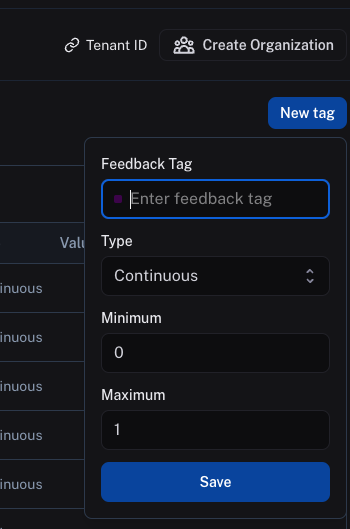
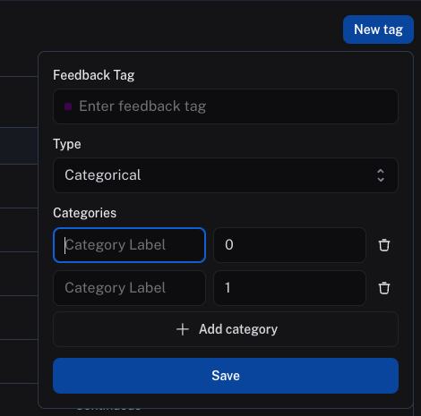

# Set up feedback criteria

> [!TIP]
>
> **Recommended Reading**
>
> Before diving into this content, it might be helpful to read the following:
>
> * [Conceptual guide on tracing and feedback](../../Monitor/Trace/Observability%20concepts.md)
> * [Reference guide on feedback data format](../../Monitor/Debug/Data%20type%20reference/Feedback%20data%20format.md)

Feedback criteria are represented in the application as feedback tags. For human feedback, you can set up new feedback criteria as continuous feedback or categorical feedback.

> [!NOTE]
>
> You can also manage feedback configs programmatically with the SDK. Refer to [Manage feedback & annotation queues programmatically](Manage%20feedback%20%26%20annotation%20queues%20programmatically.md).

> [!TIP]
>
> For free-form acceptance criteria a reviewer writes per-run (rather than a fixed set of rubric scores), refer to [Use assertions](Use%20assertions.md).

To set up a new feedback criteria, follow [this link](https://smith.langchain.com/settings/workspaces/feedbacks) to view all existing tags for your workspace, then click **New Tag**.

## Continuous feedback

For continuous feedback, you can enter a feedback tag name, then select a minimum and maximum value. Every value, including floating-point numbers, within this range will be accepted as feedback scores.

## Categorical feedback

For categorical feedback, you can enter a feedback tag name, then add a list of categories, each category mapping to a score. When you provide feedback, you can select one of these categories as the feedback score.
Both the category label and the score will be logged as feedback in `value` and `score` fields, respectively.

