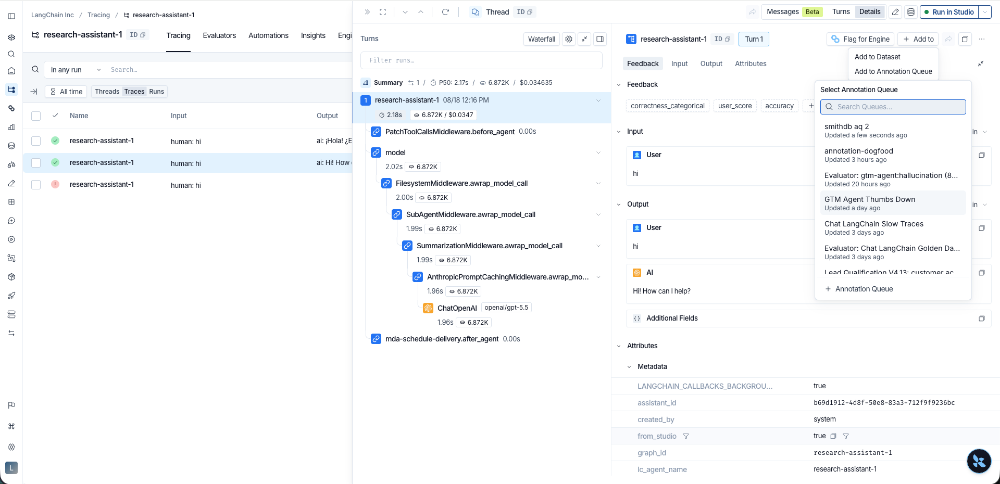
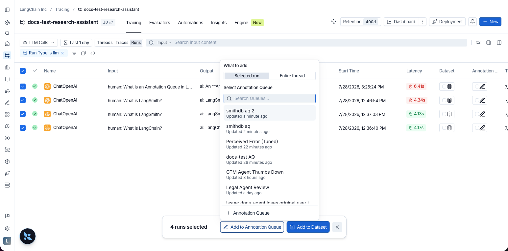
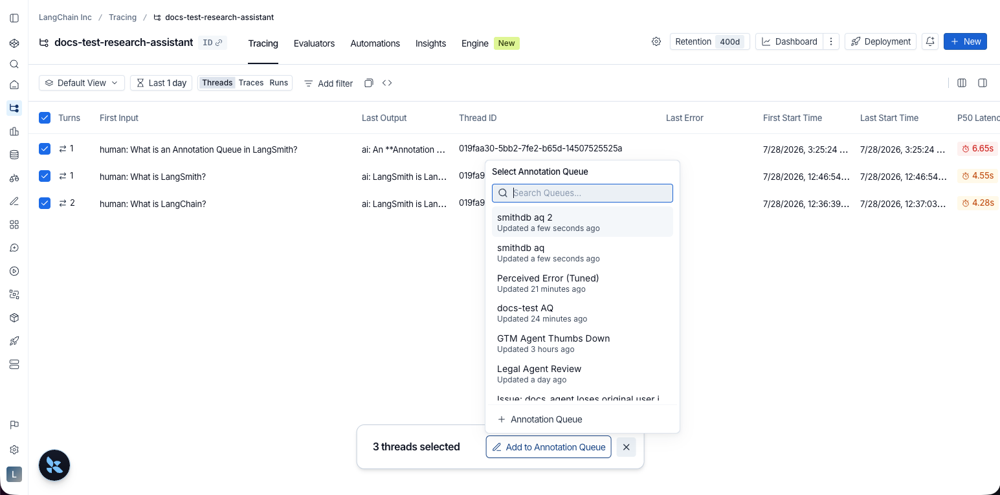
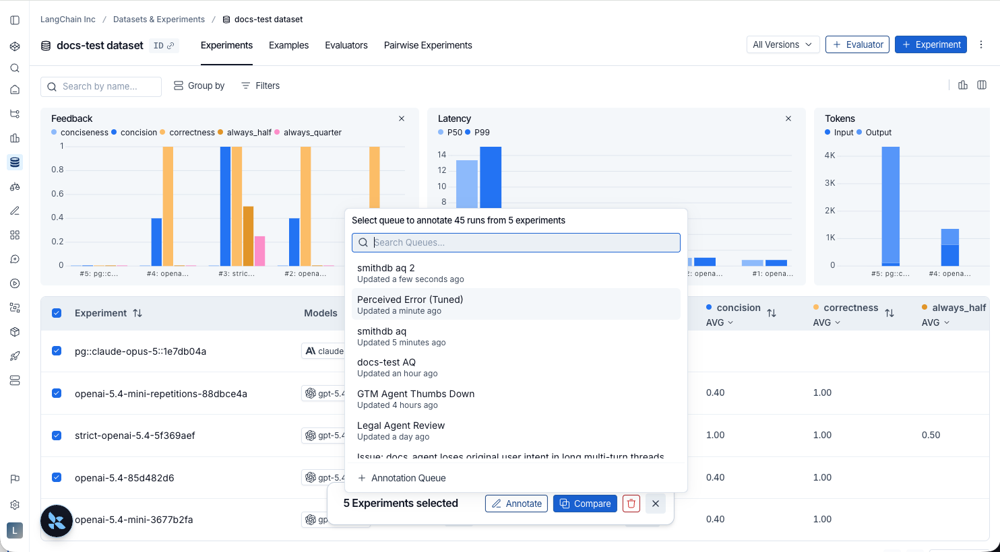
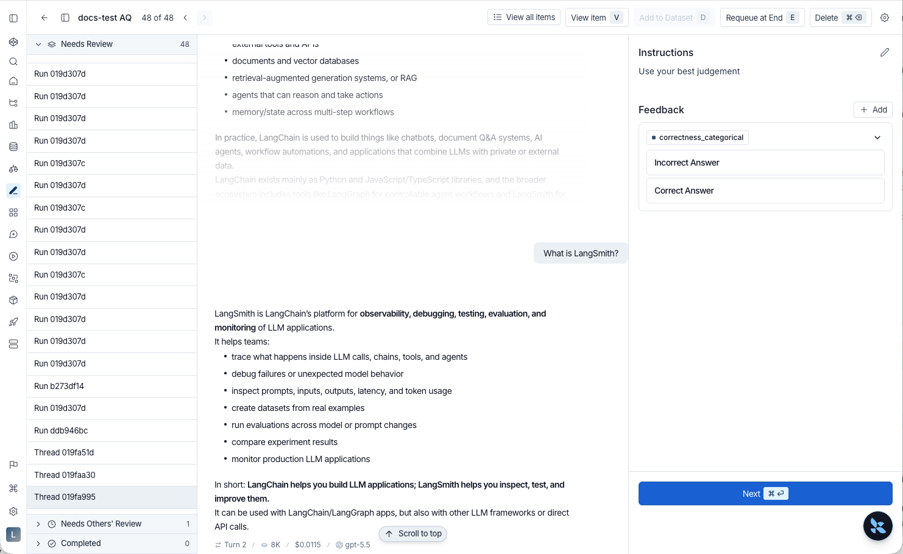
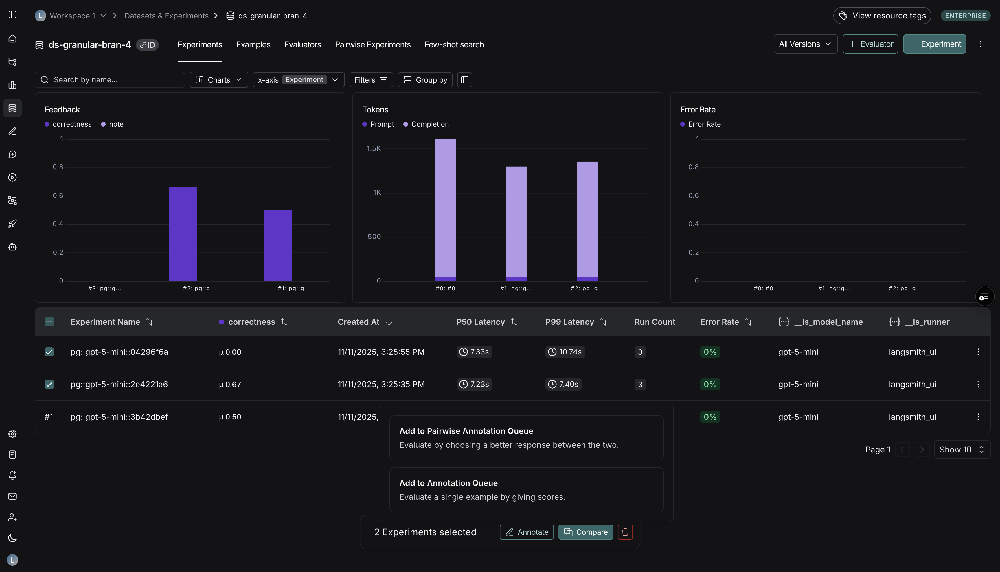
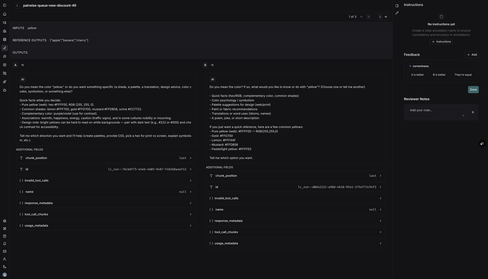

# Use annotation queues

*Annotation queues* give human reviewers a focused workflow for attaching feedback to specific [runs](../../Monitor/Trace/Observability%20concepts.md#runs) or [threads](../../Monitor/Trace/Observability%20concepts.md#threads). While you can always annotate [traces](../../Monitor/Trace/Observability%20concepts.md#traces) inline, annotation queues let you group runs and threads together, prescribe rubrics, and track reviewer progress. Reviewing an entire thread lets you evaluate a full multi-turn conversation, capturing quality signals that a single run cannot.

> [!NOTE]
>
> You can also manage annotation queues and feedback configs programmatically with the SDK. Refer to [Manage feedback & annotation queues programmatically](Manage%20feedback%20%26%20annotation%20queues%20programmatically.md).

LangSmith supports two queue styles:

* [**Single-run annotation queues**](#single-run-annotation-queues) present one queue item at a time, either a run or a thread, and let reviewers submit any rubric feedback you configure. For **run** items, single-run queues also support [assertions](Use%20assertions.md) to capture acceptance criteria for offline evaluation.
* [**Pairwise annotation queues (PAQs)**](#pairwise-annotation-queues) present two runs side-by-side so reviewers can quickly decide which output is better (or if they are equivalent) against the rubric items you define.

> [!TIP]
>
> For a demonstration of using annotation queues, watch the [Getting started with annotation queues](#video-guide) video guide.

## Single-run annotation queues

Single-run queues present one item at a time and let reviewers submit any rubric feedback you configure. They can be created directly from the **Annotation queues** section in the [LangSmith UI](https://smith.langchain.com?utm_source=docs&utm_medium=cta&utm_campaign=langsmith-signup&utm_content=langsmith-annotation-queues). A queue can contain a mix of run items and thread items. A *thread item* represents an entire conversation and is reviewed against the same rubric as a run item.

Run items and thread items support different capabilities:

| Capability | Run items | Thread items |
| - | - | - |
| Rubric feedback | Yes | Yes |
| Reviewer notes | Yes | No |
| Assertions | Yes | No |
| Add to Dataset | Yes | Yes |
| Default dataset | Yes | No |
| Automation rules | Yes | Yes |

### Create a single-run queue

1. Navigate to **Annotation Queues** in the left navigation.
2. Click **+ Annotation Queue** in the top-left corner to open the **Create Annotation Queue** panel.

#### Basic details

1. Fill in the **Name** and **Description** of the queue.
2. Optionally select an **Application**.
3. Optionally **Select a default dataset** to streamline exporting reviewed runs into a dataset in your LangSmith [workspace](../../LangSmith%20setup/Govern/Organization/Overview.md#workspaces). Default datasets apply when you use **Add to Dataset** on run items; thread items do not support default datasets.

#### Annotation rubric

1. Draft some high-level **Instructions** for your annotators, which will be shown in the sidebar on every item.
2. Click **+ Add a feedback rubric** to add feedback keys to your annotation queue. Annotators will be presented with these feedback keys on each item.
3. Add a description for each, as well as a short description of each category, if the feedback type is categorical.

   Reviewers see the **Instructions** and **Feedback** details in the right-hand pane of the UI.

#### Data formatting

Data formatting settings choose the layout reviewers see for run items. They do not apply to thread items.

> [!NOTE]
>
> The default view and the **Classic Trace View** setting are available on LangSmith Cloud and on self-hosted LangSmith v0.18 or later. Earlier self-hosted versions use the classic layout for every queue.

Each queue uses one of two layouts:

* **Default view**: Run items open in the run's [trajectory](../../Monitor/Debug/Viewing%20%26%20managing%20traces/View%20traces.md#trajectory-view), scrolled to the turn being graded. Reviewers read the conversation the way it appears in tracing, instead of raw inputs and outputs. The view is read-only. Reference outputs and attachments move to the run's [**Details**](../../Monitor/Debug/Viewing%20%26%20managing%20traces/View%20traces.md#details-view) panel. For the full review flow, see [Review a single-run queue](#review-a-single-run-queue).
* **Classic Trace View**: Off by default. When enabled, run items open in the classic layout, where reviewers can edit a run's inputs, outputs, and messages. Enabling it also reveals these settings:

  * A picker that hides selected JSON paths from a run's inputs and outputs. Select fields from checkboxes built from a sample run, or type a path. The picker appears after you save the queue.
  * **Show Feedback**: Show feedback already on the run.
  * **Show Metadata**: Show the run's metadata.

#### Collaborator settings

Set a number of reviewers or the maximum time you want to reserve the item to a collaborator. When there are multiple annotators for an item, you can choose to have the item stay in the queue until all reviewers have marked it as **Done**. In these settings, "run" refers to any queue item, including thread items. The settings are as follows:

* **All workspace members review each run**: When enabled, an item remains in the queue until every [workspace](../../LangSmith%20setup/Govern/Organization/Overview.md#workspaces) member has marked their review as **Done**.

* **Enable reservations on runs**: Reserving an item locks it for your review for a set amount of time. While an item is reserved, other reviewers can view it but cannot add feedback or notes. Reservations are disabled if all workspace members review each run.

  If a reviewer has viewed an item and then leaves without marking it **Done**, the reservation will expire after the specified **Reservation length**. The item is then released back into the queue and can be reserved by another reviewer.

  > [!NOTE]
  >
  > Clicking **Requeue** for an item's annotation will only move the current item to the end of the current user's queue; it won't affect the queue order of any other user. It will also release the reservation that the current user has on that item.

* **Number of reviewers per run**: This determines the number of reviewers that must mark an item as **Done** for it to be removed from the queue.

  * Reviewers cannot view the feedback left by other reviewers.
  * Comments on items are visible to all reviewers.

  > [!NOTE]
  >
  > The **Number of reviewers per run** setting is hidden when **Use assigned reviewers** is enabled (see below).

* **Use assigned reviewers**: Enable this toggle to use specific workspace members instead of a count-based threshold. When enabled:

  * A multi-select user picker appears so you can choose specific workspace members as assigned reviewers.
  * An item is marked **Completed** only when every assigned reviewer has submitted their review. Queue items progress through three states: **Needs Review**, **Needs Others' Review**, and **Completed**.
  * Non-assigned workspace members can still annotate items, but their submissions do not count toward completion.
  * Any workspace member can edit the assigned reviewers list in the queue settings.

  > [!NOTE]
  >
  > When you add a new assigned reviewer to a queue that already has completed items, those items do not revert to pending. If you remove an assigned reviewer, any items they had not yet reviewed recalculate their completion status.

Because of these settings, the number of items visible to each reviewer can differ from the total queue size.

### Edit a queue's settings

1. Open the **Edit Annotation Queue** panel for the annotation queue you want to edit. You can access this panel in two ways:

   * In the **Annotation queues** list, click the **Actions**  icon  at the right of the queue's row. Select  **Edit** from the dropdown.
   * In the annotation queue view, click the **Settings** icon  in the top-right corner.

2. In the **Edit Annotation Queue** panel, modify any of the settings you configured during queue creation and click **Save**.

### Assign runs and threads to a single-run queue

There are several ways to populate a single-run queue with items:

* **From the Details view**: In a [tracing project](../../Monitor/Trace/Observability%20concepts.md#tracing-projects) or agent environment, click into any row to open the side panel in the [Details view](../../Monitor/Debug/Viewing%20%26%20managing%20traces/View%20traces.md#details-view). The panel offers two actions, each with a fixed scope:

  * **Add to** : In the run header, open this menu and select **Add to Annotation Queue**. This adds the run you have selected as a run item.
  * **Add thread to annotation queue** : Next to the **Trajectory**, **Turns**, and **Details** tabs, click the icon. This adds the whole thread as a thread item.

  Both actions open a popover where you select an existing queue or create a new one.

  

  > [!NOTE]
  >
  > The thread action appears only for runs instrumented with `thread_id` / `session_id` metadata. Without that metadata, the panel opens the run on its own and only the run action is available.

* **From the Traces or Runs tab**: In a tracing project or agent environment, select either the **Traces** or **Runs** tab. Use the row checkboxes to select one or more items. Click **Add to Annotation Queue** at the bottom of the page. Use **What to add** to enqueue each selection as a **Selected run** or as its **Entire thread**.

  

* **From the Threads tab**: In a tracing project or agent environment, select the **Threads** tab. Use the row checkboxes to select one or more items. Click **Add to Annotation Queue** at the bottom of the page. Selected threads are added as thread items.

  

* **Automation rules**: [Set up a rule](../../Monitor/Observe/Automations/Set%20up%20automation%20rules.md) to automatically assign **runs** or **threads** that match a filter (for example, errors or low user scores) into a queue.

  > [!NOTE]
  >
  > What a rule enqueues depends on its [item type](../../Monitor/Observe/Automations/Set%20up%20automation%20rules.md#set-the-item-type-to-runs-or-threads). A rule whose item type is **Runs** enqueues run items. A rule whose item type is **Threads** enqueues the entire conversation as a thread item, once the thread goes idle.

* **Datasets & Experiments**: Select one or more [experiments](../Get%20started/Evaluation%20concepts.md#experiment) within a dataset and click ** Annotate**. Select **Add to Annotation Queue**, then choose an existing queue or create a new one. Experiment annotate flows add run items.

  

> [!NOTE]
>
> You can add at most **100** runs or threads to an annotation queue in a single action. To enqueue more, repeat the add flow in batches of 100 or fewer.
>
> Manually adding runs or threads to an annotation queue does not change trace retention by default. The trace keeps the retention configured for its project unless another action explicitly extends retention. Adds performed by an [automation rule](../../Monitor/Observe/Automations/Set%20up%20automation%20rules.md) are different: the rule's **Extend Data Retention** toggle is enabled by default for annotation queue actions. A run rule upgrades the whole trace that contains each matched run, and a thread rule upgrades every trace in the matched thread. For the full retention model, see [data retention auto-upgrades](../../Monitor/Trace/Configuration%20%26%20troubleshooting/Usage%20and%20billing.md#data-retention-auto-upgrades).

### Review a single-run queue

1. Navigate to the **Annotation Queues** section through the left-hand navigation bar.

   The queue list includes an **Assigned Reviewers** column showing which reviewers are assigned to each queue. To see only queues assigned to you, click the **Assigned to me** filter at the top of the list.

2. Click on the queue you want to review. This will take you to a focused, cyclical view of the items in the queue that require review. A left side panel lists queue items (runs and threads) and shows the status of each (**Needs Review**, **Needs Others' Review**, **Completed**). Use **View all items** to open the full queue list.

3. Review the current item:

   * **Run items**: The center pane shows the run in the Trajectory view. A run in a thread opens on the graded turn, with earlier and later turns loaded. A run outside a thread shows every message in its trace, with the agent's turn marked. Click **View item** to open the run's **Details** panel, which holds the run details, reference outputs, and attachments.

     Child runs show inputs and outputs instead of a trajectory. Runs whose trajectory is unavailable do the same, such as on a self-hosted installation that does not [query SmithDB](../../LangSmith%20setup/Self-hosted/SmithDB/SmithDB%20feature%20availability.md). This view collapses each intermediate tool call into one row, and lists reference outputs and attachments below the outputs.

     Add **Reviewer Notes**, score [**Feedback**](../../Monitor/Trace/Observability%20concepts.md#feedback) criteria, or mark the item as reviewed. To build a dataset, click **Add to Dataset** to save the run as an example. Instead of crafting a corrected reference output by hand, you can [write **Assertions**](Use%20assertions.md) directly in the review side panel and save them as the example's expected output. Once you add assertions, the center pane shows the run's inputs, with the assertions as its reference outputs.

     Both views are read-only. To edit a run's inputs and outputs before adding it to a dataset, enable [**Classic Trace View**](#data-formatting) for the queue.
   * **Thread items**: The center pane displays the thread's conversation transcript. Read the transcript and score its rubric **Feedback** criteria. Click **View item** to open the thread in the conversation peek. To add the full conversation to a dataset as one example, click **Add to Dataset**, then select a dataset. To create a dataset from the picker, click **New Dataset**. To learn what a thread example includes, see [Create and manage datasets in the UI](../Datasets%20%26%20Experiments/Datasets/Create%20a%20dataset/Create%20and%20manage%20datasets%20in%20the%20UI.md#manually-from-a-tracing-project).

   Click **Delete** to remove the item from the queue for all users, regardless of any current reservations or queue settings.

   > [!NOTE]
   >
   > For thread items, you can submit rubric feedback and use **Add to Dataset**. Reviewer notes and assertions are not available. See the [capability table](#single-run-annotation-queues) to compare run and thread item capabilities.

   

   Feedback and notes submitted while reviewing an annotation queue do not change the trace's [retention tier](../../Monitor/Trace/Configuration%20%26%20troubleshooting/Usage%20and%20billing.md#data-retention-auto-upgrades).

   > [!TIP]
   >
   > Use the keyboard shortcuts next to each option to review items faster.

### Customize the review pane

A custom view replaces the default trace view in the middle pane with a display you describe to LangSmith Chat, such as a chat transcript without tool calls. One view can serve several queues. For more information, see [Build custom views for annotation queues](Build%20custom%20views%20for%20annotation%20queues.md).

## Pairwise annotation queues

Pairwise annotation queues (PAQs) present two runs side-by-side so reviewers can quickly decide which output is better (or if they are equivalent) against the rubric items you define. They are designed for fast A/B comparisons between two experiments (often a baseline vs. a candidate model) and must be created from the **Datasets & Experiments** pages. Pairwise queues use run comparisons only; they do not enqueue thread items.

### Create a pairwise queue

1. Navigate to **Datasets & Experiments**, open a dataset, and select **exactly two experiments** you want to compare.

2. Click **Annotate**. In the popover, choose **Add to Pairwise Annotation Queue**. (The button is disabled until exactly two experiments are selected.)

   

3. Decide whether to send the experiments to an existing pairwise queue or create a new one.

4. Provide the queue details:
   * **Basic details** (name and description)
   * **Instructions & rubrics** tailored to pairwise scoring
   * **Collaborator settings** (reviewer count, reservations, reservation length)

5. Submit the form to create the queue. LangSmith immediately pairs runs from the two experiments and populates the queue.

Creating or populating a pairwise annotation queue does not change trace retention by default. Runs keep the [retention tier](../../Monitor/Trace/Configuration%20%26%20troubleshooting/Usage%20and%20billing.md#data-retention-auto-upgrades) they had before they were added to the queue.

Key differences for PAQs:

* **Experiments**: You must provide two experiment sessions up front. LangSmith automatically pairs their runs in chronological order and populates the queue during creation.
* **Rubric**: Pairwise rubric items only require a feedback key and (optionally) a description. Annotators decide whether Run A, Run B, or both are better for each rubric item.
* **Dataset**: Pairwise queues do not use a default dataset, because comparisons span two experiments.
* **Reservations & reviewers**: The same collaborator controls apply. Reservations help prevent two people from judging the same comparison simultaneously.

### Add more comparisons to a pairwise queue

If you need to add more comparisons later, return to **Datasets & Experiments**, select the two experiments again, and choose **Add to Pairwise Annotation Queue** to append new pairs.

Selecting two experiments and creating a PAQ automatically pairs the runs. When augmenting an existing PAQ, LangSmith preserves historical comparisons and appends new pairs to the queue.

### Review a pairwise queue

1. From **Annotation queues**, select the pairwise queue you want to review.
2. Each queue item displays Run A on the left and Run B on the right, along with your rubric.
3. For every rubric item:
   * Choose **A is better**, **B is better**, or **Equal**. The UI records binary feedback on both runs behind the scenes.
   * Use hotkeys `A`, `B`, or `E` to lock in your choice.
4. Once you finish all rubric items, press **Done** (or `Enter` on the final rubric item) to advance to the next comparison.
5. Optional actions:
   * Leave comments tied to either run.
   * Requeue the comparison if you need to revisit it later.
   * Open the Details view for deeper debugging.

Reservations, reviewer thresholds, and comments behave identically to those in single-run queues, enabling teams to use different queue types without modifying their existing workflow.

> [!TIP]
>
> Consider routing runs that already have user feedback (e.g., thumbs-down) into a single-run queue for triage and a pairwise queue for head-to-head comparisons against a stronger baseline. This helps you identify regressions quickly. To learn more about how to capture user feedback from your LLM application, follow the guide on [attaching user feedback](Feedback/Log%20user%20feedback%20using%20the%20SDK.md).

## Video guide

[YouTube video player](https://www.youtube.com/embed/rxKYHA-2KS0?si=V4EnrUmzJaUVJh0m)
