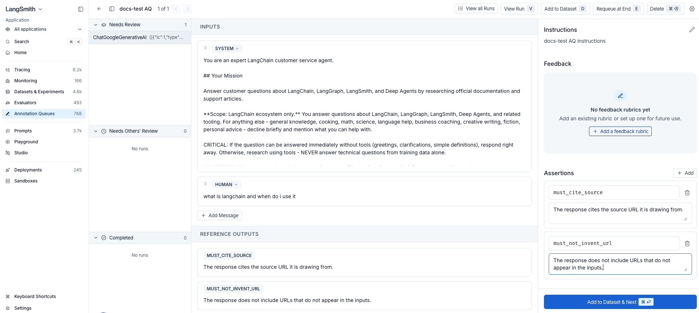

# Use assertions

> Capture free-form acceptance criteria as dataset examples by writing assertions while reviewing runs in an annotation queue.

Assertions turn a reviewer's English-language standards into an automated check. They are short, free-form claims about what a correct answer should or shouldn't include. You write them while reviewing a run in a [single-run annotation queue](Use%20annotation%20queues.md#single-run-annotation-queues), and LangSmith saves each one on a [dataset example](../Datasets%20%26%20Experiments/Common%20data%20types/Example%20data%20format.md). Any [offline evaluator](../Get%20started/Evaluation%20concepts.md#offline-evaluations) can then check whether new outputs from your application satisfy each claim.

Use assertions when:

* The run's actual output is wrong, and you'd rather describe what a correct answer looks like than write one by hand.
* You want to capture acceptance criteria in plain English without leaving the review flow.

> [!NOTE]
>
> Assertions are available on **run** items in [single-run annotation queues](Use%20annotation%20queues.md#single-run-annotation-queues). They are not available on [thread](../../Monitor/Trace/Observability%20concepts.md#threads) items or [pairwise queues](Use%20annotation%20queues.md#pairwise-annotation-queues). Assertions are available in the LangSmith UI only.

> [!TIP]
>
> [LangSmith Engine](../../Engine/Find%20and%20fix%20your%20agent%27s%20issues%20with%20LangSmith%20Engine.md#add-offline-examples) can auto-propose assertions for production traces flagged as recurring issues. Open an issue's offline examples flow to review, edit, or extend the Engine's proposed assertions before saving them to a dataset.

## Add assertions

1. In the [LangSmith UI](https://smith.langchain.com?utm_source=docs&utm_medium=cta&utm_campaign=langsmith-signup&utm_content=langsmith-assertions), navigate to **Annotation Queues** in the left sidebar. Open a single-run queue and select a run.

2. In the side panel, find the **Assertions** section below **Feedback**.

3. Click **+ Add** to create an assertion row.

4. Enter a **key** that summarizes the claim (for example, `must_cite_source`, `must_not_invent_url`) and a one-sentence **comment** describing the claim.

   The key is free-form. The `must_` / `must_not_` prefixes are just a naming convention; LangSmith doesn't treat them specially.

5. Repeat Steps 3 and 4 for each criterion you want to capture.

   The run editor shows the run's inputs and outputs alongside the assertions side panel. As soon as you add at least one assertion, the run editor's **Outputs** panel switches from the run's actual output to a read-only preview of the assertions you've added. This preview is what gets saved to the dataset. The run's actual output is not saved, because assertions describe what a correct answer should include, not what this run produced.

   

   You can keep editing the run's **Inputs** at any time, for example to refine the prompt before saving the example. The **Outputs** panel stays locked to the assertion preview while any assertions remain.

6. Click **Add to Dataset & Next** in the side panel footer (keyboard shortcut: <kbd>⌘ Enter</kbd> on macOS or <kbd>Ctrl Enter</kbd> elsewhere). LangSmith adds the current run to the queue's [default dataset](Use%20annotation%20queues.md#basic-details), or prompts you to pick one if no default is configured. The queue then moves you to the next run.

The saved example's `outputs` field is stored as JSON. For example:

```json
{
  "assertions": [
    {
      "key": "must_cite_source",
      "comment": "The response cites the source URL it is drawing from."
    },
    {
      "key": "must_not_invent_url",
      "comment": "The response does not include URLs that do not appear in the inputs."
    }
  ]
}
```

The example's `inputs` field stores the run's inputs, or your edited version if you changed them. See [Example data format](../Datasets%20%26%20Experiments/Common%20data%20types/Example%20data%20format.md) for the full shape of a saved example.

## Evaluate against assertions

Write an [offline evaluator](../Get%20started/Evaluation%20concepts.md#offline-evaluations) that reads the saved assertions from `reference_outputs["assertions"]` and returns one feedback score per assertion. The minimal shape:

```python
def grade_against_assertions(outputs: dict, reference_outputs: dict) -> list[dict]:
    """Return one feedback score per assertion."""
    feedback = []
    for assertion in reference_outputs["assertions"]:
        # Replace with your scoring logic: LLM judge, regex, schema check, and so on.
        score = ...
        feedback.append({"key": assertion["key"], "score": score})
    return feedback
```

How you score each claim is up to you. Three patterns are common and can be combined in a single evaluator:

* **[LLM-as-a-judge](../Evaluators/Evaluator%20types/UI/How%20to%20define%20an%20LLM-as-a-judge%20evaluator.md)**: For each assertion, prompt a model with the application's output and the assertion's `comment`, and have it return a score. Best when claims are subjective or hard to verify mechanically.
* **[Code-based checks](../Evaluators/Evaluator%20types/UI/How%20to%20define%20a%20code%20evaluator.md)**: For each assertion, run a deterministic check keyed off the assertion's `key`, such as a regex match, schema validation, or substring presence. Best when the claim has a crisp, mechanical answer.
* **[Partial-credit scoring](../Datasets%20%26%20Experiments/Evaluation%20techniques/Scoring%20methods/How%20to%20return%20multiple%20scores%20in%20one%20evaluator.md)**: Return a numeric score (for example, between 0.0 and 1.0) instead of a boolean to grade on a scale and give "partial credit" to outputs that fulfill some, but not all, claims.
