# Analyze an experiment

This page describes some of the essential tasks for working with [*experiments*](../../Get%20started/Evaluation%20concepts.md#experiment) in LangSmith:

* **[Analyze a single experiment](#analyze-a-single-experiment)**: View and interpret experiment results, customize columns, filter data, and compare runs.
* **[Set a baseline in the Experiments tab view](#set-a-baseline-in-the-experiments-tab-view)**: Set a baseline for a dataset that you want to outperform.
* **[Filter and group by models, prompts, and tools in the Experiments tab view](#filter-and-group-by-models-prompts-and-tools-in-the-experiments-tab-view)**: Use **Models**, **Prompts**, and **Tools** columns to filter and group experiments in the **Experiments** tab view.
* **[Download experiment results as a CSV](#download-experiment-results-as-a-csv)**: Export your experiment data for external analysis and sharing.
* **[Rename an experiment](#rename-an-experiment)**: Update experiment names in both the Playground and experiment view.

## Analyze a single experiment

After running an experiment, you can use LangSmith's experiment view to analyze the results and draw insights about your experiment's performance.

### Open the experiment view

To open the experiment view,

1. Select the relevant [*dataset*](../../Get%20started/Evaluation%20concepts.md#datasets) from the **Dataset & Experiments** page which opens the **Experiments** tab view.
2. Click the row of the experiment you want to view.

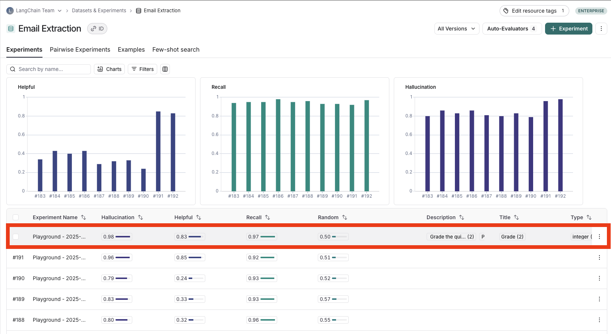

### View experiment results

#### Customize columns

By default, the experiment view shows the input, output, and reference output for each [example](../../Get%20started/Evaluation%20concepts.md#examples) in the dataset, feedback scores from evaluations and experiment metrics like cost, token counts, latency and status.

You can customize the columns clicking the **Columns** icon at the top right of the view to make it easier to interpret experiment results:

* **Break out fields from inputs, outputs, and reference outputs** into their own columns. This is especially helpful if you have long inputs/outputs/reference outputs and want to surface important fields.
* **Hide and reorder columns** to create focused views for analysis.
* **Control decimal precision on feedback scores**. By default, LangSmith surfaces numerical feedback scores with a decimal precision of 2, but you can customize this setting to be up to 6 decimals.
* **Set the Heat Map threshold** to high, middle, and low for numeric feedback scores in your experiment, which affects the threshold at which score chips render as red or green:

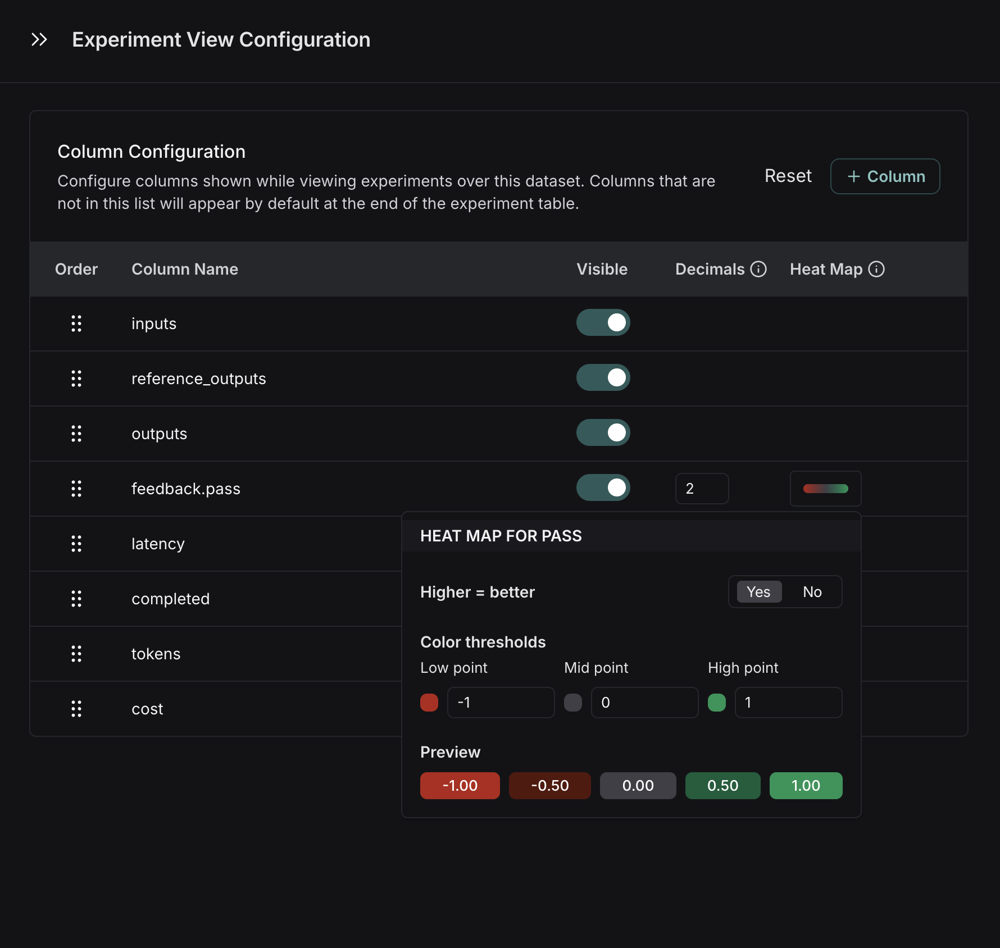

> [!TIP]
>
> You can set default configurations for an entire dataset or temporarily save settings just for yourself.

#### Sort and filter

To sort rows by a feedback score, click the **Sort by** icon in the column header.

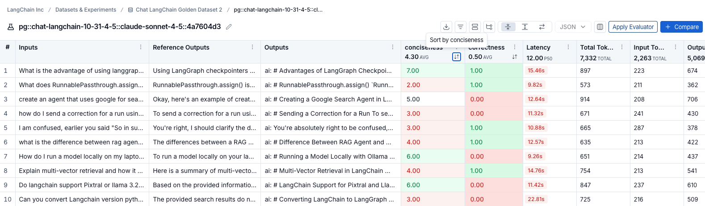

To filter rows, click the  icon in the column header and configure your filter settings.

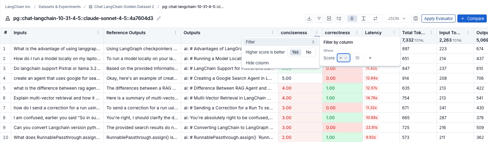

#### Table views

Select one of three table view icons at the top right of the experiment view:

* **Compact**: Shows each run as a single row for quick score comparisons.
* **Full**: Shows the full output for each run.
* **Diff**: Shows the text difference between the reference output and the output for each run.

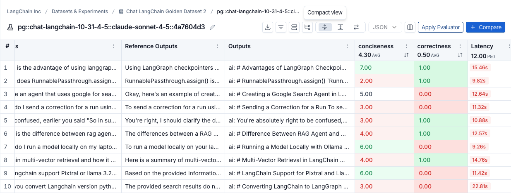

#### View the traces

Click any row in the experiment view to open the details panel, which shows the trace alongside feedback, input, output, and attributes for that run.

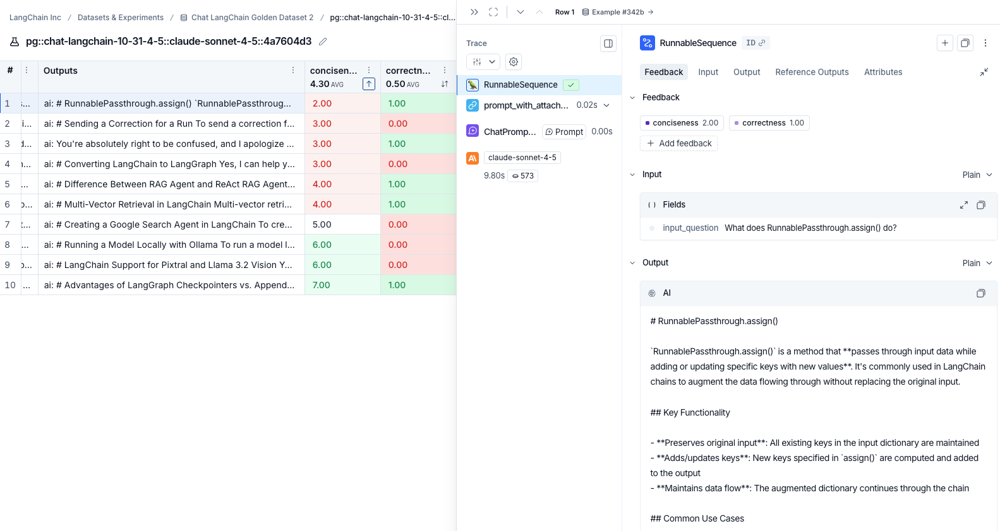

To view the traces behind an experiment, click the **View project** icon at the top right of the experiment view.

#### View evaluator runs

By hovering over the evaluator score, you can view additional details about that evaluator run. For [LLM-as-a-judge evaluators](../../Evaluators/Evaluator%20types/UI/How%20to%20define%20an%20LLM-as-a-judge%20evaluator.md), click the **Source** link to view the prompt used, or **Evaluator trace** to open the trace in a new browser tab. For experiments with [repetitions](../Evaluation%20techniques/Experiment%20configuration/How%20to%20evaluate%20with%20repetitions.md), click the aggregate average score to view links to all individual runs.

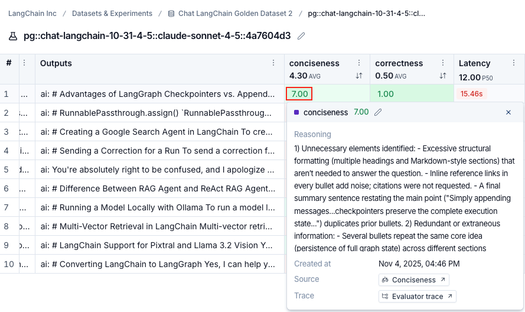

#### Track experiment progress

For experiments run from the Playground or through the SDK, a progress bar in the experiment header tracks completion in real time. The same progress appears in the **Progress** column of the experiments table. Progress reflects both run and evaluation status. Hover over the progress bar to view the number of runs completed and runs evaluated.

> [!NOTE]
>
> Progress tracking for experiments run through the SDK requires:
>
> * Python: `langsmith>=0.8.16`
> * TypeScript: `langsmith>=0.7.8`

### Group results by metadata

You can add metadata to examples to categorize and organize them. For example, if you're evaluating factual accuracy on a question answering dataset, the metadata might include which subject area each question belongs to. Metadata can be added either [via the UI](../Datasets/Create%20a%20dataset/Create%20and%20manage%20datasets%20in%20the%20UI.md#edit-example-metadata) or [via the SDK](../Datasets/Create%20a%20dataset/How%20to%20create%20and%20manage%20datasets%20programmatically.md#update-single-example).

To analyze results by metadata, use the **Group by** icon at the top right of the experiment view and select your desired metadata key. This displays average feedback scores, latency, total tokens, and cost for each metadata group.

> [!NOTE]
>
> You will only be able to group by example metadata on experiments created after February 20th, 2025. Any experiments before that date can still be grouped by metadata, but only if the metadata is on the experiment traces themselves.

### Repetitions

If you've run your experiment with [*repetitions*](../Evaluation%20techniques/Experiment%20configuration/How%20to%20evaluate%20with%20repetitions.md), click any row to open the details panel. The **Repetition Summary** shows a metrics table, all feedback scores, and lets you toggle through outputs or view individual repetitions with their traces.

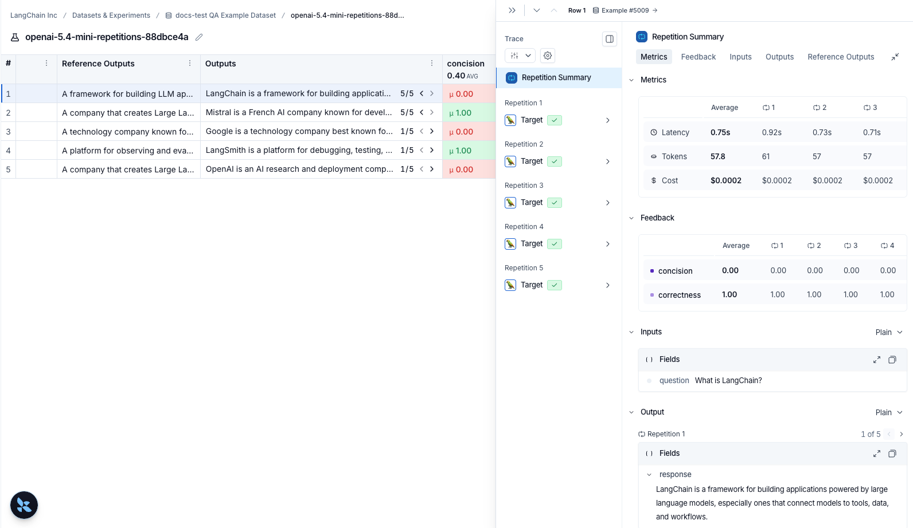

### Compare to another experiment

In the top right of the experiment view, you can select another experiment to compare to. This will open up a comparison view, where you can see how the two experiments compare. To learn more about the comparison view, see [how to compare experiment results](How%20to%20compare%20experiment%20results.md).

## Set a baseline in the Experiments tab view

While you may run dozens of tests, you typically have a specific benchmark you are trying to outperform. Setting a *baseline* anchors your results against this reference point, which allows you to identify improvements or regressions in a crowded experiment list.

By designating a baseline, you can:

* Highlight a reference: Explicitly mark your best-performing run so it remains visible at the top of the **Experiments** tab view as you iterate.
* See instant diffs: View performance deltas across all experiments automatically, which means you don't necessarily need to perform manual side-by-side selection.
* Accelerate assessment: Quickly determine if new iterations meet or exceed your current performance standards.

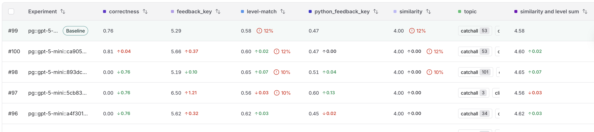

To set a baseline for a dataset:

1. In the [LangSmith UI](https://smith.langchain.com?utm_source=docs&utm_medium=cta&utm_campaign=langsmith-signup&utm_content=langsmith-analyze-an-experiment), navigate to the **Datasets & Experiments** option in the left menu.
2. Select the dataset that you want to work with from the table.
3. In the **Experiments** tab view, hover over an experiment row to display the **Set baseline** button on the right end of the row. Click to select your baseline experiment.

Your baseline experiment will pin to the top of the table and have the **Baseline** tag next to its name. Once an experiment is set as a baseline, the table will display scores against the baseline on each experiment for each column. When you are selecting multiple experiments for comparison, the baseline experiment will be the default source experiment to be compared to.

## Filter and group by models, prompts, and tools in the Experiments tab view

The experiments table includes **Models**, **Prompts**, and **Tools** columns that show which models, prompts, and tools were used for each experiment, making it easier to understand what changed between runs at a glance.

These columns are populated automatically when you run experiments from the Playground. When running experiments via the SDK, pass a `metadata` object with `models`, `prompts`, and `tools` keys to `evaluate()`:

```python
results = client.evaluate(
    target,
    data="my-dataset",
    evaluators=[...],
    metadata={
        "models": "openai:gpt-5.4-mini",
        "prompts": ["my-org/my-prompt:abc12345"],
        "tools": [{"name": "web_search", "description": "Search the web for information"}],
    },
)
```

See [how to evaluate an LLM application](../Run%20an%20evaluation/How%20to%20evaluate%20agents.md#run-the-evaluation) for an example using metadata.

The columns only appear when at least one experiment in the dataset has the field set. Once populated, click on a value in these columns to filter or group experiments.

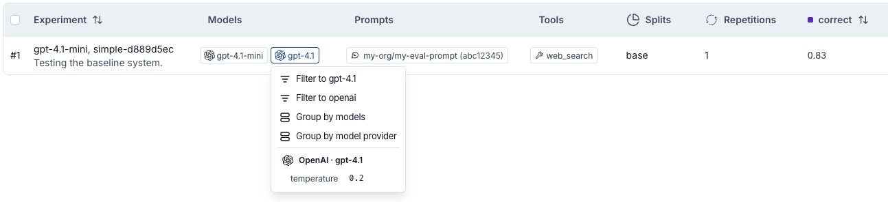

You can also filter and group by models, model providers, prompts, prompt commits, tools, and other experiment metadata at the top left of the **Experiments** tab view:

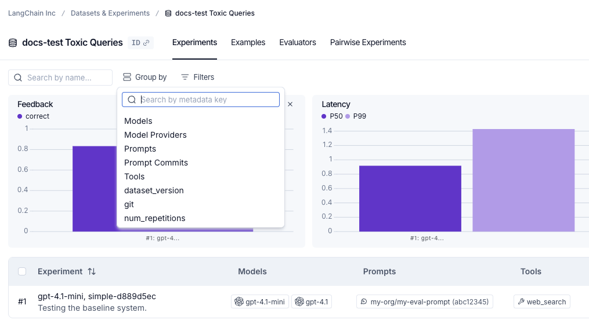

## Download experiment results as a CSV

LangSmith lets you download experiment results as a CSV file for external analysis and sharing. Click the **Download as CSV** icon at the top right of the experiment view.

> [!NOTE]
>
> The CSV export always includes all columns, regardless of any column customization, sorting, or filtering you have applied in the experiment view. Column visibility settings affect only the on-screen display and are not reflected in the downloaded file.

> [!NOTE]
>
> There is a 5,000 row download limit for experiment results.

## Rename an experiment

> [!NOTE]
>
> Experiment names must be unique per workspace.

You can rename an experiment in the LangSmith UI in the following places:

* **Experiment view**: Rename an experiment by using the pencil icon beside the experiment name.

  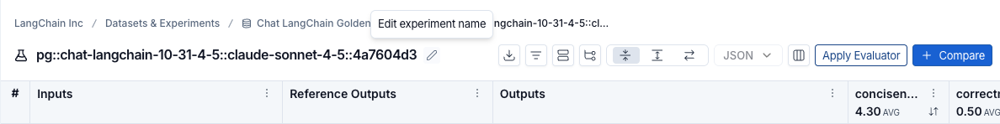

* **Playground**: A default name with the format `pg::prompt-name::model::uuid` (eg. `pg::gpt-5.4-mini::897ee630`) is automatically assigned. You can rename an experiment immediately after running it by editing its name in the Playground table header.

  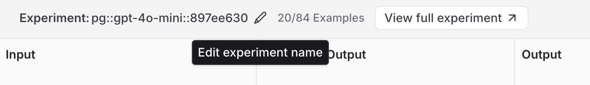
