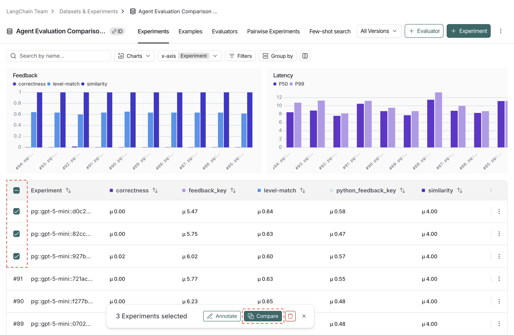
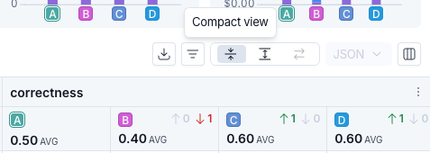
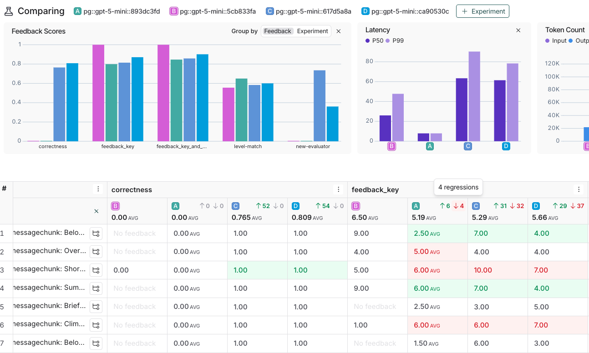
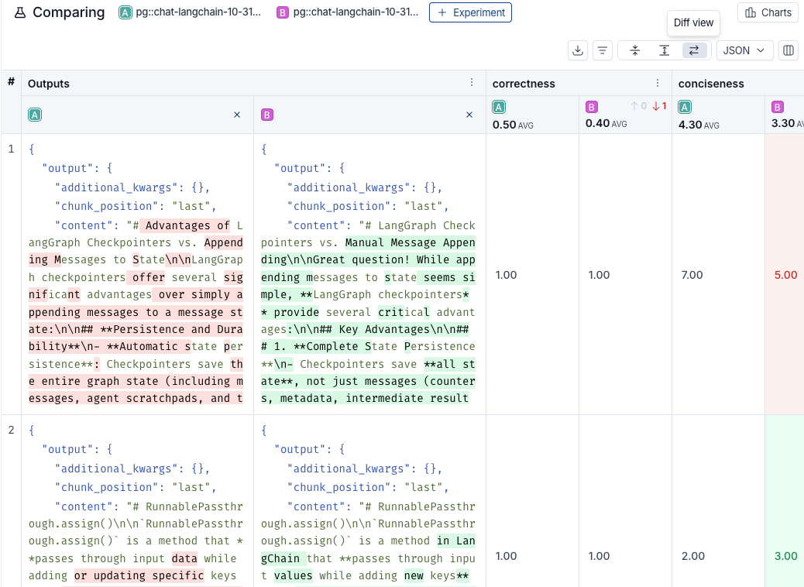
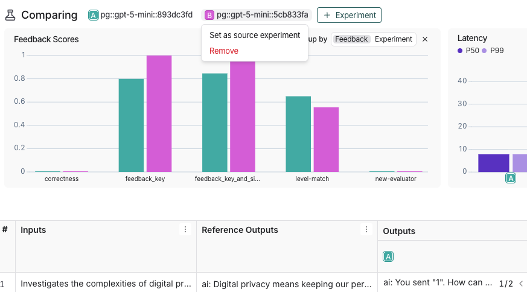
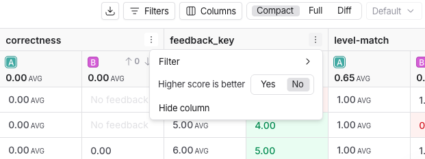
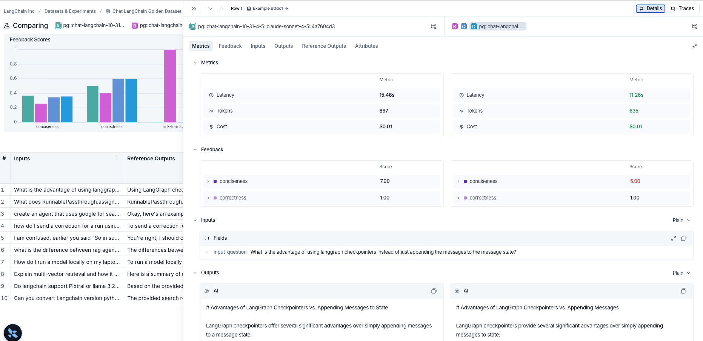
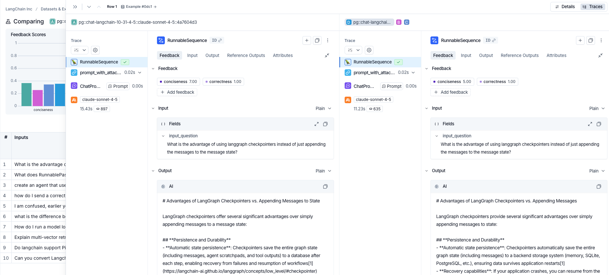
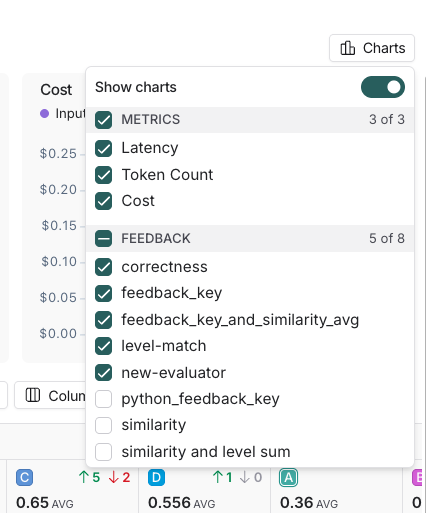

# How to compare experiment results

When you are iterating on your LLM application (such as changing the model or the prompt), you may want to compare the results of different [*experiments*](../../Get%20started/Evaluation%20concepts.md#experiment).

LangSmith supports a comparison view that lets you identify key differences, regressions, and improvements between different experiments.

## Open the comparison view

1. To access the experiment comparison view, navigate to the **Datasets & Experiments** page.
2. Select a dataset, which will open the **Experiments** tab.
3. Select two or more experiments and then click **Compare**.

## Adjust the table display

You can toggle between different display options on the top right of the comparison view.

### Filters

Click the  icon to apply filters to the comparison view to narrow down specific examples. Common examples for filters include:

* Examples that contain specific `input` / `output`.
* Runs with status `success` or `error`.
* Runs that take more than x seconds in `latency`.
* Specific `metadata`, `tag`, or `feedback`.

In addition to applying filters on the overall experiment view, you can apply filters on individual columns as well. Select the  icon at the top of any column to view the available filters for that column's data.

### Columns

Click the  icon to show or hide individual feedback keys or metrics in the comparison view.

### Table views

Select one of three table view icons at the top right of the comparison view:

* **Compact**: Shows a preview of the experiment results for each example.
* **Full**: Shows the full text of the input, output, and reference output for each run. If the output is too long to display in the table, you can click **Expand** to view the full content.
* **Diff**: Shows the text difference between experiment outputs for each run. This is only supported for 2 experiments at a time. See [View side-by-side diffs](#view-side-by-side-diffs) for more details.

### Display types

There are three built-in experiment views that cover several display types: **Default**, **YAML**, **JSON**.

## View regressions and improvements

In the comparison view, red highlights runs that *regressed* on any feedback key against your source experiment, while green highlights runs that *improved*. At the top of each feedback column, you can see how many runs did better or worse than your source experiment.

Click the regression or improvement buttons at the top of each column to show only runs that regressed or improved in that experiment.

## View side-by-side diffs

When comparing two experiments, for JSON and YAML display styles, you can toggle on the experiment diff mode to compare experiment outputs. The diff mode highlights modifications between outputs, and can be particularly useful for structured output comparisons.

## Update source experiment and metric

To track regressions across experiments, you can:

1. At the top of the comparison view, hover over an experiment icon and select **Set as source experiment** from the dropdown. You can also add or remove experiments from this dropdown. By default, the first selected experiment is set as the source.

   

2. Within the **Feedback** columns, you can configure whether a higher score is better for each feedback key. This preference will be stored. By default, a higher score is assumed to be better.

   

## Expand details panel

Click on any row to open a details panel for that example for the compared experiments.

Use the toggle in the top right of the panel to switch between two modes:

* **Details**: Shows feedback keys and scores, along with a metrics summary for the example, as well as the input, output, and reference output, and attributes for each experiment.

  

* **Traces**: Shows traces for each experiment side by side.

  

When comparing more than two experiments, the panel displays two experiments at a time. Use the header to switch which experiment you are comparing against.

## Use experiment metadata as chart labels

You can configure the x-axis labels for the charts based on [experiment metadata](How%20to%20filter%20experiments%20in%20the%20UI.md#background-add-metadata-to-your-experiments).

Select a metadata key from the **Charts** dropdown at the top-right of the comparison view to change the x-axis labels.

