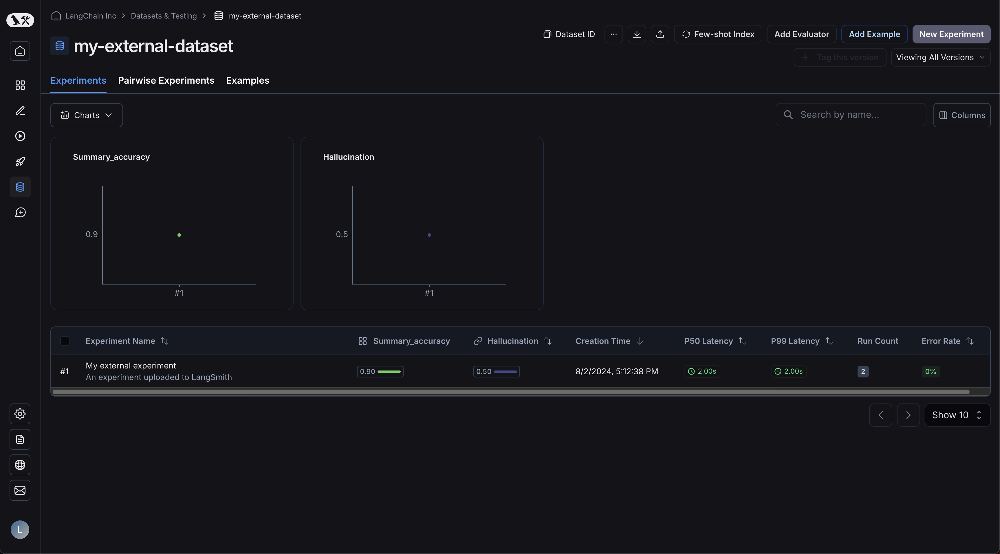
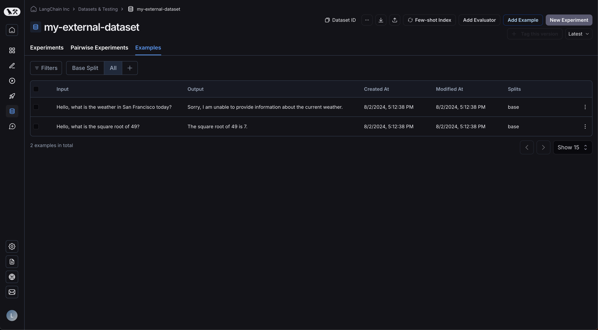
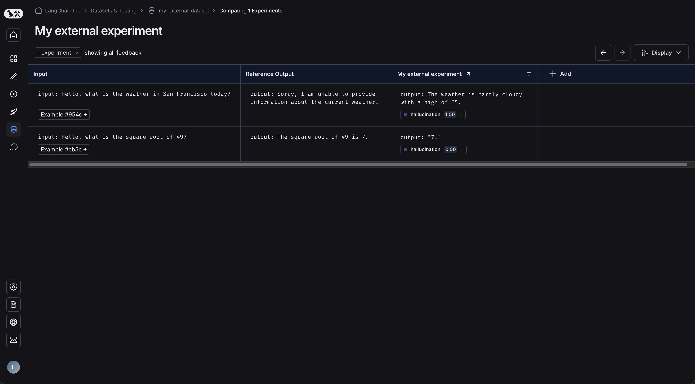

# How to upload experiments run outside of LangSmith with the REST API

Some users prefer to manage their datasets and run their experiments outside of LangSmith, but want to use the LangSmith UI to view the results. This is supported via our endpoint.

This guide will show you how to upload evals using the REST API, using the `requests` library in Python as an example. However, the same principles apply to any language.

## Request body schema

Uploading an experiment requires specifying the relevant high-level information for your experiment and dataset, along with the individual data for your examples and runs within the experiment. Each object in the `results` represents a "row" in the experiment - a single dataset example, along with an associated run. Note that `dataset_id` and `dataset_name` refer to your dataset identifier in your external system and will be used to group external experiments together in a single dataset. They should not refer to an existing dataset in LangSmith (unless that dataset was created via this endpoint).

You may use the following schema to upload experiments to the `/datasets/upload-experiment` endpoint:

```json
{
  "experiment_name": "string (required)",
  "experiment_description": "string (optional)",
  "experiment_start_time": "datetime (required)",
  "experiment_end_time": "datetime (required)",
  "dataset_id": "uuid (optional - an external dataset id, used to group experiments together)",
  "dataset_name": "string (optional - must provide either dataset_id or dataset_name)",
  "dataset_description": "string (optional)",
  "experiment_metadata": { // Object (any shape - optional)
    "key": "value"
  },
  "summary_experiment_scores": [ // List of summary feedback objects (optional)
    {
      "key": "string (required)",
      "score": "number (optional)",
      "value": "string (optional)",
      "comment": "string (optional)",
      "feedback_source": { // Object (optional)
        "type": "string (required)"
      },
      "feedback_config": { // Object (optional)
        "type": "string enum: continuous, categorical, or freeform",
        "min": "number (optional)",
        "max": "number (optional)",
        "categories": [ // List of feedback category objects (optional)
          {
            "value": "number (required)",
            "label": "string (optional)"
          }
        ]
      },
      "created_at": "datetime (optional - defaults to now)",
      "modified_at": "datetime (optional - defaults to now)",
      "correction": "Object or string (optional)"
    }
  ],
  "results": [ // List of experiment row objects (required)
    {
      "row_id": "uuid (required)",
      "inputs": { // Object (required - any shape). This will
        "key": "val" // be the input to both the run and the dataset example.
      },
      "expected_outputs": { // Object (optional - any shape).
        "key": "val" // These will be the outputs of the dataset examples.
      },
      "actual_outputs": { // Object (optional - any shape).
        "key": "val" // These will be the outputs of the runs.
      },
      "evaluation_scores": [ // List of feedback objects for the run (optional)
        {
          "key": "string (required)",
          "score": "number (optional)",
          "value": "string (optional)",
          "comment": "string (optional)",
          "feedback_source": { // Object (optional)
            "type": "string (required)"
          },
          "feedback_config": { // Object (optional)
            "type": "string enum: continuous, categorical, or freeform",
            "min": "number (optional)",
            "max": "number (optional)",
            "categories": [ // List of feedback category objects (optional)
              {
                "value": "number (required)",
                "label": "string (optional)"
              }
            ]
          },
          "created_at": "datetime (optional - defaults to now)",
          "modified_at": "datetime (optional - defaults to now)",
          "correction": "Object or string (optional)"
        }
      ],
      "start_time": "datetime (required)", // The start/end times for the runs will be used to
      "end_time": "datetime (required)", // calculate latency. They must all fall between the
      "run_name": "string (optional)", // start and end times for the experiment.
      "error": "string (optional)",
      "run_metadata": { // Object (any shape - optional)
        "key": "value"
      }
    }
  ]
}
```

The response JSON will be a dict with keys `experiment` and `dataset`, each of which is an object that contains relevant information about the experiment and dataset that was created.

## Considerations

You may upload multiple experiments to the same dataset by providing the same dataset\_id or dataset\_name between multiple calls. Your experiments will be grouped together under a single dataset, and you will be able to [use the comparison view to compare results between experiments](How%20to%20compare%20experiment%20results.md).

Ensure that the start and end times of your individual rows are all between the start and end time of your experiment.

You must provide either a dataset\_id or a dataset\_name. If you only provide an ID and the dataset does not yet exist, we will generate a name for you, and vice versa if you only provide a name.

You may not upload experiments to a dataset that was not created via this endpoint. Uploading experiments is only supported for externally-managed datasets.

## Example request

Below is an example of a simple call to the `/datasets/upload-experiment`. This is a basic example that just uses the most important fields as an illustration.

```python
import os
import requests

body = {
    "experiment_name": "My external experiment",
    "experiment_description": "An experiment uploaded to LangSmith",
    "dataset_name": "my-external-dataset",
    "summary_experiment_scores": [
        {
            "key": "summary_accuracy",
            "score": 0.9,
            "comment": "Great job!"
        }
    ],
    "results": [
        {
            "row_id": "<<uuid>>",
            "inputs": {
                "input": "Hello, what is the weather in San Francisco today?"
            },
            "expected_outputs": {
                "output": "Sorry, I am unable to provide information about the current weather."
            },
            "actual_outputs": {
                "output": "The weather is partly cloudy with a high of 65."
            },
            "evaluation_scores": [
                {
                    "key": "hallucination",
                    "score": 1,
                    "comment": "The chatbot made up the weather instead of identifying that "
                               "they don't have enough info to answer the question. This is "
                               "a hallucination."
                }
            ],
            "start_time": "2024-08-03T00:12:39",
            "end_time": "2024-08-03T00:12:41",
            "run_name": "Chatbot"
        },
        {
            "row_id": "<<uuid>>",
            "inputs": {
                "input": "Hello, what is the square root of 49?"
            },
            "expected_outputs": {
                "output": "The square root of 49 is 7."
            },
            "actual_outputs": {
                "output": "7."
            },
            "evaluation_scores": [
                {
                    "key": "hallucination",
                    "score": 0,
                    "comment": "The chatbot correctly identified the answer. This is not a "
                               "hallucination."
                }
            ],
            "start_time": "2024-08-03T00:12:40",
            "end_time": "2024-08-03T00:12:42",
            "run_name": "Chatbot"
        }
    ],
    "experiment_start_time": "2024-08-03T00:12:38",
    "experiment_end_time": "2024-08-03T00:12:43"
}

resp = requests.post(
    "https://api.smith.langchain.com/api/v1/datasets/upload-experiment", # Update appropriately for self-hosted installations or regional SaaS
    json=body,
    headers={"x-api-key": os.environ["LANGSMITH_API_KEY"]}
)

print(resp.json())
```

Below is the response received:

```json
{
  "dataset": {
    "name": "my-external-dataset",
    "description": null,
    "created_at": "2024-08-03T00:36:23.289730+00:00",
    "data_type": "kv",
    "inputs_schema_definition": null,
    "outputs_schema_definition": null,
    "externally_managed": true,
    "id": "<<uuid>>",
    "tenant_id": "<<uuid>>",
    "example_count": 0,
    "session_count": 0,
    "modified_at": "2024-08-03T00:36:23.289730+00:00",
    "last_session_start_time": null
  },
  "experiment": {
    "start_time": "2024-08-03T00:12:38",
    "end_time": "2024-08-03T00:12:43+00:00",
    "extra": null,
    "name": "My external experiment",
    "description": "An experiment uploaded to LangSmith",
    "default_dataset_id": null,
    "reference_dataset_id": "<<uuid>>",
    "trace_tier": "longlived",
    "id": "<<uuid>>",
    "run_count": null,
    "latency_p50": null,
    "latency_p99": null,
    "first_token_p50": null,
    "first_token_p99": null,
    "total_tokens": null,
    "prompt_tokens": null,
    "completion_tokens": null,
    "total_cost": null,
    "prompt_cost": null,
    "completion_cost": null,
    "tenant_id": "<<uuid>>",
    "last_run_start_time": null,
    "last_run_start_time_live": null,
    "feedback_stats": null,
    "session_feedback_stats": null,
    "run_facets": null,
    "error_rate": null,
    "streaming_rate": null,
    "test_run_number": 1
  }
}
```

Note that the latency and feedback stats in the experiment results are null because the runs haven't had a chance to be persisted yet, which may take a few seconds. If you save the experiment id and query again in a few seconds, you will see all the stats (although tokens/cost will still be null, because we don't ask for this information in the request body).

## View the experiment in the UI

Now, login to the UI and click on your newly-created dataset! You should see a single experiment: 

Your examples will have been uploaded: 

Clicking on your experiment will bring you to the comparison view: 

As you upload more experiments to your dataset, you will be able to compare the results and easily identify regressions in the comparison view.
