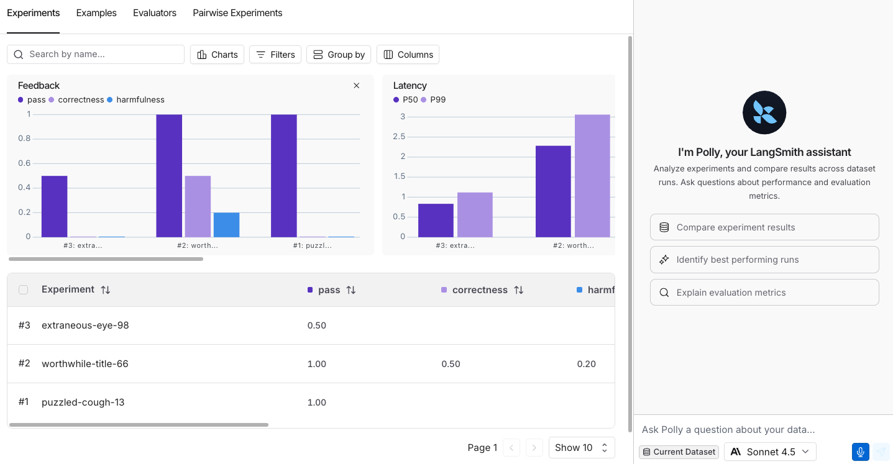

# LangSmith Chat

> Use Chat in LangSmith to analyze traces, threads, prompts, and evaluations.

**LangSmith Chat** (formerly Polly) is built directly into your LangSmith [workspace](../../../LangSmith%20setup/Govern/Organization/Overview.md#workspaces) to help you analyze and understand your application data.

Chat helps you gain insight from your traces, conversation threads, and prompts without having to dig through data manually. By asking natural language questions, you can quickly understand agent performance, debug issues, and analyze user sentiment.

 Chat appears in the right-hand bottom corner of the following locations within [LangSmith UI](https://smith.langchain.com?utm_source=docs&utm_medium=cta&utm_campaign=langsmith-signup&utm_content=langsmith-chat):

\
\
**Observability & Debugging:**

* [Projects](#projects): Browse and filter runs across a project.
* [Trace pages](#trace-pages): Analyze individual runs and execution traces.
* [Thread views](#thread-views): Understand conversation threads and user interactions.
* [Engine](#engine): Investigate detected issues and their linked traces.

**Prompt Engineering:**

* [Playground](#playground): Edit and optimize prompts.
* [Prompt Hub pages](#prompt-hub-pages): Explore and understand shared prompts.

**Evaluation & Testing:**

* [Dataset Experiments](#dataset-experiments): Analyze experiment results and compare runs.
* [Dataset Examples](#dataset-examples): Browse and understand dataset structure.
* [Annotation Queues](#annotation-queues): Review runs and make informed annotation decisions.
* [Evaluators](#evaluators): Build and refine evaluators with AI assistance.

## Get started

Before you start using Chat, you need to add an API key for the model you're using:

In the [LangSmith UI](https://smith.langchain.com?utm_source=docs&utm_medium=cta&utm_campaign=langsmith-signup&utm_content=snippets-langsmith-set-workspace-secrets), ensure that your API key is set as a [workspace secret](../../../LangSmith%20setup/Govern/Organization/Workspace%20setup/Set%20up%20hierarchy.md#configure-workspace-settings).

Adding workspace secrets requires permission to manage secrets in the workspace. If you do not have it, ask a workspace admin to add the secret for you or to grant you access.

To add a workspace secret:

1. Navigate to  **Settings** > **Integrations** > **Provider secrets**.
2. Select **+ Secret**.
3. Under **Provider**, select your model provider. LangSmith names the secret with the environment variable the provider expects, such as `OPENAI_API_KEY`. Enter your secret in that field.

   If your provider is not listed, leave **Custom** as the provider. Enter the environment variable name your provider expects as the **Key** and your API key as the **Value**.
4. Select **Save**.

> [!NOTE]
>
> If your provider authenticates with OAuth2 `client_credentials`, configure the credentials on the model configuration instead. Workspace secrets are not required in that case. See [OAuth client credentials](../../../LangSmith%20setup/Govern/Organization/Workspace%20setup/Manage%20model%20configurations.md#oauth-client-credentials).

> [!NOTE]
>
> Chat calls model providers from LangSmith's egress IP addresses. If your model provider (or a proxy in front of it) restricts traffic by IP, allowlist the LangSmith egress IPs listed in [Allowlist IP addresses](../../../Deploy/Deploy%20to%20Cloud/Cloud%20platform%20features.md#allowlist-ip-addresses).

### Supported models

Chat supports the following model providers out of the box:

* Anthropic (Claude)
* OpenAI
* Google Gemini
* AWS Bedrock
* Groq
* Mistral
* xAI
* DeepSeek
* Fireworks AI

You can also use any custom model you've configured in [Playground Settings](../../../Deploy/Prompt%20%26%20Context%20Hub/Prompts/Prompt%20engineering%20concepts.md#playground) by enabling the **Available in Chat** toggle on that configuration. Workspace admins manage which custom models are available.

### Keyboard shortcuts

| Action | Mac | Windows/Linux |
| - | - | - |
| Toggle Chat open/closed | `Cmd+I` | `Ctrl+I` |
| Clear current thread | `Cmd+Shift+O` | `Ctrl+Shift+O` |

## Observability

### Projects

On a project's run list, Chat can browse and filter runs across the entire project, create datasets, and add examples. Use Chat to quickly explore what's happening across your traces without manually paging through results.

**Example questions:**

* "Show me all the failed runs from the last 24 hours"
* "Which runs took the longest?"
* "Add the failing runs to my test dataset"
* "How many runs errored this week?"

### Trace pages

On an individual [trace](../../../Monitor/Trace/Observability%20concepts.md#traces), Chat analyzes the [run](../../../Monitor/Trace/Observability%20concepts.md#runs) data and execution trajectory. Chat examines the full trace context, including [run metadata](../../../Monitor/Trace/Observability%20concepts.md#metadata), inputs, outputs, intermediate steps, and configuration to help you understand what happened and identify areas for improvement.

**Example questions:**

* "Is there anything that the agent could have done better here?"
* "Why did this run fail?"
* "What took the most time in this trace?"
* "Summarize what happened in this trace"

### Thread views

Under the **Threads** tab, Chat analyzes conversation [threads](../../../Monitor/Trace/Observability%20concepts.md#threads) to help you understand user sentiment, conversation outcomes, and interaction patterns. Use Chat to identify user pain points and understand whether issues were resolved.

**Example questions:**

* "Did the user seem frustrated?"
* "What issues is the user experiencing?"
* "Was the user's problem solved?"
* "What was the main topic of this thread?"

### Engine

On the [Engine](../../../Engine/Find%20and%20fix%20your%20agent%27s%20issues%20with%20LangSmith%20Engine.md) page, open Chat to investigate detected issues and their linked traces. Chat can help you understand the selected issue, or answer questions across multiple Engine issues. For example:

**Example questions:**

* "What went wrong?"
* "Why was this flagged?"
* "Explain the proposed fix"
* "What are my most pressing issues?"
* "How many new issues do I have?"

## Prompt engineering

### Playground

In the [Playground](../../../Deploy/Prompt%20%26%20Context%20Hub/Prompts/Prompt%20engineering%20concepts.md#playground), Chat helps you edit and optimize your [prompts](../../../Deploy/Prompt%20%26%20Context%20Hub/Prompts/Prompt%20engineering%20concepts.md#prompts-in-langsmith). Use automated options like **Optimize prompt**, **Generate a tool**, or **Generate an output schema**, or give Chat custom instructions for editing your prompt. Chat can directly modify the playground state—updating messages, tools, output schemas, and examples—so you can iterate on prompts conversationally.

**Example questions:**

* "Make it respond in Italian"
* "Add more context about the user's role"
* "Make the tone more professional"
* "Simplify the instructions"

### Prompt Hub pages

When viewing a prompt in the [LangSmith Hub](../../../Deploy/Prompt%20%26%20Context%20Hub/Prompts/Prompt%20engineering%20concepts.md#prompts-in-langsmith), Chat helps you understand the prompt's structure, messages, tools, and configuration. This is useful for exploring and learning from shared prompts.

**Example questions:**

* "What does this prompt do?"
* "What tools does this prompt use?"
* "Explain the structure of this prompt"
* "What are the key instructions in this prompt?"

## Evaluation

### Dataset Experiments

On the **Datasets** page under the **Experiments** tab, Chat analyzes experiment results and helps you compare runs across different experiments. Chat can identify patterns, summarize performance, and help you understand which approaches work best.

**Example questions:**

* "Which experiment performed best?"
* "What are the main differences between these runs?"
* "Summarize the results of this experiment"
* "What patterns do you see in the failures?"

### Dataset Examples

On the **Datasets** page under the **Examples** tab, Chat helps you understand your dataset structure, browse examples, and identify data patterns. This is useful for understanding what data you're working with and preparing datasets for experiments.

**Example questions:**

* "What type of data is in this dataset?"
* "Show me examples with errors"
* "What patterns do you see in the inputs?"
* "How many examples are in this dataset?"

### Annotation Queues

In **Annotation Queues**, Chat helps you analyze runs before making annotation decisions. Whether you're reviewing runs individually or comparing them pairwise, Chat provides insights into run behavior, errors, and execution patterns to inform your scoring.

**Example questions:**

* "What went wrong in this run?"
* "Summarize what happened in this run"
* "Compare these two runs"
* "What should I consider when scoring this?"

### Evaluators

In the **Evaluators** builder, Chat helps you write and refine evaluator logic. Chat can generate evaluator code, suggest improvements, and help you test your evaluator against examples.

**Example questions:**

* "Write an evaluator that checks for hallucinations"
* "Improve the accuracy of this evaluator"
* "What does this evaluator check for?"
* "Add handling for edge cases"

## What's next

Learn more about the features that Chat helps you explore:

> [card] [Observability](../../../Monitor/Overview/LangSmith%20Observability.md)
>
> Learn more about tracing and monitoring your LLM applications

> [card] [Threads](../../../Monitor/Debug/Configure%20threads.md)
>
> Understand how threads work in LangSmith

> [card] [Prompt Engineering](../../../Deploy/Prompt%20%26%20Context%20Hub/Prompt%20%26%20Context%20Hub.md#prompts)
>
> Create and iterate on prompts in the Playground

> [card] [Evaluation](../../Get%20started/LangSmith%20Evaluation.md)
>
> Evaluate and test your applications systematically
