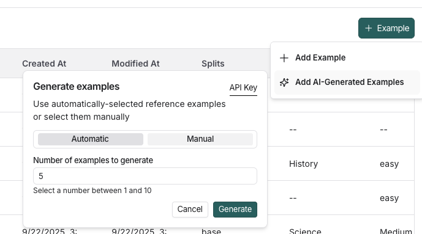
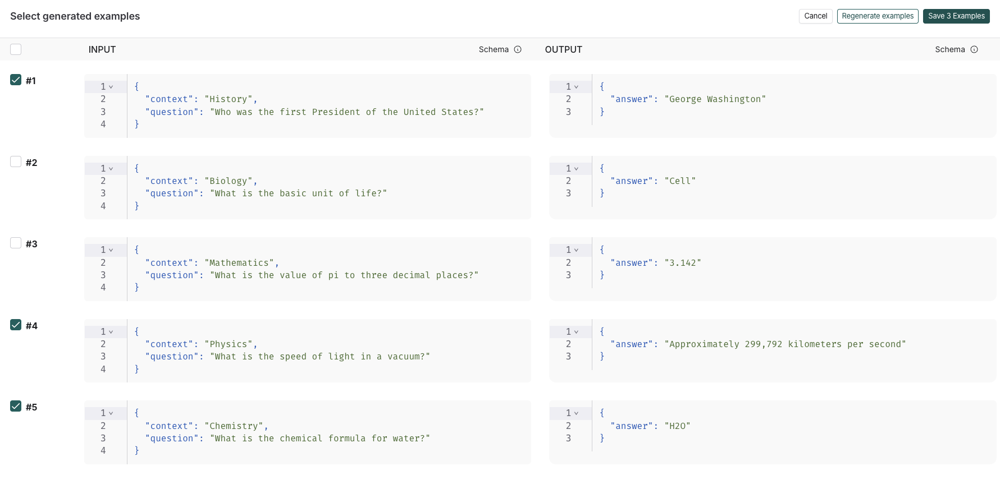
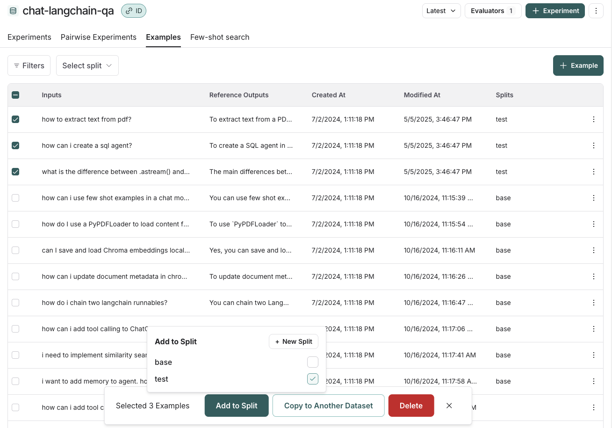
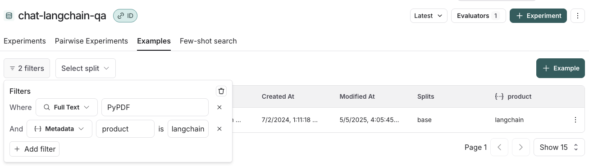

# Create and manage datasets in the UI

[*Datasets*](../../../Get%20started/Evaluation%20concepts.md#datasets) enable you to perform repeatable evaluations over time using consistent data. Datasets are made up of [*examples*](../../../Get%20started/Evaluation%20concepts.md#examples), which store inputs, outputs, and optionally, reference outputs.

This page outlines the various methods for [creating](#create-a-dataset-and-add-examples) and [managing](#manage-a-dataset) datasets in the [UI](https://smith.langchain.com?utm_source=docs&utm_medium=cta&utm_campaign=langsmith-signup&utm_content=langsmith-manage-datasets-in-application).

## Create a dataset and add examples

The following sections explain the different ways you can create a dataset in LangSmith and add examples to it. Depending on your workflow, you can manually curate examples, automatically capture them from tracing, import files, or even generate synthetic data:

* [Manually from a tracing project](#manually-from-a-tracing-project)
* [Automatically from a tracing project](#automatically-from-a-tracing-project)
* [From examples in an annotation queue](#from-examples-in-an-annotation-queue)
* [From the Playground](#from-the-playground)
* [Import a dataset from a CSV or JSONL file](#import-a-dataset-from-a-csv-or-jsonl-file)
* [Create a new dataset from the dataset page](#create-a-new-dataset-from-the-datasets-%26-experiments-page)
* [Add synthetic examples created by an LLM via the Datasets UI](#add-synthetic-examples-created-by-an-llm)

### Manually from a tracing project

A common pattern for constructing datasets is to convert notable traces from your application into dataset examples. This approach requires that you have [configured tracing to LangSmith](../../../../Monitor/Trace/Observability%20concepts.md).

> [!TIP]
>
> A technique to build datasets is to filter the most interesting traces, such as traces that were tagged with poor user feedback, and add them to a dataset. For tips on how to filter traces, refer to the [Filter traces](../../../../Monitor/Debug/Viewing%20%26%20managing%20traces/Filter%20traces.md) guide.

There are three ways to add data manually from a tracing project to datasets. Navigate to **Tracing** and select a tracing project, or an agent environment.

1. Multi-select runs from the runs table. On the **Runs** tab, multi-select runs. At the bottom of the page, click  **Add to Dataset**.

2. On the **Runs** tab, select a run from the table. On the individual run details page, select  **Add to** -> **Dataset** in the top right corner.

   When you select a dataset from the run details page, a modal will pop up letting you know if any [transformations](../../Common%20data%20types/Dataset%20transformations.md) were applied or if schema validation failed.

   You can then optionally edit the run before adding it to the dataset.

3. Multi-select threads from the threads table. On the **Threads** tab, multi-select threads. At the bottom of the page, click  **Add to Dataset**. You can add at most **100** threads in a single action.

   To send the threads to a new dataset instead, click **New Dataset** in the dataset picker. This pane creates the dataset from scratch only and does not offer the schema editor.

Adding threads to a dataset differs from adding runs:

* **One example per thread**: Each thread's full conversation is saved as one example. When you add runs from a thread, each run becomes a separate example.
* **No reference output**: Thread examples include the conversation as input only. They do not include a reference output.

### Automatically from a tracing project

Use [automation rules](../../../../Monitor/Observe/Automations/Set%20up%20automation%20rules.md) to add traces to a dataset automatically when they meet specified conditions. For example, add traces that are [tagged](../../../../Monitor/Trace/Observability%20concepts.md#tags) for a specific use case or have a [low feedback score](../../../../Monitor/Trace/Observability%20concepts.md#feedback).

A rule's [item type](../../../../Monitor/Observe/Automations/Set%20up%20automation%20rules.md#set-the-item-type-to-runs-or-threads) controls what it adds. A rule with the **Runs** item type adds one example for each matching trace. A rule with the **Threads** item type waits for conversations to go idle, then adds one example for each matching thread.

### From examples in an annotation queue

> [!TIP]
>
> If you rely on subject matter experts to build meaningful datasets, use [annotation queues](../../../Annotation%20Queues/Use%20annotation%20queues.md) to provide a streamlined view for reviewers. Human reviewers can optionally modify the inputs/outputs/reference outputs from a trace before it is added to the dataset.

You can set a default dataset for run items in an annotation queue. Thread items do not support default datasets. To add a run or thread to a different dataset, use the dataset switcher. After selecting a dataset, click **Add to Dataset** or press `D`. A run item adds the run, and a thread item adds the full conversation as one example.

Changes you make to a run in an annotation queue, including its metadata, are copied to the dataset. You cannot edit thread items. They are added as they were traced.

> [!NOTE]
>
> Default datasets are not available for thread items.

> [!TIP]
>
> Use [automation rules](../../../../Monitor/Observe/Automations/Set%20up%20automation%20rules.md) to add runs or threads that meet specific criteria to an annotation queue.

### From the Playground

On the [**Playground**](../../../../Deploy/Prompt%20%26%20Context%20Hub/Prompts/Prompt%20engineering%20concepts.md#playground) page:

1. Select **Set up Evaluation**.

2. Click **+New** if you're starting a new dataset or select from an existing dataset.

   > [!NOTE]
   >
   > Creating datasets inline in the Playground is not supported for datasets that have nested keys. In order to add/edit examples with nested keys, you must edit [from the datasets page](Create%20and%20manage%20datasets%20in%20the%20UI.md#create-a-new-dataset-from-the-datasets-%26-experiments-page).

3. Edit the examples:

   * Use **+Row** to add a new example to the dataset.
   * Delete an example using the **⋮** dropdown on the right-hand side of the table.
   * If you're creating a reference-free dataset, remove the **Reference Output** column using the **x** button in the column. Note that this action is not reversible.

### Import a dataset from a CSV or JSONL file

On the **Datasets & Experiments** page, click **+New Dataset**, then **Import** an existing dataset from CSV or JSONL file.

### Create a new dataset from the datasets & experiments page

1. Navigate to the **Datasets & Experiments** page from the left-hand menu.
2. Click **+ New Dataset**.
3. On the **New Dataset** page, select the **Create from scratch** tab.
4. Add a name and description for the dataset.
5. (Optional) Create a [dataset schema](#create-a-dataset-schema) to validate your dataset.
6. Click **Create**, which will create an empty dataset.
7. To add examples inline, on the dataset's page, go to the **Examples** tab. Click **+ Example**.
8. Define examples in JSON and click **Submit**. For more details on dataset splits, refer to [Create and manage dataset splits](#create-and-manage-dataset-splits).

### Add synthetic examples created by an LLM

If you have existing examples and a [schema](#create-a-dataset-schema) defined on your dataset, when you click **+ Example** there is an option to  **Add AI-Generated Examples**. This will use an LLM to create [synthetic](../../../Get%20started/Evaluation%20concepts.md#building-datasets) examples.

In **Generate examples**, do the following:

1. Click **API Key** in the top right of the pane to set your OpenAI API key as a [workspace secret](../../../../LangSmith%20setup/Govern/Organization/Overview.md#workspaces). If your workspace already has an OpenAI API key set, you can skip this step.

2. Select few-shot examples (A few sample input–output pairs that guide the model on how to perform a task.): Toggle **Automatic** or **Manual** reference examples. You can select these examples manually from your dataset or use the automatic selection option.

3. Enter the number of synthetic examples you want to generate.

4. Click **Generate**.

   

5. The examples will appear on the **Select generated examples** page. Choose which examples to add to your dataset, with the option to edit them before finalizing. Click **Save Examples**.

6. Each example will be validated against your specified dataset schema and tagged as **synthetic** in the source metadata.

   

## Manage a dataset

### Create a dataset schema

LangSmith datasets store arbitrary JSON objects. We recommend (but do not require) that you define a schema for your dataset to ensure that they conform to a specific JSON schema. Dataset schemas are defined with standard [JSON schema](https://json-schema.org/), with the addition of a few [prebuilt types](../../Common%20data%20types/Dataset%20prebuilt%20JSON%20schema%20types.md) that make it easier to type common primitives like messages and tools.

Certain fields in your schema have a `+ Transformations` option. Transformations are preprocessing steps that, if enabled, update your examples when you add them to the dataset. For example, the `convert to OpenAI messages` transformation will convert message-like objects, like LangChain messages, to OpenAI message format.

For the full list of available transformations, refer to the [Dataset transformations reference](../../Common%20data%20types/Dataset%20transformations.md).

> [!NOTE]
>
> If you plan to collect production traces in your dataset from LangChain [ChatModels](https://docs.langchain.com/oss/python/langchain/models.md) or from OpenAI calls using the [LangSmith OpenAI wrapper](../../../../Monitor/Trace/Tracing%20setup/Manual%20instrumentation/Custom%20instrumentation.md), we offer a prebuilt Chat Model schema that converts messages and tools into industry standard openai formats that can be used downstream with any model for testing. You can also customize the template settings to match your use case.
>
> Please see the [dataset transformations reference](../../Common%20data%20types/Dataset%20transformations.md) for more information.

### Create and manage dataset splits

For an overview of when and why to use splits, refer to [Dataset organization](../../../Get%20started/Evaluation%20concepts.md#dataset-organization).

To create and manage splits in the UI:

1. Select examples in your dataset.
2. Click **Add to Split**.
3. From the resulting popup menu, you can select and unselect splits for the selected examples, or create a new split.

### Edit example metadata

To add metadata to your examples:

1. Click on an example and then click **Edit** on the top right-hand side of the popover.
2. From this page, update or delete existing metadata, or add new metadata.

You may use this to store information about your examples, such as tags or version info, which you can then [group by](../../Analyze%20experiment%20results/Analyze%20an%20experiment.md#group-results-by-metadata) when analyzing experiment results or [filter by](How%20to%20create%20and%20manage%20datasets%20programmatically.md#list-examples-by-metadata) when you call `list_examples` in the SDK.

### Filter examples

You can filter examples by split, metadata key/value or perform full-text search over examples. These filtering options are available to the top left of the examples table:

* **Filter by split**: Select split > Select a split to filter by.
* **Filter by metadata**: Filters > Select **Metadata** from the dropdown > Select the metadata key and value to filter on.
* **Full-text search**: Filters > Select **Full Text** from the dropdown > Enter your search criteria.

You may add multiple filters, and only examples that satisfy all of the filters will be displayed in the table.

