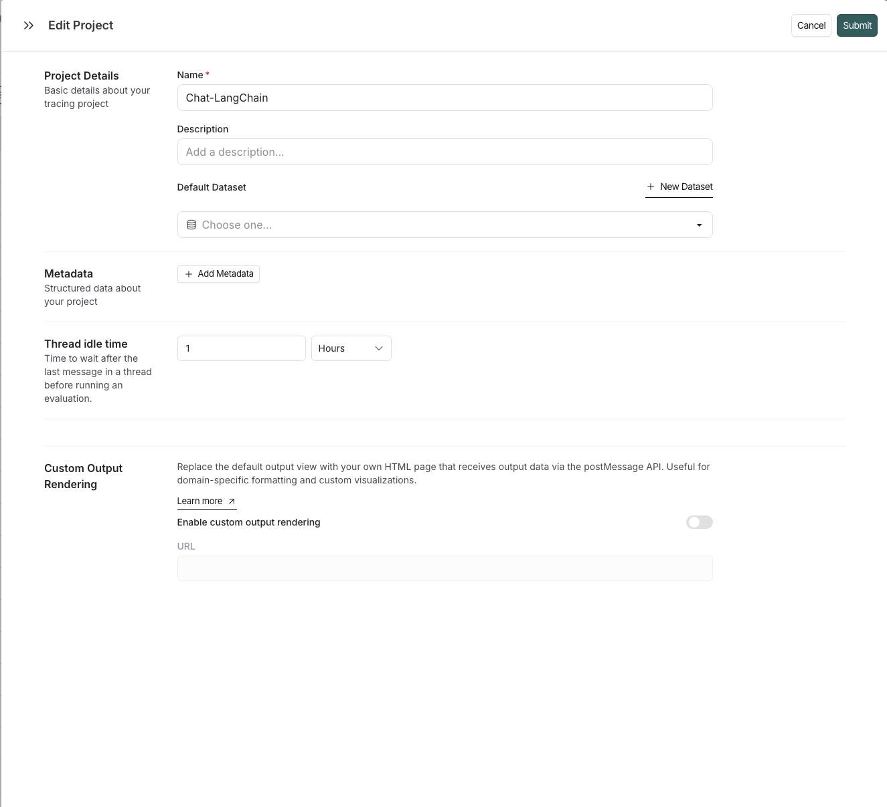
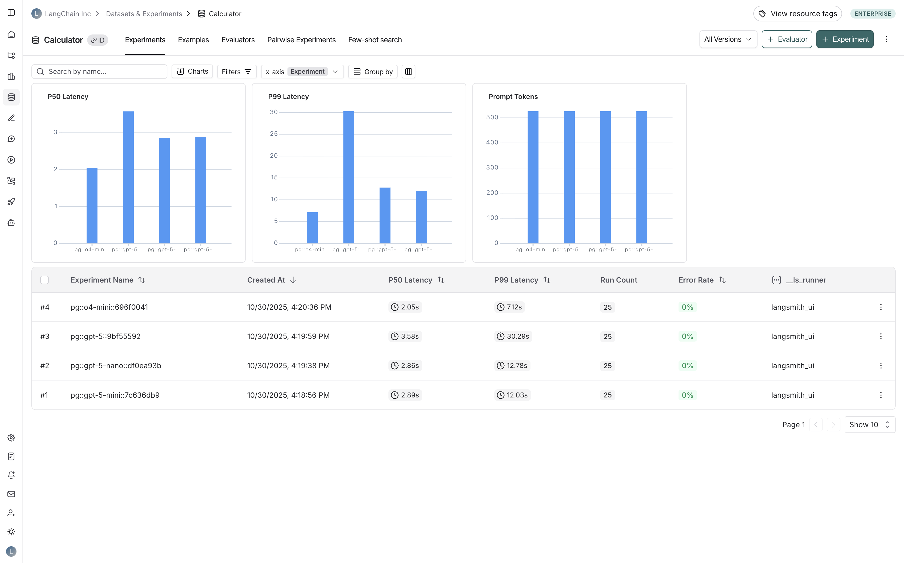
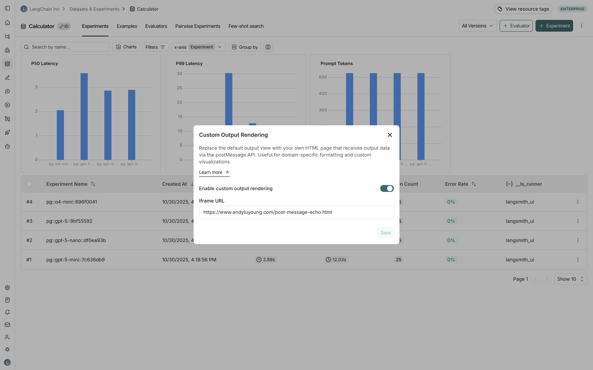
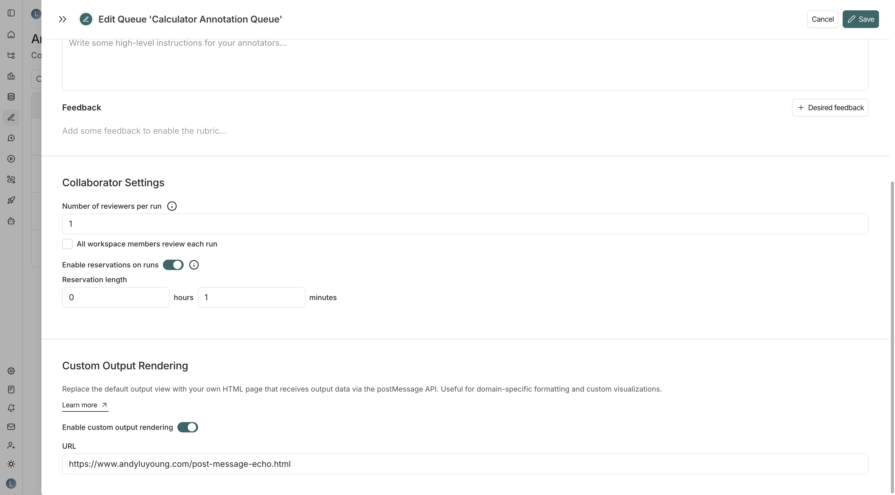
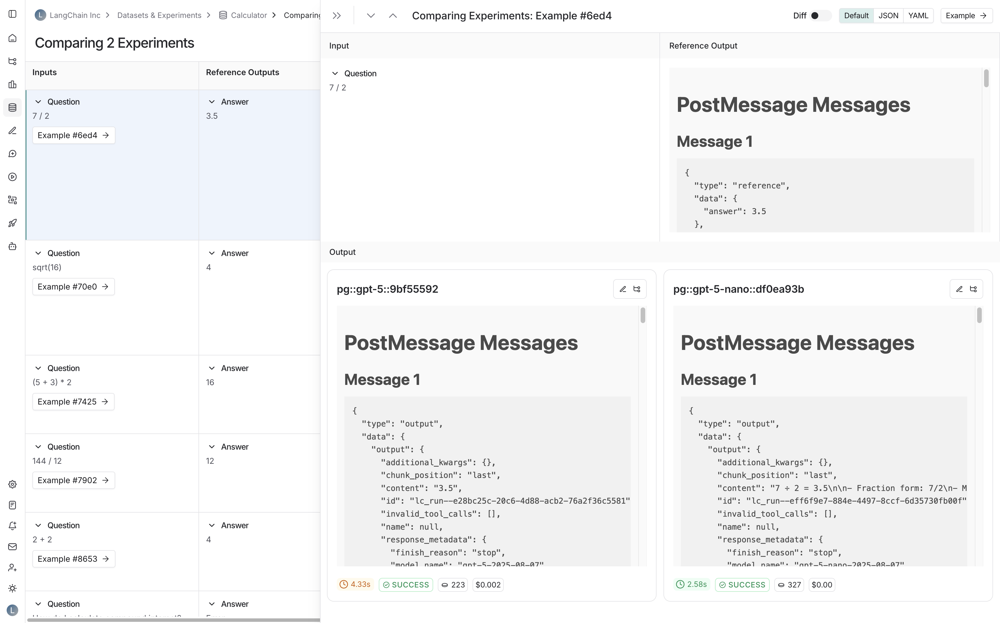
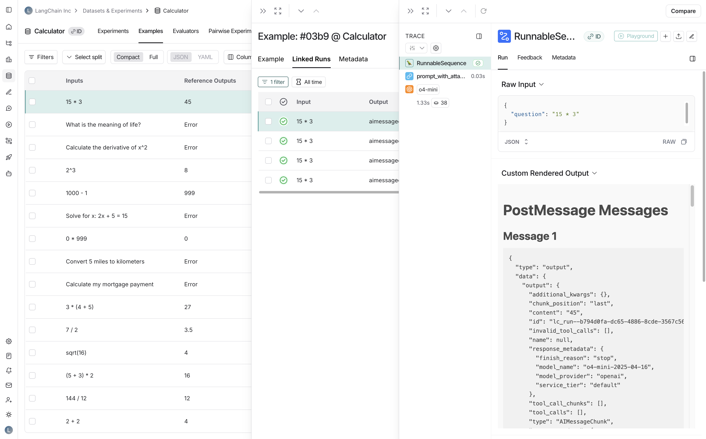
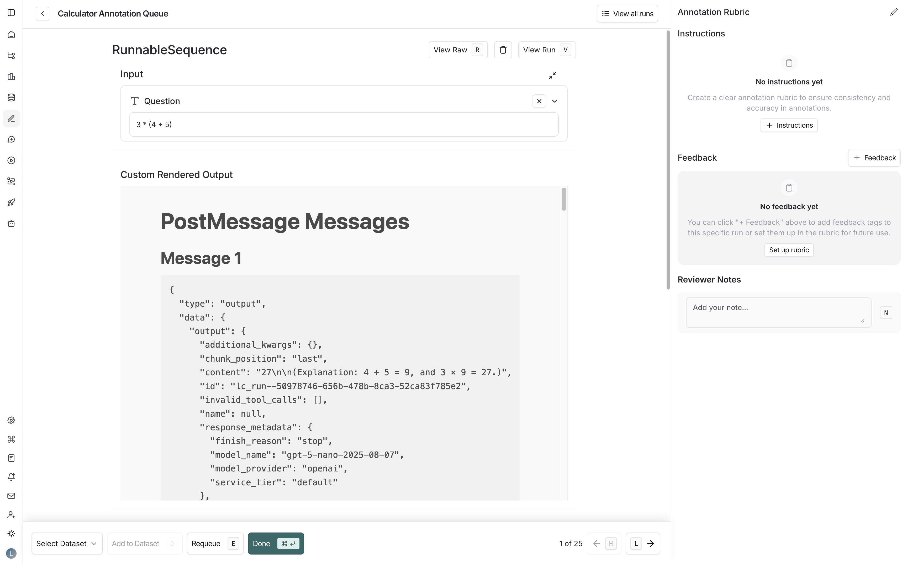

# Custom output rendering

Custom output rendering allows you to visualize run outputs and dataset reference outputs using your own custom HTML pages. This is particularly useful for:

* **Domain-specific formatting**: Display medical records, legal documents, or other specialized data types in their native format.
* **Custom visualizations**: Create charts, graphs, or diagrams from numeric or structured output data.

In this page you'll learn how to:

* **[Configure custom rendering](#configure-custom-output-rendering)** in the LangSmith UI.
* **[Build a custom renderer](#build-a-custom-renderer)** to display output data.
* **[Understand where custom rendering appears](#where-custom-rendering-appears)** in LangSmith.

## Configure custom output rendering

Configure custom rendering at two levels:

* **For datasets**: Apply custom rendering to all runs associated with that dataset, wherever they appear—in experiments, run detail panes, or annotation queues.
* **For annotation queues**: Apply custom rendering to all runs within a specific annotation queue, regardless of which dataset they come from. This takes precedence over dataset-level configuration.

### For tracing projects

To configure custom output rendering for a tracing project:



1. Navigate to the **Tracing Projects** page.
2. Click on an existing tracing project or create a new one.
3. In the edit tracing project pane, scroll to the **Custom Output Rendering** section.
4. Toggle **Enable custom output rendering**.
5. Enter the webpage URL in the **URL** field.
6. Click **Save**.

### For datasets

To configure custom output rendering for a dataset:



1. Navigate to your dataset in the **Datasets & Experiments** page.
2. Click **⋮** (three-dot menu) in the top right corner.
3. Select **Custom Output Rendering**.
4. Toggle **Enable custom output rendering**.
5. Enter the webpage URL in the **URL** field.
6. Click **Save**.



### For annotation queues

> [!NOTE]
>
> Custom output rendering for annotation queues will be deprecated. Use a [custom view](../../Annotation%20Queues/Build%20custom%20views%20for%20annotation%20queues.md) instead. A queue can use custom output rendering or a custom view, not both.

To configure custom output rendering for an annotation queue:



1. Navigate to the **Annotation Queues** page.
2. Click on an existing annotation queue or create a new one.
3. In the annotation queue settings pane, scroll to the **Custom Output Rendering** section.
4. Toggle **Enable custom output rendering**.
5. Enter the webpage URL in the **URL** field.
6. Click **Save** or **Create**.

> [!NOTE]
>
> When custom rendering settings are applied at multiple levels, the precedence is as follows: annotation queue > dataset > tracing project.

## Build a custom renderer

### Understand the message format

Your HTML page will receive output data via the [postMessage API](https://developer.mozilla.org/en-US/docs/Web/API/Window/postMessage). LangSmith sends messages with the following structure:

```typescript
{
  type: "output" | "reference",
  data: {
    // The outputs (actual output or reference output)
    // Structure varies based on your application
  },
  metadata: {
    inputs: {
      // The inputs that generated this output
      // Structure varies based on your application
    }
  }
}
```

* `type`: Indicates whether this is an actual output (`"output"`) or a reference output (`"reference"`).
* `data`: The output data itself.
* `metadata.inputs`: The input data that generated this output, provided for context.

> [!NOTE]
>
> **Message delivery timing**: LangSmith uses an exponential backoff retry mechanism to ensure your page receives the data even if it loads slowly. Messages are sent up to 6 times with increasing delays (100ms, 200ms, 400ms, 800ms, 1600ms, 3200ms).

### Example implementation

This example listens for incoming postMessage events and displays them on the page. Each message is numbered and formatted as JSON, making it easy to inspect the data structure LangSmith sends to your renderer.

```html
<!DOCTYPE html>
<html>
    <head>
        <meta charset="UTF-8" />
        <title>PostMessage Echo</title>
        <link rel="stylesheet" href="https://unpkg.com/sakura.css/css/sakura.css" />
    </head>
    <body>
        <h1>PostMessage Messages</h1>
        <div id="messages"></div>
        <script>
            let count = 0;
            window.addEventListener("message", (event) => {
                count++;
                const header = document.createElement("h3");
                header.appendChild(document.createTextNode(`Message ${count}`));
                const code = document.createElement("code");
                code.appendChild(document.createTextNode(JSON.stringify(event.data, null, 2)));
                const pre = document.createElement("pre");
                pre.appendChild(code);
                document.getElementById("messages").appendChild(header);
                document.getElementById("messages").appendChild(pre);
            });
        </script>
    </body>
</html>
```

## Where custom rendering appears

When enabled, your custom rendering will replace the default output view in:

* **Experiment comparison view**: When comparing outputs across multiple experiments:



* **Run detail panes**: When viewing runs that are associated with a dataset:



* **Annotation queues**: When reviewing runs in annotation queues:


