# Manage datasets

LangSmith provides tools for managing and working with your [*datasets*](../../Get%20started/Evaluation%20concepts.md#datasets). This page describes dataset operations including:

* [Versioning datasets](#version-a-dataset) to track changes over time.
* [Filtering](#evaluate-on-a-filtered-view-of-a-dataset) and [splitting](#evaluate-on-a-dataset-split) datasets for evaluation.
* [Sharing datasets](#share-a-dataset) publicly.
* [Exporting datasets](#export-a-dataset) in various formats.

You'll also learn how to [export filtered traces](#export-filtered-traces-from-experiment-to-dataset) from [experiments](../../Get%20started/Evaluation%20concepts.md#experiment) back to datasets for further analysis and iteration.

> [!TIP]
>
> The [LangSmith Engine](../../../Engine/Find%20and%20fix%20your%20agent%27s%20issues%20with%20LangSmith%20Engine.md#add-offline-examples) can automatically generate ground truth dataset examples from your production traces.

## Version a dataset

In LangSmith, datasets are versioned. This means that every time you add, update, or delete examples in your dataset, a new version of the dataset is created.

### Create a new version of a dataset

Any time you add, update, or delete examples in your dataset, a new [version](../../Get%20started/Evaluation%20concepts.md#dataset-organization) of your dataset is created. This allows you to track changes to your dataset over time and understand how your dataset has evolved.

By default, the version is defined by the timestamp of the change. When you click on a particular version of a dataset (by timestamp) in the **Examples** tab, you will find the state of the dataset at that point in time.

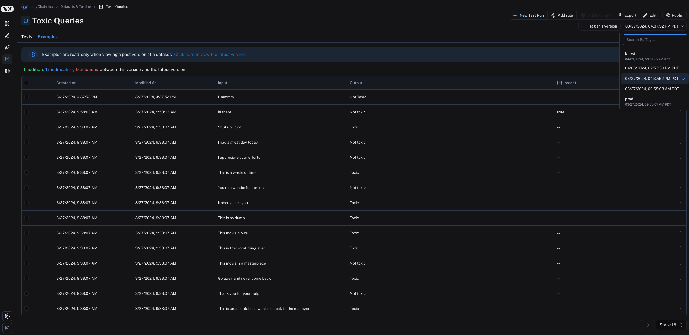

Note that examples are read-only when viewing a past version of the dataset. You will also see the operations that were between this version of the dataset and the latest version of the dataset.

> [!NOTE]
>
> By default, the latest version of the dataset is shown in the **Examples** tab and experiments from all versions are shown in the **Tests** tab.

In the **Tests** tab, you will find the results of tests run on the dataset at different versions.

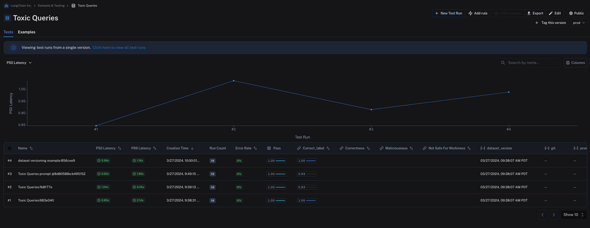

### Tag a version

You can also tag versions of your dataset to give them a more human-readable name, which can be useful for marking important milestones in your dataset's history.

For example, you might tag a version of your dataset as "prod" and use it to run tests against your LLM pipeline.

You can tag a version of your dataset in the UI by clicking on **+ Tag this version** in the **Examples** tab.

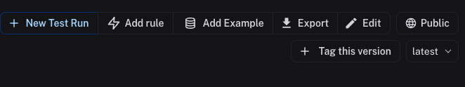

You can also tag versions of your dataset using the SDK. Here's an example of how to tag a version of a dataset using the [Python SDK](../../../Monitor/Reference/langsmith%20%28smith-python-sdk%29.md):

```python
from langsmith import Client
from datetime import datetime

client = Client()
initial_time = datetime(2024, 1, 1, 0, 0, 0) # The timestamp of the version you want to tag

# You can tag a specific dataset version with a semantic name, like "prod"
client.update_dataset_tag(
    dataset_name=toxic_dataset_name, as_of=initial_time, tag="prod"
)
```

To run an evaluation on a particular tagged version of a dataset, refer to the [Evaluate on a specific dataset version section](#evaluate-on-a-specific-dataset-version).

## Evaluate on a specific dataset version

> [!TIP]
>
> You may find it helpful to refer to the following content before you read this section:
>
> * [Version a dataset](#version-a-dataset).
> * [Fetching examples](Create%20a%20dataset/How%20to%20create%20and%20manage%20datasets%20programmatically.md#fetch-examples).

### Use `list_examples`

You can use `evaluate` / `aevaluate` to pass in an iterable of examples to evaluate on a particular version of a dataset. Use `list_examples` / `listExamples` to fetch examples from a particular version tag using `as_of` / `asOf` and pass that into the `data` argument.

```python Python
from langsmith import Client

ls_client = Client()

# Assumes actual outputs have a 'class' key.
# Assumes example outputs have a 'label' key.
def correct(outputs: dict, reference_outputs: dict) -> bool:
  return outputs["class"] == reference_outputs["label"]

results = ls_client.evaluate(
    lambda inputs: {"class": "Not toxic"},
    # Pass in filtered data here:
    data=ls_client.list_examples(
      dataset_name="Toxic Queries",
      as_of="latest",  # specify version here
    ),
    evaluators=[correct],
)
```

```typescript TypeScript
import { evaluate } from "langsmith/evaluation";

await evaluate((inputs) => labelText(inputs["input"]), {
  data: langsmith.listExamples({
    datasetName: datasetName,
    asOf: "latest",
  }),
  evaluators: [correctLabel],
});
```

```java Java
import com.langchain.smith.models.examples.ExampleListParams;

ExampleListParams listParams = ExampleListParams.builder()
    .datasetId(datasetId)
    .asOf("latest")
var examples = client.examples().list(listParams);
```

Learn more about how to fetch views of a dataset on the [Create and manage datasets programmatically](Create%20a%20dataset/How%20to%20create%20and%20manage%20datasets%20programmatically.md#fetch-datasets) page.

## Evaluate on a split / filtered view of a dataset

> [!TIP]
>
> You may find it helpful to refer to the following content before you read this section:
>
> * [Fetching examples](Create%20a%20dataset/How%20to%20create%20and%20manage%20datasets%20programmatically.md#fetch-examples).
> * [Creating and managing dataset splits](Create%20a%20dataset/Create%20and%20manage%20datasets%20in%20the%20UI.md#create-and-manage-dataset-splits).

### Evaluate on a filtered view of a dataset

You can use the `list_examples` / `listExamples` method to [fetch](Create%20a%20dataset/How%20to%20create%20and%20manage%20datasets%20programmatically.md#fetch-examples) a subset of examples from a dataset to evaluate on.

One common workflow is to fetch examples that have a certain metadata key-value pair.

```python Python
from langsmith import evaluate

results = evaluate(
    lambda inputs: label_text(inputs["text"]),
    data=client.list_examples(dataset_name=dataset_name, metadata={"desired_key": "desired_value"}),
    evaluators=[correct_label],
    experiment_prefix="Toxic Queries",
)
```

```typescript TypeScript
import { evaluate } from "langsmith/evaluation";

await evaluate((inputs) => labelText(inputs["input"]), {
  data: langsmith.listExamples({
    datasetName: datasetName,
    metadata: {"desired_key": "desired_value"},
  }),
  evaluators: [correctLabel],
  experimentPrefix: "Toxic Queries",
});
```

```java Java
import com.langchain.smith.models.examples.ExampleListParams;

ExampleListParams listParams = ExampleListParams.builder()
    .datasetId(datasetId)
    .metadata("{\"desired_key\":\"desired_value\"}")
    .build();
var examples = client.examples().list(listParams);
```

For more filtering capabilities, refer to this [how-to guide](Create%20a%20dataset/How%20to%20create%20and%20manage%20datasets%20programmatically.md#list-examples-by-structured-filter).

### Evaluate on a dataset split

You can use the `list_examples` / `listExamples` method to evaluate on one or multiple [splits](../../Get%20started/Evaluation%20concepts.md#dataset-organization) of your dataset. The `splits` parameter takes a list of the splits you would like to evaluate.

```python Python
from langsmith import evaluate

results = evaluate(
    lambda inputs: label_text(inputs["text"]),
    data=client.list_examples(dataset_name=dataset_name, splits=["test", "training"]),
    evaluators=[correct_label],
    experiment_prefix="Toxic Queries",
)
```

```typescript TypeScript
import { evaluate } from "langsmith/evaluation";

await evaluate((inputs) => labelText(inputs["input"]), {
  data: langsmith.listExamples({
    datasetName: datasetName,
    splits: ["test", "training"],
  }),
  evaluators: [correctLabel],
  experimentPrefix: "Toxic Queries",
});
```

```java Java
import com.langchain.smith.models.examples.ExampleListParams;
import java.util.Arrays;
import java.util.List;

List<String> splits = Arrays.asList("test", "training");

ExampleListParams listParams = ExampleListParams.builder()
    .datasetId(datasetId)
    .splits(splits)
    .build();
var examples = client.examples().list(listParams);
```

For more details on fetching views of a dataset, refer to the guide on [fetching datasets](Create%20a%20dataset/How%20to%20create%20and%20manage%20datasets%20programmatically.md#fetch-datasets).

## Share a dataset

### Share a dataset publicly

> [!WARNING]
>
> Sharing a dataset publicly will make the **dataset examples, experiments and associated runs, and feedback on this dataset accessible to anyone with the link**, even if they don't have a LangSmith account. Make sure you're not sharing sensitive information.
>
> This feature is only available in the cloud-hosted version of LangSmith.

From the **Dataset & Experiments** tab, select a dataset, click **⋮** (top right of the page), click **Share Dataset**. This will open a dialog where you can copy the link to the dataset.

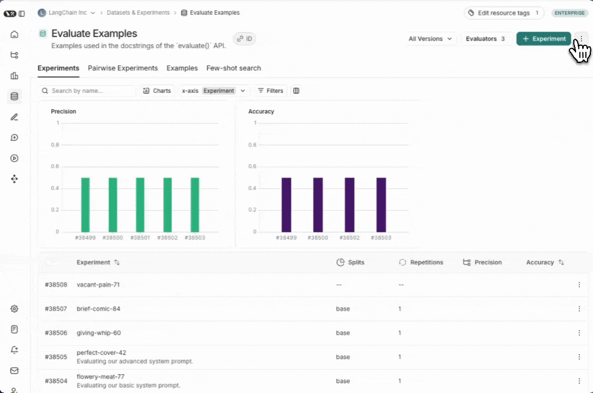

### Unshare a dataset

1. Click on **Unshare** by clicking on **Public** in the upper right hand corner of any publicly shared dataset, then **Unshare** in the dialog. 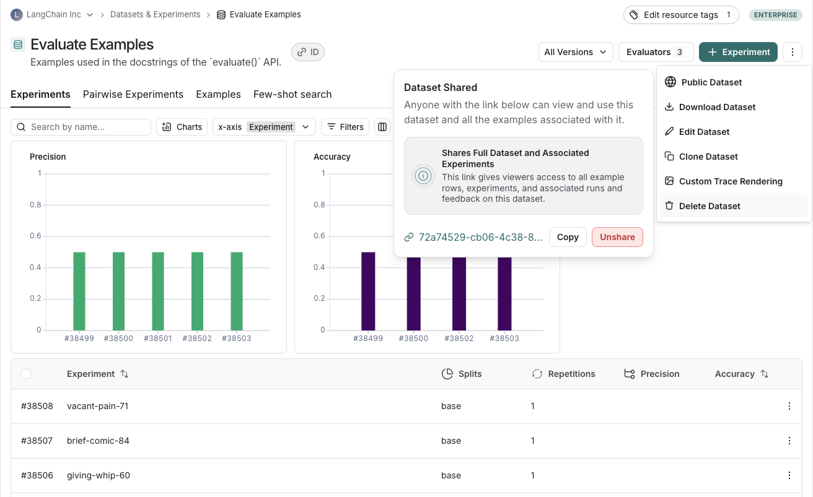

2. Navigate to your organization's list of publicly shared datasets, by clicking on **Settings** -> **Shared URLs** or [this link](https://smith.langchain.com/settings/shared), then click on **Unshare** next to the dataset you want to unshare.

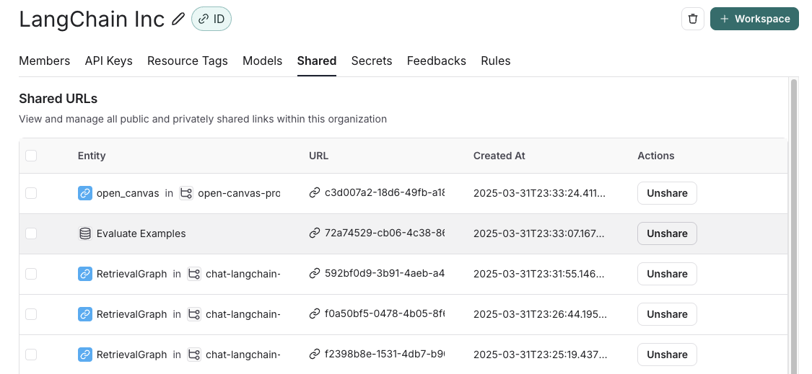

## Export a dataset

You can export your LangSmith dataset to a CSV, JSONL, or [OpenAI's fine tuning format](https://platform.openai.com/docs/guides/fine-tuning#example-format) from the LangSmith UI. To fine-tune a model on a trajectory dataset without exporting it, use [Smithtune](../Fine-tuning/Fine-tune%20models%20with%20Smithtune.md).

From the **Dataset & Experiments** tab, select a dataset, click **⋮** (top right of the page), click **Download Dataset**.

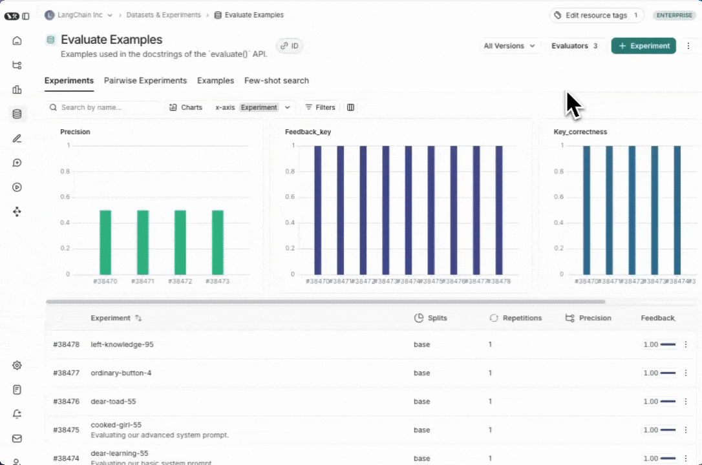

## Export filtered traces from experiment to dataset

After running an [offline evaluation](../../Get%20started/Evaluation%20concepts.md#offline-evaluations) in LangSmith, you may want to export [traces](../../../Monitor/Trace/Observability%20concepts.md#traces) that met some evaluation criteria to a dataset.

### View experiment traces

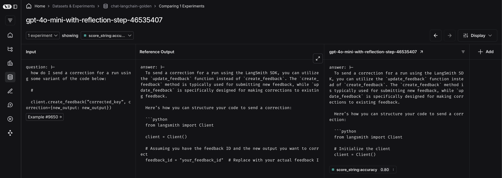

To do so, first click on the arrow next to your experiment name. This will direct you to a project that contains the traces generated from your experiment.

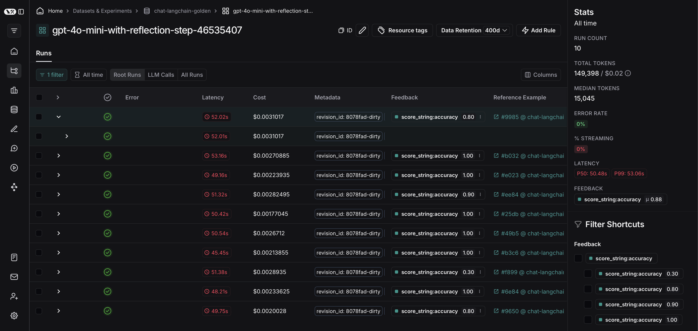

From there, you can filter the traces based on your evaluation criteria. In this example, we're filtering for all traces that received an accuracy score greater than 0.5.

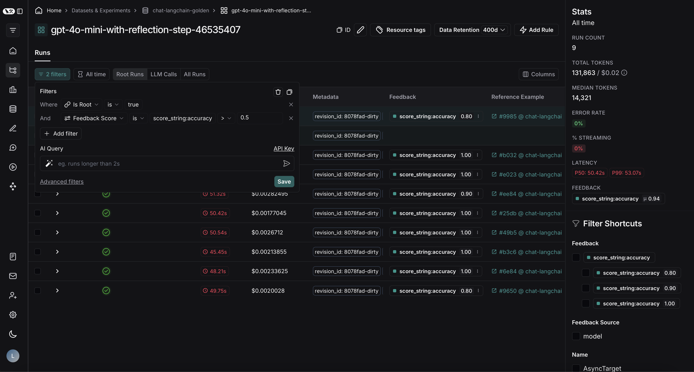

After applying the filter on the project, we can multi-select runs to add to the dataset, and click **Add to Dataset**.

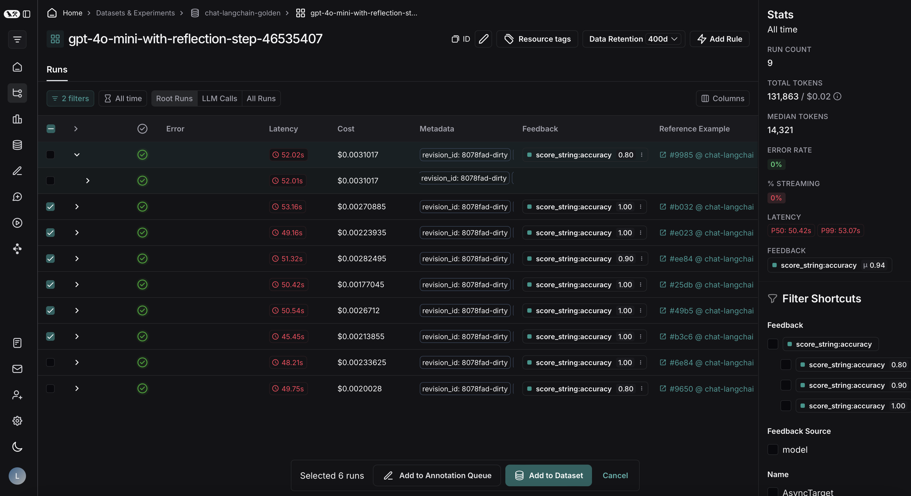
