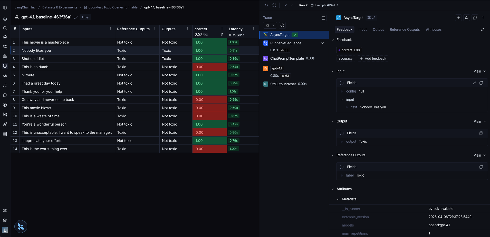

# How to evaluate a runnable

> [!NOTE]
>
> * `langchain`: [Python](https://docs.langchain.com/oss/python/langchain/overview.md) and [JS/TS](https://docs.langchain.com/oss/javascript/langchain/overview.md)
> * Runnable: [Python](https://reference.langchain.com/python/langchain_core/runnables/) and [JS/TS](https://reference.langchain.com/javascript/classes/_langchain_core.runnables.Runnable.html)

`langchain` [`Runnable`](https://reference.langchain.com/python/langchain_core/runnables/) objects (such as chat models, retrievers, chains, etc.) can be passed directly into `evaluate()` / `aevaluate()`.

## Setup

Let's define a simple chain to evaluate. First, install all the required packages:

```bash Python
pip install -U langsmith langchain[openai]
```

```bash TypeScript
yarn add langsmith @langchain/openai
```

Now define a chain:

```python Python
from langchain.chat_models import init_chat_model
from langchain_core.output_parsers import StrOutputParser
from langchain_core.prompts import ChatPromptTemplate

instructions = (
    "Please review the user query below and determine if it contains any form "
    "of toxic behavior, such as insults, threats, or highly negative comments. "
    "Respond with 'Toxic' if it does, and 'Not toxic' if it doesn't."
)

prompt = ChatPromptTemplate(
    [("system", instructions), ("user", "{text}")],
)

model = init_chat_model("gpt-6.1-sol")
chain = prompt | model | StrOutputParser()
```

```typescript TypeScript
import { ChatOpenAI } from "@langchain/openai";
import { ChatPromptTemplate } from "@langchain/core/prompts";
import { StringOutputParser } from "@langchain/core/output_parsers";

const prompt = ChatPromptTemplate.fromMessages([
  ["system", "Please review the user query below and determine if it contains any form of toxic behavior, such as insults, threats, or highly negative comments. Respond with 'Toxic' if it does, and 'Not toxic' if it doesn't."],
  ["user", "{text}"]
]);

const chatModel = new ChatOpenAI();
const outputParser = new StringOutputParser();
const chain = prompt.pipe(chatModel).pipe(outputParser);
```

## Evaluate

To evaluate our chain we can pass it directly to the `evaluate()` / `aevaluate()` method. Note that the input variables of the chain must match the keys of the example inputs. In this case, the example inputs should have the form `{"text": "..."}`.

```python Python
import asyncio
from langsmith import Client, aevaluate

client = Client()

# Clone a dataset of texts with toxicity labels.
# Each example input has a "text" key and each output has a "label" key.
dataset = client.clone_public_dataset(
    "https://smith.langchain.com/public/3d6831e6-1680-4c88-94df-618c8e01fc55/d"
)

def correct(outputs: dict, reference_outputs: dict) -> bool:
    # Since our chain outputs a string not a dict, this string
    # gets stored under the default "output" key in the outputs dict:
    actual = outputs["output"]
    expected = reference_outputs["label"]
    return actual == expected

async def main():
    results = await aevaluate(
        chain,
        data=dataset,
        evaluators=[correct],
        experiment_prefix="gpt-6.1-sol, baseline",
        metadata={"models": "openai:gpt-6.1-sol"},  # optional, used to populate model/prompt/tool columns in UI
    )
    print(results)

asyncio.run(main())
```

```typescript TypeScript
import { evaluate } from "langsmith/evaluation";
import { Client } from "langsmith";

const langsmith = new Client();

const dataset = await client.clonePublicDataset(
  "https://smith.langchain.com/public/3d6831e6-1680-4c88-94df-618c8e01fc55/d"
)

await evaluate(chain, {
  data: dataset.name,
  evaluators: [correct],
  experimentPrefix: "gpt-6.1-sol, baseline",
  metadata: { models: "openai:gpt-6.1-sol" },  // optional, used to populate model/prompt/tool columns in UI
});
```

The runnable is traced appropriately for each output.



## Related

* [How to evaluate a `langgraph` graph](How%20to%20evaluate%20an%20application%27s%20intermediate%20steps.md)
