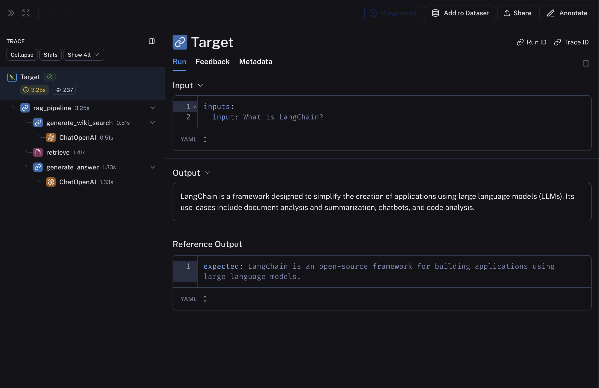
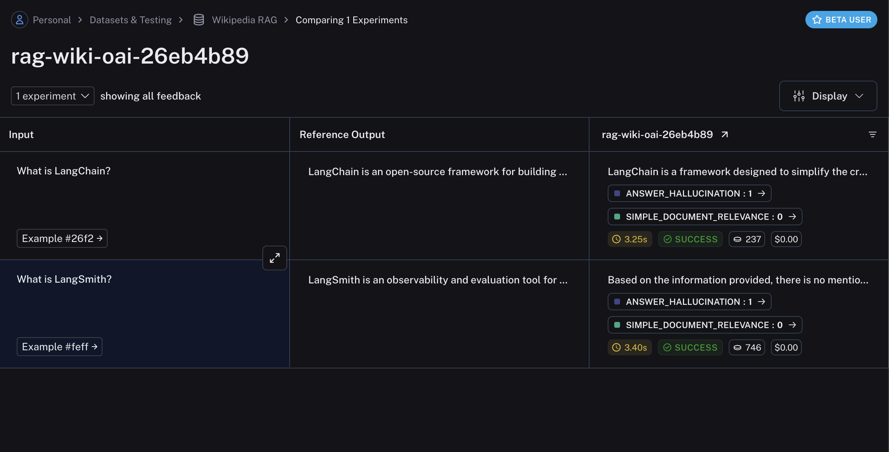

# How to evaluate an application's intermediate steps

While, in many scenarios, it is sufficient to evaluate the final output of your task, in some cases you might want to evaluate the intermediate steps of your pipeline.

For example, for retrieval-augmented generation (RAG), you might want to

1. Evaluate the retrieval step to ensure that the correct documents are retrieved with respect to the input query.
2. Evaluate the generation step to ensure that the correct answer is generated with respect to the retrieved documents.

In this guide, we will use a simple, fully-custom evaluator for evaluating criteria 1 and an LLM-based evaluator for evaluating criteria 2 to highlight both scenarios.

In order to evaluate the intermediate steps of your pipeline, your evaluator function should traverse and process the `run`/`rootRun` argument, which is a `Run` object that contains the intermediate steps of your pipeline.

## 1. Define your LLM pipeline

The below RAG pipeline consists of 1) generating a Wikipedia query given the input question, 2) retrieving relevant documents from Wikipedia, and 3) generating an answer given the retrieved documents.

```bash Python
pip install -U langsmith langchain[openai] wikipedia
```

```bash TypeScript
yarn add langsmith langchain @langchain/openai wikipedia
```

Requires `langsmith>=0.3.13`

```python Python
import wikipedia as wp
from openai import OpenAI
from langsmith import traceable, wrappers

oai_client = wrappers.wrap_openai(OpenAI())

@traceable
def generate_wiki_search(question: str) -> str:
    """Generate the query to search in wikipedia."""
    instructions = (
        "Generate a search query to pass into wikipedia to answer the user's question. "
        "Return only the search query and nothing more. "
        "This will passed in directly to the wikipedia search engine."
    )
    messages = [
        {"role": "system", "content": instructions},
        {"role": "user", "content": question}
    ]
    result = oai_client.chat.completions.create(
        messages=messages,
        model="gpt-5.4-mini",
        temperature=0,
    )
    return result.choices[0].message.content

@traceable(run_type="retriever")
def retrieve(query: str) -> list:
    """Get up to two search wikipedia results."""
    results = []
    for term in wp.search(query, results = 10):
        try:
            page = wp.page(term, auto_suggest=False)
            results.append({
                "page_content": page.summary,
                "type": "Document",
                "metadata": {"url": page.url}
            })
        except wp.DisambiguationError:
            pass
        if len(results) >= 2:
            return results

@traceable
def generate_answer(question: str, context: str) -> str:
    """Answer the question based on the retrieved information."""
    instructions = f"Answer the user's question based ONLY on the content below:\n\n{context}"
    messages = [
        {"role": "system", "content": instructions},
        {"role": "user", "content": question}
    ]
    result = oai_client.chat.completions.create(
        messages=messages,
        model="gpt-5.4-mini",
        temperature=0
    )
    return result.choices[0].message.content

@traceable
def qa_pipeline(question: str) -> str:
    """The full pipeline."""
    query = generate_wiki_search(question)
    context = "\n\n".join([doc["page_content"] for doc in retrieve(query)])
    return generate_answer(question, context)
```

```typescript TypeScript
import OpenAI from "openai";
import wiki from "wikipedia";
import { Client } from "langsmith";
import { traceable } from "langsmith/traceable";
import { wrapOpenAI } from "langsmith/wrappers";

const openai = wrapOpenAI(new OpenAI());

const generateWikiSearch = traceable(
  async (input: { question: string }) => {
    const messages = [
      {
        role: "system" as const,
        content:
          "Generate a search query to pass into Wikipedia to answer the user's question. Return only the search query and nothing more. This will be passed in directly to the Wikipedia search engine.",
      },
      { role: "user" as const, content: input.question },
    ];
    const chatCompletion = await openai.chat.completions.create({
      model: "gpt-5.4-mini",
      messages: messages,
      temperature: 0,
    });
    return chatCompletion.choices[0].message.content ?? "";
  },
  { name: "generateWikiSearch" }
);

const retrieve = traceable(
  async (input: { query: string; numDocuments: number }) => {
    const { results } = await wiki.search(input.query, { limit: 10 });
    const finalResults: Array<{
      page_content: string;
      type: "Document";
      metadata: { url: string };
    }> = [];
    for (const result of results) {
      if (finalResults.length >= input.numDocuments) {
        // Just return the top 2 pages for now
        break;
      }
      const page = await wiki.page(result.title, { autoSuggest: false });
      const summary = await page.summary();
      finalResults.push({
        page_content: summary.extract,
        type: "Document",
        metadata: { url: page.fullurl },
      });
    }
    return finalResults;
  },
  { name: "retrieve", run_type: "retriever" }
);

const generateAnswer = traceable(
  async (input: { question: string; context: string }) => {
    const messages = [
      {
        role: "system" as const,
        content: `Answer the user's question based only on the content below:\n\n${input.context}`,
      },
      { role: "user" as const, content: input.question },
    ];
    const chatCompletion = await openai.chat.completions.create({
      model: "gpt-5.4-mini",
      messages: messages,
      temperature: 0,
    });
    return chatCompletion.choices[0].message.content ?? "";
  },
  { name: "generateAnswer" }
);

const ragPipeline = traceable(
  async ({ question }: { question: string }, numDocuments: number = 2) => {
    const query = await generateWikiSearch({ question });
    const retrieverResults = await retrieve({ query, numDocuments });
    const context = retrieverResults
      .map((result) => result.page_content)
      .join("\n\n");
    const answer = await generateAnswer({ question, context });
    return answer;
  },
  { name: "ragPipeline" }
);
```

This pipeline will produce a trace that looks something like: 

## 2. Create a dataset and examples to evaluate the pipeline

We are building a very simple dataset with a couple of examples to evaluate the pipeline.

Requires `langsmith>=0.3.13`

```python Python
from langsmith import Client

ls_client = Client()
dataset_name = "Wikipedia RAG"

if not ls_client.has_dataset(dataset_name=dataset_name):
    dataset = ls_client.create_dataset(dataset_name=dataset_name)
    examples = [
      {"inputs": {"question": "What is LangChain?"}},
      {"inputs": {"question": "What is LangSmith?"}},
    ]
    ls_client.create_examples(
      dataset_id=dataset.id,
      examples=examples,
    )
```

```typescript TypeScript
import { Client } from "langsmith";

const client = new Client();
const examples = [
  [
    "What is LangChain?",
    "LangChain is an open-source framework for building applications using large language models.",
  ],
  [
    "What is LangSmith?",
    "LangSmith is an observability and evaluation tool for LLM products, built by LangChain Inc.",
  ],
];
const datasetName = "Wikipedia RAG";
const inputs = examples.map(([input, _]) => ({ input }));
const outputs = examples.map(([_, expected]) => ({ expected }));
const dataset = await client.createDataset(datasetName);
await client.createExamples({ datasetId: dataset.id, inputs, outputs });
```

## 3. Define your custom evaluators

As mentioned above, we will define two evaluators: one that evaluates the relevance of the retrieved documents with respect to the input query and another that evaluates the hallucination of the generated answer with respect to the retrieved documents. We will be using LangChain LLM wrappers, along with [`with_structured_output`](https://reference.langchain.com/python/langchain-core/language_models/chat_models/BaseChatModel/with_structured_output) to define the evaluator for hallucination.

The key here is that the evaluator function should traverse the `run` / `rootRun` argument to access the intermediate steps of the pipeline. The evaluator can then process the inputs and outputs of the intermediate steps to evaluate according to the desired criteria.

Example uses `langchain` for convenience, this is not required.

```python Python
from langchain.chat_models import init_chat_model
from langsmith.schemas import Run
from pydantic import BaseModel, Field

def document_relevance(run: Run) -> bool:
    """Checks if retriever input exists in the retrieved docs."""
    qa_pipeline_run = next(
        r for run in run.child_runs if r.name == "qa_pipeline"
    )
    retrieve_run = next(
        r for run in qa_pipeline_run.child_runs if r.name == "retrieve"
    )
    page_contents = "\n\n".join(
        doc["page_content"] for doc in retrieve_run.outputs["output"]
    )
    return retrieve_run.inputs["query"] in page_contents

# Data model
class GradeHallucinations(BaseModel):
    """Binary score for hallucination present in generation answer."""
    is_grounded: bool = Field(..., description="True if the answer is grounded in the facts, False otherwise.")

# LLM with structured output for grading hallucinations
# For more see: https://docs.langchain.com/oss/python/langchain/structured-output
grader_llm= init_chat_model("gpt-5.4-mini", temperature=0).with_structured_output(
    GradeHallucinations,
    method="json_schema",
    strict=True,
)

def no_hallucination(run: Run) -> bool:
    """Check if the answer is grounded in the documents.
    Return True if there is no hallucination, False otherwise.
    """
    # Get documents and answer
    qa_pipeline_run = next(
        r for r in run.child_runs if r.name == "qa_pipeline"
    )
    retrieve_run = next(
        r for r in qa_pipeline_run.child_runs if r.name == "retrieve"
    )
    retrieved_content = "\n\n".join(
        doc["page_content"] for doc in retrieve_run.outputs["output"]
    )

    # Construct prompt
    instructions = (
        "You are a grader assessing whether an LLM generation is grounded in / "
        "supported by a set of retrieved facts. Give a binary score 1 or 0, "
        "where 1 means that the answer is grounded in / supported by the set of facts."
    )
    messages = [
        {"role": "system", "content": instructions},
        {"role": "user", "content": f"Set of facts:\n{retrieved_content}\n\nLLM generation: {run.outputs['answer']}"},
    ]
    grade = grader_llm.invoke(messages)
    return grade.is_grounded
```

```typescript TypeScript
import { EvaluationResult } from "langsmith/evaluation";
import { Run, Example } from "langsmith/schemas";
import { ChatPromptTemplate } from "@langchain/core/prompts";
import { ChatOpenAI } from "@langchain/openai";
import { z } from "zod";

function findNestedRun(run: Run, search: (run: Run) => boolean): Run | null {
  const queue: Run[] = [run];
  while (queue.length > 0) {
    const currentRun = queue.shift()!;
    if (search(currentRun)) return currentRun;
    queue.push(...currentRun.child_runs);
  }
  return null;
}

// A very simple evaluator that checks to see if the input of the retrieval step exists
// in the retrieved docs.
function documentRelevance(rootRun: Run, example: Example): EvaluationResult {
  const retrieveRun = findNestedRun(rootRun, (run) => run.name === "retrieve");
  const docs: Array<{ page_content: string }> | undefined =
    retrieveRun.outputs?.outputs;
  const pageContents = docs?.map((doc) => doc.page_content).join("\n\n");
  const score = pageContents.includes(retrieveRun.inputs?.query);
  return { key: "simple_document_relevance", score };
}

async function hallucination(
  rootRun: Run,
  example: Example
): Promise<EvaluationResult> {
  const rag = findNestedRun(rootRun, (run) => run.name === "ragPipeline");
  const retrieve = findNestedRun(rootRun, (run) => run.name === "retrieve");
  const docs: Array<{ page_content: string }> | undefined =
    retrieve.outputs?.outputs;
  const documents = docs?.map((doc) => doc.page_content).join("\n\n");

  const prompt = ChatPromptTemplate.fromMessages<{
    documents: string;
    generation: string;
  }>([
    [
      "system",
      [
        `You are a grader assessing whether an LLM generation is grounded in / supported by a set of retrieved facts. \n`,
        `Give a binary score 1 or 0, where 1 means that the answer is grounded in / supported by the set of facts.`,
      ].join("\n"),
    ],
    [
      "human",
      "Set of facts: \n\n {documents} \n\n LLM generation: {generation}",
    ],
  ]);

  const llm = new ChatOpenAI({
    model: "gpt-5.4-mini",
    temperature: 0,
  }).withStructuredOutput(
    z
      .object({
        binary_score: z
          .number()
          .describe("Answer is grounded in the facts, 1 or 0"),
      })
      .describe("Binary score for hallucination present in generation answer.")
  );

  const grader = prompt.pipe(llm);
  const score = await grader.invoke({
    documents,
    generation: rag.outputs?.outputs,
  });
  return { key: "answer_hallucination", score: score.binary_score };
}
```

## 4. Evaluate the pipeline

Finally, we'll run `evaluate` with the custom evaluators defined above.

```python Python
def qa_wrapper(inputs: dict) -> dict:
  """Wrap the qa_pipeline so it can accept the Example.inputs dict as input."""
  return {"answer": qa_pipeline(inputs["question"])}

experiment_results = ls_client.evaluate(
    qa_wrapper,
    data=dataset_name,
    evaluators=[document_relevance, no_hallucination],
    experiment_prefix="rag-wiki-oai"
)
```

```typescript TypeScript
import { evaluate } from "langsmith/evaluation";

await evaluate((inputs) => ragPipeline({ question: inputs.input }), {
  data: datasetName,
  evaluators: [hallucination, documentRelevance],
  experimentPrefix: "rag-wiki-oai",
});
```

The experiment will contain the results of the evaluation, including the scores and comments from the evaluators: 

## Related

* [Evaluate a `langgraph` graph](How%20to%20evaluate%20an%20application%27s%20intermediate%20steps.md)
