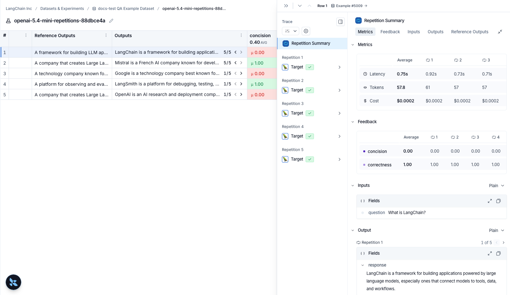

# How to evaluate with repetitions

Running multiple repetitions can give a more accurate estimate of the performance of your system since LLM outputs are not deterministic. Outputs can differ from one repetition to the next. Repetitions are a way to reduce noise in systems prone to high variability, such as agents.

## Configuring repetitions on an experiment

Add the optional `num_repetitions` param to the `evaluate` / `aevaluate` function ([Python](https://reference.langchain.com/python/langsmith/evaluation/_runner/evaluate), [TypeScript](https://reference.langchain.com/javascript/langsmith/evaluation/EvaluateOptions)) to specify how many times to evaluate over each example in your dataset. For instance, if you have 5 examples in the dataset and set `num_repetitions=5`, each example will be run 5 times, for a total of 25 runs.

```python Python
from langsmith import evaluate

results = evaluate(
    lambda inputs: label_text(inputs["text"]),
    data=dataset_name,
    evaluators=[correct_label],
    experiment_prefix="Toxic Queries",
    num_repetitions=3,
)
```

```typescript TypeScript
import { evaluate } from "langsmith/evaluation";

await evaluate((inputs) => labelText(inputs["input"]), {
  data: datasetName,
  evaluators: [correctLabel],
  experimentPrefix: "Toxic Queries",
  numRepetitions: 3,
});
```

## Viewing results of experiments run with repetitions

If you've run your experiment with [repetitions](How%20to%20evaluate%20with%20repetitions.md), there will be arrows in the output results column so you can view outputs in the table. To view each run from the repetition, hover over the output cell and click the expanded view. When you run an experiment with repetitions, LangSmith displays the average for each feedback score in the table. Click on the feedback score to view the feedback scores from individual runs, or to view the standard deviation across repetitions.


