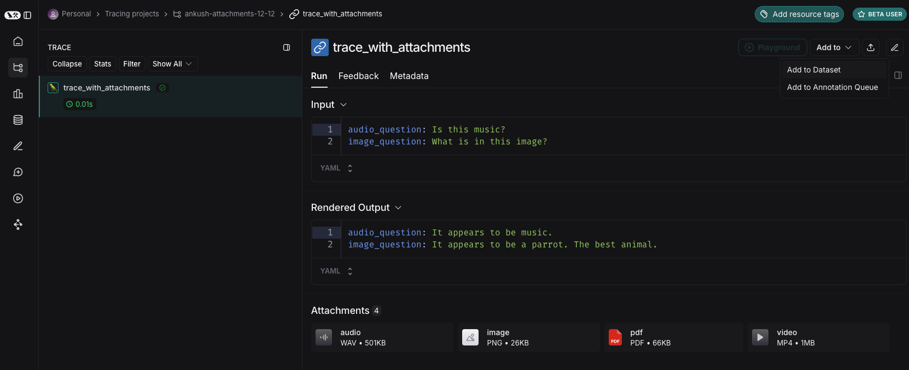
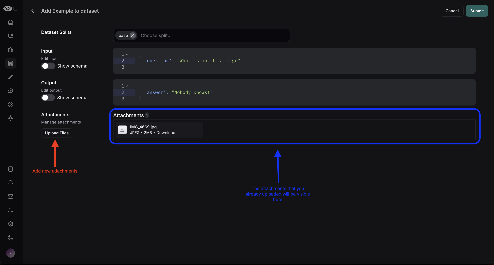
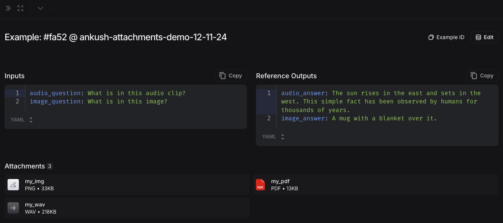
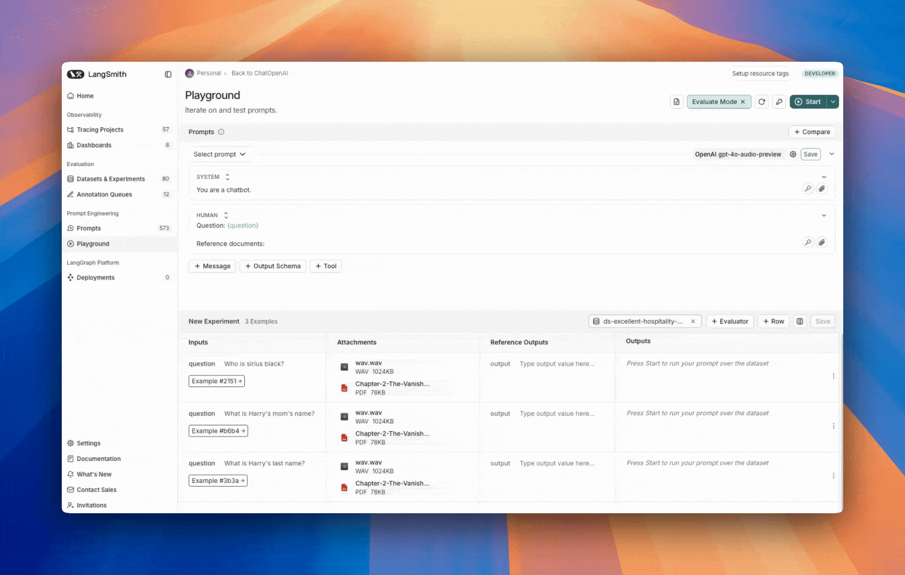
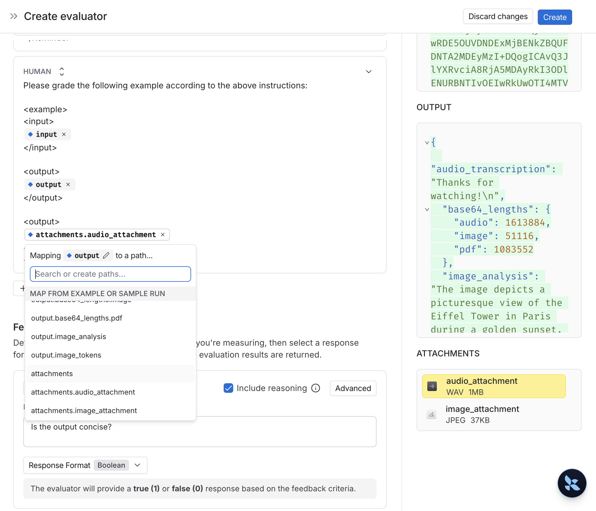
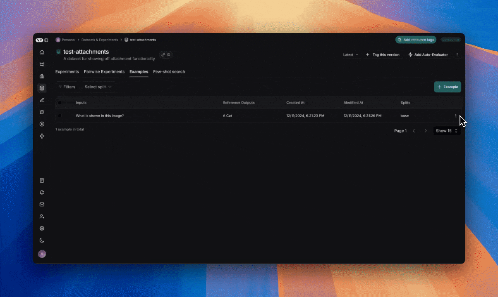

# Run an evaluation with multimodal content

> Learn how to create dataset examples with file attachments and use them in prompts and evaluators when running LangSmith evaluations with multimodal content.

LangSmith lets you create dataset examples with file attachments, like images, audio files, or documents, and use them in your prompts and evaluators when running evaluations with multimodal content.

While you can include multimodal data in your examples by base64 encoding it, this approach is inefficient—the encoded data takes up more space than the original binary files, resulting in slower transfers to and from LangSmith. Using attachments instead provides two key benefits:

* Faster upload and download speeds due to more efficient binary file transfers.
* Enhanced visualization of different file types in the LangSmith UI.

This guide covers how to create examples with attachments, build multimodal prompts and evaluators that use those attachments, and run evaluations with multimodal content. Select either the [**UI**](#ui) or [**SDK**](#sdk) tab to get started.

**Choose your preferred method:**

> [tab] UI
>
> ## 1. Create examples with attachments
>
> You can add examples with attachments to a dataset in a few different ways.
>
> #### From existing runs
>
> When adding runs to a LangSmith dataset, attachments can be selectively propagated from the source run to the destination example. To learn more, please see [Manage datasets in application](../../Datasets/Create%20a%20dataset/Create%20and%20manage%20datasets%20in%20the%20UI.md#manually-from-a-tracing-project).
>
> 
>
> #### From scratch
>
> You can create examples with attachments directly from the LangSmith UI. Click the `+ Example` button in the `Examples` tab of the dataset UI. Then upload attachments using the "Upload Files" button:
>
> 
>
> Once uploaded, you can view examples with attachments in the LangSmith UI. Each attachment will be rendered with a preview for easy inspection. 
>
> ## 2. Create a multimodal prompt
>
> The LangSmith UI allows you to include attachments in your prompts when evaluating multimodal models:
>
> First, click the file icon in the message where you want to add multimodal content. Next, add a template variable for the attachment(s) you want to include for each example.
>
> * If you want to include a specific attachment, you can use the suggested variable name, such as `{{attachment.file_name}}`, this will map the file with `file_name` in the attachment list to pass it to the evaluator
> * If you want to include all attachments, use the `{{attachments}}` variable.
>
>   
>
> ## 3. Define custom evaluators
>
> You can create evaluators that use multimodal content from your dataset examples.
>
> > [!NOTE]
> >
> > Evaluators must use a model that supports both the input modality and structured output. For audio attachments, this is currently only Gemini. Image and PDF attachments work with any vision-capable model that returns structured output.
>
> Since your dataset already has examples with attachments (added in step 1), you can reference them directly in your evaluator. To do so:
>
> 1. Select **+ Evaluator** from the dataset page.
> 2. In the **Template variables** editor, add a variable for the attachment(s) to include:
>
>    * If you want to include a specific attachment, you can use the suggested variable name, such as `{{attachment.file_name}}`, this will map the file with `file_name` in the attachment list to pass it to the evaluator.
>    * If you want to include all attachments, use the `{{attachments}}` variable.
>
>    
>
> The evaluator can then use these attachments along with the model's outputs to judge quality. For example, you could create an evaluator that:
>
> * Checks if an image description matches the actual image content.
> * Verifies if a transcription accurately reflects the audio.
> * Validates if extracted text from a PDF is correct.
>
> You can also create text-only evaluators that don't use attachments but evaluate the model's text output:
>
> * OCR → text correction: Use a vision model to extract text from a document, then evaluate the accuracy of the extracted output.
>
> * Speech-to-text → transcription quality: Use a voice model to transcribe audio to text, then evaluate the transcription against your reference.
>
> > [!TIP]
> >
> > If your traces contain base64-encoded multimodal content in their inputs or outputs (for example, if you followed the [log multimodal traces](../../../../Monitor/Trace/Configuration%20%26%20troubleshooting/Advanced%20tracing%20techniques/Log%20multimodal%20traces.md) guide), you don't need attachments to evaluate them. Use standard variable mapping—such as `{{input}}` or `{{output}}`—in your evaluator prompt, and the base64 content will be passed correctly to the LLM evaluator for visualization and evaluation.
>
> For more information on defining custom evaluators, see the [LLM as Judge](../../../Evaluators/Evaluator%20types/UI/How%20to%20define%20an%20LLM-as-a-judge%20evaluator.md) guide.
>
> ## 4. Update examples with attachments
>
> > [!NOTE]
> >
> > Attachments are limited to 20MB in size in the UI.
>
> When editing an example in the UI, you can:
>
> * Upload new attachments
> * Rename and delete attachments
> * Reset attachments to their previous state using the quick reset button
>
> Changes are not saved until you click submit.
>
> 

> [tab] SDK
>
> ## 1. Create examples with attachments
>
> To upload examples with attachments using the SDK, use the [create\_examples](https://reference.langchain.com/python/langsmith/client/Client/create_examples) / [update\_examples](https://reference.langchain.com/python/langsmith/client/Client/update_examples) Python methods or the [uploadExamplesMultipart](https://reference.langchain.com/javascript/langsmith/client/Client/uploadExamplesMultipart) / [updateExamplesMultipart](https://reference.langchain.com/javascript/langsmith/client/Client/updateExamplesMultipart) TypeScript methods.
>
> #### Python
>
> Requires `langsmith>=0.3.13`
>
> ```python theme={"theme":{"light":"catppuccin-latte","dark":"catppuccin-mocha"}}
> import requests
> from langsmith import uuid7
> from pathlib import Path
> from langsmith import Client
>
> # Publicly available test files
> pdf_url = "https://www.w3.org/WAI/ER/tests/xhtml/testfiles/resources/pdf/dummy.pdf"
> wav_url = "https://openaiassets.blob.core.windows.net/$web/API/docs/audio/alloy.wav"
> img_url = "https://www.w3.org/Graphics/PNG/nurbcup2si.png"
>
> # Fetch the files as bytes
> pdf_bytes = requests.get(pdf_url).content
> wav_bytes = requests.get(wav_url).content
> img_bytes = requests.get(img_url).content
>
> # Create the dataset
> ls_client = Client()
> dataset_name = "attachment-test-dataset"
> dataset = ls_client.create_dataset(
>   dataset_name=dataset_name,
>   description="Test dataset for evals with publicly available attachments",
> )
>
> inputs = {
>   "audio_question": "What is in this audio clip?",
>   "image_question": "What is in this image?",
> }
>
> outputs = {
>   "audio_answer": "The sun rises in the east and sets in the west. This simple fact has been observed by humans for thousands of years.",
>   "image_answer": "A mug with a blanket over it.",
> }
>
> # Define an example with attachments
> example_id = uuid7()
> example = {
>   "id": example_id,
>   "inputs": inputs,
>   "outputs": outputs,
>   "attachments": {
>       "my_pdf": {"mime_type": "application/pdf", "data": pdf_bytes},
>       "my_wav": {"mime_type": "audio/wav", "data": wav_bytes},
>       "my_img": {"mime_type": "image/png", "data": img_bytes},
>       # Example of an attachment specified via a local file path:
>       # "my_local_img": {"mime_type": "image/png", "data": Path(__file__).parent / "my_local_img.png"},
>   },
> }
>
> # Create the example
> ls_client.create_examples(
>   dataset_id=dataset.id,
>   examples=[example],
>   # Uncomment this flag if you'd like to upload attachments from local files:
>   # dangerously_allow_filesystem=True
> )
> ```
>
> #### TypeScript
>
> Requires version 0.2.13 or later
>
> You can use the `uploadExamplesMultipart` method to upload examples with attachments.
>
> Note that this is a different method from the standard `createExamples` method, which currently does not support attachments. Each attachment requires either a `Uint8Array` or an `ArrayBuffer` as the data type.
>
> * `Uint8Array`: Useful for handling binary data directly.
> * `ArrayBuffer`: Represents fixed-length binary data, which can be converted to `Uint8Array` as needed.
>
> Note that you cannot directly pass in a file path in the TypeScript SDK, as accessing local files is not supported in all runtime environments.
>
> ```typescript theme={"theme":{"light":"catppuccin-latte","dark":"catppuccin-mocha"}}
> import { Client } from "langsmith";
> import { uuid7 } from "langsmith";
>
> // Publicly available test files
> const pdfUrl = "https://www.w3.org/WAI/ER/tests/xhtml/testfiles/resources/pdf/dummy.pdf";
> const wavUrl = "https://openaiassets.blob.core.windows.net/$web/API/docs/audio/alloy.wav";
> const pngUrl = "https://www.w3.org/Graphics/PNG/nurbcup2si.png";
>
> // Helper function to fetch file as ArrayBuffer
> async function fetchArrayBuffer(url: string): Promise<ArrayBuffer> {
>   const response = await fetch(url);
>   if (!response.ok) {
>     throw new Error(`Failed to fetch ${url}: ${response.statusText}`);
>   }
>   return response.arrayBuffer();
> }
>
> // Fetch files as ArrayBuffer
> const pdfArrayBuffer = await fetchArrayBuffer(pdfUrl);
> const wavArrayBuffer = await fetchArrayBuffer(wavUrl);
> const pngArrayBuffer = await fetchArrayBuffer(pngUrl);
>
> // Create the LangSmith client (Ensure LANGSMITH_API_KEY is set in env)
> const langsmithClient = new Client();
>
> // Create a unique dataset name
> const datasetName = "attachment-test-dataset:" + uuid7().substring(0, 8);
>
> // Create the dataset
> const dataset = await langsmithClient.createDataset(datasetName, {
>   description: "Test dataset for evals with publicly available attachments",
> });
>
> // Define the example with attachments
> const exampleId = uuid7();
> const example = {
>   id: exampleId,
>   inputs: {
>       audio_question: "What is in this audio clip?",
>       image_question: "What is in this image?",
>   },
>   outputs: {
>       audio_answer: "The sun rises in the east and sets in the west. This simple fact has been observed by humans for thousands of years.",
>       image_answer: "A mug with a blanket over it.",
>   },
>   attachments: {
>     my_pdf: {
>       mimeType: "application/pdf",
>       data: pdfArrayBuffer
>     },
>     my_wav: {
>       mimeType: "audio/wav",
>       data: wavArrayBuffer
>     },
>     my_img: {
>       mimeType: "image/png",
>       data: pngArrayBuffer
>     },
>   },
> };
>
> // Upload the example with attachments to the dataset
> await langsmithClient.uploadExamplesMultipart(dataset.id, [example]);
> ```
>
> > [!NOTE]
> >
> > Along with being passed in as bytes, attachments can be specified as paths to local files. To do so pass in a path for the attachment `data` value and specify arg `dangerously_allow_filesystem=True`:
> >
> > ```python theme={"theme":{"light":"catppuccin-latte","dark":"catppuccin-mocha"}}
> > client.create_examples(..., dangerously_allow_filesystem=True)
> > ```
>
> ## 2. Run evaluations
>
> ### Define a target function
>
> Now that we have a dataset that includes examples with attachments, we can define a target function to run over these examples. The following example simply uses OpenAI's GPT-4o model to answer questions about an image and an audio clip.
>
> #### Python
>
> The target function you are evaluating must have two positional arguments in order to consume the attachments associated with the example, the first must be called `inputs` and the second must be called `attachments`.
>
> * The `inputs` argument is a dictionary that contains the input data for the example, excluding the attachments.
> * The `attachments` argument is a dictionary that maps the attachment name to a dictionary containing a presigned url, mime\_type, and a reader of the bytes content of the file. You can use either the presigned url or the reader to get the file contents. Each value in the attachments dictionary is a dictionary with the following structure:
>
> ```python theme={"theme":{"light":"catppuccin-latte","dark":"catppuccin-mocha"}}
> {
>     "presigned_url": str,
>     "mime_type": str,
>     "reader": BinaryIO
> }
> ```
>
> ```python theme={"theme":{"light":"catppuccin-latte","dark":"catppuccin-mocha"}}
> from langsmith.wrappers import wrap_openai
> import base64
> from openai import OpenAI
>
> client = wrap_openai(OpenAI())
>
> # Define target function that uses attachments
> def file_qa(inputs, attachments):
>     # Read the audio bytes from the reader and encode them in base64
>     audio_reader = attachments["my_wav"]["reader"]
>     audio_b64 = base64.b64encode(audio_reader.read()).decode('utf-8')
>
>     audio_completion = client.chat.completions.create(
>         model="gpt-4o-audio-preview",
>         messages=[
>             {
>                 "role": "user",
>                 "content": [
>                     {
>                         "type": "text",
>                         "text": inputs["audio_question"]
>                     },
>                     {
>                         "type": "input_audio",
>                         "input_audio": {
>                             "data": audio_b64,
>                             "format": "wav"
>                         }
>                     }
>                 ]
>             }
>         ]
>     )
>
>     # Most models support taking in an image URL directly in addition to base64 encoded images
>     # You can pipe the image pre-signed URL directly to the model
>     image_url = attachments["my_img"]["presigned_url"]
>     image_completion = client.chat.completions.create(
>         model="gpt-5.4-mini",
>         messages=[
>           {
>             "role": "user",
>             "content": [
>               {"type": "text", "text": inputs["image_question"]},
>               {
>                 "type": "image_url",
>                 "image_url": {
>                   "url": image_url,
>                 },
>               },
>             ],
>           }
>         ],
>     )
>
>     return {
>         "audio_answer": audio_completion.choices[0].message.content,
>         "image_answer": image_completion.choices[0].message.content,
>     }
> ```
>
> #### TypeScript
>
> In the TypeScript SDK, the `config` argument is used to pass in the attachments to the target function if `includeAttachments` is set to `true`.
>
> The `config` will contain `attachments` which is an object mapping the attachment name to an object of the form:
>
> ```typescript theme={"theme":{"light":"catppuccin-latte","dark":"catppuccin-mocha"}}
> {
>   presigned_url: string,
>   mime_type: string,
> }
> ```
>
> ```typescript theme={"theme":{"light":"catppuccin-latte","dark":"catppuccin-mocha"}}
> import OpenAI from "openai";
> import { wrapOpenAI } from "langsmith/wrappers";
>
> const client: any = wrapOpenAI(new OpenAI());
>
> async function fileQA(inputs: Record<string, any>, config?: Record<string, any>) {
>   const presignedUrl = config?.attachments?.["my_wav"]?.presigned_url;
>   if (!presignedUrl) {
>     throw new Error("No presigned URL provided for audio.");
>   }
>
>   const response = await fetch(presignedUrl);
>   if (!response.ok) {
>     throw new Error(`Failed to fetch audio: ${response.statusText}`);
>   }
>
>   const arrayBuffer = await response.arrayBuffer();
>   const uint8Array = new Uint8Array(arrayBuffer);
>   const audioB64 = Buffer.from(uint8Array).toString("base64");
>
>   const audioCompletion = await client.chat.completions.create({
>     model: "gpt-4o-audio-preview",
>     messages: [
>       {
>         role: "user",
>         content: [
>           { type: "text", text: inputs["audio_question"] },
>           {
>             type: "input_audio",
>             input_audio: {
>               data: audioB64,
>               format: "wav",
>             },
>           },
>         ],
>       },
>     ],
>   });
>
>   const imageUrl = config?.attachments?.["my_img"]?.presigned_url
>   const imageCompletion = await client.chat.completions.create({
>     model: "gpt-5.4-mini",
>     messages: [
>       {
>         role: "user",
>         content: [
>           { type: "text", text: inputs["image_question"] },
>           {
>             type: "image_url",
>             image_url: {
>               url: imageUrl,
>             },
>           },
>         ],
>       },
>     ],
>   });
>
>   return {
>     audio_answer: audioCompletion.choices[0].message.content,
>     image_answer: imageCompletion.choices[0].message.content,
>   };
> }
> ```
>
> ### Define custom evaluators
>
> > [!NOTE]
> >
> > You can also define a multimodal evaluator in the UI that references these attachment inputs and outputs. UI-based evaluators run automatically on every experiment—including those invoked from the SDK. For instructions, refer to the [**UI**](#ui) tab.
>
> The exact same rules apply as above to determine whether the evaluator should receive attachments.
>
> The evaluator below uses an LLM to judge if the reasoning and the answer are consistent. To learn more about how to define llm-based evaluators, please see [How to define an LLM-as-a-judge evaluator](../../../Evaluators/Evaluator%20types/UI/How%20to%20define%20an%20LLM-as-a-judge%20evaluator.md).
>
> ```python Python theme={"theme":{"light":"catppuccin-latte","dark":"catppuccin-mocha"}}
> # Assumes you've installed pydantic
> from pydantic import BaseModel
>
> def valid_image_description(outputs: dict, attachments: dict) -> bool:
>   """Use an LLM to judge if the image description and images are consistent."""
>   instructions = """
>   Does the description of the following image make sense?
>   Please carefully review the image and the description to determine if the description is valid.
>   """
>
>   class Response(BaseModel):
>       description_is_valid: bool
>
>   image_url = attachments["my_img"]["presigned_url"]
>   response = client.beta.chat.completions.parse(
>       model="gpt-6.1-sol",
>       messages=[
>           {
>               "role": "system",
>               "content": instructions
>           },
>           {
>               "role": "user",
>               "content": [
>                   {"type": "image_url", "image_url": {"url": image_url}},
>                   {"type": "text", "text": outputs["image_answer"]}
>               ]
>           }
>       ],
>       response_format=Response
>   )
>   return response.choices[0].message.parsed.description_is_valid
>
> ls_client.evaluate(
>   file_qa,
>   data=dataset_name,
>   evaluators=[valid_image_description],
> )
> ```
>
> ```typescript TypeScript theme={"theme":{"light":"catppuccin-latte","dark":"catppuccin-mocha"}}
> import { zodResponseFormat } from 'openai/helpers/zod';
> import { z } from 'zod';
> import { evaluate } from "langsmith/evaluation";
>
> const DescriptionResponse = z.object({
>   description_is_valid: z.boolean(),
> });
>
> async function validImageDescription({
>   outputs,
>   attachments,
> }: {
>   outputs?: any;
>   attachments?: any;
> }): Promise<{ key: string; score: boolean}> {
>   const instructions = `Does the description of the following image make sense?
> Please carefully review the image and the description to determine if the description is valid.`;
>
>   const imageUrl = attachments?.["my_img"]?.presigned_url
>   const completion = await client.beta.chat.completions.parse({
>       model: "gpt-6.1-sol",
>       messages: [
>           {
>               role: "system",
>               content: instructions,
>           },
>           {
>               role: "user",
>               content: [
>                   { type: "image_url", image_url: { url: imageUrl } },
>                   { type: "text", text: outputs?.image_answer },
>               ],
>           },
>       ],
>       response_format: zodResponseFormat(DescriptionResponse, 'imageResponse'),
>   });
>
>   const score: boolean = completion.choices[0]?.message?.parsed?.description_is_valid ?? false;
>   return { key: "valid_image_description", score };
> }
>
> const resp = await evaluate(fileQA, {
>   data: datasetName,
>   // Need to pass flag to include attachments
>   includeAttachments: true,
>   evaluators: [validImageDescription],
>   client: langsmithClient
> });
> ```
>
> ## 3. Update examples with attachments
>
> In the code above, we showed how to add examples with attachments to a dataset. It is also possible to update these same examples using the SDK.
>
> As with existing examples, datasets are versioned when you update them with attachments. Therefore, you can navigate to the dataset version history to see the changes made to each example. To learn more, please see [Create and manage datasets in the UI](../../Datasets/Create%20a%20dataset/Create%20and%20manage%20datasets%20in%20the%20UI.md).
>
> When updating an example with attachments, you can update attachments in a few different ways:
>
> * Pass in new attachments
> * Rename existing attachments
> * Delete existing attachments
>
> Note that:
>
> * Any existing attachments that are not explicitly renamed or retained **will be deleted**.
> * An error will be raised if you pass in a non-existent attachment name to `retain` or `rename`.
> * New attachments take precedence over existing attachments in case the same attachment name appears in the `attachments` and `attachment_operations` fields.
>
> ```python Python theme={"theme":{"light":"catppuccin-latte","dark":"catppuccin-mocha"}}
> example_update = {
>   "id": example_id,
>   "attachments": {
>       # These are net new attachments
>       "my_new_file": ("text/plain", b"foo bar"),
>   },
>   "inputs": inputs,
>   "outputs": outputs,
>   # Any attachments not in rename/retain will be deleted.
>   # In this case, that would be "my_img" if we uploaded it.
>   "attachments_operations": {
>       # Retained attachments will stay exactly the same
>       "retain": ["my_pdf"],
>       # Renaming attachments preserves the original data
>       "rename": {
>           "my_wav": "my_new_wav",
>       }
>   },
> }
>
> ls_client.update_examples(dataset_id=dataset.id, updates=[example_update])
> ```
>
> ```typescript TypeScript theme={"theme":{"light":"catppuccin-latte","dark":"catppuccin-mocha"}}
> import { ExampleUpdateWithAttachments } from "langsmith/schemas";
>
> const exampleUpdate: ExampleUpdateWithAttachments = {
>   id: exampleId,
>   attachments: {
>     // These are net new attachments
>     "my_new_file": {
>       mimeType: "text/plain",
>       data: Buffer.from("foo bar")
>     },
>   },
>   attachments_operations: {
>     // Retained attachments will stay exactly the same
>     retain: ["my_img"],
>     // Renaming attachments preserves the original data
>     rename: {
>       "my_wav": "my_new_wav",
>     },
>     // Any attachments not in rename/retain will be deleted
>     // In this case, that would be "my_pdf"
>   },
> };
>
> await langsmithClient.updateExamplesMultipart(dataset.id, [exampleUpdate]);
> ```
