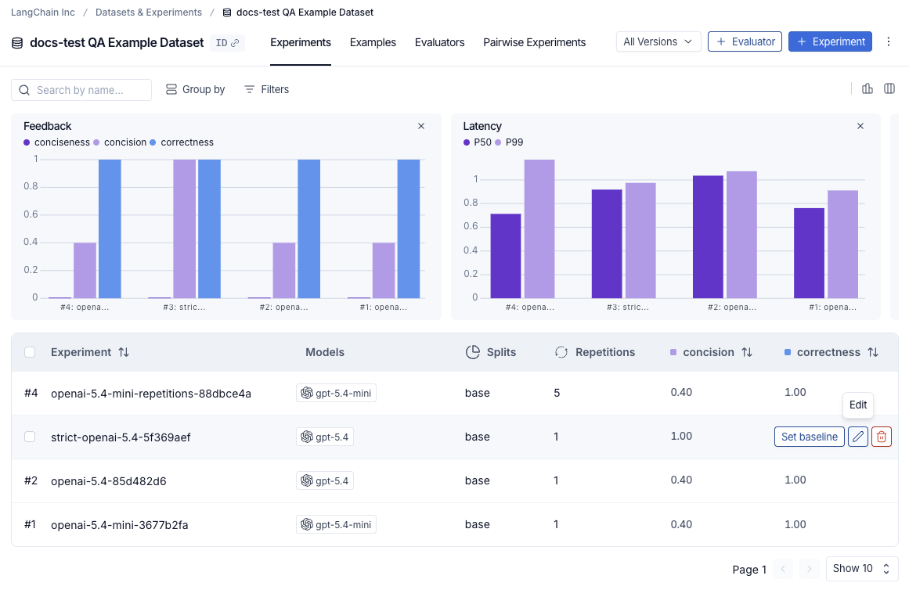
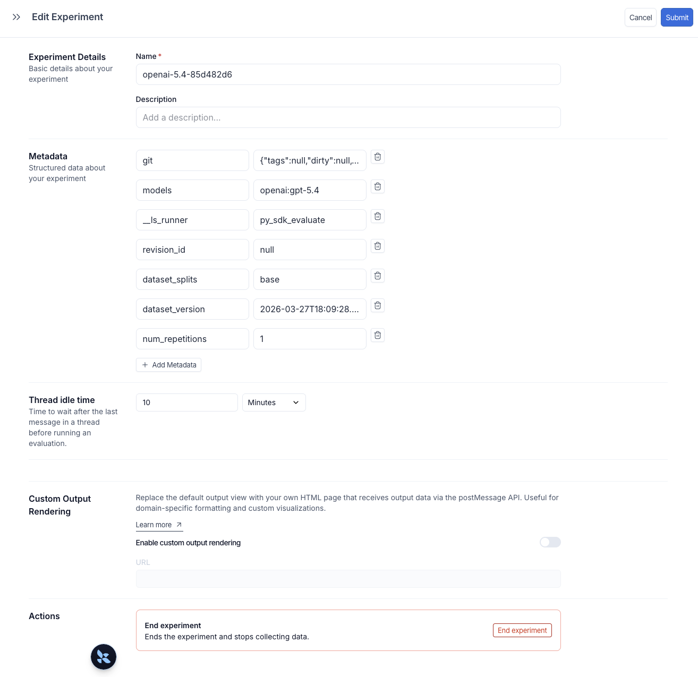
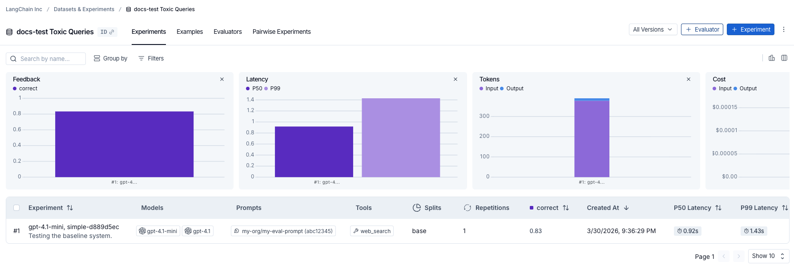
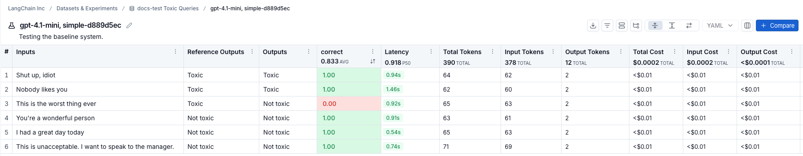
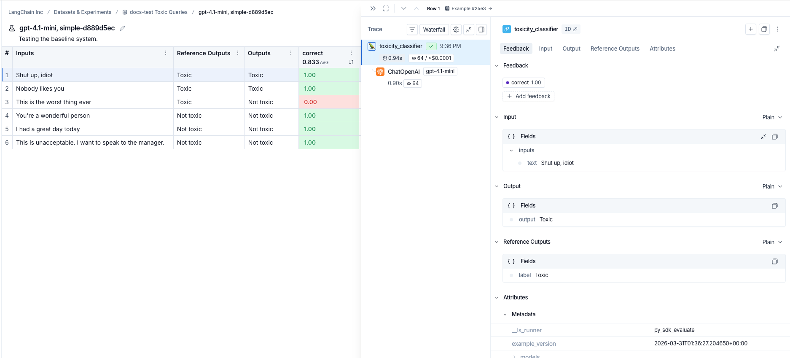

# How to evaluate agents

This guide shows you how to run an evaluation on an agent using the LangSmith SDK.

> [!NOTE]
>
> [Evaluations](../../Get%20started/Evaluation%20concepts.md#evaluation-lifecycle) | [Evaluators](../../Get%20started/Evaluation%20concepts.md#evaluators) | [Datasets](../../Get%20started/Evaluation%20concepts.md#datasets)

In this guide we'll go over how to evaluate an application using the [evaluate()](https://reference.langchain.com/python/langsmith/evaluation/_runner/evaluate) method in the LangSmith SDK.

> [!TIP]
>
> For larger evaluation jobs in Python we recommend using [aevaluate()](https://reference.langchain.com/python/langsmith/evaluation/_arunner/aevaluate), the asynchronous version of [evaluate()](https://reference.langchain.com/python/langsmith/evaluation/_runner/evaluate). It is still worthwhile to read this guide first, as the two have identical interfaces, before reading the how-to guide on [running an evaluation asynchronously](../Evaluation%20techniques/Experiment%20configuration/How%20to%20run%20an%20evaluation%20asynchronously.md).
>
> In JS/TS evaluate() is already asynchronous so no separate method is needed.
>
> It is also important to configure the `max_concurrency`/`maxConcurrency` arg when running large jobs. This parallelizes evaluation by effectively splitting the dataset across threads.

## Define an application

First we need an application to evaluate. Let's create a simple toxicity classifier for this example.

```python Python
from langsmith import traceable, wrappers
from openai import OpenAI

# Optionally wrap the OpenAI client to trace all model calls.
oai_client = wrappers.wrap_openai(OpenAI())

# Optionally add the 'traceable' decorator to trace the inputs/outputs of this function.
@traceable
def toxicity_classifier(inputs: dict) -> dict:
    instructions = (
      "Please review the user query below and determine if it contains any form of toxic behavior, "
      "such as insults, threats, or highly negative comments. Respond with 'Toxic' if it does "
      "and 'Not toxic' if it doesn't."
    )
    messages = [
        {"role": "system", "content": instructions},
        {"role": "user", "content": inputs["text"]},
    ]
    result = oai_client.chat.completions.create(
        messages=messages, model="gpt-5.4-mini", temperature=0
    )
    return {"class": result.choices[0].message.content}
```

```typescript TypeScript
import { OpenAI } from "openai";
import { wrapOpenAI } from "langsmith/wrappers";
import { traceable } from "langsmith/traceable";

// Optionally wrap the OpenAI client to trace all model calls.
const oaiClient = wrapOpenAI(new OpenAI());

// Optionally add the 'traceable' wrapper to trace the inputs/outputs of this function.
const toxicityClassifier = traceable(
  async (text: string) => {
    const result = await oaiClient.chat.completions.create({
      messages: [
        {
           role: "system",
          content: "Please review the user query below and determine if it contains any form of toxic behavior, such as insults, threats, or highly negative comments. Respond with 'Toxic' if it does, and 'Not toxic' if it doesn't.",
        },
        { role: "user", content: text },
      ],
      model: "gpt-5.4-mini",
      temperature: 0,
    });

    return result.choices[0].message.content;
  },
  { name: "toxicityClassifier" }
);
```

We've optionally enabled tracing to capture the inputs and outputs of each step in the pipeline. To understand how to annotate your code for tracing, please refer to [Custom instrumentation](../../../Monitor/Trace/Tracing%20setup/Manual%20instrumentation/Custom%20instrumentation.md).

## Create or select a dataset

We need a [Dataset](../../Get%20started/Evaluation%20concepts.md#datasets) to evaluate our application on. Our dataset will contain labeled [examples](../../Get%20started/Evaluation%20concepts.md#examples) of toxic and non-toxic text.

Requires `langsmith>=0.3.13`

```python Python
from langsmith import Client
ls_client = Client()

examples = [
  {
    "inputs": {"text": "Shut up, idiot"},
    "outputs": {"label": "Toxic"},
  },
  {
    "inputs": {"text": "You're a wonderful person"},
    "outputs": {"label": "Not toxic"},
  },
  {
    "inputs": {"text": "This is the worst thing ever"},
    "outputs": {"label": "Toxic"},
  },
  {
    "inputs": {"text": "I had a great day today"},
    "outputs": {"label": "Not toxic"},
  },
  {
    "inputs": {"text": "Nobody likes you"},
    "outputs": {"label": "Toxic"},
  },
  {
    "inputs": {"text": "This is unacceptable. I want to speak to the manager."},
    "outputs": {"label": "Not toxic"},
  },
]

dataset = ls_client.create_dataset(dataset_name="Toxic Queries")
ls_client.create_examples(
  dataset_id=dataset.id,
  examples=examples,
)
```

```typescript TypeScript
import { Client } from "langsmith";

const langsmith = new Client();

// create a dataset
const labeledTexts = [
  ["Shut up, idiot", "Toxic"],
  ["You're a wonderful person", "Not toxic"],
  ["This is the worst thing ever", "Toxic"],
  ["I had a great day today", "Not toxic"],
  ["Nobody likes you", "Toxic"],
  ["This is unacceptable. I want to speak to the manager.", "Not toxic"],
];

const [inputs, outputs] = labeledTexts.reduce<
  [Array<{ input: string }>, Array<{ outputs: string }>]
>(
  ([inputs, outputs], item) => [
    [...inputs, { input: item[0] }],
    [...outputs, { outputs: item[1] }],
  ],
  [[], []]
);

const datasetName = "Toxic Queries";
const toxicDataset = await langsmith.createDataset(datasetName);
await langsmith.createExamples({ inputs, outputs, datasetId: toxicDataset.id });
```

For more details on datasets, refer to the [Manage datasets](../Datasets/Manage%20datasets.md) page.

## Define an evaluator

There are two main ways to define an evaluator.

### Locally in code

> [!TIP]
>
> You can also check out LangChain's open source evaluation package [openevals](https://github.com/langchain-ai/openevals) for common prebuilt evaluators.

[Evaluators](../../Get%20started/Evaluation%20concepts.md#evaluators) are functions for scoring your application's outputs. They take in the example inputs, actual outputs, and, when present, the reference outputs. Since we have labels for this task, our evaluator can directly check if the actual outputs match the reference outputs.

* Python: Requires `langsmith>=0.3.13`
* TypeScript: Requires `langsmith>=0.2.9`

```python Python
def correct(inputs: dict, outputs: dict, reference_outputs: dict) -> bool:
    return outputs["class"] == reference_outputs["label"]
```

```typescript TypeScript
import type { EvaluationResult } from "langsmith/evaluation";

function correct({
  outputs,
  referenceOutputs,
}: {
  outputs: Record<string, any>;
  referenceOutputs?: Record<string, any>;
}): EvaluationResult {
  const score = outputs.output === referenceOutputs?.outputs;
  return { key: "correct", score };
}
```

### In LangSmith UI

You can also define an evaluator in the [LangSmith UI](https://smith.langchain.com?utm_source=docs&utm_medium=cta&utm_campaign=langsmith-signup&utm_content=langsmith-evaluate-llm-application). You can [create evaluators in the UI](../../Evaluators/Evaluator%20types/UI/How%20to%20define%20an%20LLM-as-a-judge%20evaluator.md) under the **Evaluators** tab. These evaluators will be [automatically triggered with every new experiment](../../Evaluators/Automatically%20run%20evaluators%20on%20experiments.md).

## Run the evaluation

We'll use the [evaluate()](https://reference.langchain.com/python/langsmith/evaluation/_runner/evaluate) / [aevaluate()](https://reference.langchain.com/python/langsmith/evaluation/_arunner/aevaluate) methods to run the evaluation.

The key arguments are:

* a target function that takes an input dictionary and returns an output dictionary. The `example.inputs` field of each [Example](../Common%20data%20types/Example%20data%20format.md) is what gets passed to the target function. In this case our `toxicity_classifier` is already set up to take in example inputs so we can use it directly.
* `data` - the name OR UUID of the LangSmith dataset to evaluate on, or an iterator of examples.
* `evaluators` - a list of evaluators to score the outputs of the function; dataset evaluators in the [Langsmith UI](https://smith.langchain.com?utm_source=docs&utm_medium=cta&utm_campaign=langsmith-signup&utm_content=langsmith-evaluate-llm-application) will also automatically get triggered.
* `metadata` - an optional object to attach to the experiment. Pass `models`, `prompts`, and `tools` keys to populate the corresponding columns in the experiment table view.

Python: Requires `langsmith>=0.3.13`

```python Python
# optional metadata, used to populate model/prompt/tool columns in UI
EXPERIMENT_METADATA = {
    "models": [
        "openai:gpt-5.4-mini",
        {
            "id": ["langchain", "chat_models", "openai", "ChatOpenAI"],
            "lc": 1,
            "type": "constructor",
            "kwargs": {"model_name": "gpt-6.1-sol", "temperature": 0.2},
        },
    ],
    "prompts": ["my-org/my-eval-prompt:abc12345"],
    "tools": [
        {
            "name": "web_search",
            "description": "Search the web for information",
            "parameters": {
                "type": "object",
                "properties": {"query": {"type": "string"}},
                "required": ["query"],
            },
        },
    ],
}

# Can equivalently use the 'evaluate' function directly:
# from langsmith import evaluate; evaluate(...)
results = ls_client.evaluate(
    toxicity_classifier,
    data=dataset.name,
    evaluators=[correct],
    experiment_prefix="gpt-5.4-mini, baseline",  # optional, experiment name prefix
    description="Testing the baseline system.",  # optional, experiment description
    max_concurrency=4,  # optional, add concurrency
    metadata=EXPERIMENT_METADATA,  # optional, used to populate model/prompt/tool columns in UI
)
```

```typescript TypeScript
import { evaluate } from "langsmith/evaluation";

// optional metadata, used to populate model/prompt/tool columns in UI
const EXPERIMENT_METADATA = {
  models: [
    "openai:gpt-5.4-mini",
    {
      id: ["langchain", "chat_models", "openai", "ChatOpenAI"],
      lc: 1,
      type: "constructor",
      kwargs: { model_name: "gpt-6.1-sol", temperature: 0.2 },
    },
  ],
  prompts: ["my-org/my-eval-prompt:abc12345"],
  tools: [
    {
      name: "web_search",
      description: "Search the web for information",
      parameters: {
        type: "object",
        properties: { query: { type: "string" } },
        required: ["query"],
      },
    },
  ],
};

await evaluate((inputs) => toxicityClassifier(inputs["input"]), {
  data: datasetName,
  evaluators: [correct],
  experimentPrefix: "gpt-5.4-mini, baseline",  // optional, experiment name prefix
  maxConcurrency: 4, // optional, add concurrency
  metadata: EXPERIMENT_METADATA,  // optional, used to populate model/prompt/tool columns in UI
});
```

## Add metadata to an experiment

Metadata is a set of key-value pairs you can attach to an experiment to group and filter experiments in the experiments table. You can pass metadata when running an experiment via the `metadata` argument (see [Run the evaluation](#run-the-evaluation)), or add it afterwards directly in the LangSmith UI.

To open the **Edit Experiment** panel, hover over an experiment row in the experiments table and click the **Edit** pencil icon that appears at the right of the row.



The **Edit Experiment** panel lets you update the experiment name and description, and manage metadata key-value pairs. Click **+ Add Metadata** to add a new key-value pair, then click **Submit** in the top right to save your changes.



Once experiments are tagged with metadata, use the **Group by** control at the top of the experiments table to cluster experiments by any metadata field. The summary charts above the table update per group, showing average feedback scores, latency, and token usage for each configuration. This makes it easy to compare how different prompt versions, models, or other changes perform across the same dataset.

The reserved `models`, `prompts`, and `tools` keys automatically populate dedicated columns in the experiments table. Click a value in one of those columns to filter or group by it. For full details, see [Filter and group by models, prompts, and tools](../Analyze%20experiment%20results/Analyze%20an%20experiment.md#filter-and-group-by-models-prompts-and-tools-in-the-experiments-tab-view).

## Explore the results

Each invocation of `evaluate()` creates an [experiment](../../Get%20started/Evaluation%20concepts.md#experiment) that you can view in the LangSmith UI or query via the SDK. See [Analyze an experiment](../Analyze%20experiment%20results/Analyze%20an%20experiment.md) for more details.

Experiments run against a dataset are listed in the experiments table.



For experiments run from the Playground or through the SDK, the **Progress** column tracks completion in real time. Progress reflects both run and evaluation status. Hover over the progress bar to view the number of runs completed and runs evaluated.

> [!NOTE]
>
> Progress tracking for experiments run through the SDK requires:
>
> * Python: `langsmith>=0.8.16`
> * TypeScript: `langsmith>=0.7.8`

Click an experiment row to see scores for each example. Filter and sort by score to identify patterns in where your application performs well or poorly.



Click an example to open its details panel, which includes inputs, outputs, reference outputs, and any associated traces (if you've annotated your code for tracing).



## Reference code

> [accordion] Click to see a consolidated code snippet
>
> ```python Python theme={"theme":{"light":"catppuccin-latte","dark":"catppuccin-mocha"}}
> from langsmith import Client, traceable, wrappers
> from openai import OpenAI
>
> # Step 1. Define an application
> oai_client = wrappers.wrap_openai(OpenAI())
>
> @traceable
> def toxicity_classifier(inputs: dict) -> str:
>     system = (
>       "Please review the user query below and determine if it contains any form of toxic behavior, "
>       "such as insults, threats, or highly negative comments. Respond with 'Toxic' if it does "
>       "and 'Not toxic' if it doesn't."
>     )
>     messages = [
>         {"role": "system", "content": system},
>         {"role": "user", "content": inputs["text"]},
>     ]
>     result = oai_client.chat.completions.create(
>         messages=messages, model="gpt-5.4-mini", temperature=0
>     )
>     return result.choices[0].message.content
>
> # Step 2. Create a dataset
> ls_client = Client()
> dataset = ls_client.create_dataset(dataset_name="Toxic Queries")
> examples = [
>   {
>     "inputs": {"text": "Shut up, idiot"},
>     "outputs": {"label": "Toxic"},
>   },
>   {
>     "inputs": {"text": "You're a wonderful person"},
>     "outputs": {"label": "Not toxic"},
>   },
>   {
>     "inputs": {"text": "This is the worst thing ever"},
>     "outputs": {"label": "Toxic"},
>   },
>   {
>     "inputs": {"text": "I had a great day today"},
>     "outputs": {"label": "Not toxic"},
>   },
>   {
>     "inputs": {"text": "Nobody likes you"},
>     "outputs": {"label": "Toxic"},
>   },
>   {
>     "inputs": {"text": "This is unacceptable. I want to speak to the manager."},
>     "outputs": {"label": "Not toxic"},
>   },
> ]
> ls_client.create_examples(
>   dataset_id=dataset.id,
>   examples=examples,
> )
>
> # Step 3. Define an evaluator
> def correct(inputs: dict, outputs: dict, reference_outputs: dict) -> bool:
>     return outputs["output"] == reference_outputs["label"]
>
> # Step 4. Run the evaluation
>
> # optional metadata, used to populate model/prompt/tool columns in UI
> EXPERIMENT_METADATA = {
>     "models": [
>         "openai:gpt-5.4-mini",
>         {
>             "id": ["langchain", "chat_models", "openai", "ChatOpenAI"],
>             "lc": 1,
>             "type": "constructor",
>             "kwargs": {"model_name": "gpt-6.1-sol", "temperature": 0.2},
>         },
>     ],
>     "prompts": ["my-org/my-eval-prompt:abc12345"],
>     "tools": [
>         {
>             "name": "web_search",
>             "description": "Search the web for information",
>             "parameters": {
>                 "type": "object",
>                 "properties": {"query": {"type": "string"}},
>                 "required": ["query"],
>             },
>         },
>     ],
> }
>
> # Client.evaluate() and evaluate() behave the same.
> results = ls_client.evaluate(
>     toxicity_classifier,
>     data=dataset.name,
>     evaluators=[correct],
>     experiment_prefix="gpt-5.4-mini, simple",  # optional, experiment name prefix
>     description="Testing the baseline system.",  # optional, experiment description
>     max_concurrency=4,  # optional, add concurrency
>     metadata=EXPERIMENT_METADATA,  # optional, used to populate model/prompt/tool columns in UI
> )
> ```
>
> ```typescript TypeScript theme={"theme":{"light":"catppuccin-latte","dark":"catppuccin-mocha"}}
> import { OpenAI } from "openai";
> import { Client } from "langsmith";
> import { evaluate, EvaluationResult } from "langsmith/evaluation";
> import type { Run, Example } from "langsmith/schemas";
> import { traceable } from "langsmith/traceable";
> import { wrapOpenAI } from "langsmith/wrappers";
>
> const oaiClient = wrapOpenAI(new OpenAI());
>
> const toxicityClassifier = traceable(
>   async (text: string) => {
>     const result = await oaiClient.chat.completions.create({
>       messages: [
>         {
>           role: "system",
>           content: "Please review the user query below and determine if it contains any form of toxic behavior, such as insults, threats, or highly negative comments. Respond with 'Toxic' if it does, and 'Not toxic' if it doesn't.",
>         },
>         { role: "user", content: text },
>       ],
>       model: "gpt-5.4-mini",
>       temperature: 0,
>     });
>     return result.choices[0].message.content;
>   },
>   { name: "toxicityClassifier" }
> );
>
> const langsmith = new Client();
>
> // create a dataset
> const labeledTexts = [
>   ["Shut up, idiot", "Toxic"],
>   ["You're a wonderful person", "Not toxic"],
>   ["This is the worst thing ever", "Toxic"],
>   ["I had a great day today", "Not toxic"],
>   ["Nobody likes you", "Toxic"],
>   ["This is unacceptable. I want to speak to the manager.", "Not toxic"],
> ];
>
> const [inputs, outputs] = labeledTexts.reduce<
>   [Array<{ input: string }>, Array<{ outputs: string }>]
> >(
>   ([inputs, outputs], item) => [
>     [...inputs, { input: item[0] }],
>     [...outputs, { outputs: item[1] }],
>   ],
>   [[], []]
> );
>
> const datasetName = "Toxic Queries";
> const toxicDataset = await langsmith.createDataset(datasetName);
> await langsmith.createExamples({ inputs, outputs, datasetId: toxicDataset.id });
>
> // Row-level evaluator
> function correct({
>   outputs,
>   referenceOutputs,
> }: {
>   outputs: Record<string, any>;
>   referenceOutputs?: Record<string, any>;
> }): EvaluationResult {
>   const score = outputs.output === referenceOutputs?.outputs;
>   return { key: "correct", score };
> }
>
> // optional metadata, used to populate model/prompt/tool columns in UI
> const EXPERIMENT_METADATA = {
>   models: [
>     "openai:gpt-5.4-mini",
>     {
>       id: ["langchain", "chat_models", "openai", "ChatOpenAI"],
>       lc: 1,
>       type: "constructor",
>       kwargs: { model_name: "gpt-6.1-sol", temperature: 0.2 },
>     },
>   ],
>   prompts: ["my-org/my-eval-prompt:abc12345"],
>   tools: [
>     {
>       name: "web_search",
>       description: "Search the web for information",
>       parameters: {
>         type: "object",
>         properties: { query: { type: "string" } },
>         required: ["query"],
>       },
>     },
>   ],
> };
>
> await evaluate((inputs) => toxicityClassifier(inputs["input"]), {
>   data: datasetName,
>   evaluators: [correct],
>   experimentPrefix: "gpt-5.4-mini, simple",  // optional, experiment name prefix
>   maxConcurrency: 4, // optional, add concurrency
>   metadata: EXPERIMENT_METADATA,  // optional, used to populate model/prompt/tool columns in UI
> });
> ```

## Related

* [Run an evaluation asynchronously](../Evaluation%20techniques/Experiment%20configuration/How%20to%20run%20an%20evaluation%20asynchronously.md)
* [Run an evaluation via the REST API](How%20to%20use%20the%20REST%20API.md)
* [Run an evaluation from the Playground](Run%20an%20evaluation%20from%20the%20Playground.md)
