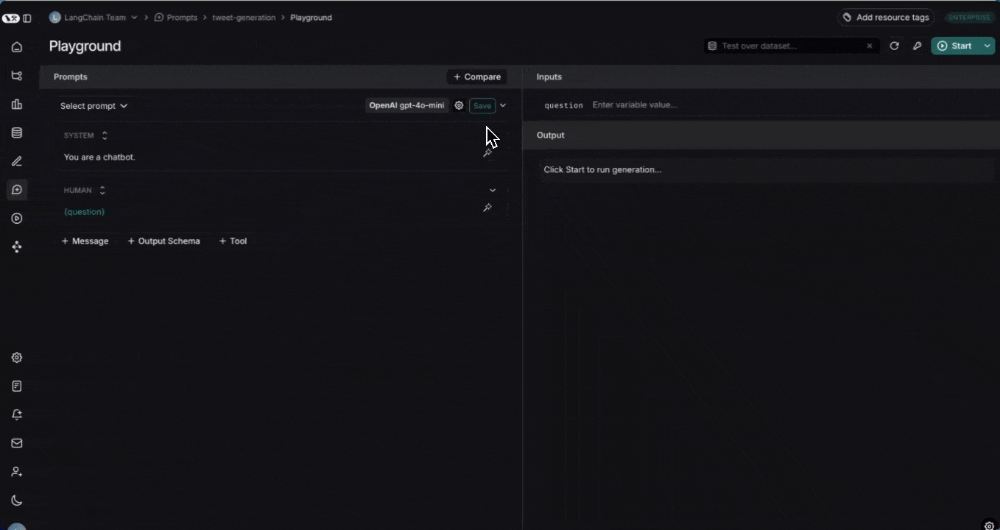

# Run an evaluation from the Playground

LangSmith allows you to run evaluations directly in the UI. The [**Playground**](../../../Deploy/Prompt%20%26%20Context%20Hub/Prompts/Prompt%20engineering%20concepts.md#playground) allows you to test your prompt or model configuration over a series of inputs to see how well it scores across different contexts or scenarios, without having to write any code.

Before you run an evaluation, you need to have an [existing dataset](../../Get%20started/Evaluation%20concepts.md#datasets). Learn how to [create a dataset from the UI](../Datasets/Create%20a%20dataset/Create%20and%20manage%20datasets%20in%20the%20UI.md#create-a-dataset-and-add-examples).

To run evaluations from Studio instead, see [run experiments over a dataset in Studio](../../Test%20from%20Studio/Observability%20in%20Studio.md#run-experiments-over-a-dataset). If you prefer to run experiments in code, see [run an evaluation using the SDK](How%20to%20evaluate%20agents.md).

The **[Chat](../Analyze%20experiment%20results/LangSmith%20Chat.md)** is available in the Playground to help you optimize prompts before running evaluations.

## Create an experiment in the Playground

1. **Click Playground** in the sidebar.

2. **Add a prompt** by selecting an existing saved a prompt or creating a new one.

3. **Select a dataset** from the **Test over dataset** dropdown

   * Note that the keys in the dataset input must match the input variables of the prompt. For example, in the above video the selected dataset has inputs with the key "blog", which correctly match the input variable of the prompt.
   * There is a maximum of 15 input variables allowed in the Playground.

4. **Start the experiment** by clicking on the **Start** or CMD+Enter. This will run the prompt over all the examples in the dataset and create an entry for the experiment in the dataset details page. We recommend committing the prompt to the prompt hub before starting the experiment so that it can be easily referenced later when reviewing your experiment.

5. **View the full results** by clicking **View full experiment**. This will take you to the experiment details page where you can see the results of the experiment.

While an experiment runs, the **Progress** column in the experiments table and the progress bar in the experiment view track completion in real time, including how many runs have completed and been evaluated. For more information, see [Track experiment progress](../Analyze%20experiment%20results/Analyze%20an%20experiment.md#track-experiment-progress).

## Add evaluation scores to the experiment

Evaluate your experiment over specific criteria by adding evaluators. Add LLM-as-a-judge or custom code evaluators in the Playground using the **+Evaluator** button.

To learn more about adding evaluators in via UI, visit [how to define an LLM-as-a-judge evaluator](../../Evaluators/Evaluator%20types/UI/How%20to%20define%20an%20LLM-as-a-judge%20evaluator.md).
