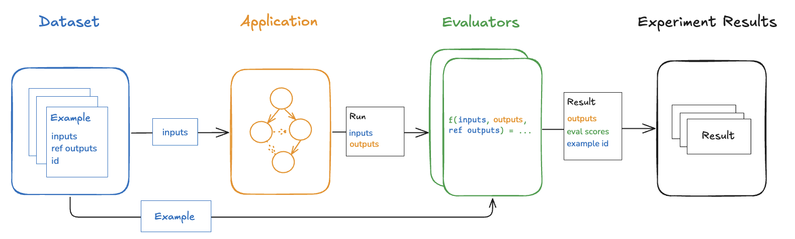
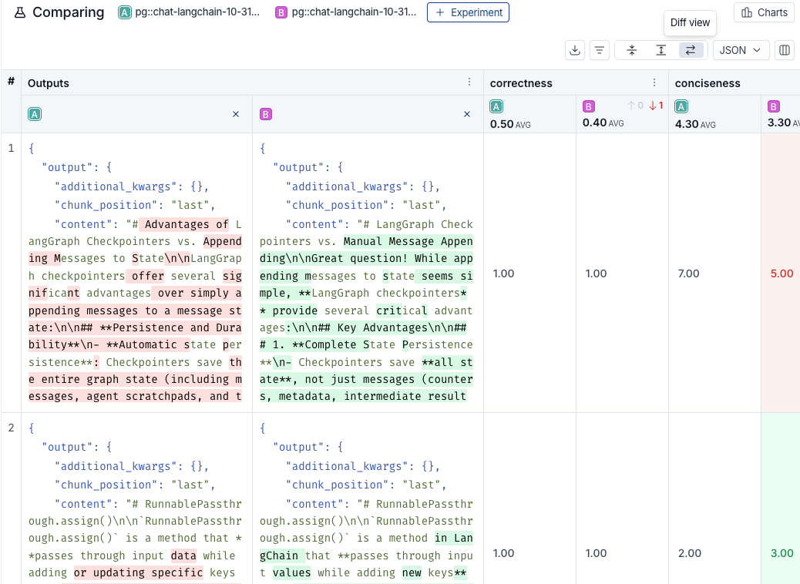
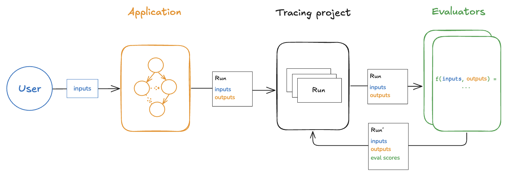

# Evaluation types

This page covers two aspects of evaluation in LangSmith:

1. **[Evaluation types](#offline-evaluation-types)**: *When and why* to evaluate. Offline evaluation types (benchmarking, unit tests, regression tests) for pre-deployment testing, and online evaluation types (monitoring, anomaly detection) for production.
2. **[Evaluator implementations](#implement-evaluators)**: *How* to evaluate. The available evaluator approaches (LLM-as-judge, decision model, code, composite, summary, pairwise) and where to configure them (UI or SDK, offline or online).

Understanding both aspects helps you build a comprehensive evaluation strategy that validates functionality before deployment and monitors quality in production.

## Offline evaluation types

Offline evaluation tests applications on curated datasets before deployment. By running evaluations on examples with reference outputs, teams can compare versions, validate functionality, and build confidence before exposing changes to users.

Run offline evaluations client-side using the LangSmith SDK ([Python](https://reference.langchain.com/python/langsmith/observability/sdk/) or [TypeScript](../../Monitor/Reference/langsmith%20%28smith-js-ts-sdk%29.md)) or server-side via the [Playground](../../Deploy/Prompt%20%26%20Context%20Hub/Prompts/Prompt%20engineering%20concepts.md#playground) or by [binding evaluators to a dataset](Automatically%20run%20evaluators%20on%20experiments.md).

### Benchmarking

*Benchmarking* compares multiple application versions on a curated dataset to identify the best performer. This process involves creating a dataset of representative inputs, defining performance metrics, and testing each version.

Benchmarking requires dataset curation with gold-standard reference outputs and well-designed comparison metrics. Examples:

* **RAG Q\&A bot**: Dataset of questions and reference answers, with an LLM-as-judge evaluator checking semantic equivalence between actual and reference answers.
* **ReAct agent**: Dataset of user requests and reference tool calls, with a heuristic evaluator verifying all expected tool calls were made.

### Unit tests

*Unit tests* verify the correctness of individual system components. In LLM contexts, [unit tests are often rule-based assertions](https://hamel.dev/blog/posts/evals/#level-1-unit-tests) on inputs or outputs (e.g., verifying LLM-generated code compiles, JSON loads successfully) that validate basic functionality.

Unit tests typically expect consistent passing results, making them suitable for CI pipelines. When running in CI, configure caching to minimize LLM API calls and associated costs.

For more details, refer to the [Pytest](Frameworks%20%26%20integrations/How%20to%20run%20evaluations%20with%20pytest.md) and [Vitest/Jest](Frameworks%20%26%20integrations/How%20to%20run%20evaluations%20with%20Vitest-Jest.md) pages.

### Regression tests

*Regression tests* measure performance consistency across application versions over time. They ensure new versions do not degrade performance on cases the current version handles correctly, and ideally demonstrate improvements over the baseline. These tests typically run when making updates expected to affect user experience (e.g., model or architecture changes).

LangSmith's comparison view highlights regressions (red) and improvements (green) relative to the baseline, enabling quick identification of changes.

### Backtesting

*Backtesting* evaluates new application versions against historical production data. Production logs are converted into a dataset, then newer versions process these examples to assess performance on past, realistic user inputs.

This approach is commonly used for evaluating new model releases. For example, when a new model becomes available, test it on the most recent production runs and compare results to actual production outcomes.

### Pairwise evaluation

*Pairwise evaluation* compares outputs from two versions by determining relative quality rather than assigning absolute scores. For some tasks, [determining "version A is better than B"](https://www.oreilly.com/radar/what-we-learned-from-a-year-of-building-with-llms-part-i/) is easier than scoring each version independently.

This approach proves particularly useful for LLM-as-judge evaluations on subjective tasks. For example, in summarization, determining "Which summary is clearer and more concise?" is often simpler than assigning numeric clarity scores.

Learn [how run pairwise evaluations](Evaluator%20types/SDK/How%20to%20run%20a%20pairwise%20evaluation.md).

## Online evaluation types

Online evaluation assesses production application outputs in near real-time. Without reference outputs, these evaluations focus on detecting issues, monitoring quality trends, and identifying edge cases that inform future offline testing.

Online evaluators typically run server-side. LangSmith supports custom [LLM-as-judge evaluators](Evaluator%20types/UI/How%20to%20define%20an%20LLM-as-a-judge%20evaluator.md) and code evaluators. [LangChain Tuned Evaluators](../../Monitor/Observe/Online%20evaluators/Set%20up%20LangChain%20Tuned%20Evaluators.md) provide specialized judges managed by LangChain.

### Real-time monitoring

Monitor application quality continuously as users interact with the system. Online evaluations run automatically on production traffic, providing immediate feedback on each interaction. This enables detection of quality degradation, unusual patterns, or unexpected behaviors before they impact significant user populations.

### Anomaly detection

Identify outliers and edge cases that deviate from expected patterns. Online evaluators can flag runs with unusual characteristics—extremely long or short responses, unexpected error rates, or outputs that fail safety checks—for human review and potential addition to offline datasets.

### Production feedback loop

Use insights from production to improve offline evaluation. Online evaluations surface real-world issues and usage patterns that may not appear in curated datasets. Failed production runs become candidates for dataset examples, creating an iterative cycle where production experience continuously refines testing coverage.

## Implement evaluators

The evaluation types above describe *when* to evaluate. LangSmith provides several approaches for *how* to implement evaluators that work across these evaluation types.

### LLM-as-a-judge

Use an LLM to score outputs based on criteria defined in a prompt. This approach works well for subjective qualities like tone, clarity, or semantic correctness that are difficult to capture with deterministic rules.

Common use cases include assessing factual accuracy against reference outputs (offline) or checking for toxicity in production responses (online). For example, benchmarking a RAG system might use an LLM-as-judge evaluator to check semantic equivalence between generated and reference answers.

Configure LLM-as-a-judge evaluators for:

* Programmatic offline evaluation: [With the SDK](Evaluator%20types/SDK/How%20to%20define%20an%20LLM-as-a-judge%20evaluator.md)
* Offline evaluation on datasets: [In the UI](Evaluator%20types/UI/How%20to%20define%20an%20LLM-as-a-judge%20evaluator.md)
* Online evaluation on production traces: [In the UI](../../Monitor/Observe/Online%20evaluators/Set%20up%20LLM-as-a-judge%20online%20evaluators.md)

### Decision model evaluators

Use a decision model to answer typed questions about outputs. Each question returns a probability, a selected option, or a score, and becomes its own feedback key, so you do not write a prompt or an output schema.

Configure decision model evaluators for:

* Offline evaluation on datasets: [In the UI](Evaluator%20types/UI/How%20to%20define%20a%20decision%20model%20evaluator.md)
* Online evaluation on production traces: [In the UI](../../Monitor/Observe/Online%20evaluators/Set%20up%20decision%20model%20online%20evaluators.md)

The SDK does not support decision model evaluators yet.

### Code evaluators

Write deterministic, rule-based functions that check specific conditions. These evaluators execute custom logic to validate structure, check for patterns, or apply business rules.

Code evaluators are particularly useful for unit tests—verifying generated code compiles, JSON parses correctly, or required fields are present. In regression testing, they can track consistency of structured outputs. For online monitoring, they catch format violations in real-time.

Define code evaluators for:

* Offline evaluation on datasets: [In the UI](Evaluator%20types/UI/How%20to%20define%20a%20code%20evaluator.md)
* Programmatic offline evaluation: [With the SDK](Evaluator%20types/SDK/How%20to%20define%20a%20code%20evaluator.md)
* Online evaluation on production traces: [In the UI](../../Monitor/Observe/Online%20evaluators/Set%20up%20online%20code%20evaluators.md)

### Composite evaluators

Combine multiple evaluator scores into a single metric using weighted averages or sums. This creates aggregate quality scores that reflect multiple evaluation criteria simultaneously.

For benchmarking, composite scores help compare versions on multiple dimensions (e.g., 70% accuracy + 20% clarity + 10% conciseness). In online monitoring, they provide single metrics for dashboards and alerts. For example, track overall chatbot quality as a weighted combination of helpfulness, correctness, and tone scores.

Set up composite evaluators for:

* Offline evaluation with predefined aggregation: [In the UI](Evaluator%20types/UI/How%20to%20create%20a%20composite%20evaluator.md)
* Offline evaluation with custom aggregation logic: [With the SDK](Evaluator%20types/SDK/How%20to%20create%20a%20composite%20evaluator.md)
* Online evaluation on production traces: [In the UI](../../Monitor/Observe/Online%20evaluators/Set%20up%20composite%20online%20evaluators.md)

### Summary evaluators

Compute metrics across an entire experiment rather than individual examples. These evaluators receive all outputs from a dataset and calculate aggregate statistics like precision, recall, F1 scores, or distribution analysis.

Summary evaluators are essential for benchmarking when you need dataset-level metrics—comparing overall performance across versions rather than example-by-example scores. They work exclusively with offline evaluation because they require processing complete datasets.

Implement summary evaluators for:

* Custom aggregation functions for offline evaluation: [With the SDK](Evaluator%20types/SDK/How%20to%20define%20a%20summary%20evaluator.md)

### Pairwise evaluators

Compare outputs from two versions to determine relative quality. This approach, covered earlier under [pairwise evaluation](#pairwise-evaluation), helps when absolute scoring is difficult but determining "which is better" is straightforward.

Run pairwise evaluations for:

* Compare existing experiments: [With the SDK](Evaluator%20types/SDK/How%20to%20run%20a%20pairwise%20evaluation.md)
