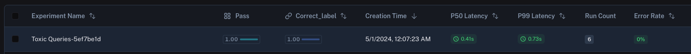

# How to define a summary evaluator

Some metrics can only be defined on the entire experiment level as opposed to the individual runs of the experiment. For example, you may want to compute the overall pass rate or f1 score of your evaluation target across all examples in the dataset. These are called summary evaluators.

## Basic example

Here, we'll compute the f1-score, which is a combination of precision and recall.

This sort of metric can only be computed over all of the examples in our experiment, so our evaluator takes in a list of outputs, and a list of reference\_outputs.

```python Python
def f1_score_summary_evaluator(outputs: list[dict], reference_outputs: list[dict]) -> dict:
    true_positives = 0
    false_positives = 0
    false_negatives = 0

    for output_dict, reference_output_dict in zip(outputs, reference_outputs):
        output = output_dict["class"]
        reference_output = reference_output_dict["class"]

        if output == "Toxic" and reference_output == "Toxic":
            true_positives += 1
        elif output == "Toxic" and reference_output == "Not toxic":
            false_positives += 1
        elif output == "Not toxic" and reference_output == "Toxic":
            false_negatives += 1

    if true_positives == 0:
        return {"key": "f1_score", "score": 0.0}

    precision = true_positives / (true_positives + false_positives)
    recall = true_positives / (true_positives + false_negatives)
    f1_score = 2 * (precision * recall) / (precision + recall)

    return {"key": "f1_score", "score": f1_score}
```

```typescript TypeScript
function f1ScoreSummaryEvaluator({ outputs, referenceOutputs }: {
    outputs: Record<string, any>[],
    referenceOutputs: Record<string, any>[]
}) {
    let truePositives = 0;
    let falsePositives = 0;
    let falseNegatives = 0;

    for (let i = 0; i < outputs.length; i++) {
        const output = outputs[i]["class"];
        const referenceOutput = referenceOutputs[i]["class"];

        if (output === "Toxic" && referenceOutput === "Toxic") {
            truePositives += 1;
        } else if (output === "Toxic" && referenceOutput === "Not toxic") {
            falsePositives += 1;
        } else if (output === "Not toxic" && referenceOutput === "Toxic") {
            falseNegatives += 1;
        }
    }

    if (truePositives === 0) {
        return { key: "f1_score", score: 0.0 };
    }

    const precision = truePositives / (truePositives + falsePositives);
    const recall = truePositives / (truePositives + falseNegatives);
    const f1Score = 2 * (precision * recall) / (precision + recall);

    return { key: "f1_score", score: f1Score };
}
```

You can then pass this evaluator to the `evaluate` method as follows:

```python Python
from langsmith import Client

ls_client = Client()
dataset = ls_client.clone_public_dataset(
    "https://smith.langchain.com/public/3d6831e6-1680-4c88-94df-618c8e01fc55/d"
)

def bad_classifier(inputs: dict) -> dict:
    return {"class": "Not toxic"}

def correct(outputs: dict, reference_outputs: dict) -> bool:
    """Row-level correctness evaluator."""
    return outputs["class"] == reference_outputs["label"]

results = ls_client.evaluate(
    bad_classifier,
    data=dataset,
    evaluators=[correct],
    summary_evaluators=[pass_50],
)
```

```typescript TypeScript
import { Client } from "langsmith";
import { evaluate } from "langsmith/evaluation";
import type { EvaluationResult } from "langsmith/evaluation";

const client = new Client();
const datasetName = "Toxic queries";
const dataset = await client.clonePublicDataset(
    "https://smith.langchain.com/public/3d6831e6-1680-4c88-94df-618c8e01fc55/d",
    { datasetName: datasetName }
);

function correct({ outputs, referenceOutputs }: {
    outputs: Record<string, any>,
    referenceOutputs?: Record<string, any>
}): EvaluationResult {
    const score = outputs["class"] === referenceOutputs?.["label"];
    return { key: "correct", score };
}

function badClassifier(inputs: Record<string, any>): { class: string } {
    return { class: "Not toxic" };
}

await evaluate(badClassifier, {
    data: datasetName,
    evaluators: [correct],
    summaryEvaluators: [summaryEval],
    experimentPrefix: "Toxic Queries",
});
```

In the LangSmith UI, you'll the summary evaluator's score displayed with the corresponding key.



## Summary evaluator args

Summary evaluator functions must have specific argument names. They can take any subset of the following arguments:

* `inputs: list[dict]`: A list of the inputs corresponding to a single example in a dataset.
* `outputs: list[dict]`: A list of the dict outputs produced by each experiment on the given inputs.
* `reference_outputs/referenceOutputs: list[dict]`: A list of the reference outputs associated with the example, if available.
* `runs: list[Run]`: A list of the full [Run](../../../../Monitor/Debug/Data%20type%20reference/Run%20%28span%29%20data%20format.md) objects generated by the two experiments on the given example. Use this if you need access to intermediate steps or metadata about each run.
* `examples: list[Example]`: All of the dataset [Example](../../../Datasets%20%26%20Experiments/Common%20data%20types/Example%20data%20format.md) objects, including the example inputs, outputs (if available), and metadata (if available).

## Summary evaluator output

Summary evaluators are expected to return one of the following types:

Python and JS/TS

* `dict`: dicts of the form `{"key": ..., "score": ...}` allow you to pass a metric name and a numeric or boolean score.
* `list[dict]`: a list of these dicts, to log multiple metrics from one summary evaluator.

Currently Python only

* `int | float | bool`: this is interpreted as a continuous metric that can be averaged, sorted, etc. The function name is used as the name of the metric.
