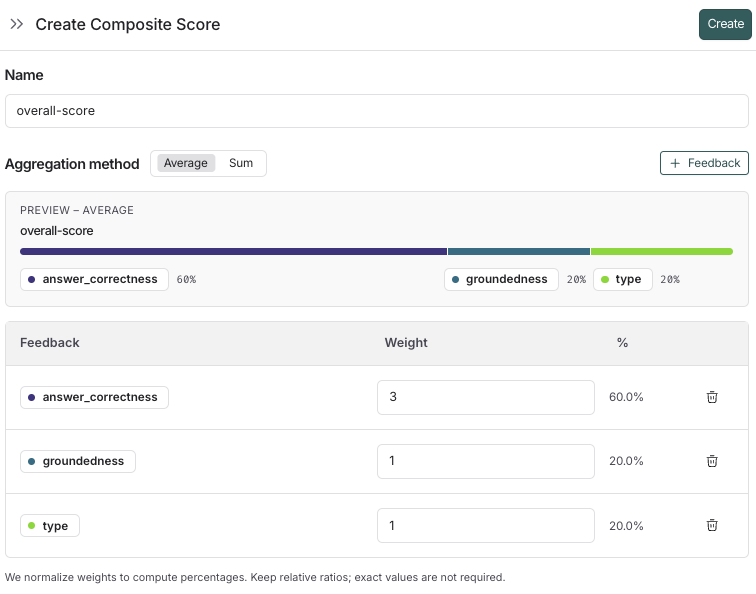

# How to create a composite evaluator

*Composite evaluators* are a way to combine multiple evaluator scores into a single [score](../../../Get%20started/Evaluation%20concepts.md#evaluator-outputs). This is useful when you want to evaluate multiple aspects of your application and combine the results into a single result.

This guide shows you how to define a [composite evaluator](../../../Get%20started/Evaluation%20concepts.md#llm-as-judge) using the [LangSmith UI](https://smith.langchain.com?utm_source=docs&utm_medium=cta&utm_campaign=langsmith-signup&utm_content=langsmith-composite-evaluators-ui).

> [!NOTE]
>
> To create composite evaluators programmatically using the SDK, refer to [How to create a composite evaluator (SDK)](../SDK/How%20to%20create%20a%20composite%20evaluator.md).

## Create a composite evaluator

You can create composite evaluators on a [tracing project](../../../../Monitor/Trace/Observability%20concepts.md#tracing-projects) (for [online evaluations](../../../Get%20started/Evaluation%20concepts.md#online-evaluations)) or a [dataset](../../../Get%20started/Evaluation%20concepts.md#datasets) (for [offline evaluations](../../../Get%20started/Evaluation%20concepts.md#offline-evaluations)). With composite evaluators in the UI, you can compute a weighted average or weighted sum of multiple evaluator scores, with configurable weights.

### 1. Navigate to the tracing project or dataset

To start configuring a composite evaluator, navigate to the **Tracing** or **Dataset & Experiments** tab and select a tracing project, an agent environment, or a dataset.

* From within a tracing project or agent environment: **+ New** > **Evaluator** > **Composite score**
* From within a dataset: **+ Evaluator** > **Composite score**

### 2. Configure the composite evaluator

1. Name your evaluator.
2. Select an aggregation method, either **Average** or **Sum**.
   * **Average**: ∑(weight\*score) / ∑(weight).
   * **Sum**: ∑(weight\*score).
3. Add the feedback keys you want to include in the composite score.
4. Add the weights for the feedback keys. By default, the weights are equal for each feedback key. Adjust the weights to increase or decrease the importance of specific feedback keys in the final score.
5. Click **Create** to save the evaluator.

> [!TIP]
>
> If you need to adjust the weights for the composite scores, they can be updated after the evaluator is created. The resulting scores will be updated for all runs that have the evaluator configured.

### 3. View composite evaluator results

Composite scores are attached to a run as **feedback**, similarly to feedback from a single evaluator. How you can view them depends on where the evaluation was run:

**On a tracing project or agent environment**:

* Composite scores appear as feedback on runs.
* [Filter for runs](../../../../Monitor/Debug/Viewing%20%26%20managing%20traces/Filter%20traces.md) with a composite score, or where the composite score meets a certain threshold.
* [Create a chart](../../../../Monitor/Observe/Monitoring%20%26%20alerting/Monitor%20projects%20with%20dashboards.md#custom-dashboards) to visualize trends in the composite score over time.

**On a dataset**:

* View the composite scores in the experiments tab. You can also filter and sort experiments based on the average composite score of their runs.
* Click into an experiment to view the composite score for each run.

> [!NOTE]
>
> If any of the constituent evaluators are not configured on the run, the composite score will not be calculated for that run.
