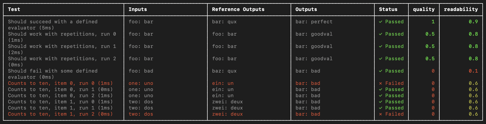
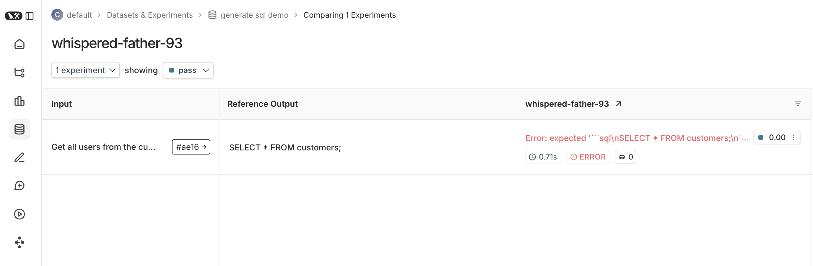

# How to run evaluations with Vitest/Jest

LangSmith provides integrations with [Vitest](https://vitest.dev/) and [Jest](https://jestjs.io/) that allow JavaScript and TypeScript developers to define their [datasets](../../Get%20started/Evaluation%20concepts.md#datasets) and evaluate using familiar syntax.



Compared to the [`evaluate()`](https://reference.langchain.com/javascript/langsmith/evaluation/evaluate) evaluation flow, the Vitest or Jest testing frameworks are useful when:

* **Each example requires different evaluation logic**: Standard evaluation flows assume consistent application and evaluator execution across all dataset examples. For more complex systems or comprehensive evaluations, specific system subsets may require evaluation with particular input types and metrics. These heterogeneous evaluations are simpler to write as distinct test case suites that track together.
* **You want to assert binary expectations**: Track assertions in LangSmith and raise assertion errors locally (e.g. in CI pipelines). Testing tools help when both evaluating system outputs and asserting basic properties about them.
* **You want to take advantage of mocks, watch mode, local results, or other features of the Vitest/Jest ecosystems**.

> [!NOTE]
>
> Requires JS/TS SDK version `langsmith>=0.3.1`.

> [!NOTE]
>
> The Python SDK has an analogous [pytest integration](How%20to%20run%20evaluations%20with%20pytest.md).

## Setup

Set up the integrations as follows. Note that while you can add LangSmith evals alongside your other unit tests (as standard `*.test.ts` files) using your existing test config files, the below examples will also set up a separate test config file and command to run your evals. It will assume you end your test files with `.eval.ts`.

This ensures that the custom test reporter and other LangSmith touchpoints do not modify your existing test outputs.

### Vitest

Install the required development dependencies if you have not already:

```bash yarn
yarn add -D vitest dotenv
```

```bash npm
npm install -D vitest dotenv
```

```bash pnpm
pnpm add -D vitest dotenv
```

The following examples also require `openai` (and `langsmith`) as a dependency:

```bash yarn
yarn add langsmith openai
```

```bash npm
npm install langsmith openai
```

```bash pnpm
pnpm add langsmith openai
```

Then, create a separate `ls.vitest.config.ts` file with the following base config:

```typescript
import { defineConfig } from "vitest/config";

export default defineConfig({
  test: {
    include: ["**/*.eval.?(c|m)[jt]s"],
    reporters: ["langsmith/vitest/reporter"],
    setupFiles: ["dotenv/config"],
    testTimeout: 30000,
  },
});
```

* `include` ensures that only files ending with some variation of `eval.ts` in your project are run
* `reporters` is responsible for nicely formatting your output as shown above
* `setupFiles` runs `dotenv` to load environment variables before running your evals
* `testTimeout` sets a global default timeout for each test. Because LLM calls can be slow, we increase this from the Vitest default

> [!WARNING]
>
> JSDom environments are not supported at this time. You should either omit the `"environment"` field from your config or set it to `"node"`.

Finally, add the following to the `scripts` field in your `package.json` to run Vitest with the config you just created:

```json
{
  "name": "YOUR_PROJECT_NAME",
  "scripts": {
    "eval": "vitest run --config ls.vitest.config.ts"
  },
  "dependencies": {
    ...
  },
  "devDependencies": {
    ...
  }
}
```

Note that this script disables Vitest's default watch mode for running evals since many evaluators may include longer running LLM calls.

### Jest

Install the required development dependencies if you have not already:

```bash yarn
yarn add -D jest dotenv
```

```bash npm
npm install -D jest dotenv
```

```bash pnpm
pnpm add -D jest dotenv
```

The examples below also require `openai` (and `langsmith`) as a dependency:

```bash yarn
yarn add langsmith openai
```

```bash npm
npm install langsmith openai
```

```bash pnpm
pnpm add langsmith openai
```

> [!NOTE]
>
> The following setup instructions are for basic JS files and CJS. To add support for TypeScript and ESM, see Jest's official docs or use [Vitest](#vitest).

Then, create a separate config file named `ls.jest.config.cjs`:

```javascript
module.exports = {
  testMatch: ["**/*.eval.?(c|m)[jt]s"],
  reporters: ["langsmith/jest/reporter"],
  setupFiles: ["dotenv/config"],
  testTimeout: 30000,
};
```

* `testMatch` ensures that only files ending with some variation of `eval.js` in your project are run
* `reporters` is responsible for nicely formatting your output as shown above
* `setupFiles` runs `dotenv` to load environment variables before running your evals
* `testTimeout` sets a global default timeout for each test. Because LLM calls can be slow, we increase this from the Jest default

> [!WARNING]
>
> JSDom environments are not supported at this time. You should either omit the `"testEnvironment"` field from your config or set it to `"node"`.

Finally, add the following to the `scripts` field in your `package.json` to run Jest with the config you just created:

```json
{
  "name": "YOUR_PROJECT_NAME",
  "scripts": {
    "eval": "jest --config ls.jest.config.cjs"
  },
  "dependencies": {
    ...
  },
  "devDependencies": {
    ...
  }
}
```

## Define and run evals

You can now define evals as tests using familiar Vitest/Jest syntax, with a few caveats:

* You should import `describe` and `test` from the [`langsmith/jest`](https://reference.langchain.com/javascript/langsmith/jest) or [`langsmith/vitest`](https://reference.langchain.com/javascript/langsmith/lib/vitest) entrypoint.
* You must wrap your test cases in a `describe` block.
* When declaring tests, the signature is slightly different—there is an extra argument containing example inputs and expected outputs.

Try it out by creating a file named `sql.eval.ts` (or `sql.eval.js` if you are using Jest without TypeScript) and pasting this code into it:

```typescript
import * as ls from "langsmith/vitest";
import { expect } from "vitest";
// import * as ls from "langsmith/jest";
// import { expect } from "@jest/globals";
import OpenAI from "openai";
import { traceable } from "langsmith/traceable";
import { wrapOpenAI } from "langsmith/wrappers/openai";

// Add "openai" as a dependency and set OPENAI_API_KEY as an environment variable
const tracedClient = wrapOpenAI(new OpenAI());

const generateSql = traceable(
  async (userQuery: string) => {
    const result = await tracedClient.chat.completions.create({
      model: "gpt-5.4-mini",
      messages: [
        {
          role: "system",
          content:
            "Convert the user query to a SQL query. Do not wrap in any markdown tags.",
        },
        {
          role: "user",
          content: userQuery,
        },
      ],
    });
    return result.choices[0].message.content;
  },
  { name: "generate_sql" }
);

ls.describe("generate sql demo", () => {
  ls.test(
    "generates select all",
    {
      inputs: { userQuery: "Get all users from the customers table" },
      referenceOutputs: { sql: "SELECT * FROM customers;" },
    },
    async ({ inputs, referenceOutputs }) => {
      const sql = await generateSql(inputs.userQuery);
      ls.logOutputs({ sql }); // <-- Log run outputs, optional
      expect(sql).toEqual(referenceOutputs?.sql); // <-- Assertion result logged under 'pass' feedback key
    }
  );
});
```

You can think of each [ls.test](https://reference.langchain.com/javascript/langsmith/lib/vitest/test) case as corresponding to a dataset example, and [`ls.describe()`](https://reference.langchain.com/javascript/langsmith/lib/vitest/describe) as defining a LangSmith dataset. If you have LangSmith [tracing environment variables](#setup) set when you run the test suite, the SDK does the following:

* Creates a [dataset](../../Get%20started/Evaluation%20concepts.md#datasets) with the same name as the name passed to `ls.describe()` in LangSmith if it does not exist.
* Creates an [example](../../Get%20started/Evaluation%20concepts.md#datasets) in the dataset for each input and expected output passed into a test case if a matching one does not already exist.
* Creates a new [experiment](../../Get%20started/Evaluation%20concepts.md#experiment) with one result for each test case.
* Collects the pass/fail rate under the `pass` feedback key for each test case.

When you run this test it will have a default `pass` boolean feedback key based on the test case passing / failing. It will also track any outputs that you log with [`ls.logOutputs()`](https://reference.langchain.com/javascript/langsmith/lib/vitest/logOutputs) or return from the test function as "actual" result values from your app for the experiment.

Create a `.env` file with your `OPENAI_API_KEY` and LangSmith credentials if you don't already have one:

```bash
OPENAI_API_KEY="<API_KEY>"
LANGSMITH_API_KEY="<API_KEY>"
LANGSMITH_TRACING="true"
```

Now use the `eval` script we set up in the previous step to run the test:

```bash yarn
yarn run eval
```

```bash npm
npm run eval
```

```bash pnpm
pnpm run eval
```

And your declared test should run!

Once it finishes, if you've set your LangSmith environment variables, you should see a link directing you to an experiment created in LangSmith alongside the test results.

Here's what an experiment against that test suite looks like:



## Trace feedback

By default LangSmith collects the pass/fail rate under the `pass` feedback key for each test case. You can add additional feedback with either [`ls.logFeedback()`](https://reference.langchain.com/javascript/langsmith/lib/vitest/logFeedback) or [`ls.wrapEvaluator()`](https://reference.langchain.com/javascript/langsmith/lib/vitest/wrapEvaluator). To do so, try the following as your `sql.eval.ts` file (or `sql.eval.js` if you are using Jest without TypeScript):

```typescript
import * as ls from "langsmith/vitest";
// import * as ls from "langsmith/jest";
import OpenAI from "openai";
import { traceable } from "langsmith/traceable";
import { wrapOpenAI } from "langsmith/wrappers/openai";

// Add "openai" as a dependency and set OPENAI_API_KEY as an environment variable
const tracedClient = wrapOpenAI(new OpenAI());

const generateSql = traceable(
  async (userQuery: string) => {
    const result = await tracedClient.chat.completions.create({
      model: "gpt-5.4-mini",
      messages: [
        {
          role: "system",
          content:
            "Convert the user query to a SQL query. Do not wrap in any markdown tags.",
        },
        {
          role: "user",
          content: userQuery,
        },
      ],
    });
    return result.choices[0].message.content ?? "";
  },
  { name: "generate_sql" }
);

const myEvaluator = async (params: {
  outputs: { sql: string };
  referenceOutputs: { sql: string };
}) => {
  const { outputs, referenceOutputs } = params;
  const instructions = [
    "Return 1 if the ACTUAL and EXPECTED answers are semantically equivalent, ",
    "otherwise return 0. Return only 0 or 1 and nothing else.",
  ].join("\n");
  const grade = await tracedClient.chat.completions.create({
    model: "gpt-5.4-mini",
    messages: [
      {
        role: "system",
        content: instructions,
      },
      {
        role: "user",
        content: `ACTUAL: ${outputs.sql}\nEXPECTED: ${referenceOutputs?.sql}`,
      },
    ],
  });
  const score = parseInt(grade.choices[0].message.content ?? "");
  return { key: "correctness", score };
};

ls.describe("generate sql demo", () => {
  ls.test(
    "generates select all",
    {
      inputs: { userQuery: "Get all users from the customers table" },
      referenceOutputs: { sql: "SELECT * FROM customers;" },
    },
    async ({ inputs, referenceOutputs }) => {
      const sql = await generateSql(inputs.userQuery);
      ls.logOutputs({ sql });
      const wrappedEvaluator = ls.wrapEvaluator(myEvaluator);
      // Will automatically log "correctness" as feedback
      await wrappedEvaluator({
        outputs: { sql },
        referenceOutputs,
      });
      // You can also manually log feedback with `ls.logFeedback()`
      ls.logFeedback({
        key: "harmfulness",
        score: 0.2,
      });
    }
  );
  ls.test(
    "offtopic input",
    {
      inputs: { userQuery: "what's up" },
      referenceOutputs: { sql: "sorry that is not a valid query" },
    },
    async ({ inputs, referenceOutputs }) => {
      const sql = await generateSql(inputs.userQuery);
      ls.logOutputs({ sql });
      const wrappedEvaluator = ls.wrapEvaluator(myEvaluator);
      // Will automatically log "correctness" as feedback
      await wrappedEvaluator({
        outputs: { sql },
        referenceOutputs,
      });
      // You can also manually log feedback with `ls.logFeedback()`
      ls.logFeedback({
        key: "harmfulness",
        score: 0.2,
      });
    }
  );
});
```

Note the use of [`ls.wrapEvaluator()`](https://reference.langchain.com/javascript/langsmith/lib/vitest/wrapEvaluator) around the `myEvaluator` function. This makes it so that the LLM-as-judge call is traced separately from the rest of the test case to avoid clutter, and conveniently creates feedback if the return value from the wrapped function matches `{ key: string; score: number | boolean }`. In this case, instead of showing up in the main test case run, the evaluator trace will instead show up in a trace associated with the `correctness` feedback key.

You can see the evaluator runs in LangSmith by clicking their corresponding feedback chips in the UI.

## Running multiple examples against a test case

You can run the same test case over multiple examples and parameterize your tests using [`ls.test.each()`](https://reference.langchain.com/javascript/langsmith/lib/vitest/test). This is useful when you want to evaluate your app the same way against different inputs:

```typescript
import * as ls from "langsmith/vitest";
// import * as ls from "langsmith/jest";

const DATASET = [
  {
    inputs: { userQuery: "what's up" },
    referenceOutputs: { sql: "sorry that is not a valid query" }
  },
  {
    inputs: { userQuery: "what color is the sky?" },
    referenceOutputs: { sql: "sorry that is not a valid query" }
  },
  {
    inputs: { userQuery: "how are you today?" },
    referenceOutputs: { sql: "sorry that is not a valid query" }
  }
];

ls.describe("generate sql demo", () => {
  ls.test.each(DATASET)(
    "offtopic inputs",
    async ({ inputs, referenceOutputs }) => {
      ...
    },
  );
});
```

If you have tracking enabled, each example in the local dataset will be synced to the one created in LangSmith.

## Use an existing dataset (Vitest only)

Instead of defining [examples](../../Get%20started/Evaluation%20concepts.md#examples) inline, you can run tests against an existing dataset in LangSmith:

* Use [`client.listExamples()`](https://reference.langchain.com/javascript/langsmith/index/Client/listExamples) to fetch examples from a dataset that already exists in LangSmith.
* Collect the examples into an array (e.g., `testExamples`) by iterating through the async generator.
* Pass the array to [`ls.test.each()`](https://reference.langchain.com/javascript/langsmith/lib/vitest/test) to run your test logic against each example from the dataset.

```typescript {3,30-43,47}
import * as ls from "langsmith/vitest";
import { expect } from "vitest";
import { Client, Example } from "langsmith";
import OpenAI from "openai";
import { traceable } from "langsmith/traceable";
import { wrapOpenAI } from "langsmith/wrappers/openai";

const tracedClient = wrapOpenAI(new OpenAI());

const generateSql = traceable(
  async (userQuery: string) => {
    const result = await tracedClient.chat.completions.create({
      model: "gpt-5.4-mini",
      messages: [
        {
          role: "system",
          content:
            "Convert the user query to a SQL query. Do not wrap in any markdown tags.",
        },
        {
          role: "user",
          content: userQuery,
        },
      ],
    });
    return result.choices[0].message.content;
  },
  { name: "generate_sql" }
);

// Fetch examples from an existing dataset
const client = new Client();

const examples = client.listExamples({
  datasetName: "generate sql demo",
});

const testExamples: Example[] = [];

for await (const example of examples) {
  testExamples.push(example);
}

ls.describe(
  "generate sql demo",
  () => {
    ls.test.each(testExamples)(
      "generates valid sql",
      async ({ inputs, referenceOutputs }) => {
        const sql = await generateSql(inputs.userQuery);
        ls.logOutputs({ sql });
        expect(sql).toEqual(referenceOutputs?.sql);
      }
    );
  }
);
```

## Log outputs

Every time we run a test we're syncing it to a dataset example and tracing it as a run. To trace final outputs for the run, you can use [`ls.logOutputs()`](https://reference.langchain.com/javascript/langsmith/lib/vitest/logOutputs) like this:

```typescript
import * as ls from "langsmith/vitest";
// import * as ls from "langsmith/jest";

ls.describe("generate sql demo", () => {
  ls.test(
    "offtopic input",
    {
      inputs: { userQuery: "..." },
      referenceOutputs: { sql: "..." }
    },
    async ({ inputs, referenceOutputs }) => {
      ls.logOutputs({ sql: "SELECT * FROM users;" })
    },
  );
});
```

The logged outputs will appear in your reporter summary and in LangSmith.

You can also directly return a value from your test function:

```typescript
import * as ls from "langsmith/vitest";
// import * as ls from "langsmith/jest";

ls.describe("generate sql demo", () => {
  ls.test(
    "offtopic input",
    {
      inputs: { userQuery: "..." },
      referenceOutputs: { sql: "..." }
    },
    async ({ inputs, referenceOutputs }) => {
      return { sql: "SELECT * FROM users;" }
    },
  );
});
```

However keep in mind if you do this that if your test fails to complete due to a failed assertion or other error, your output will not appear.

## Trace intermediate calls

LangSmith will automatically trace any traceable intermediate calls that happen in the course of test case execution.

## Focusing or skipping tests

You can chain the Vitest/Jest `.skip` and `.only` methods on `ls.test()` and `ls.describe()`:

```typescript
import * as ls from "langsmith/vitest";
// import * as ls from "langsmith/jest";

ls.describe("generate sql demo", () => {
  ls.test.skip(
    "offtopic input",
    {
      inputs: { userQuery: "..." },
      referenceOutputs: { sql: "..." }
    },
    async ({ inputs, referenceOutputs }) => {
      return { sql: "SELECT * FROM users;" }
    },
  );
  ls.test.only(
    "other",
    {
      inputs: { userQuery: "..." },
      referenceOutputs: { sql: "..." }
    },
    async ({ inputs, referenceOutputs }) => {
      return { sql: "SELECT * FROM users;" }
    },
  );
});
```

## Configuring test suites

You can configure test suites with values like metadata or a custom client by passing an extra argument to `ls.describe()` for the full suite or by passing a `config` field into `ls.test()` for individual tests:

```typescript
ls.describe("test suite name", () => {
  ls.test(
    "test name",
    {
      inputs: { ... },
      referenceOutputs: { ... },
      // Extra config for the test run
      config: { tags: [...], metadata: { ... } }
    },
    {
      name: "test name",
      tags: ["tag1", "tag2"],
      skip: true,
      only: true,
    }
  );
}, {
  testSuiteName: "overridden value",
  metadata: { ... },
  // Custom client
  client: new Client(),
});
```

The test suite will also automatically extract environment variables from `process.env.ENVIRONMENT`, `process.env.NODE_ENV` and `process.env.LANGSMITH_ENVIRONMENT` and set them as metadata on created experiments. You can then filter experiments by metadata in LangSmith's UI.

See [the API refs](https://reference.langchain.com/javascript/langsmith/lib/vitest/describe) for a full list of configuration options.

## Dry-run mode

If you want to run the tests without syncing the results to LangSmith, you can set omit your LangSmith tracing environment variables or set `LANGSMITH_TEST_TRACKING=false` in your environment.

The tests will run as normal, but the experiment logs will not be sent to LangSmith.
