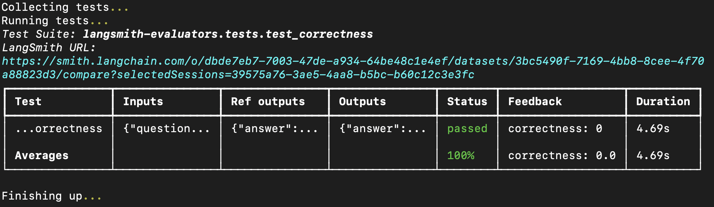

# Run evals with openevals package

> Run evaluations using the open-source openevals and agentevals packages with LangSmith.

LangSmith integrates with the open-source `openevals` package to provide a suite of evaluation utilities and prompts that you can use as starting points for evaluation.

> [!NOTE]
>
> This how-to guide will demonstrate how to set up and run one type of evaluator (LLM-as-a-judge). For a complete list of evaluation utilities and prompts with usage examples, refer to the [openevals](https://github.com/langchain-ai/openevals) and [agentevals](https://github.com/langchain-ai/agentevals) repos.

## Setup

You'll need to install the `openevals` package to use the LLM-as-a-judge evaluator.

```bash Python
pip install -U openevals
```

```bash TypeScript
yarn add openevals @langchain/core
```

You'll also need to set your OpenAI API key as an environment variable, though you can choose different providers too:

```bash
export OPENAI_API_KEY="<API_KEY>"
```

We'll also use LangSmith's [pytest](How%20to%20run%20evaluations%20with%20pytest.md) integration for Python and [Vitest/Jest](How%20to%20run%20evaluations%20with%20Vitest-Jest.md) for TypeScript to run our evals. `openevals` also integrates seamlessly with the [`evaluate`](https://reference.langchain.com/python/langsmith/evaluation/_runner/evaluate) method. See the [appropriate guides](How%20to%20run%20evaluations%20with%20pytest.md) for setup instructions.

## Running an evaluator

The general flow is simple: import the evaluator or factory function from `openevals`, then run it within your test file with inputs, outputs, and reference outputs. LangSmith will automatically log the evaluator's results as feedback.

Note that not all evaluators will require each parameter (the exact match evaluator only requires outputs and reference outputs, for example). Additionally, if your LLM-as-a-judge prompt requires additional variables, passing them in as kwargs will format them into the prompt.

Set up your test file like this:

```python Python
import pytest
from langsmith import testing as t
from openevals.llm import create_llm_as_judge
from openevals.prompts import CORRECTNESS_PROMPT

correctness_evaluator = create_llm_as_judge(
    prompt=CORRECTNESS_PROMPT,
    feedback_key="correctness",
    model="openai:gpt-5.4-mini",
)

# Mock standin for your application
def my_llm_app(inputs: dict) -> str:
    return "Doodads have increased in price by 10% in the past year."

@pytest.mark.langsmith
def test_correctness():
    inputs = "How much has the price of doodads changed in the past year?"
    reference_outputs = "The price of doodads has decreased by 50% in the past year."
    outputs = my_llm_app(inputs)

    t.log_inputs({"question": inputs})
    t.log_outputs({"answer": outputs})
    t.log_reference_outputs({"answer": reference_outputs})

    correctness_evaluator(
        inputs=inputs,
        outputs=outputs,
        reference_outputs=reference_outputs
    )
```

```typescript TypeScript
import * as ls from "langsmith/vitest";
// import * as ls from "langsmith/jest";
import { createLLMAsJudge, CORRECTNESS_PROMPT } from "openevals";

const correctnessEvaluator = createLLMAsJudge({
    prompt: CORRECTNESS_PROMPT,
    feedbackKey: "correctness",
    model: "openai:gpt-5.4-mini",
});

// Mock standin for your application
const myLLMApp = async (_inputs: Record<string, unknown>) => {
    return "Doodads have increased in price by 10% in the past year.";
};

ls.describe("Correctness", () => {
    ls.test("incorrect answer", {
        inputs: {
            question: "How much has the price of doodads changed in the past year?"
        },
        referenceOutputs: {
            answer: "The price of doodads has decreased by 50% in the past year."
        }
    }, async ({ inputs, referenceOutputs }) => {
        const outputs = await myLLMApp(inputs);
        ls.logOutputs({ answer: outputs });
        await correctnessEvaluator({
            inputs,
            outputs,
            referenceOutputs,
        });
    });
});
```

The `feedback_key`/`feedbackKey` parameter will be used as the name of the feedback in your experiment.

Running the eval in your terminal will result in something like the following:



You can also pass evaluators directly into the `evaluate` method if you have already created a dataset in LangSmith. If using Python, this requires `langsmith>=0.3.11`:

```python Python
from langsmith import Client
from openevals.llm import create_llm_as_judge
from openevals.prompts import CONCISENESS_PROMPT

client = Client()
conciseness_evaluator = create_llm_as_judge(
    prompt=CONCISENESS_PROMPT,
    feedback_key="conciseness",
    model="openai:gpt-5.4-mini",
)

experiment_results = client.evaluate(
    # This is a dummy target function, replace with your actual LLM-based system
    lambda inputs: "What color is the sky?",
    data="Sample dataset",
    evaluators=[
        conciseness_evaluator
    ]
)
```

```typescript TypeScript
import { evaluate } from "langsmith/evaluation";
import { createLLMAsJudge, CONCISENESS_PROMPT } from "openevals";

const concisenessEvaluator = createLLMAsJudge({
    prompt: CONCISENESS_PROMPT,
    feedbackKey: "conciseness",
    model: "openai:gpt-5.4-mini",
});

await evaluate((inputs) => "What color is the sky?", {
    data: datasetName,
    evaluators: [concisenessEvaluator],
});
```

For a complete list of available evaluation utilities and prompts, see the [openevals](https://github.com/langchain-ai/openevals) and [agentevals](https://github.com/langchain-ai/agentevals) repos.
