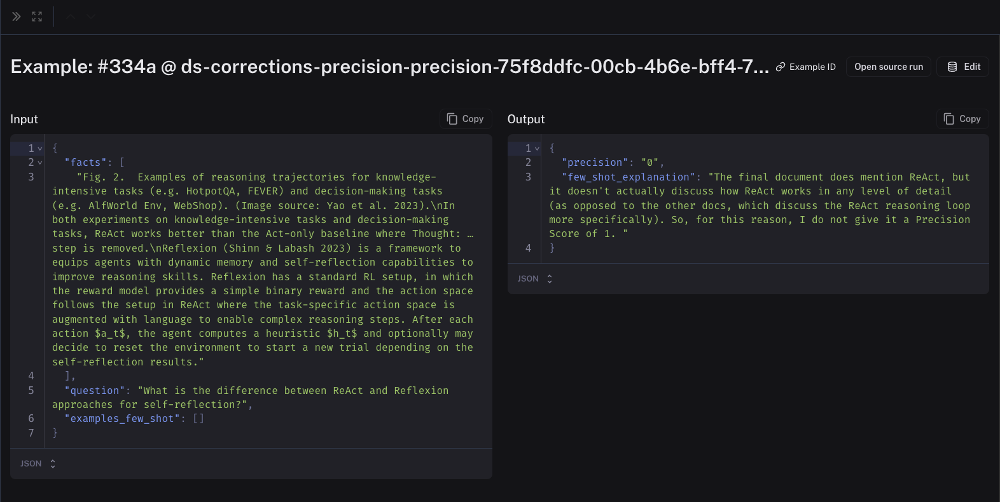
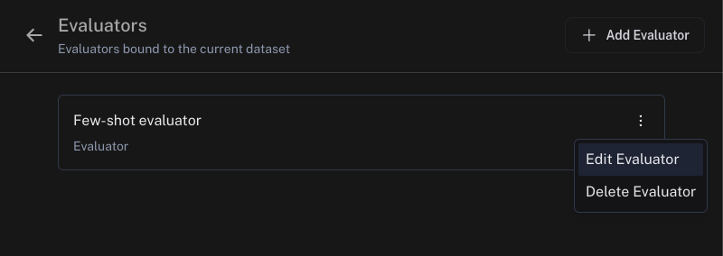
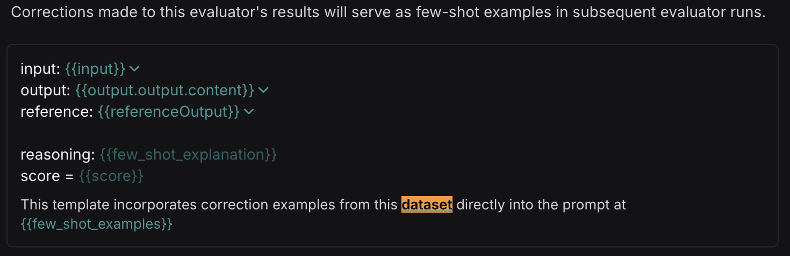

# How to improve your evaluator with few-shot examples

Using LLM-as-a-judge evaluators can be very helpful when you can't evaluate your system programmatically. However, their effectiveness depends on their quality and how well they align with human reviewer feedback. LangSmith provides the ability to improve the alignment of LLM-as-a-judge evaluator to human preferences using few-shot examples.

Human corrections are automatically inserted into your evaluator prompt using few-shot examples. Few-shot examples is a technique inspired by [few-shot prompting](https://www.promptingguide.ai/techniques/fewshot) that guides the models output with a few high-quality examples.

This guide covers how to set up few-shot examples as part of your LLM-as-a-judge evaluator and apply corrections to feedback scores.

## How few-shot examples work

* Few-shot examples are added to your evaluator prompt using the `{{Few-shot examples}}` variable.
* Creating an evaluator with few-shot examples, will automatically create a dataset for you, which will be auto-populated with few-shot examples once you start making corrections.
* At runtime, these examples will be inserted into the evaluator to serve as a guide for its outputs. This will help the evaluator to better align with human preferences.

## Configure your evaluator

> [!NOTE]
>
> Few-shot examples are not currently supported in LLM-as-a-judge evaluators that use the prompt hub and are only compatible with prompts that use mustache formatting.
>
> Few-shot examples are only supported for run-level evaluators, not thread-level. Toggle on **Runs** in the [**Configure Evaluator** panel](../Manage%20evaluators.md#edit-an-evaluator).
>
> Few-shot examples are not available for [decision model evaluators](../Evaluator%20types/UI/How%20to%20define%20a%20decision%20model%20evaluator.md).

Before enabling few-shot examples, set up your LLM-as-a-judge evaluator. If you haven't done this yet, follow the steps in the [LLM-as-a-judge evaluator guide](../Evaluator%20types/UI/How%20to%20define%20an%20LLM-as-a-judge%20evaluator.md).

### 1. Configure variable mapping

Each few-shot example is formatted according to the variable mapping specified in the configuration. The variable mapping for few-shot examples, should contain the same variables as your main prompt, plus a `few_shot_explanation` and a `score` variable which should have the same name as your feedback key.

For example, if your main prompt has variables `question` and `response`, and your evaluator outputs a `correctness` score, then your few-shot prompt should have the variables `question`, `response`, `few_shot_explanation`, and `correctness`.

### 2. Specify the number of few-shot examples to use

You may also specify the number of few-shot examples to use. The default is 5. If your examples are very long, you may want to set this number lower to save tokens - whereas if your examples tend to be short, you can set a higher number in order to give your evaluator more examples to learn from. If you have more examples in your dataset than this number, we will randomly choose them for you.

## Make corrections

> [!NOTE]
>
> [Audit evaluator scores](How%20to%20audit%20evaluator%20scores.md)

As you start logging traces or running experiments, you will likely disagree with some of the scores that your evaluator has given. When you [make corrections to these scores](How%20to%20audit%20evaluator%20scores.md), you will begin seeing examples populated inside your corrections dataset. As you make corrections, make sure to attach explanations - these will get populated into your evaluator prompt in place of the `few_shot_explanation` variable.

The inputs to the few-shot examples will be the relevant fields from the inputs, outputs, and reference (if this an offline evaluator) of your chain/dataset. The outputs will be the corrected evaluator score and the explanations that you created when you left the corrections. Feel free to edit these to your liking. Here is an example of a few-shot example in a corrections dataset:

Note that the corrections may take a minute or two to be populated into your few-shot dataset. Once they are there, future runs of your evaluator will include them in the prompt!

## View your corrections dataset

In order to view your corrections dataset:

* **Online evaluators**: Select your run rule and click **Edit Rule**
* **Offline evaluators**: Select your evaluator and click **Edit Evaluator**

Head to your dataset of corrections linked in the **Improve evaluator accuracy using few-shot examples** section. You can view and update your few-shot examples in the dataset.

