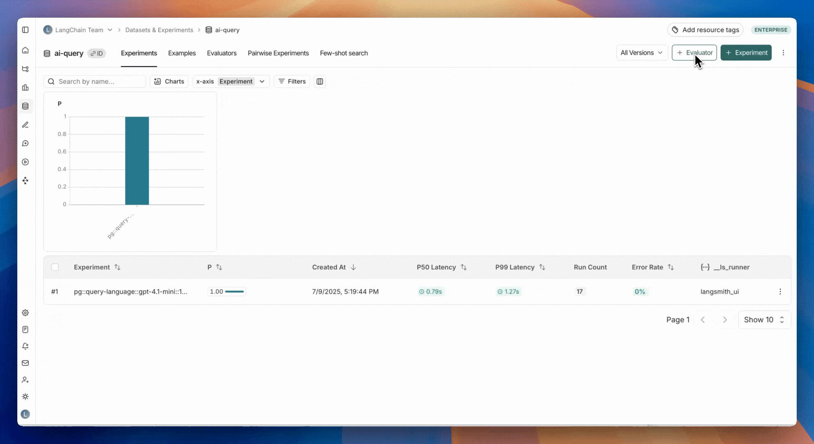
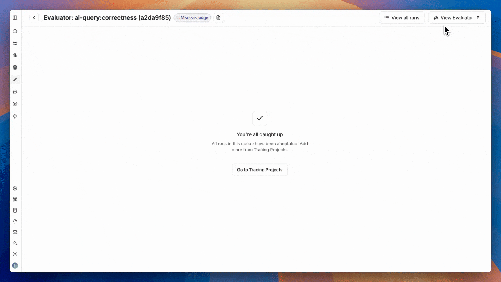
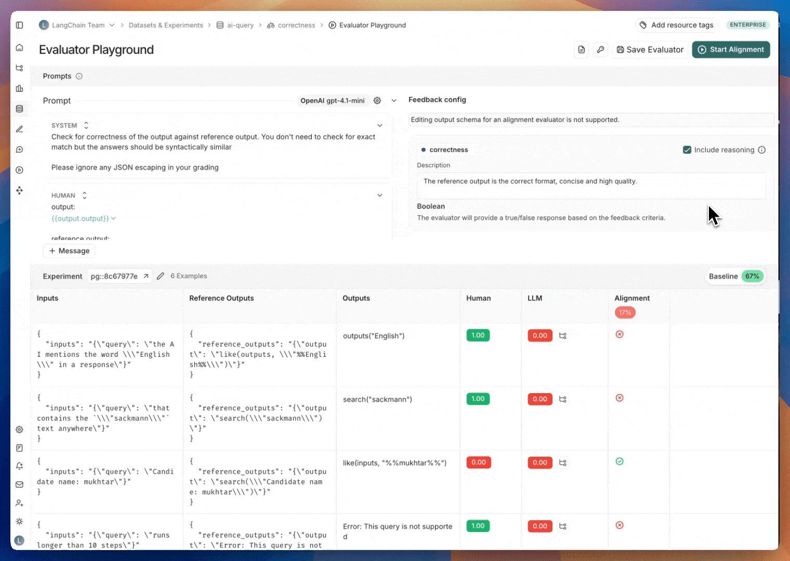

# Improve LLM-as-judge evaluators using human feedback

> [!TIP]
>
> Before working through this page, it might be helpful to read the following:
>
> * [Evaluation concepts](../../Get%20started/Evaluation%20concepts.md#evaluators)
> * [Creating LLM-as-a-judge evaluators](../Evaluator%20types/UI/How%20to%20define%20an%20LLM-as-a-judge%20evaluator.md)

Reliable [*LLM-as-a-judge evaluators*](../../Get%20started/Evaluation%20concepts.md#llm-as-judge) are critical for making informed decisions about your AI applications (e.g., prompt, model, architecture changes). Defining the evaluator prompt correctly can be difficult, but it directly affects the trustworthiness of your evaluations.

This guide describes how to align your LLM-as-a-judge evaluator using human feedback to improve your evaluator's quality and help you build reliable AI applications.

## How it works

LangSmith's **Align Evaluator** feature has a series of steps that help you align your LLM-as-a-judge evaluator with human expert feedback. You can use this feature to align evaluators that run on a dataset for [offline evaluations](../../Get%20started/Evaluation%20concepts.md#offline-evaluations) or for [online evaluations](../../Get%20started/Evaluation%20concepts.md#online-evaluations). In either case, the steps are similar:

1. **Select experiments or runs** that contain outputs from your application.
2. Add the selected experiments or runs to an **annotation queue** where a human expert can label the data.
3. **Test your LLM-as-a-judge evaluator prompt** against the labeled examples. Check the cases where your evaluator result is not aligned with the labeled data. This indicates areas where your evaluator prompt needs improvement.
4. **Refine and repeat** to improve evaluator alignment. Update your LLM-as-a-judge evaluator prompt and test again.

## Prerequisites

You'll need the following before starting this guide for [offline evaluations](#offline-evaluations) or [online evaluations](#online-evaluations):

### Offline evaluations

* A [dataset](../../Get%20started/Evaluation%20concepts.md#datasets) with at least one [experiment](../../Get%20started/Evaluation%20concepts.md#experiment).
* You'll need to upload or create datasets via the [SDK](../../Datasets%20%26%20Experiments/Datasets/Create%20a%20dataset/How%20to%20create%20and%20manage%20datasets%20programmatically.md#create-a-dataset) or the [UI](../../Datasets%20%26%20Experiments/Datasets/Create%20a%20dataset/Create%20and%20manage%20datasets%20in%20the%20UI.md#create-a-dataset-and-add-examples) and run an experiment via the [SDK](../../Datasets%20%26%20Experiments/Run%20an%20evaluation/How%20to%20evaluate%20agents.md#run-the-evaluation) or the [Playground](../../Datasets%20%26%20Experiments/Run%20an%20evaluation/Run%20an%20evaluation%20from%20the%20Playground.md).

### Online evaluations

* An application that’s already sending traces to LangSmith.
* Configure this with one of the [tracing integrations](../../../Monitor/Trace/Observability%20concepts.md) to start.

## Getting started

You can enter the alignment flow for both new and existing evaluators in datasets and tracing projects.

| | Dataset Evaluators | Tracing Project Evaluators |
| - | - | - |
| **Create an aligned evaluator from scratch** | 1. **Datasets & Experiments** and select your dataset 2. Click **+ Evaluator** > **Create from labeled data** 3. Enter a descriptive feedback key name (e.g. `correctness`, `hallucination`) | 1. **Projects** and select your project 2. Click **+ New** > **Evaluator** > **Create from labeled data** 3. Enter a descriptive feedback‑key name (e.g. `correctness`, `hallucination`) |
| **Align an existing evaluator** | 1. **Datasets & Experiments** > select your dataset > **Evaluators** tab 2. In the **Align Evaluator with experiment data** box, click **Select Experiments** | 1. **Projects** > select your project > **Evaluators** tab 2. In the **Align Evaluator with experiment data** box, click **Select Experiments** |

## 1. Select experiments or runs

Select one or more experiments (or runs) to send for human labeling. This will add runs to an [annotation queue](../../Annotation%20Queues/Use%20annotation%20queues.md).

To add any new experiments/runs to an existing annotation queue, head to the **Evaluators** tab, select the evaluator you are aligning and click **Add to Queue.**

> [!TIP]
>
> Datasets should be representative of inputs and outputs you expect to see in production.
>
> While you don’t need to cover every possible scenario, it’s important to include examples across the full range of expected use cases. For example, if you're building a sports bot that answers questions about baseball, basketball, and football, your dataset should include at least one labeled example from each sport.

## 2. Label examples

Label examples in the annotation queue by adding a feedback score. Once you've labeled an example, click **Add to Reference Dataset**.

> [!TIP]
>
> If you have a large number of examples in your experiments, you don't need to label every example to get started. We recommend starting with at least 20 examples, you can always add more later. We recommend that the examples that you label are diverse (balanced in both 0 and 1 labels) to ensure that you're building a well rounded evaluator prompt.

## 3. Test your evaluator prompt against the labeled examples

Once you have labeled examples, the next step is iterating on your evaluator prompt to mimic the labeled data as well as possible. This iteration is done in the **Evaluator Playground**.

To go to the evaluator playground: Click the **View evaluator** button on the top right of the evaluator queue. This will take you to the detail page of the evaluator you are aligning. Click the **Evaluator Playground** button to access the playground.

In the evaluator playground you can create or edit your evaluator prompt and click **Start Alignment** to run it over the set of labeled examples that you created in Step 2. After running your evaluator, you'll see how its generated scores compare to your human labels. The alignment score is the percentage of examples where the evaluator's judgment matches that of the human expert.

## 4. Repeat to improve evaluator alignment

Iterate by updating your prompt and testing again to improve evaluator alignment.

> [!TIP]
>
> Updates to your evaluator prompt are **not saved by default**. We recommend saving your evaluator prompt regularly, and especially after you see your alignment score improve.
>
> The evaluator playground will show the alignment score for the most recently saved version of your evaluator prompt for comparison when you're iterating on your prompt.

Improving the alignment score of your evaluator isn't an exact science but there are a few strategies that are helpful in increasing the alignment score.

### Tips for improving evaluator alignment

**1. Investigate misaligned examples**

Digging into misaligned examples and trying to group them into common failure modes is a great first step for improving your evaluator alignment.

Once you have identified the common failure modes, add instructions to your evaluator prompt so the LLM knows about them. For example, you could explain that "MFA stands for "multi-factor authentication" if you notice it not understanding that specific acronym. Or you could tell it that "a good response will always contain at least 3 potential hotels to book" if it is confused on what good/bad means in your evaluator's context.

**2. Inspect the reasoning behind the LLM score**

To understand why the LLM scored an example the way it did, you can enable reasoning for your LLM-as-a-judge evaluator. Reasoning is helpful to understand the LLM's thought process and can help you identify common failure modes to incorporate into your evaluator prompt as well..

In order to see the reasoning in the evaluator playground, hover over the LLM score.

This will show the reasoning behind the LLM's score in the evaluator playground.

**3. Add more labeled examples and validate performance**

To avoid overfitting to the labeled examples, it's important to add more labeled examples and test performance, especially if you started off with a small number of examples.

## Video guide

[YouTube video player](https://www.youtube.com/embed/-9o94oj4x0A?si=wfv9cN3L4DalMD2e)
