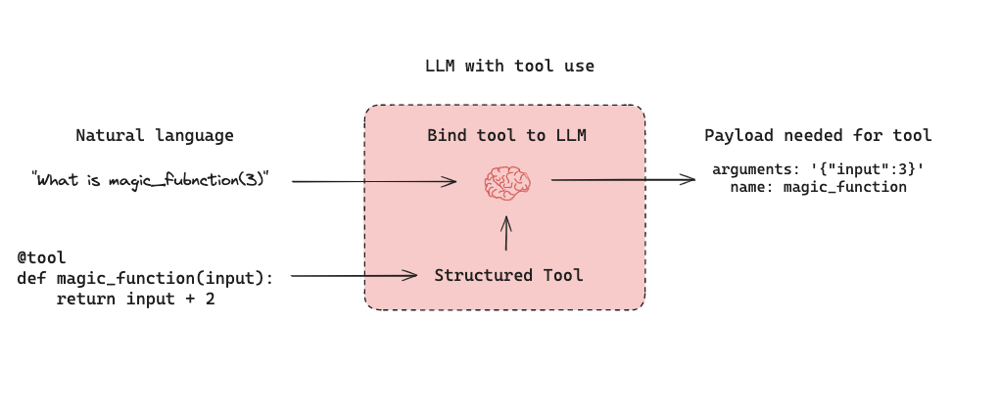
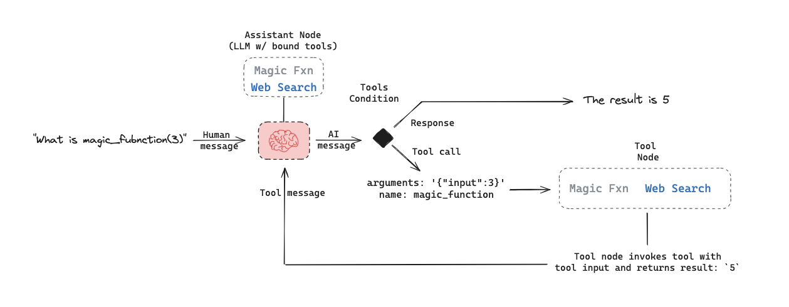
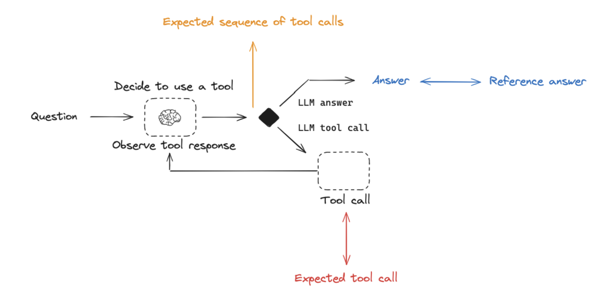
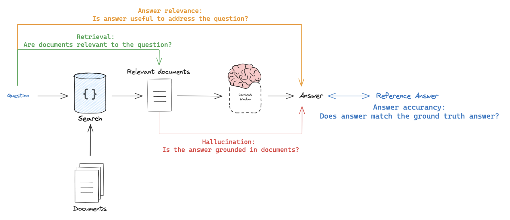

# Application-specific evaluation approaches

Below, we will discuss evaluation of a few popular types of LLM applications.

## Agents

[LLM-powered autonomous agents](https://lilianweng.github.io/posts/2023-06-23-agent/) combine three components (1) Tool calling, (2) Memory, and (3) Planning. Agents [use tool calling](https://docs.langchain.com/oss/python/langchain/tools.md) with planning (e.g., often via prompting) and memory (e.g., often short-term message history) to generate responses. [Tool calling](https://docs.langchain.com/oss/python/langchain/tools.md) allows a model to respond to a given prompt by generating two things: (1) a tool to invoke and (2) the input arguments required.

Below is a tool-calling agent in [LangGraph](https://docs.langchain.com/oss/python/langgraph/quickstart.md). The `assistant node` is an LLM that determines whether to invoke a tool based upon the input. The `tool condition` sees if a tool was selected by the `assistant node` and, if so, routes to the `tool node`. The `tool node` executes the tool and returns the output as a tool message to the `assistant node`. This loop continues as long as the `assistant node` selects a tool. If no tool is selected, then the agent directly returns the LLM response.

This sets up three general types of agent evaluations that users are often interested in:

* `Final Response`: Evaluate the agent's final response.
* `Single step`: Evaluate any agent step in isolation (e.g., whether it selects the appropriate tool).
* `Trajectory`: Evaluate whether the agent took the expected path (e.g., of tool calls) to arrive at the final answer.

The following sections cover what these are, the components (inputs, outputs, evaluators) needed for each one, and when you should consider this. Common use cases often use multiple or all of these types of evaluations; they are not mutually exclusive.

### Evaluating an agent's final response

One way to evaluate an agent is to assess its overall performance on a task. This basically involves treating the agent as a black box and simply evaluating whether or not it gets the job done.

The inputs should be the user input and (optionally) a list of tools. In some cases, tool are hardcoded as part of the agent and they don't need to be passed in. In other cases, the agent is more generic, meaning it does not have a fixed set of tools and tools need to be passed in at run time.

The output should be the agent's final response.

The evaluator varies depending on the task you are asking the agent to do. Many agents perform a relatively complex set of steps and then output a final text response. Similar to RAG, LLM-as-judge evaluators are often effective for evaluation in these cases because they can assess whether the agent got a job done directly from the text response.

However, there are several downsides to this type of evaluation. First, it usually takes a while to run. Second, you are not evaluating anything that happens inside the agent, so it can be hard to debug when failures occur. Third, it can sometimes be hard to define appropriate evaluation metrics.

### Evaluating a single step of an agent

Agents generally perform multiple actions. While it is useful to evaluate them end-to-end, it can also be useful to evaluate these individual actions. This generally involves evaluating a single step of the agent - the LLM call where it decides what to do.

The inputs should be the input to a single step. Depending on what you are testing, this could just be the raw user input (e.g., a prompt and / or a set of tools) or it can also include previously completed steps.

The outputs are just the output of that step, which is usually the LLM response. The LLM response often contains tool calls, indicating what action the agent should take next.

The evaluator for this is usually some binary score for whether the correct tool call was selected, as well as some heuristic for whether the input to the tool was correct. The reference tool can be simply specified as a string.

There are several benefits to this type of evaluation. It allows you to evaluate individual actions, which lets you hone in where your application may be failing. They are also relatively fast to run (because they only involve a single LLM call) and evaluation often uses simple heuristic evaluation of the selected tool relative to the reference tool. One downside is that they don't capture the full agent - only one particular step. Another downside is that dataset creation can be challenging, particular if you want to include past history in the agent input. It is pretty easy to generate a dataset for steps early on in an agent's trajectory (e.g., this may only include the input prompt), but it can be difficult to generate a dataset for steps later on in the trajectory (e.g., including numerous prior agent actions and responses).

### Evaluating an agent's trajectory

Evaluating an agent's trajectory involves evaluating all the steps an agent took.

The inputs are again the inputs to the overall agent (the user input, and optionally a list of tools).

The outputs are a list of tool calls, which can be formulated as an "exact" trajectory (e.g., an expected sequence of tool calls) or simply a set of tool calls that are expected (in any order).

The evaluator here is some function over the steps taken. Assessing the "exact" trajectory can use a single binary score that confirms an exact match for each tool name in the sequence. This is simple, but has some flaws. Sometimes there can be multiple correct paths. This evaluation also does not capture the difference between a trajectory being off by a single step versus being completely wrong.

To address these flaws, evaluation metrics can focus on the number of "incorrect" steps taken, which better accounts for trajectories that are close versus ones that deviate significantly. Evaluation metrics can also focus on whether all of the expected tools are called in any order.

However, none of these approaches evaluate the input to the tools; they only focus on the tools selected. In order to account for this, another evaluation technique is to pass the full agent's trajectory (along with a reference trajectory) as a set of messages (e.g., all LLM responses and tool calls) to an LLM-as-judge. This can evaluate the complete behavior of the agent, but it is the most challenging reference to compile. This is where using a framework like LangGraph can help. Another downside is that evaluation metrics can be somewhat tricky to come up with.

## Evaluate RAG applications

[Retrieval-augmented generation (RAG)](https://github.com/langchain-ai/rag-from-scratch) retrieves documents for a user input and passes them to a model so the response can use external knowledge. For a step-by-step walkthrough, see [Evaluate a RAG application](../Datasets%20%26%20Experiments/Tutorials/Evaluate%20a%20RAG%20application.md).

### Choose a dataset

When you evaluate RAG applications, start by deciding whether you have a reference answer for each example:

* **With reference answers**: Use them as ground truth to score answer correctness.
* **Without reference answers**: Use reference-free prompts that check document relevance, answer faithfulness, and helpfulness (see [RAG evaluation summary](#rag-evaluation-summary)).

### Choose evaluators

LLM-as-judge evaluators work well for RAG because they can score factual accuracy and consistency between texts.

You can use two kinds of evaluators:

* **Reference-based**: Compare the generated answer or retrieved documents to a reference answer or reference retrievals.
* **Reference-free**: Run self-consistency checks that do not need a reference answer (orange, green, and red in the figure above).

### Choose an evaluation mode

* **Offline**: Use when the prompt needs a reference answer, most often for answer correctness.
* **Online**: Use for reference-free prompts so you can score live traffic.
* **Pairwise**: Compare answers from different RAG chains on criteria such as format or style. Use self-consistency or a reference answer for correctness instead.

### RAG evaluation summary

| Evaluator | Detail | Needs reference output | LLM-as-judge? | Pairwise relevant |
| - | - | - | - | - |
| Document relevance | Are documents relevant to the question? | No | Yes - [prompt](https://smith.langchain.com/hub/langchain-ai/rag-document-relevance) | No |
| Answer faithfulness | Is the answer grounded in the documents? | No | Yes - [prompt](https://smith.langchain.com/hub/langchain-ai/rag-answer-hallucination) | No |
| Answer helpfulness | Does the answer help address the question? | No | Yes - [prompt](https://smith.langchain.com/hub/langchain-ai/rag-answer-helpfulness) | No |
| Answer correctness | Is the answer consistent with a reference answer? | Yes | Yes - [prompt](https://smith.langchain.com/hub/langchain-ai/rag-answer-vs-reference) | No |
| Pairwise comparison | How do multiple answer versions compare? | No | Yes - [prompt](https://smith.langchain.com/hub/langchain-ai/pairwise-evaluation-rag) | Yes |

## Summarization

Summarization is one specific type of free-form writing. The evaluation aim is typically to examine the writing (summary) relative to a set of criteria.

`Developer curated examples` of texts to summarize are commonly used for evaluation (see a [summarization dataset example](https://smith.langchain.com/public/659b07af-1cab-4e18-b21a-91a69a4c3990/d)). However, `user logs` from a production (summarization) app can be used for online evaluation with any of the `Reference-free` evaluation prompts below.

`LLM-as-judge` is typically used for evaluation of summarization (as well as other types of writing) using `Reference-free` prompts that follow provided criteria to grade a summary. It is less common to provide a particular `Reference` summary, because summarization is a creative task and there are many possible correct answers.

`Online` or `Offline` evaluation are feasible because of the `Reference-free` prompt used. `Pairwise` evaluation is also a powerful way to perform comparisons between different summarization chains (e.g., different summarization prompts or LLMs):

| Use Case | Detail | Needs reference output | LLM-as-judge? | Pairwise relevant |
| - | - | - | - | - |
| Factual accuracy | Is the summary accurate relative to the source documents? | No | Yes - [prompt](https://smith.langchain.com/hub/langchain-ai/summary-accurancy-evaluator) | Yes |
| Faithfulness | Is the summary grounded in the source documents (e.g., no hallucinations)? | No | Yes - [prompt](https://smith.langchain.com/hub/langchain-ai/summary-hallucination-evaluator) | Yes |
| Helpfulness | Is summary helpful relative to user need? | No | Yes - [prompt](https://smith.langchain.com/hub/langchain-ai/summary-helpfulness-evaluator) | Yes |

## Classification and tagging

Classification and tagging apply a label to a given input (e.g., for toxicity detection, sentiment analysis, etc). Classification/tagging evaluation typically employs the following components, which we will review in detail below:

A central consideration for classification/tagging evaluation is whether you have a dataset with `reference` labels or not. If not, users frequently want to define an evaluator that uses criteria to apply label (e.g., toxicity, etc) to an input (e.g., text, user-question, etc). However, if ground truth class labels are provided, then the evaluation objective is focused on scoring a classification/tagging chain relative to the ground truth class label (e.g., using metrics such as precision, recall, etc).

If ground truth reference labels are provided, then it's common to simply define a [custom heuristic evaluator](../Evaluators/Evaluator%20types/UI/How%20to%20define%20a%20code%20evaluator.md) to compare ground truth labels to the chain output. However, it is increasingly common given the emergence of LLMs simply use `LLM-as-judge` to perform the classification/tagging of an input based upon specified criteria (without a ground truth reference).

`Online` or `Offline` evaluation is feasible when using `LLM-as-judge` with the `Reference-free` prompt used. In particular, this is well suited to `Online` evaluation when a user wants to tag / classify application input (e.g., for toxicity, etc).

| Use Case | Detail | Needs reference output | LLM-as-judge? | Pairwise relevant |
| - | - | - | - | - |
| Accuracy | Standard definition | Yes | No | No |
| Precision | Standard definition | Yes | No | No |
| Recall | Standard definition | Yes | No | No |
